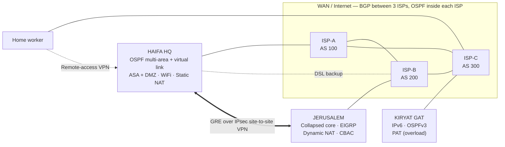

# מעבדת רשת ארגונית — קורס צעד אחר צעד (Cisco Packet Tracer)

קורס שלומדים בו תוך כדי בנייה, לקראת פרויקט הגמר של משרד החינוך
(**שאלון 735918 — פרויקט גמר הנדסאים, רשתות תקשורת**).

הקורס מלמד כל נושא של פרויקט הגמר על **דוגמה פתורה אחת**: רשת של 3 סניפים עבור
**אינטל ישראל**. כל שלב מסביר *למה*, נותן את המכשירים, הכבלים והפקודות המדויקים, מראה איך
**לבדוק** שהכול עובד, ומסתיים ב**אתגר** שפותרים לבד.

**אינטל ישראל היא רק הדוגמה.** פרויקט הגמר שלכם הוא **החברה שלכם**, עם אתרים, מחלקות,
כתובות וסיסמאות משלכם. לומדים כל נושא על הדוגמה, ואז בונים את אותו הדבר בפרויקט שלכם.

## איך הקורס עובד

בכל שלב יש שני חלקים:

| | איפה | מה עושים |
|---|---|---|
| **1. לומדים** | `my-work/stepNN.pkt` | עוקבים אחרי השלב בדיוק, עם הערכים של אינטל. מקלידים כל פקודה כמו שהיא, בודקים, פותרים את האתגר. זה תרגול — אף אחד לא נותן עליו ציון. |
| **2. בונים את שלכם** | `my-project/` | עושים את אותו שלב שוב בפרויקט **שלכם**, עם הערכים מהתוכנית **שלכם**. הסעיף **🛠 הפרויקט שלכם** בסוף כל שלב מפרט בדיוק מה לקחת מהתוכנית. |

לפני שמתחילים:
1. בשלב 00 בוחרים חברה (נושא אחד לכל תלמיד — המורה מאשר).
2. בשלב 01 מעתיקים את [docs/project-plan-template.md](docs/project-plan-template.md)
   ל-`my-project/plan.md` וממלאים. מקבלים אישור **לפני** שלב 02.

**3. מתכוננים לבחינה.** כל שלב מסתיים ב-**🎓 מסבירים לבוחן** (השאלות ממאגר משרד החינוך על
הנושא, עם תשובות) וב-**🔁 עושים שוב — בלי המדריך** (תרגיל עם זמן). בבחינה תצטרכו להסביר את
מה שבניתם ולהגדיר אותו שוב מול הבוחן — ראו [docs/exam-guide.md](docs/exam-guide.md). עקבו אחרי
ההתקדמות שלכם ב-`my-project/progress.md` (מועתק מ-[docs/progress-template.md](docs/progress-template.md)).

**הכללים** (מהנחיות משרד החינוך):
- אסור ששני תלמידים יגישו את אותו נושא או את אותה תוכנית.
- אף סניף אינו העתק של סניף אחר — כל אתר משתמש בנושאים אחרים.
- כל דרישה של משרד החינוך חייבת להופיע בפרויקט. השורה הראשונה של כל שלב (🎯) מציגה את
  הדרישות שהוא מכסה.
- מותר להשאיר מהדוגמה את **המבנה והשיטה**; אסור להשאיר את **הערכים** (שמות, VLANים, כתובות,
  סיסמאות). הרשימה המלאה בתבנית.

> **גרסה זו בעברית כוללת את שלושת הפרקים הראשונים בלבד (שלבים 00–02).**
> שאר השלבים יתורגמו בהמשך. עד אז הם זמינים בגרסה האנגלית (`intel-israel-network-lab`).
> בשתי הגרסאות אותם מכשירים, פורטים, כתובות וסיסמאות — אפשר לעבור ביניהן בכל שלב.

> **כלל אצבע:** **הקלידו את הפקודות, אל תדביקו אותן** — לפחות בפעם הראשונה שאתם פוגשים
> פקודה חדשה. ההקלדה היא מה שמלמד את האצבעות את IOS. הדביקו רק פקודות שכבר הקלדתם בעבר.

> **חשוב:** כל הפקודות, שמות המכשירים, הכתובות והסיסמאות נכתבים **באנגלית, בדיוק כפי שהם
> מופיעים כאן** — כולל אותיות גדולות וקטנות. לפני שאתם מקלידים ב-Packet Tracer, ודאו
> שהמקלדת על **אנגלית** (Alt+Shift או Win+רווח).

---

## הדוגמה הפתורה: אינטל ישראל

| קוד | עיר | תפקיד | סגנון תכנון |
|---|---|---|---|
| **HFA** | חיפה (מת"ם) | **סניף ראשי (מטה)** — DMZ, חומת אש, רשת אלחוטית | 3 שכבות: access / distribution / core, ‏3 בניינים |
| **JLM** | ירושלים | סניף | **Collapsed core** על מתגי שכבה 3, ‏3 קומות |
| **KG** | קריית גת | סניף (מפעל) | רשת פנימית ב-**IPv6 בלבד**, תלת-שכבתי קומפקטי |



## מפת הדרכים — 17 מיני-פרויקטים

עבדו **לפי הסדר**. כל שלב מסתיים בקובץ `.pkt` של הדוגמה שעובד ונשמר, ואחר כך באותו שלב
בפרויקט שלכם.

| # | שלב | מה לומדים | זמן |
|---|---|---|---|
| 00 | [מתחילים](steps/00-getting-started) | Packet Tracer, מצבי ה-CLI, בחירת הפרויקט שלכם | 2 שיעורים |
| 01 | [מתכננים את הרשת](steps/01-plan-the-network) | תכנון כתובות IP, טבלאות VLAN, שמות — **תוכנית הפרויקט שלכם, קודם על נייר** | 2 שיעורים |
| 02 | [המתג הראשון ו-VLANים](steps/02-first-switch-vlans) | הקשחה בסיסית, VLANים, פורטי access | 1–2 שיעורים |
| 03 | Trunks ו-VTP | ‏802.1Q trunks, ‏native VLAN, ‏VTP | *טרם תורגם* |
| 04 | EtherChannel ו-STP | ‏LACP, ‏Rapid-PVST+, ‏root bridge, ‏PortFast, ‏BPDU/Root guard | *טרם תורגם* |
| 05 | Inter-VLAN, ‏HSRP, ‏DHCP | ‏SVI, יתירות שער, DHCP על מתג שכבה 3 | *טרם תורגם* |
| 06 | אבטחת שכבה 2 | ‏Port-security, ‏DHCP snooping, הקשחה | *טרם תורגם* |
| 07 | ניהול ב-SSH | ‏VLAN ניהול, ‏SSH, ‏ACL על VTY | *טרם תורגם* |
| 08 | Core, ‏OSPF, שרתים | קישורים מנותבים, אזורי OSPF, ‏MD5, ‏AAA/TACACS+, ‏Syslog | *טרם תורגם* |
| 09 | בניינים B ו-C + virtual link | **אתם** בונים 2 בניינים; OSPF virtual link, סיכום נתיבים | *טרם תורגם* |
| 10 | רשת אלחוטית | WiFi לעובדים ולאורחים, ACL לבידוד אורחים | *טרם תורגם* |
| 11 | חומת אש ASA ו-DMZ | ‏inside/outside/DMZ, ‏security levels, ‏ACL, ‏6 שרתי DMZ, ‏NTP | *טרם תורגם* |
| 12 | ‏WAN: ספקים, BGP, ‏NAT | ‏eBGP, ‏OSPF בתוך AS, ‏static NAT + PAT, גיבוי DSL | *טרם תורגם* |
| 13 | סניף 2 (בדוגמה: ירושלים) — collapsed core | ‏EIGRP + סיכום + אימות, ‏PAgP, שרת DHCP, ‏dynamic NAT, ‏CBAC | *טרם תורגם* |
| 14 | סניף 3 (בדוגמה: קריית גת) — IPv6 | כתובות IPv6, ‏SLAAC + DHCPv6, ‏OSPFv3, ‏HSRPv6, ‏PAT | *טרם תורגם* |
| 15 | ‏VPN | ‏GRE over IPsec בין אתרים, VPN לגישה מרחוק | *טרם תורגם* |
| 16 | אינטגרציה סופית | חשבונות דואר, הרחבה ל-8 מחשבים למחלקה, תוכנית בדיקות מלאה, ספר הפרויקט | *טרם תורגם* |

## מסמכי עזר

- [docs/exam-guide.md](docs/exam-guide.md) — **איך הבחינה על הפרויקט עובדת ואיך מתכוננים**
- [docs/progress-template.md](docs/progress-template.md) — טבלת ההתקדמות שלכם (מעתיקים ל-`my-project/progress.md`)
- [docs/project-plan-template.md](docs/project-plan-template.md) — **התוכנית של הפרויקט שלכם** (מעתיקים ל-`my-project/plan.md` בשלב 01)
- [docs/design.md](docs/design.md) — התוכנית המלאה של הדוגמה: כתובות, VLANים ושמות (המודל לתוכנית שלכם)
- [docs/passwords.md](docs/passwords.md) — טבלת הסיסמאות של הדוגמה (לפרויקט שלכם צריך טבלה משלכם)

## איך בנוי כל שלב

1. **מטרה** — מה עובד בסוף השלב
2. **מבינים קודם** — התאוריה שצריך, בקצרה ובשפה פשוטה
3. **בונים** — אילו מכשירים לגרור, וטבלת כבלים
4. **מגדירים** — הפקודות, עם הסבר לכל שורה
5. **בודקים** — פקודות `show` ו-`ping`, ואיך נראית תוצאה תקינה
6. **נקודת ביקורת** — שמירה בשם `my-work/stepNN.pkt`
7. **אם משהו לא עובד** — טעויות נפוצות ואיך מתקנים
8. **אתגר** — פותרים לבד; התשובה מוסתרת בבלוק שנפתח בלחיצה
9. **🛠 הפרויקט שלכם** — אותו שלב ברשת **שלכם**, עם הערכים מהתוכנית **שלכם**
10. **🎓 מסבירים לבוחן** — שאלות ממאגר משרד החינוך, עם תשובות
11. **🔁 עושים שוב — בלי המדריך** — בונים את השלב שוב בלי המדריך, מול השעון

## שמירת ההתקדמות עם git (לא חובה)

```bash
git clone <this repo>
cd intel-israel-network-lab-he
# after each step:
git add my-work/step02.pkt my-project/
git commit -m "Step 02 done"
git push
```

נכתב עבור Packet Tracer **8.2.x** (מתאים גם לגרסה 9). הפקודות נכתבו לפי תחביר IOS 15
כפי ש-Packet Tracer מממש אותו.
