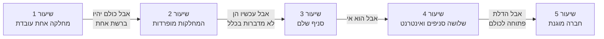

# אוסם — בונים יחד בכיתה פרויקט שלם עם 3 סניפים

פרויקט גמר שלם (אוסם: סכנין, אשדוד, אילת), שנבנה **קליק אחר קליק** ב-**5 שיעורים של 90 דקות**, עם
התיאוריה של כל שלב. הוא מבוסס על פרויקט אמיתי משנה קודמת, אחרי תיקון הטעויות שלו, וכל טעות הפכה ל"מצאו את הטעות".
כל שיעור מסתיים ב**"הפרויקט שלכם"**: עושים את אותו דבר ברשת של החברה שלכם.

**אוסם היא רק דוגמה.** אל תעתיקו ממנה שמות, כתובות או סיסמאות לפרויקט שלכם.

## 📖 הסיפור של הפרויקט
*זה סיפור דמיוני לכיתה. הרשת היא דוגמה.*

**איך הגענו לכאן.** אוסם מייצרת מזון. היא התחילה במשרד קטן אחד ב**סכנין**. כולם ישבו בחדר אחד, צעקו זה לזה, והעבירו קבצים בדיסק און קי. אחר כך החברה גדלה: מחלקות, שרת, סניף שני ב**אשדוד** ושלישי ב**אילת**. אף אחד לא תכנן את הרשת, פשוט חיברו כבלים. בוקר אחד קובץ המשכורות היה פתוח במחשב באולם ההרכבה, ובאותו יום כבל אחד שנקרע עצר את כל הבניין.

**איפה אתם נכנסים.** המנהל שכר **אתכם**, צוות הרשת החדש. אתם מקבלים קובץ Packet Tracer ריק ומשפט אחד: *"תבנו לנו רשת מסודרת, שלא נעצרת כשמשהו נשבר, שמחברת את שלושת הסניפים, ושלא נותנת לזרים להיכנס."*

**מה אנחנו רוצים בסוף.** ארבע הבקשות האלה הן כל הפרויקט. כל שורה שנכתוב שייכת לאחת מהן:

| הבקשה של המנהל | בשפה של רשתות | איפה |
|---|---|---|
| "מסודרת" | שמות, VLAN, כתובות, DHCP, DNS | שיעורים 1–3 |
| "לא נעצרת כשמשהו נשבר" | מתג גיבוי ו-STP, שני נתבים ו-HSRP, שני קווים לנתב הקצה | שיעורים 2, 3, 4 |
| "מחברת את הסניפים" | קווים טוריים, OSPF, EIGRP, BGP, NAT | שיעור 4 |
| "לא נותנת לזרים להיכנס" | סיסמאות, port security, DHCP snooping, ACL, VPN, SSH ו-AAA, ASA | כל השיעורים, בעיקר 5 |

**הדרך.** כל פרק פותר בעיה אחת ו**מגלה את הבעיה הבאה**. לכן אי אפשר לשנות את הסדר:

| פרק | מתחילים עם | הבעיה | מה בונים, ולמה זה פותר | מסיימים עם | הבעיה החדשה |
|---|---|---|---|---|---|
| ‎[1](lesson-01/) | קובץ ריק | שלושה אנשים לא יכולים לשתף קובץ | **מתג**: מחבר הרבה מכשירים ושולח כל מסגרת רק למי שהיא שלו | מחלקת המשכורות עובדת | עוד מחלקות = רשת אחת גדולה ורועשת |
| ‎[2](lesson-02/) | שבעה מתגים מחוברים | כולם רואים את כולם | ‏**VLAN** מפריד, **trunk** מעביר, **STP** מאפשר דרך גיבוי, **port security** שומר על השקעים | חמש מחלקות נפרדות | הן לא מדברות בכלל, והכתובות מוקלדות ביד |
| ‎[3](lesson-03/) | חמישה איים בבניין אחד | אין דרך בין ה-VLAN, אין שירותים | שני **נתבים עם HSRP** הם הדרך, **שרת** אחד לכתובות, שמות, אתר, קבצים ודואר | סניף שלם | הסניף לא מגיע לעולם |
| ‎[4](lesson-04/) | שלושה סניפים, שלושה איים | קווים אדומים, אין מסלולים, כתובות פרטיות | **קווים טוריים**, ‏**OSPF/EIGRP** בפנים, **BGP** לספק, **NAT** ביציאה | שלושה סניפים באינטרנט | מה שיוצא החוצה, אפשר גם לתקוף |
| ‎[5](lesson-05/) | רשת עובדת ופתוחה | הכול מותר, והכול קריא | ‏**ACL** מגביל, **VPN** מצפין, **SSH ו-AAA** מזהים, **NTP ו-Syslog** זוכרים, **ASA** חוסם | הפרויקט המוכן | עכשיו בונים את **הפרויקט שלכם** |

בכל שיעור יש **📖 הסיפור** בהתחלה ו**⏭ מה הלאה** בסוף. בכל משימה שלוש שורות עושות אותו דבר: 📖 איך הגענו לכאן, 🎯 מה רוצים עכשיו, ⏭ מה הלאה. בסוף המשימה, **📘 הסבר הפקודות** אומר מה עושה כל שורה ולמה היא שם.

📘 **שכחתם מה עושה פקודה?** [כל הפקודות של הפרויקט](commands/), עם הסבר.

| שיעור | נושא | הקובץ שפותחים |
|---|---|---|
| ‎[01](lesson-01/) | המחלקה הראשונה: מכשירים, כבלים, שמות, סיסמאות | קובץ חדש |
| ‎[02](lesson-02/) | המיתוג של סכנין: VLAN, ‏VTP, ‏Trunk, ‏STP, ‏Port Security | ‎[lesson02-start.pkt](lesson-02/lesson02-start.pkt) |
| ‎[03](lesson-03/) | ניתוב ושירותים בסכנין: HSRP, ‏DHCP, ‏DNS, ‏web, ‏FTP, דואר | ‎[lesson03-start.pkt](lesson-03/lesson03-start.pkt) |
| ‎[04](lesson-04/) | מחברים את הסניפים: WAN, ‏OSPF, ‏EIGRP, ‏BGP, ‏NAT | ‎[lesson04-start.pkt](lesson-04/lesson04-start.pkt) |
| ‎[05](lesson-05/) | אבטחה: ACL, ‏VPN, ‏SSH, ‏AAA, ‏NTP, ‏Syslog, ‏ASA | ‎[lesson05-start.pkt](lesson-05/lesson05-start.pkt) |

🧱 **רוצים לבנות הכול לבד, בלי קבצי התחלה?** ‏[מקובץ ריק ועד הפרויקט המלא](from-zero/): כל מכשיר, כבל ופקודה שקובצי ההתחלה עושים במקומכם, ו-14 בדיקות בסוף.

קובץ ההתחלה של כל שיעור הוא התוצאה של השיעור הקודם, ולכן גם תלמיד שהחסיר או נתקע יכול להצטרף.
מומלץ **Packet Tracer 9.0.1**: בגרסה הזו בדקנו.

## מה יש בכל שיעור

| סימן | מה זה | איך משתמשים בכיתה |
|---|---|---|
| ‎📖 🎯 ⏭ | איך הגענו לכאן, מה רוצים עכשיו, מה הלאה | מבקשים מתלמיד לספר לפני שקוראים |
| ‎🌐 | הרשת עכשיו, עם מפה ממוספרת | אומרים איפה אנחנו. המספרים מראים על איזה מכשיר לוחצים |
| ‎❗ | הבעיה | מראים אותה על המסך **לפני** שפותרים |
| ‎💡 | הפתרון במילים | אחריו מבקשים מתלמיד להסביר בחזרה |
| ‎📋 | מבצעים לבד בפרויקט | 5 דקות לבד, בלי להסתכל למטה |
| ‎🖱 | הפתרון המלא: על מה לוחצים, מה כותבים ומה חייבים לראות | משווים את המסך לצילום, שלב אחרי שלב |
| ‎📘 | כל פקודה או שדה, עם הסבר | מצביעים על שורה ושואלים "למה היא כאן?" |
| ‎💬 | הרעיון במילים פשוטות | אומרים לפני ההגדרה |
| **דוגמה** | דוגמה פתורה עם הכתובות שלנו | פותרים על הלוח, שורה אחר שורה |
| ‎❓ | שאלה לכיתה | מחכים לתשובות לפני שפותחים את התשובה |
| ‎✅ | בדיקה | לא ממשיכים לפני שזה נכון על המסך |
| ‎👀 | רואים את החבילות זזות, במצב Simulation | 5–10 דקות על המקרן: התלמידים מנחשים, ואז לוחצים |
| ‎🧯 | "לא עובד?" | התלמיד מסתכל כאן קודם, ורק אחר כך קורא לכם |
| ‎🔎 | מצאו את הטעות | בזוגות, 3 דקות |
| ‎🏋 | תרגילים עם תשובות | למי שסיים מוקדם, או לבית |
| ‎🎓 | שאלות של הבוחן עם תשובות לדוגמה | תלמיד אחד שואל ואחר עונה |
| ‎✏️ | מבחן יציאה | 3 דקות בסוף, על דף |

בכל שיעור יש יותר חומר מ-90 דקות: המשימות הן הליבה, ואת 🏋, 🎓 ו-✏️ אפשר להעביר לבית.

## תוכנית הכתובות

| סניף | ‎VLAN | שם | רשת | שער (VIP) |
|---|---|---|---|---|
| סכנין | ‎10 | ‎MANAGEMENT | ‎192.168.10.0/24 | ‎.252 |
| סכנין | ‎20 | ‎DISPLAY-SALARIES | ‎192.168.20.0/24 | ‎.252 |
| סכנין | ‎30 | ‎ASSEMBLY-MEETING | ‎192.168.30.0/24 | ‎.252 |
| סכנין | ‎40 | ‎IT | ‎192.168.40.0/24 | ‎.252 |
| סכנין | ‎50 | ‎SERVERS | ‎192.168.50.0/24 | ‎.252 |
| אשדוד | ‎60–63 | ‏63 = שרתים | ‎192.168.60–63.0/24 | ‎.252 |
| אילת | ‎80–83 | ‏83 = שרתים | ‎192.168.80–83.0/24 | ‎.252 |

בכל רשת ‎.254 הוא הנתב הראשי ו-‎.253 הגיבוי. טבלת ה-WAN נמצאת בשיעור 4.

## סיסמאות לכיתה

| איפה | ערך |
|---|---|
| קונסול / enable | ‎`Osem#Con` / `Osem#En1` |
| אחרי שיעור 5, קונסול של הנתבים הראשיים והגיבוי | ‎`admin` / `Osem#Adm1` |

רק לכיתה. בפרויקט שלכם בוחרים סיסמאות משלכם.
