# מקובץ ריק ועד הפרויקט המלא

<div dir="rtl">

> ‏🧰 Packet Tracer 9.0.1 · 🏠 שיעורי בית, או שיעורים נוספים · 💾 הקובץ שלכם: `osem-full.pkt`

</div>

לחמשת השיעורים יש **קבצי התחלה**, כדי שבכיתה לא נבזבז זמן על הצבת 60 מכשירים. הדף הזה מיועד לתלמיד שרוצה לבנות
**הכול לבד**: יש בו כל שלב שקובצי ההתחלה עושים במקומכם. יחד עם חמשת השיעורים זה הפרויקט השלם.

<div dir="rtl">

| עושים | ואז יש לכם |
|---|---|
| שיעור 1 | 2 מתגים ו-3 מחשבים |
| **[חלק A](#part-a)** | אותו דבר כמו `lesson02-start.pkt` |
| שיעור 2 | המיתוג של סכנין |
| **[חלק B](#part-b)** | אותו דבר כמו `lesson03-start.pkt` |
| שיעור 3 | סניף שלם |
| **[חלק C](#part-c)** | אותו דבר כמו `lesson04-start.pkt` |
| שיעור 4 | שלושה סניפים מחוברים |
| **[חלק D](#part-d)** | אותו דבר כמו `lesson05-start.pkt` |
| שיעור 5, ו**[הבדיקה הסופית](#final)** | הפרויקט המוכן |

</div>

**שלושה כללים.** (1) שמות בדיוק כמו שכתוב. (2) פורטים בדיוק כמו בטבלאות: כל הפקודות תלויות בהם.
(3) אחרי כל משימה: `copy running-config startup-config` בכל מכשיר שנגעתם בו, ו-**File ‏←‏ Save** (Ctrl+S). לפעמים Packet Tracer נסגר לבד, ולכן שומרים הרבה.

✔️ **נבדק.** כל הפקודות וכל טופסי השרתים שבדף הזה ובחמשת השיעורים הוקלדו, אחד אחרי השני, במכשירים ריקים מהמפעל.
התוצאה זהה לפרויקט המוכן (30 מתוך 30 מכשירים מוגדרים, 3 שרתים), ו-14 הבדיקות של [הבדיקה הסופית](#final) עברו.

**איך בנויה כל משימה:** 🌐 הרשת עכשיו ‏←‏ ❗ הבעיה ‏←‏ 💡 הפתרון ‏←‏ 📋 מבצעים לבד ‏←‏ 🖱 הפתרון המלא.

הפרויקט כולו, כשהוא מוכן:

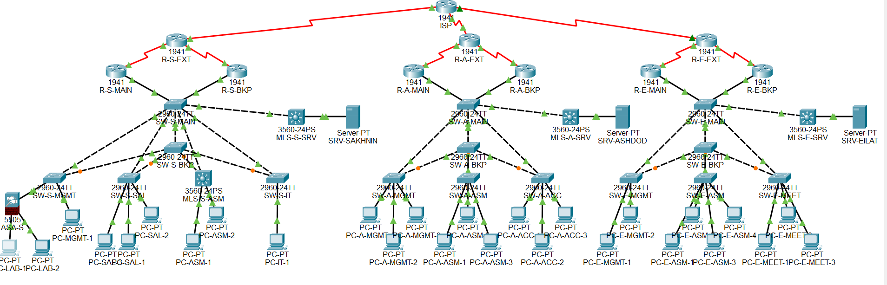

---

<a id="part-a"></a>

# חלק A — שאר סכנין

*אחרי שיעור 1, לפני שיעור 2. ממשיכים בקובץ ששמרתם בשיעור 1.*

## ‏A1 — מציבים את המכשירים
**🌐 הרשת עכשיו.** SW-S-MAIN, ‏SW-S-SAL ושלושה מחשבים, משיעור 1.

**❗ הבעיה.** בסניף יש חמש רשתות (ארבע מחלקות והשרתים), ולכם יש מחלקה אחת.

**💡 הפתרון.** מתג לכל מחלקה, מתג גיבוי, מתג לשרת, והשרת עצמו. ההרכבה והשרתים מקבלים **3560**: מתג רב-שכבתי.

**📋 מבצעים בפרויקט.** מציבים את המכשירים שבטבלה ונותנים להם את השמות האלה.

### 🖱 הפתרון: על מה לוחצים ומה כותבים
1. ‏**Network Devices** (1) ‏←‏ **Switches** (2) ‏←‏ **2960** (3) או **3560-24PS** (4; לא ה-3650 שלידו), ולוחצים על משטח העבודה.

   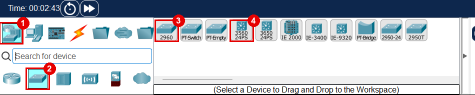
2. למחשבים ולשרת: **End Devices** (1) ‏←‏ **PC** (2) או **Server** (3).

‏   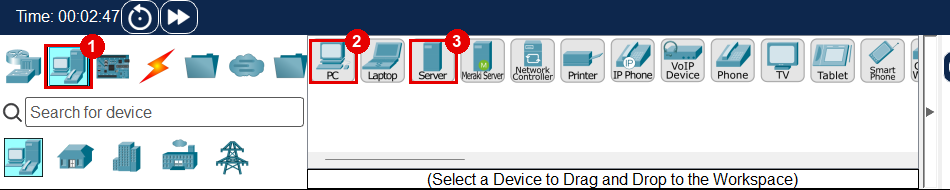
3. משנים את השם של כל מכשיר כמו בשיעור 1: לוחצים עליו ‏←‏ **Config** ‏←‏ **Display Name**.

<div dir="rtl">

| שם | דגם |
|---|---|
| ‎SW-S-BKP | ‎2960 |
| ‎SW-S-IT | ‎2960 |
| ‎SW-S-MGMT | ‎2960 |
| ‎MLS-S-ASM | ‎3560-24PS |
| ‎MLS-S-SRV | ‎3560-24PS |
| ‎SRV-SAKHNIN | ‎Server |
| ‎PC-ASM-1 | ‎PC |
| ‎PC-ASM-2 | ‎PC |
| ‎PC-IT-1 | ‎PC |
| ‎PC-MGMT-1 | ‎PC |

</div>

מסדרים כך. התווית בקצה של כל כבל היא הפורט (למשימה הבאה). קו מקווקו הוא כבל מוצלב:

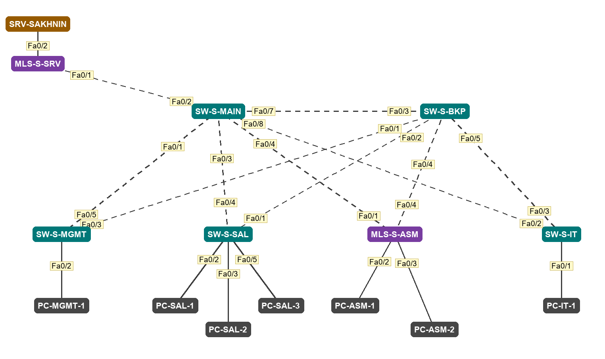

## ‏A2 — הכבלים
**🌐 הרשת עכשיו.** מכשירים בלי כבלים.

**❗ הבעיה.** בשיעור 2 כל פקודה מזכירה פורט. כבל בפורט אחר = VLAN על המכשיר הלא נכון.

**💡 הפתרון.** טבלת פורטים. לכל מתג מחלקה יש **שני** קישורים למעלה: אחד למתג הראשי ואחד לגיבוי.

**📋 מבצעים בפרויקט.** מחברים לפי הטבלה. בכל שורה אומרים בקול: ישר או מוצלב, ולמה?

### 🖱 הפתרון: על מה לוחצים ומה כותבים
‏**Connections** (1) ‏←‏ **Copper Straight-Through** (2) או **Copper Cross-Over** (3) ‏←‏ לוחצים על המכשיר הראשון ובוחרים פורט ‏←‏ לוחצים על המכשיר השני ובוחרים פורט.

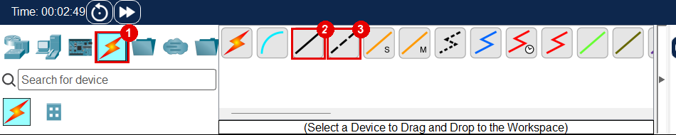

<div dir="rtl">

| ‎# | כבל | מכשיר ראשון | פורט | מכשיר שני | פורט |
|---|---|---|---|---|---|
| ‎1 | ‎Cross-Over | ‎SW-S-MAIN | ‎Fa0/1 | ‎SW-S-MGMT | ‎Fa0/5 |
| ‎2 | ‎Cross-Over | ‎SW-S-MAIN | ‎Fa0/2 | ‎MLS-S-SRV | ‎Fa0/1 |
| ‎3 | ‎Cross-Over | ‎SW-S-MAIN | ‎Fa0/4 | ‎MLS-S-ASM | ‎Fa0/1 |
| ‎4 | ‎Cross-Over | ‎SW-S-MAIN | ‎Fa0/7 | ‎SW-S-BKP | ‎Fa0/3 |
| ‎5 | ‎Cross-Over | ‎SW-S-MAIN | ‎Fa0/8 | ‎SW-S-IT | ‎Fa0/2 |
| ‎6 | ‎Cross-Over | ‎SW-S-BKP | ‎Fa0/1 | ‎SW-S-MGMT | ‎Fa0/3 |
| ‎7 | ‎Cross-Over | ‎SW-S-BKP | ‎Fa0/2 | ‎SW-S-SAL | ‎Fa0/1 |
| ‎8 | ‎Cross-Over | ‎SW-S-BKP | ‎Fa0/4 | ‎MLS-S-ASM | ‎Fa0/4 |
| ‎9 | ‎Cross-Over | ‎SW-S-BKP | ‎Fa0/5 | ‎SW-S-IT | ‎Fa0/3 |
| ‎10 | ‎Straight-Through | ‎SW-S-IT | ‎Fa0/1 | ‎PC-IT-1 | ‎Fa0 |
| ‎11 | ‎Straight-Through | ‎SW-S-MGMT | ‎Fa0/2 | ‎PC-MGMT-1 | ‎Fa0 |
| ‎12 | ‎Straight-Through | ‎MLS-S-ASM | ‎Fa0/2 | ‎PC-ASM-1 | ‎Fa0 |
| ‎13 | ‎Straight-Through | ‎MLS-S-ASM | ‎Fa0/3 | ‎PC-ASM-2 | ‎Fa0 |
| ‎14 | ‎Straight-Through | ‎MLS-S-SRV | ‎Fa0/2 | ‎SRV-SAKHNIN | ‎Fa0 |

</div>

✅ אחרי כדקה: ירוק, ובחלק מהקישורים כתום בצד אחד. זה STP שחוסם לולאה, וכך צריך להיות.

## ‏A3 — הגדרות בסיס בחמישה מתגים
**🌐 הרשת עכשיו.** SW-S-MAIN ו-SW-S-SAL הוגדרו בשיעור 1. חמישה מתגים חדשים עדיין נקראים `Switch`, בלי סיסמה.

**❗ הבעיה.** כל מי שיש לו כבל קונסול נכנס, ולא רואים באיזה מתג נמצאים.

**💡 הפתרון.** הבלוק משיעור 1, ורק שורה אחת משתנה: `hostname`.

**📋 מבצעים בפרויקט.** מגדירים את SW-S-BKP, ‏SW-S-MGMT, ‏SW-S-IT, ‏MLS-S-ASM, ‏MLS-S-SRV. את הראשון מנסים מהזיכרון.

### 🖱 הפתרון: על מה לוחצים ומה כותבים
לוחצים על המתג ‏←‏ **CLI** ‏←‏ **Enter** עד שמופיע `Switch>`‎. כותבים את הבלוק של **SW-S-BKP** (כשמופיע `Destination filename` לוחצים Enter):

```
enable
configure terminal
hostname SW-S-BKP
no ip domain-lookup
enable secret Osem#En1
service password-encryption
banner motd # Osem - Authorized access only #
line console 0
password Osem#Con
login
logging synchronous
exec-timeout 10 0
end
copy running-config startup-config
```

‏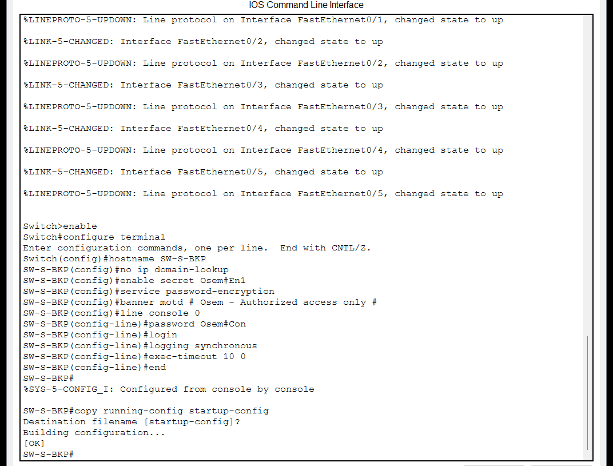

בארבעת האחרים אותו בלוק. רק שורה אחת משתנה:

<div dir="rtl">

| מכשיר | השורה שמשתנה |
|---|---|
| ‎SW-S-MGMT | ‎`hostname SW-S-MGMT` |
| ‎SW-S-IT | ‎`hostname SW-S-IT` |
| ‎MLS-S-ASM | ‎`hostname MLS-S-ASM` |
| ‎MLS-S-SRV | ‎`hostname MLS-S-SRV` |

</div>

⚠️ ה-**3560** (המכשירים MLS) מתחיל בשאלה, כמו נתב: `Would you like to enter the initial configuration dialog? [yes/no]:`‎. כותבים `no`, לוחצים Enter, ושוב Enter עד `Switch>`‎. אחר כך הוא מקבל בדיוק אותן פקודות:

‏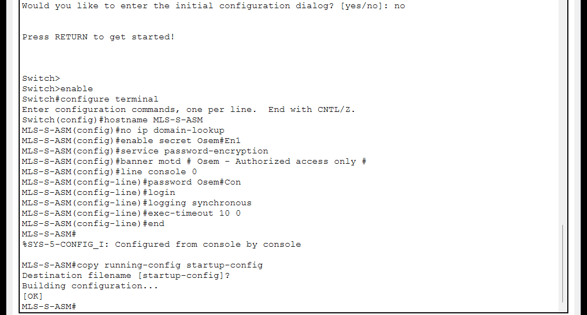

## ‏A4 — כתובות למחשבים
**🌐 הרשת עכשיו.** רק למחשבי השכר יש כתובות (שיעור 1).

**❗ הבעיה.** בשיעור 2 מראים אילו מחשבים מדברים ואילו לא. מחשב בלי כתובת לא מוכיח כלום.

**💡 הפתרון.** כתובת קבועה לכל מחשב, ברשת של ה-VLAN העתידי שלו. בשיעור 3 עוברים ל-DHCP.

**📋 מבצעים בפרויקט.** נותנים כתובת לארבעת המחשבים החדשים. אילו מחשבים יכולים לעשות ping זה לזה עכשיו? למה?

### 🖱 הפתרון: על מה לוחצים ומה כותבים
מחשב ‏←‏ **Desktop** ‏←‏ **IP Configuration** ‏←‏ **Static**, כמו בשיעור 1. ה-Gateway נשאר ריק.

<div dir="rtl">

| מחשב | ‎IPv4 Address | ‎Subnet Mask |
|---|---|---|
| ‎PC-MGMT-1 | ‎192.168.10.21 | ‎255.255.255.0 |
| ‎PC-ASM-1 | ‎192.168.30.21 | ‎255.255.255.0 |
| ‎PC-ASM-2 | ‎192.168.30.22 | ‎255.255.255.0 |
| ‎PC-IT-1 | ‎192.168.40.21 | ‎255.255.255.0 |

</div>

‏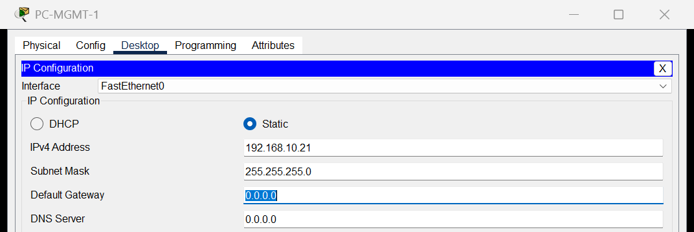

✅ מ-PC-ASM-1: הפקודה `ping 192.168.30.22` מצליחה, והפקודה `ping 192.168.40.21` נכשלת (רשת אחרת, ועדיין אין נתב).

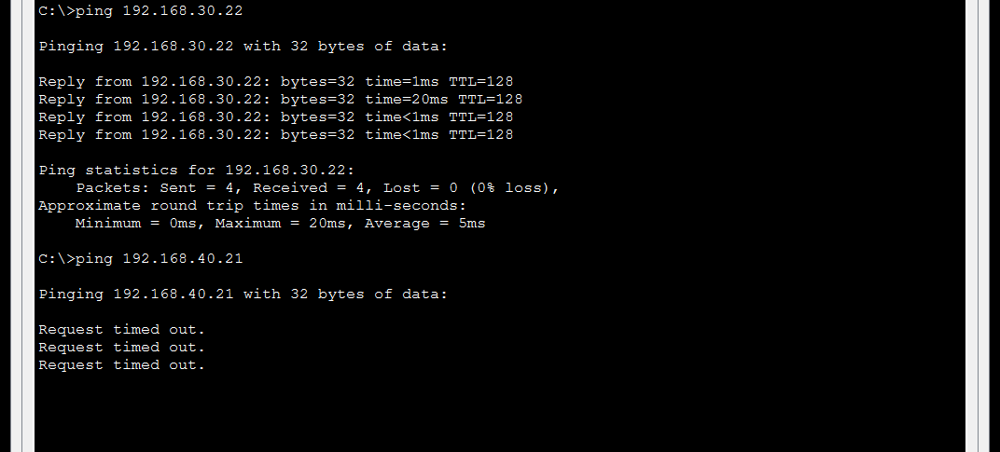

➡ עכשיו עושים את **[שיעור 2](../lesson-02/)** בקובץ שלכם.

---

<a id="part-b"></a>

# חלק B — שני נתבים לסכנין

*אחרי שיעור 2, לפני שיעור 3.*

## ‏B1 — מציבים שני נתבים ומוסיפים כרטיס טורי
**🌐 הרשת עכשיו.** חמישה VLAN, ממותגים ומוגנים. שום דבר לא מנתב ביניהם.

**❗ הבעיה.** צריך שני נתבים, ובהמשך קו טורי לאינטרנט. בנתב 1941 חדש יש שני פורטי Ethernet ו**אין אף פורט טורי**.

**💡 הפתרון.** שני נתבי **1941**, ובכל אחד כרטיס **HWIC-2T**: שני פורטים טוריים. כרטיס נכנס רק כשהחשמל **כבוי**.

**📋 מבצעים בפרויקט.** מציבים את R-S-MAIN ואת R-S-BKP, ובכל אחד כרטיס HWIC-2T בחריץ **הימני**.

### 🖱 הפתרון: על מה לוחצים ומה כותבים
1. ‏**Network Devices** (1) ‏←‏ **Routers** (2) ‏←‏ **1941** (3). השמות: `R-S-MAIN`, `R-S-BKP`.

   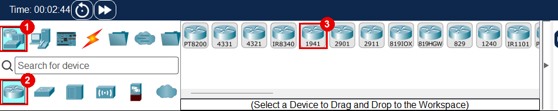
2. לוחצים על הנתב ‏←‏ לשונית **Physical**. לוחצים על **מתג החשמל** (1): האור הירוק שלו נכבה.
3. גוררים את **HWIC-2T** (2) מהרשימה אל החריץ **הימני** (3).
4. לוחצים שוב על מתג החשמל (1): האור ירוק.

   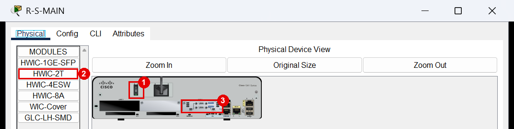

⚠️ החריץ **הימני** הוא חריץ 0: הפורטים שלו הם `S0/0/0` ו-`S0/0/1`. השמאלי הוא חריץ 1: `S0/1/0` ו-`S0/1/1`. כרטיס בחריץ
הלא נכון = הפקודות הטוריות של שיעור 4 נדחות.

## ‏B2 — כבלים והגדרות בסיס
**🌐 הרשת עכשיו.** שני נתבים שלא מחוברים לכלום.

**❗ הבעיה.** נתב חדש לא מתחיל ב-`Router>`‎ אלא ב**שאלה**. מי שעונה `yes` נכנס לשאלון ארוך.

**💡 הפתרון.** עונים `no`, וכותבים את בלוק הבסיס.

**📋 מבצעים בפרויקט.** מחברים את שני הנתבים ל-SW-S-MAIN ומגדירים. איזה כבל עובר בין נתב למתג?

### 🖱 הפתרון: על מה לוחצים ומה כותבים

<div dir="rtl">

| ‎# | כבל | מכשיר ראשון | פורט | מכשיר שני | פורט |
|---|---|---|---|---|---|
| ‎1 | ‎Straight-Through | ‎R-S-BKP | ‎G0/0 | ‎SW-S-MAIN | ‎Fa0/5 |
| ‎2 | ‎Straight-Through | ‎R-S-MAIN | ‎G0/0 | ‎SW-S-MAIN | ‎Fa0/6 |

</div>

המשולשים נשארים **אדומים**: פורטים של נתב כבויים עד `no shutdown` (שיעור 3).

לוחצים על **R-S-MAIN** ‏←‏ **CLI**. כשמופיע `Would you like to enter the initial configuration dialog? [yes/no]:`‎ כותבים `no` ולוחצים Enter. לוחצים שוב Enter עד `Router>`‎:

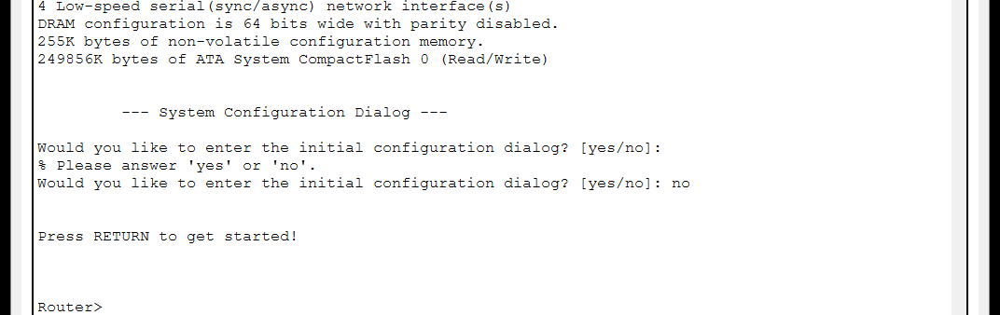

**R-S-MAIN**:

```
enable
configure terminal
hostname R-S-MAIN
no ip domain-lookup
enable secret Osem#En1
service password-encryption
banner motd # Osem - Authorized access only #
line console 0
password Osem#Con
login
logging synchronous
exec-timeout 10 0
end
copy running-config startup-config
```

‏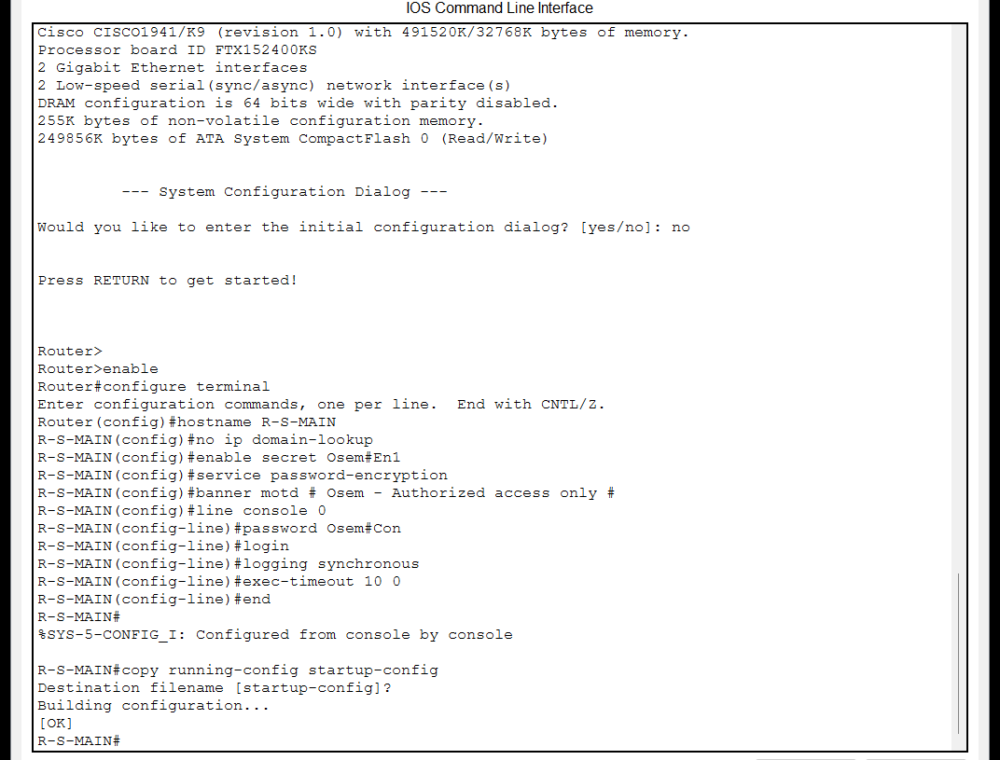

‏**R-S-BKP**: קודם `no`, ואז אותו בלוק. רק שורה אחת משתנה: `hostname R-S-BKP`.

➡ עכשיו עושים את **[שיעור 3](../lesson-03/)**.

---

<a id="part-c"></a>

# חלק C — הספק, אשדוד ואילת

*אחרי שיעור 3, לפני שיעור 4. החלק הארוך ביותר.*

## ‏C1 — נתבי הקצה, הספק והקווים הטוריים
**🌐 הרשת עכשיו.** סכנין עובדת, אבל היא אי.

**❗ הבעיה.** אין נתב לכיוון האינטרנט, אין ספק, ואין סניפים אחרים.

**💡 הפתרון.** בכל סניף **נתב קצה** אחד (EXT), ונתב **ISP** אחד לכולם. הנתבים האלה מחוברים בכבלים **טוריים**.

**📋 מבצעים בפרויקט.** מציבים את שמונת הנתבים עם הכרטיסים הנכונים, ומחברים את תשעת הקווים הטוריים.

### 🖱 הפתרון: על מה לוחצים ומה כותבים
1. מציבים את נתבי **1941** ומכניסים את הכרטיסים כמו ב-B1 (מכבים ‏←‏ גוררים ‏←‏ מדליקים):

   | נתב | כרטיסים | איפה |
   |---|---|---|
   | ISP, R-S-EXT, R-A-EXT, R-E-EXT | **שני** HWIC-2T | חריץ ימני **וגם** שמאלי |
   | R-A-MAIN, R-A-BKP, R-E-MAIN, R-E-BKP | HWIC-2T אחד | חריץ ימני |

   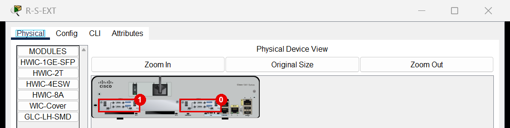
2. ‏**Connections** (1) ‏←‏ **Serial DCE** (2) ‏←‏ לוחצים **קודם** על מכשיר ה-DCE שבטבלה, ואחר כך על השני.

   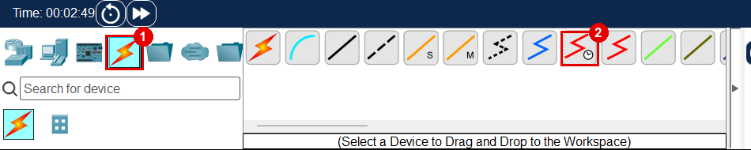

   | # | ראשון (DCE) | פורט | שני | פורט |
   |---|---|---|---|---|
   | 1 | R-S-EXT | S0/0/0 | R-S-MAIN | S0/0/0 |
   | 2 | R-S-EXT | S0/1/0 | R-S-BKP | S0/0/0 |
   | 3 | ISP | S0/0/0 | R-S-EXT | S0/0/1 |
   | 4 | R-A-EXT | S0/0/1 | R-A-MAIN | S0/0/0 |
   | 5 | R-A-EXT | S0/1/0 | R-A-BKP | S0/0/0 |
   | 6 | ISP | S0/0/1 | R-A-EXT | S0/0/0 |
   | 7 | R-E-EXT | S0/0/1 | R-E-MAIN | S0/0/0 |
   | 8 | R-E-EXT | S0/1/0 | R-E-BKP | S0/0/0 |
   | 9 | ISP | S0/1/0 | R-E-EXT | S0/0/0 |

   ⚠️ המכשיר **הראשון** שלוחצים עליו הוא ה-DCE: הוא נותן את השעון. בשיעור 4 כותבים `clock rate` בצד הזה.
3. הגדרות בסיס: בכל נתב חדש עונים `no`, וכותבים את הבלוק של B2 עם השם שלו:

<div dir="rtl">

| מכשיר | השורה שמשתנה |
|---|---|
| ‎R-S-EXT | ‎`hostname R-S-EXT` |
| ‎ISP | ‎`hostname ISP` |
| ‎R-A-EXT | ‎`hostname R-A-EXT` |
| ‎R-A-MAIN | ‎`hostname R-A-MAIN` |
| ‎R-A-BKP | ‎`hostname R-A-BKP` |
| ‎R-E-EXT | ‎`hostname R-E-EXT` |
| ‎R-E-MAIN | ‎`hostname R-E-MAIN` |
| ‎R-E-BKP | ‎`hostname R-E-BKP` |

</div>

כל הקווים הטוריים נשארים **אדומים** עד שיעור 4. כך צריך להיות.

## ‏C2 — אשדוד: מכשירים, כבלים, בסיס
**🌐 הרשת עכשיו.** הנתבים של אשדוד עומדים לבד.

**❗ הבעיה.** חסר סניף שלם: הנהלה, הרכבה, הנהלת חשבונות ושרתים.

**💡 הפתרון.** בדיוק אותו תכנון כמו סכנין. **זה המבחן של מה שלמדתם**: אין כאן שום דבר חדש.

**📋 מבצעים בפרויקט.** מציבים, נותנים שמות, מחברים, ונותנים לכל מתג הגדרות בסיס.

### 🖱 הפתרון: על מה לוחצים ומה כותבים

<div dir="rtl">

| שם | דגם |
|---|---|
| ‎SW-A-MAIN | ‎2960 |
| ‎SW-A-BKP | ‎2960 |
| ‎SW-A-ACC | ‎2960 |
| ‎SW-A-ASM | ‎2960 |
| ‎SW-A-MGMT | ‎2960 |
| ‎MLS-A-SRV | ‎3560-24PS |
| ‎SRV-ASHDOD | ‎Server |
| ‎PC-A-ACC-1 | ‎PC |
| ‎PC-A-ACC-2 | ‎PC |
| ‎PC-A-ACC-3 | ‎PC |
| ‎PC-A-ASM-1 | ‎PC |
| ‎PC-A-ASM-2 | ‎PC |
| ‎PC-A-ASM-3 | ‎PC |
| ‎PC-A-MGMT-1 | ‎PC |
| ‎PC-A-MGMT-2 | ‎PC |
| ‎PC-A-MGMT-3 | ‎PC |

</div>

<div dir="rtl">

| ‎# | כבל | מכשיר ראשון | פורט | מכשיר שני | פורט |
|---|---|---|---|---|---|
| ‎1 | ‎Straight-Through | ‎R-A-BKP | ‎G0/0 | ‎SW-A-MAIN | ‎Fa0/6 |
| ‎2 | ‎Straight-Through | ‎R-A-MAIN | ‎G0/0 | ‎SW-A-MAIN | ‎Fa0/2 |
| ‎3 | ‎Cross-Over | ‎SW-A-MAIN | ‎Fa0/1 | ‎SW-A-MGMT | ‎Fa0/4 |
| ‎4 | ‎Cross-Over | ‎SW-A-MAIN | ‎Fa0/3 | ‎SW-A-ASM | ‎Fa0/4 |
| ‎5 | ‎Cross-Over | ‎SW-A-MAIN | ‎Fa0/4 | ‎MLS-A-SRV | ‎Fa0/1 |
| ‎6 | ‎Cross-Over | ‎SW-A-MAIN | ‎Fa0/5 | ‎SW-A-ACC | ‎Fa0/4 |
| ‎7 | ‎Cross-Over | ‎SW-A-MAIN | ‎Fa0/7 | ‎SW-A-BKP | ‎Fa0/4 |
| ‎8 | ‎Cross-Over | ‎SW-A-BKP | ‎Fa0/1 | ‎SW-A-MGMT | ‎Fa0/5 |
| ‎9 | ‎Cross-Over | ‎SW-A-BKP | ‎Fa0/2 | ‎SW-A-ASM | ‎Fa0/5 |
| ‎10 | ‎Cross-Over | ‎SW-A-BKP | ‎Fa0/3 | ‎SW-A-ACC | ‎Fa0/5 |
| ‎11 | ‎Straight-Through | ‎SW-A-ACC | ‎Fa0/1 | ‎PC-A-ACC-1 | ‎Fa0 |
| ‎12 | ‎Straight-Through | ‎SW-A-ACC | ‎Fa0/2 | ‎PC-A-ACC-2 | ‎Fa0 |
| ‎13 | ‎Straight-Through | ‎SW-A-ACC | ‎Fa0/3 | ‎PC-A-ACC-3 | ‎Fa0 |
| ‎14 | ‎Straight-Through | ‎SW-A-ASM | ‎Fa0/1 | ‎PC-A-ASM-1 | ‎Fa0 |
| ‎15 | ‎Straight-Through | ‎SW-A-ASM | ‎Fa0/2 | ‎PC-A-ASM-2 | ‎Fa0 |
| ‎16 | ‎Straight-Through | ‎SW-A-ASM | ‎Fa0/3 | ‎PC-A-ASM-3 | ‎Fa0 |
| ‎17 | ‎Straight-Through | ‎SW-A-MGMT | ‎Fa0/1 | ‎PC-A-MGMT-1 | ‎Fa0 |
| ‎18 | ‎Straight-Through | ‎SW-A-MGMT | ‎Fa0/2 | ‎PC-A-MGMT-2 | ‎Fa0 |
| ‎19 | ‎Straight-Through | ‎SW-A-MGMT | ‎Fa0/3 | ‎PC-A-MGMT-3 | ‎Fa0 |
| ‎20 | ‎Straight-Through | ‎MLS-A-SRV | ‎Fa0/2 | ‎SRV-ASHDOD | ‎Fa0 |

</div>

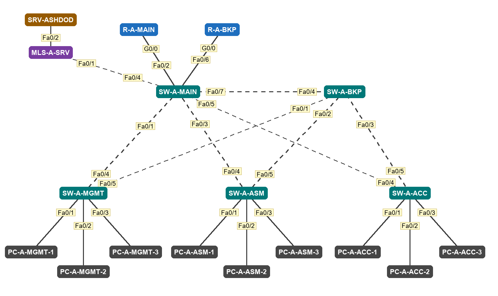

בלוק הבסיס של A3 בכל מתג, עם השם שלו (ב-MLS: קודם עונים `no`):

<div dir="rtl">

| מכשיר | השורה שמשתנה |
|---|---|
| ‎SW-A-MAIN | ‎`hostname SW-A-MAIN` |
| ‎SW-A-BKP | ‎`hostname SW-A-BKP` |
| ‎SW-A-MGMT | ‎`hostname SW-A-MGMT` |
| ‎SW-A-ASM | ‎`hostname SW-A-ASM` |
| ‎SW-A-ACC | ‎`hostname SW-A-ACC` |
| ‎MLS-A-SRV | ‎`hostname MLS-A-SRV` |

</div>

## ‏C3 — אשדוד: מיתוג
**🌐 הרשת עכשיו.** הכול מחובר, הכול ב-VLAN 1.

**❗ הבעיה.** כמו בשיעור 2: רשת אחת גדולה, לולאות, ופורטים פתוחים.

**💡 הפתרון.** כל שיעור 2 ו-DHCP Snooping משיעור 3, בבלוק אחד לכל מתג.

**📋 מבצעים בפרויקט.** כותבים לבד את הבלוק של SW-A-ACC, לפי התוכנית. אחר כך משווים.

<div dir="rtl">

| ‎VLAN | שם | רשת | מתג |
|---|---|---|---|
| ‎60 | ‎MANAGEMENT | ‎192.168.60.0/24 | ‎SW-A-MGMT |
| ‎61 | ‎ASSEMBLY | ‎192.168.61.0/24 | ‎SW-A-ASM |
| ‎62 | ‎ACCOUNTING | ‎192.168.62.0/24 | ‎SW-A-ACC |
| ‎63 | ‎SERVERS | ‎192.168.63.0/24 | ‎MLS-A-SRV |

</div>

### 🖱 הפתרון: על מה לוחצים ומה כותבים
בכל מתג: נכנסים, `enable`, וכותבים את הבלוק. הודעות על פורטים שנכבים והודעות `PVID` הן רגילות כאן.

**SW-A-MAIN:**
```
configure terminal
vtp domain ASHDOD
vtp password Osem#Vtp
vtp mode server
vlan 60
name MANAGEMENT
vlan 61
name ASSEMBLY
vlan 62
name ACCOUNTING
vlan 63
name SERVERS
exit
spanning-tree vlan 1,60,61,62,63 root primary
ip dhcp snooping
ip dhcp snooping vlan 60,61,62
no ip dhcp snooping information option
interface range fa0/1 - 3 , fa0/5 - 7
switchport mode trunk
exit
interface range fa0/1 , fa0/3 , fa0/5
spanning-tree guard root
exit
interface fa0/4
switchport mode access
switchport access vlan 63
switchport port-security
switchport port-security maximum 2
switchport port-security mac-address sticky
switchport port-security violation shutdown
exit
interface range fa0/2 , fa0/4 , fa0/6 - 7
ip dhcp snooping trust
exit
interface range fa0/8 - 24 , g0/1 - 2
shutdown
end
copy running-config startup-config
```
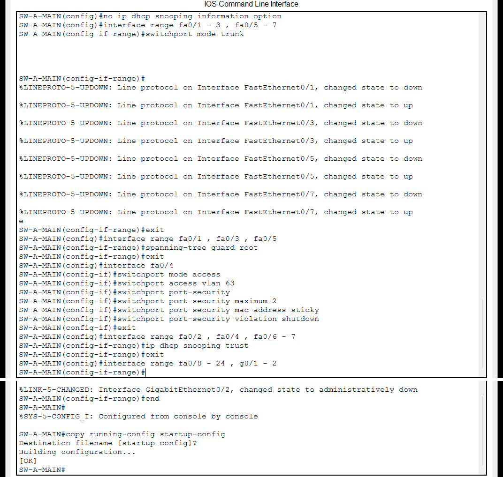

**SW-A-BKP:**
```
configure terminal
vtp domain ASHDOD
vtp password Osem#Vtp
vtp mode client
spanning-tree vlan 1,60,61,62,63 root secondary
interface range fa0/1 - 4
switchport mode trunk
exit
interface range fa0/5 - 24 , g0/1 - 2
shutdown
end
copy running-config startup-config
```
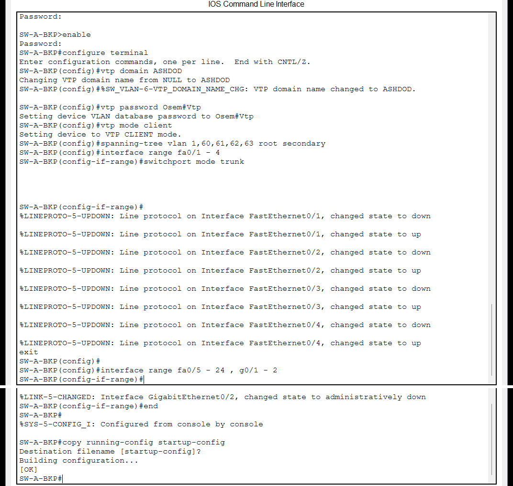

**SW-A-MGMT:**
```
configure terminal
vtp domain ASHDOD
vtp password Osem#Vtp
vtp mode client
interface range fa0/4 - 5
switchport mode trunk
exit
interface range fa0/1 - 3
switchport mode access
switchport access vlan 60
spanning-tree portfast
spanning-tree bpduguard enable
switchport port-security
switchport port-security maximum 1
switchport port-security mac-address sticky
switchport port-security violation shutdown
exit
interface range fa0/6 - 24 , g0/1 - 2
shutdown
end
copy running-config startup-config
```
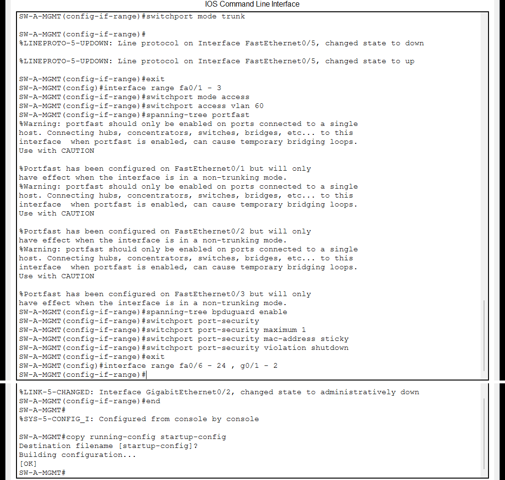

**SW-A-ASM:**
```
configure terminal
vtp domain ASHDOD
vtp password Osem#Vtp
vtp mode client
interface range fa0/4 - 5
switchport mode trunk
exit
interface range fa0/1 - 3
switchport mode access
switchport access vlan 61
spanning-tree portfast
spanning-tree bpduguard enable
switchport port-security
switchport port-security maximum 1
switchport port-security mac-address sticky
switchport port-security violation shutdown
exit
interface range fa0/6 - 24 , g0/1 - 2
shutdown
end
copy running-config startup-config
```
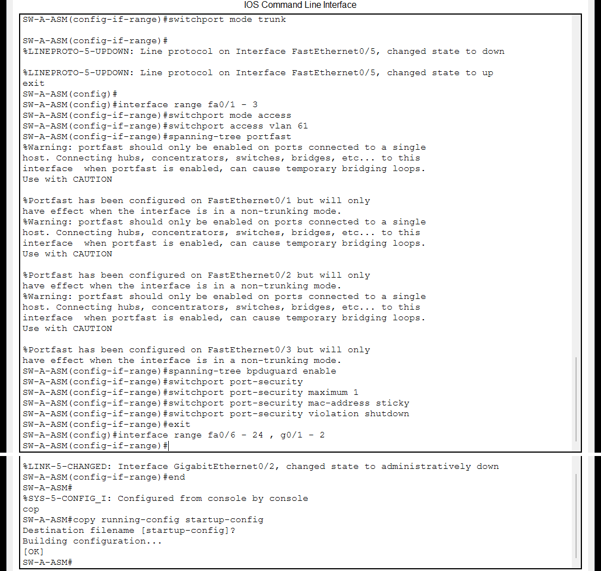

**SW-A-ACC:**
```
configure terminal
vtp domain ASHDOD
vtp password Osem#Vtp
vtp mode client
interface range fa0/4 - 5
switchport mode trunk
exit
interface range fa0/1 - 3
switchport mode access
switchport access vlan 62
spanning-tree portfast
spanning-tree bpduguard enable
switchport port-security
switchport port-security maximum 1
switchport port-security mac-address sticky
switchport port-security violation shutdown
exit
interface range fa0/6 - 24 , g0/1 - 2
shutdown
end
copy running-config startup-config
```
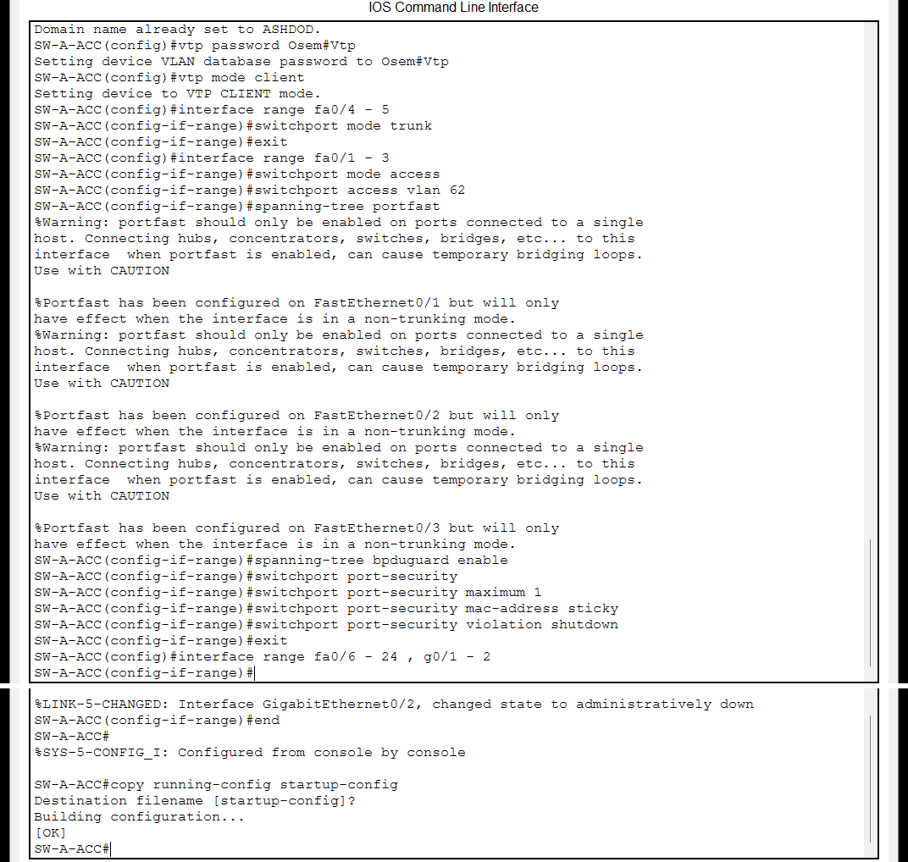

**MLS-A-SRV:**
```
configure terminal
vtp mode transparent
vlan 63
name SERVERS
exit
interface range fa0/1 - 2
switchport mode access
switchport access vlan 63
exit
interface range fa0/3 - 24 , g0/1 - 2
shutdown
exit
interface fa0/2
spanning-tree portfast
spanning-tree bpduguard enable
switchport port-security
switchport port-security maximum 1
switchport port-security mac-address sticky
switchport port-security violation shutdown
end
copy running-config startup-config
```
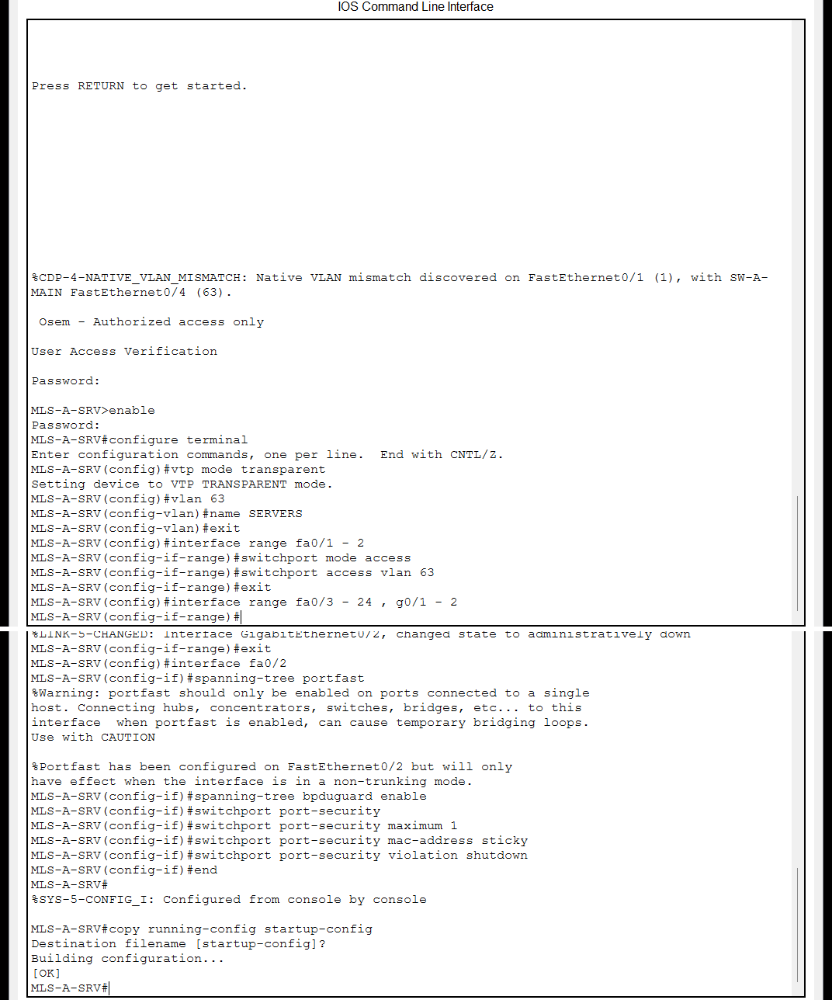

✅ ב-SW-A-ACC: הפקודה `show vtp status` (client, תחום ASHDOD) והפקודה `show vlan brief`: הרשתות 60–63, ו-Fa0/1–3 ב-VLAN 62.

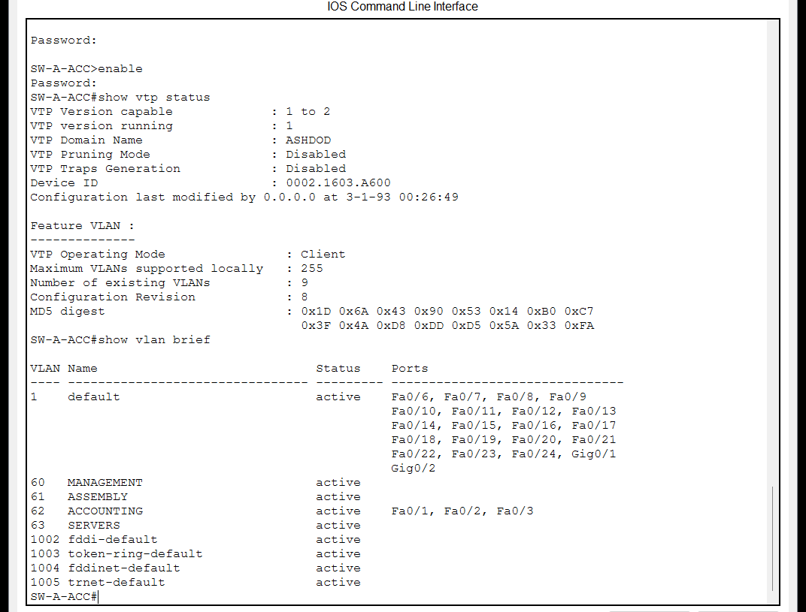

## ‏C4 — אשדוד: נתבים
**🌐 הרשת עכשיו.** ארבעה VLAN, ואין שער.

**❗ הבעיה.** אין דרך בין המחלקות, ואין דרך לשרת ה-DHCP.

**💡 הפתרון.** ממשקי משנה, HSRP ו-helper, כמו בשיעור 3.

**📋 מבצעים בפרויקט.** מעתיקים את הבלוק שלכם של R-S-MAIN ומשנים את ה-VLAN, הכתובות וה-helper. באיזה VLAN אין helper?

### 🖱 הפתרון: על מה לוחצים ומה כותבים
**R-A-MAIN:**
```
configure terminal
interface g0/0
no shutdown
exit
interface g0/0.60
encapsulation dot1Q 60
ip address 192.168.60.254 255.255.255.0
standby 60 ip 192.168.60.252
standby 60 priority 110
standby 60 preempt
ip helper-address 192.168.63.1
exit
interface g0/0.61
encapsulation dot1Q 61
ip address 192.168.61.254 255.255.255.0
standby 61 ip 192.168.61.252
standby 61 priority 110
standby 61 preempt
ip helper-address 192.168.63.1
exit
interface g0/0.62
encapsulation dot1Q 62
ip address 192.168.62.254 255.255.255.0
standby 62 ip 192.168.62.252
standby 62 priority 110
standby 62 preempt
ip helper-address 192.168.63.1
exit
interface g0/0.63
encapsulation dot1Q 63
ip address 192.168.63.254 255.255.255.0
standby 63 ip 192.168.63.252
standby 63 priority 110
standby 63 preempt
exit
end
copy running-config startup-config
```
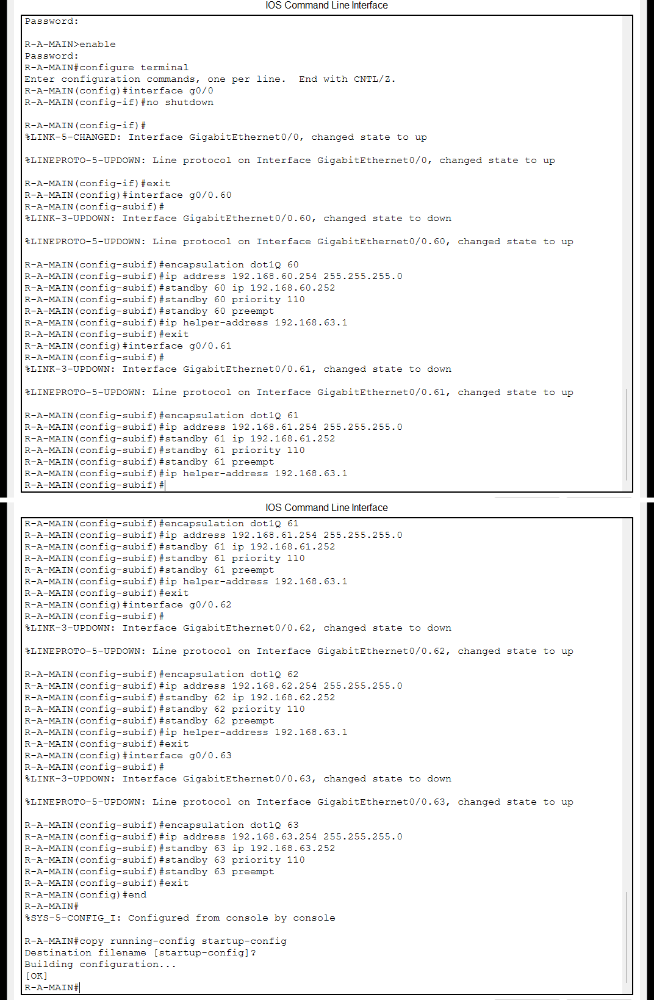

**R-A-BKP:**
```
configure terminal
interface g0/0
no shutdown
exit
interface g0/0.60
encapsulation dot1Q 60
ip address 192.168.60.253 255.255.255.0
standby 60 ip 192.168.60.252
standby 60 priority 105
standby 60 preempt
ip helper-address 192.168.63.1
exit
interface g0/0.61
encapsulation dot1Q 61
ip address 192.168.61.253 255.255.255.0
standby 61 ip 192.168.61.252
standby 61 priority 105
standby 61 preempt
ip helper-address 192.168.63.1
exit
interface g0/0.62
encapsulation dot1Q 62
ip address 192.168.62.253 255.255.255.0
standby 62 ip 192.168.62.252
standby 62 priority 105
standby 62 preempt
ip helper-address 192.168.63.1
exit
interface g0/0.63
encapsulation dot1Q 63
ip address 192.168.63.253 255.255.255.0
standby 63 ip 192.168.63.252
standby 63 priority 105
standby 63 preempt
exit
end
copy running-config startup-config
```
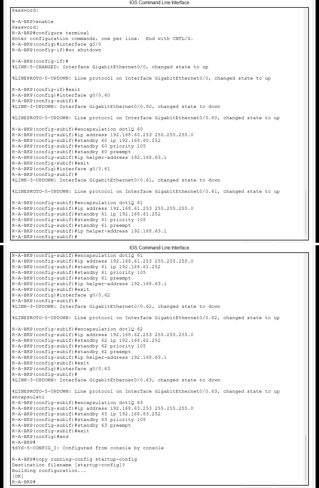

✅ אחרי 20 שניות, `show standby brief` ב-R-A-MAIN: מצב **Active** בארבע קבוצות.

‏

## ‏C5 — אשדוד: השרת והמחשבים
**🌐 הרשת עכשיו.** הנתבים והמתגים עובדים, ולאף אחד אין כתובת.

**❗ הבעיה.** שרת ריק.

**💡 הפתרון.** אותם שירותים כמו בשיעור 3, עם הערכים של אשדוד. (האתר נשאר דף ברירת המחדל: כך מזהים בשיעור 4 את השרת של אשדוד.)

**📋 מבצעים בפרויקט.** ממלאים לפי הטבלאות. קודם כתובת קבועה!

### 🖱 הפתרון: על מה לוחצים ומה כותבים
כל הטפסים מוסברים עם תמונות ב[שיעור 3, משימה 3](../lesson-03/). רק הערכים משתנים.

**SRV-ASHDOD** ‏←‏ **Desktop** ‏←‏ **IP Configuration** ‏←‏ Static:

<div dir="rtl">

| ‎Address | ‎Mask | ‎Gateway | ‎DNS |
|---|---|---|---|
| ‎192.168.63.1 | ‎255.255.255.0 | ‎192.168.63.252 | ‎192.168.63.1 |

</div>

‏**Services** ‏←‏ **DHCP**: לכל שורה ממלאים ולוחצים **Add**. בסוף **Service: On** ‏←‏ **Save**.

<div dir="rtl">

| ‎Pool Name | ‎Default Gateway | ‎DNS Server | ‎Start IP | ‎Mask | ‎Max users |
|---|---|---|---|---|---|
| ‎MANAGEMENT | ‎192.168.60.252 | ‎192.168.63.1 | ‎192.168.60.20 | ‎255.255.255.0 | ‎50 |
| ‎ASSEMBLY | ‎192.168.61.252 | ‎192.168.63.1 | ‎192.168.61.20 | ‎255.255.255.0 | ‎50 |
| ‎ACCOUNTING | ‎192.168.62.252 | ‎192.168.63.1 | ‎192.168.62.20 | ‎255.255.255.0 | ‎50 |

</div>


‏**DNS** ‏←‏ On ‏←‏ Name `www.osem.com`, Address ‎`192.168.63.1` ‏←‏ **Add**.

‏**FTP** ‏←‏ Username `ashdod`, Password `Osem#Ftp`, כל חמש ההרשאות ‏←‏ **Add**.

‏**EMAIL** ‏←‏ Domain `osem.com` ‏←‏ **Set**. משתמשים `ashdod1` ו-`ashdod2`, סיסמה `Osem#Mail` ‏←‏ **+**.

אחר כך **כל מחשב** באשדוד: Desktop ‏←‏ IP Configuration ‏←‏ **DHCP**.

✅ מ-PC-A-ACC-1: כתובת 192.168.62.x, שער .252, והפקודה `ping 192.168.63.1` מצליחה.

‏

## ‏C6 — אילת: מכשירים, כבלים, בסיס
**🌐 הרשת עכשיו.** סכנין ואשדוד מוכנות.

**❗ הבעיה.** הסניף השלישי. השמות, המספרים ו**הפורטים** שונים מאשדוד.

**💡 הפתרון.** אותו תכנון בפעם השלישית.

**📋 מבצעים בפרויקט.** בונים רק לפי הטבלאות, בלי להסתכל על אשדוד.

### 🖱 הפתרון: על מה לוחצים ומה כותבים

<div dir="rtl">

| שם | דגם |
|---|---|
| ‎SW-E-MAIN | ‎2960 |
| ‎SW-E-BKP | ‎2960 |
| ‎SW-E-ASM | ‎2960 |
| ‎SW-E-MEET | ‎2960 |
| ‎SW-E-MGMT | ‎2960 |
| ‎MLS-E-SRV | ‎3560-24PS |
| ‎SRV-EILAT | ‎Server |
| ‎PC-E-ASM-1 | ‎PC |
| ‎PC-E-ASM-2 | ‎PC |
| ‎PC-E-ASM-3 | ‎PC |
| ‎PC-E-ASM-4 | ‎PC |
| ‎PC-E-MEET-1 | ‎PC |
| ‎PC-E-MEET-2 | ‎PC |
| ‎PC-E-MEET-3 | ‎PC |
| ‎PC-E-MGMT-1 | ‎PC |
| ‎PC-E-MGMT-2 | ‎PC |

</div>

<div dir="rtl">

| ‎# | כבל | מכשיר ראשון | פורט | מכשיר שני | פורט |
|---|---|---|---|---|---|
| ‎1 | ‎Straight-Through | ‎R-E-BKP | ‎G0/0 | ‎SW-E-MAIN | ‎Fa0/6 |
| ‎2 | ‎Straight-Through | ‎R-E-MAIN | ‎G0/0 | ‎SW-E-MAIN | ‎Fa0/4 |
| ‎3 | ‎Cross-Over | ‎SW-E-MAIN | ‎Fa0/1 | ‎SW-E-MGMT | ‎Fa0/3 |
| ‎4 | ‎Cross-Over | ‎SW-E-MAIN | ‎Fa0/2 | ‎MLS-E-SRV | ‎Fa0/1 |
| ‎5 | ‎Cross-Over | ‎SW-E-MAIN | ‎Fa0/3 | ‎SW-E-ASM | ‎Fa0/5 |
| ‎6 | ‎Cross-Over | ‎SW-E-MAIN | ‎Fa0/5 | ‎SW-E-MEET | ‎Fa0/4 |
| ‎7 | ‎Cross-Over | ‎SW-E-MAIN | ‎Fa0/7 | ‎SW-E-BKP | ‎Fa0/3 |
| ‎8 | ‎Cross-Over | ‎SW-E-BKP | ‎Fa0/1 | ‎SW-E-MGMT | ‎Fa0/4 |
| ‎9 | ‎Cross-Over | ‎SW-E-BKP | ‎Fa0/2 | ‎SW-E-ASM | ‎Fa0/6 |
| ‎10 | ‎Cross-Over | ‎SW-E-BKP | ‎Fa0/4 | ‎SW-E-MEET | ‎Fa0/5 |
| ‎11 | ‎Straight-Through | ‎SW-E-ASM | ‎Fa0/1 | ‎PC-E-ASM-1 | ‎Fa0 |
| ‎12 | ‎Straight-Through | ‎SW-E-ASM | ‎Fa0/2 | ‎PC-E-ASM-2 | ‎Fa0 |
| ‎13 | ‎Straight-Through | ‎SW-E-ASM | ‎Fa0/3 | ‎PC-E-ASM-3 | ‎Fa0 |
| ‎14 | ‎Straight-Through | ‎SW-E-ASM | ‎Fa0/4 | ‎PC-E-ASM-4 | ‎Fa0 |
| ‎15 | ‎Straight-Through | ‎SW-E-MEET | ‎Fa0/1 | ‎PC-E-MEET-1 | ‎Fa0 |
| ‎16 | ‎Straight-Through | ‎SW-E-MEET | ‎Fa0/2 | ‎PC-E-MEET-2 | ‎Fa0 |
| ‎17 | ‎Straight-Through | ‎SW-E-MEET | ‎Fa0/3 | ‎PC-E-MEET-3 | ‎Fa0 |
| ‎18 | ‎Straight-Through | ‎SW-E-MGMT | ‎Fa0/1 | ‎PC-E-MGMT-1 | ‎Fa0 |
| ‎19 | ‎Straight-Through | ‎SW-E-MGMT | ‎Fa0/2 | ‎PC-E-MGMT-2 | ‎Fa0 |
| ‎20 | ‎Straight-Through | ‎MLS-E-SRV | ‎Fa0/2 | ‎SRV-EILAT | ‎Fa0 |

</div>

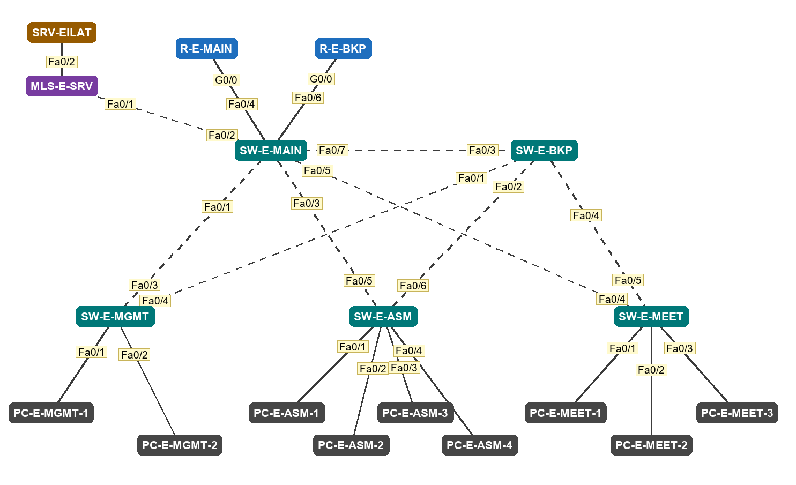

בלוק הבסיס של A3 בכל מתג, עם השם שלו (ב-MLS: קודם עונים `no`):

<div dir="rtl">

| מכשיר | השורה שמשתנה |
|---|---|
| ‎SW-E-MAIN | ‎`hostname SW-E-MAIN` |
| ‎SW-E-BKP | ‎`hostname SW-E-BKP` |
| ‎SW-E-MGMT | ‎`hostname SW-E-MGMT` |
| ‎SW-E-ASM | ‎`hostname SW-E-ASM` |
| ‎SW-E-MEET | ‎`hostname SW-E-MEET` |
| ‎MLS-E-SRV | ‎`hostname MLS-E-SRV` |

</div>

## ‏C7 — אילת: מיתוג
**🌐 הרשת עכשיו.** מחובר, והכול ב-VLAN 1.

**❗ הבעיה.** כמו ב-C3. באילת מתג השרתים מחובר ל-**Fa0/2** של המתג הראשי, ו-R-E-MAIN ל-**Fa0/4**. העתקה מאשדוד בלי לחשוב מנתקת את הסניף.

**💡 הפתרון.** אותם בלוקים, לפי התוכנית של אילת.

**📋 מבצעים בפרויקט.** כותבים לבד את הבלוק של SW-E-ASM. כמה פורטים של מחשבים יש לו?

<div dir="rtl">

| ‎VLAN | שם | רשת | מתג |
|---|---|---|---|
| ‎80 | ‎MANAGEMENT | ‎192.168.80.0/24 | ‎SW-E-MGMT |
| ‎81 | ‎DEVICES-ASSEMBLY | ‎192.168.81.0/24 | ‎SW-E-ASM |
| ‎82 | ‎MEETING | ‎192.168.82.0/24 | ‎SW-E-MEET |
| ‎83 | ‎SERVERS | ‎192.168.83.0/24 | ‎MLS-E-SRV |

</div>

### 🖱 הפתרון: על מה לוחצים ומה כותבים
**SW-E-MAIN:**
```
configure terminal
vtp domain EILAT
vtp password Osem#Vtp
vtp mode server
vlan 80
name MANAGEMENT
vlan 81
name DEVICES-ASSEMBLY
vlan 82
name MEETING
vlan 83
name SERVERS
exit
spanning-tree vlan 1,80,81,82,83 root primary
ip dhcp snooping
ip dhcp snooping vlan 80,81,82
no ip dhcp snooping information option
interface range fa0/1 , fa0/3 - 7
switchport mode trunk
exit
interface range fa0/1 , fa0/3 , fa0/5
spanning-tree guard root
exit
interface fa0/2
switchport mode access
switchport access vlan 83
switchport port-security
switchport port-security maximum 2
switchport port-security mac-address sticky
switchport port-security violation shutdown
exit
interface range fa0/2 , fa0/4 , fa0/6 - 7
ip dhcp snooping trust
exit
interface range fa0/8 - 24 , g0/1 - 2
shutdown
end
copy running-config startup-config
```
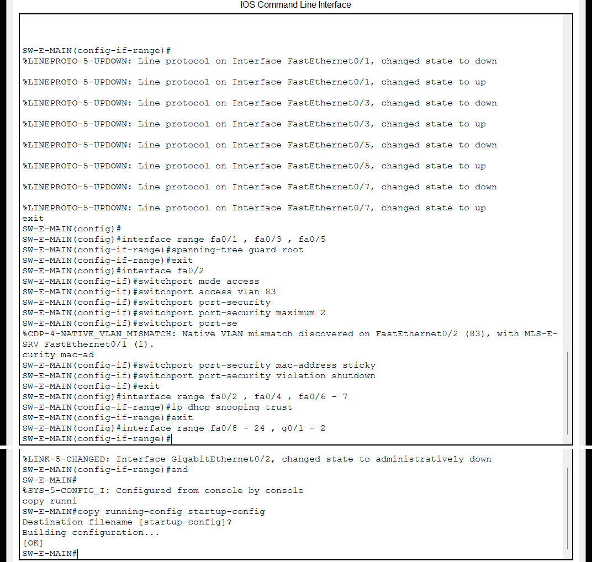

**SW-E-BKP:**
```
configure terminal
vtp domain EILAT
vtp password Osem#Vtp
vtp mode client
spanning-tree vlan 1,80,81,82,83 root secondary
interface range fa0/1 - 4
switchport mode trunk
exit
interface range fa0/5 - 24 , g0/1 - 2
shutdown
end
copy running-config startup-config
```


**SW-E-MGMT:**
```
configure terminal
vtp domain EILAT
vtp password Osem#Vtp
vtp mode client
interface range fa0/3 - 4
switchport mode trunk
exit
interface range fa0/1 - 2
switchport mode access
switchport access vlan 80
spanning-tree portfast
spanning-tree bpduguard enable
switchport port-security
switchport port-security maximum 1
switchport port-security mac-address sticky
switchport port-security violation shutdown
exit
interface range fa0/5 - 24 , g0/1 - 2
shutdown
end
copy running-config startup-config
```
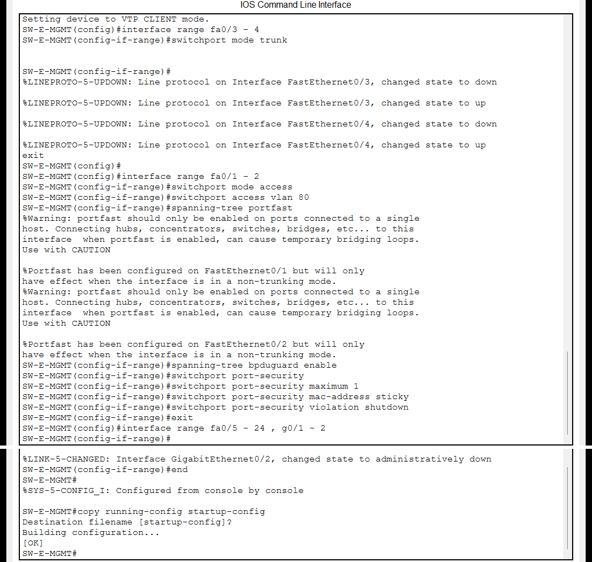

**SW-E-ASM:**
```
configure terminal
vtp domain EILAT
vtp password Osem#Vtp
vtp mode client
interface range fa0/5 - 6
switchport mode trunk
exit
interface range fa0/1 - 4
switchport mode access
switchport access vlan 81
spanning-tree portfast
spanning-tree bpduguard enable
switchport port-security
switchport port-security maximum 1
switchport port-security mac-address sticky
switchport port-security violation shutdown
exit
interface range fa0/7 - 24 , g0/1 - 2
shutdown
end
copy running-config startup-config
```
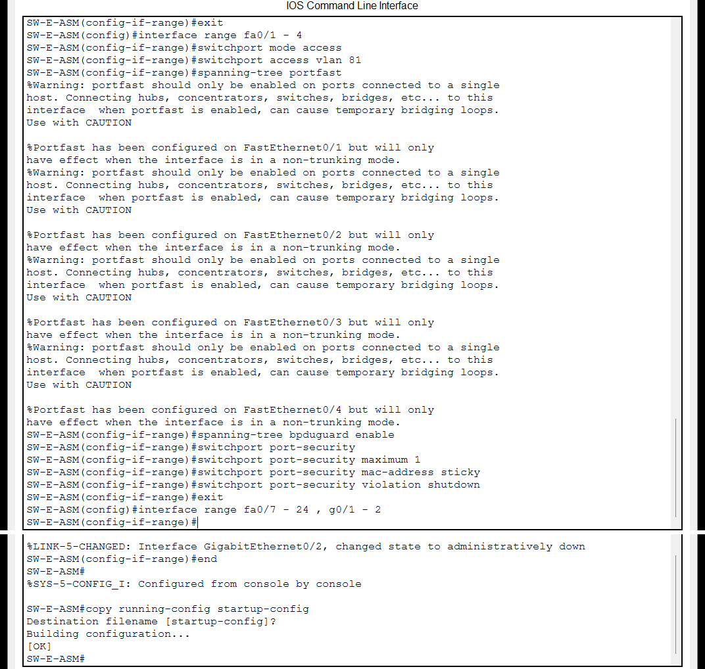

**SW-E-MEET:**
```
configure terminal
vtp domain EILAT
vtp password Osem#Vtp
vtp mode client
interface range fa0/4 - 5
switchport mode trunk
exit
interface range fa0/1 - 3
switchport mode access
switchport access vlan 82
spanning-tree portfast
spanning-tree bpduguard enable
switchport port-security
switchport port-security maximum 1
switchport port-security mac-address sticky
switchport port-security violation shutdown
exit
interface range fa0/6 - 24 , g0/1 - 2
shutdown
end
copy running-config startup-config
```
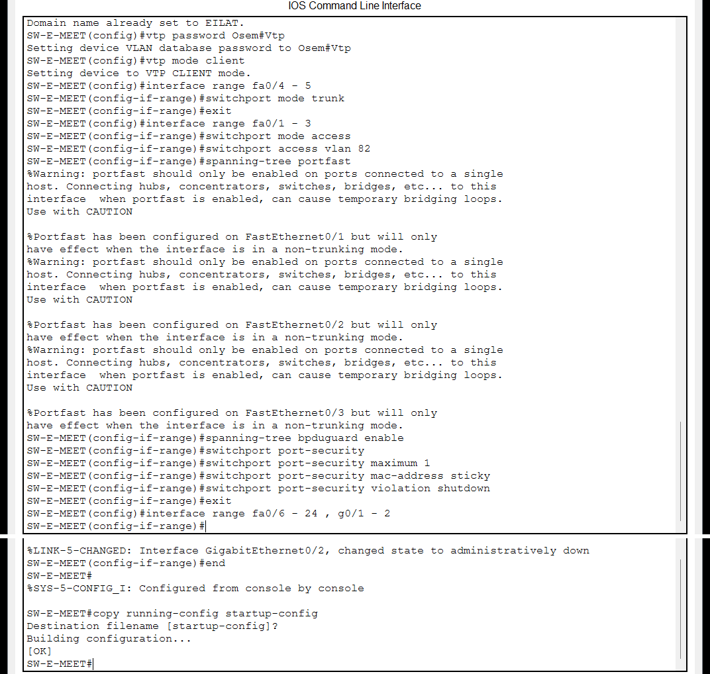

**MLS-E-SRV:**
```
configure terminal
vtp mode transparent
vlan 83
name SERVERS
exit
interface range fa0/1 - 2
switchport mode access
switchport access vlan 83
exit
interface range fa0/3 - 24 , g0/1 - 2
shutdown
exit
interface fa0/2
spanning-tree portfast
spanning-tree bpduguard enable
switchport port-security
switchport port-security maximum 1
switchport port-security mac-address sticky
switchport port-security violation shutdown
end
copy running-config startup-config
```


✅ ב-SW-E-MEET: הפקודות `show vtp status` ו-`show vlan brief`: הרשתות 80–83, ו-Fa0/1–3 ב-VLAN 82.

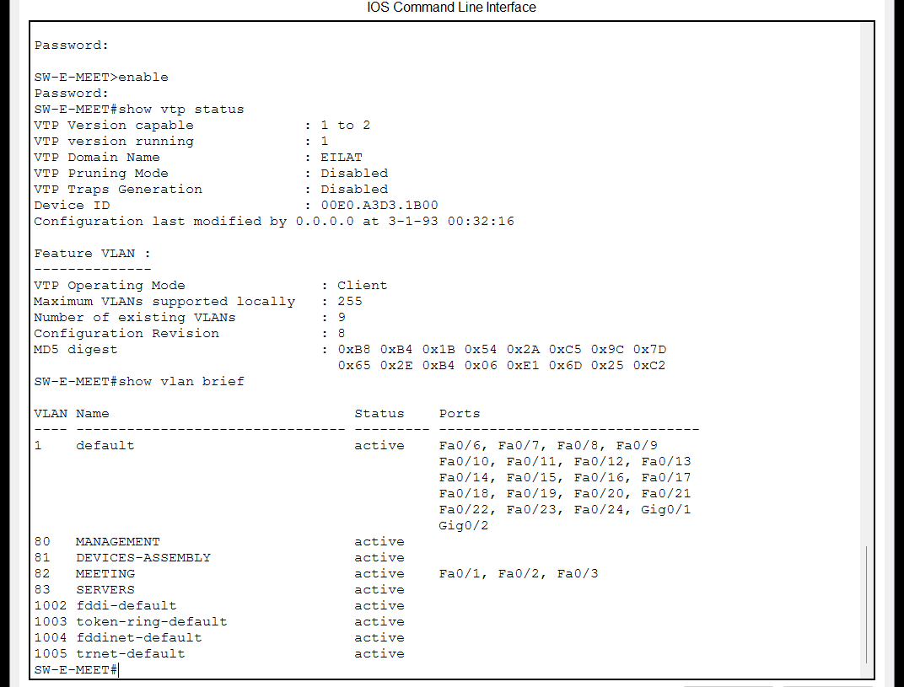

## ‏C8 — אילת: נתבים
**🌐 הרשת עכשיו.** ארבעה VLAN בלי שער.

**❗ הבעיה.** כמו ב-C4.

**💡 הפתרון.** ממשקי משנה 80–83, HSRP, ו-helper ‏192.168.83.1.

**📋 מבצעים בפרויקט.** כותבים את R-E-MAIN מהזיכרון ובודקים.

### 🖱 הפתרון: על מה לוחצים ומה כותבים
**R-E-MAIN:**
```
configure terminal
interface g0/0
no shutdown
exit
interface g0/0.80
encapsulation dot1Q 80
ip address 192.168.80.254 255.255.255.0
standby 80 ip 192.168.80.252
standby 80 priority 110
standby 80 preempt
ip helper-address 192.168.83.1
exit
interface g0/0.81
encapsulation dot1Q 81
ip address 192.168.81.254 255.255.255.0
standby 81 ip 192.168.81.252
standby 81 priority 110
standby 81 preempt
ip helper-address 192.168.83.1
exit
interface g0/0.82
encapsulation dot1Q 82
ip address 192.168.82.254 255.255.255.0
standby 82 ip 192.168.82.252
standby 82 priority 110
standby 82 preempt
ip helper-address 192.168.83.1
exit
interface g0/0.83
encapsulation dot1Q 83
ip address 192.168.83.254 255.255.255.0
standby 83 ip 192.168.83.252
standby 83 priority 110
standby 83 preempt
exit
end
copy running-config startup-config
```
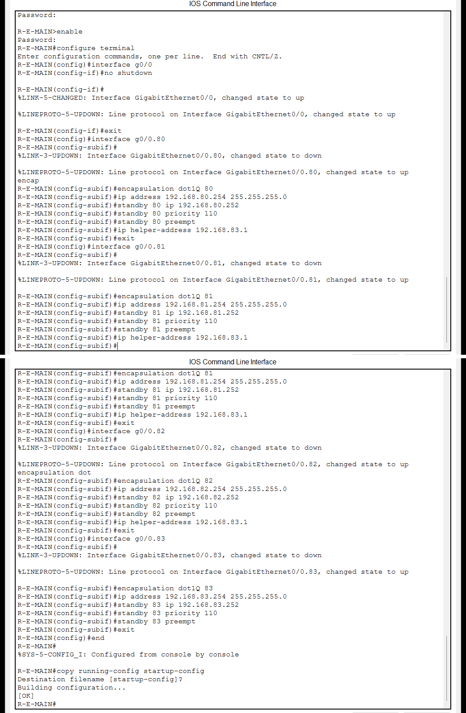

**R-E-BKP:**
```
configure terminal
interface g0/0
no shutdown
exit
interface g0/0.80
encapsulation dot1Q 80
ip address 192.168.80.253 255.255.255.0
standby 80 ip 192.168.80.252
standby 80 priority 105
standby 80 preempt
ip helper-address 192.168.83.1
exit
interface g0/0.81
encapsulation dot1Q 81
ip address 192.168.81.253 255.255.255.0
standby 81 ip 192.168.81.252
standby 81 priority 105
standby 81 preempt
ip helper-address 192.168.83.1
exit
interface g0/0.82
encapsulation dot1Q 82
ip address 192.168.82.253 255.255.255.0
standby 82 ip 192.168.82.252
standby 82 priority 105
standby 82 preempt
ip helper-address 192.168.83.1
exit
interface g0/0.83
encapsulation dot1Q 83
ip address 192.168.83.253 255.255.255.0
standby 83 ip 192.168.83.252
standby 83 priority 105
standby 83 preempt
exit
end
copy running-config startup-config
```
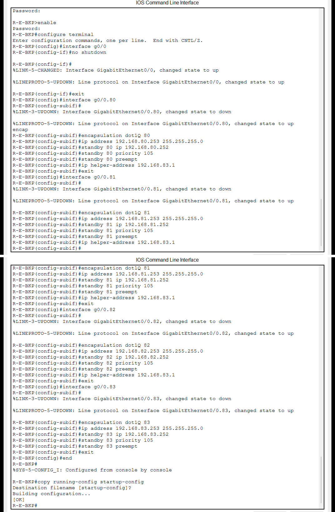

✅ אחרי 20 שניות, `show standby brief` ב-R-E-MAIN: מצב **Active** בארבע קבוצות.

‏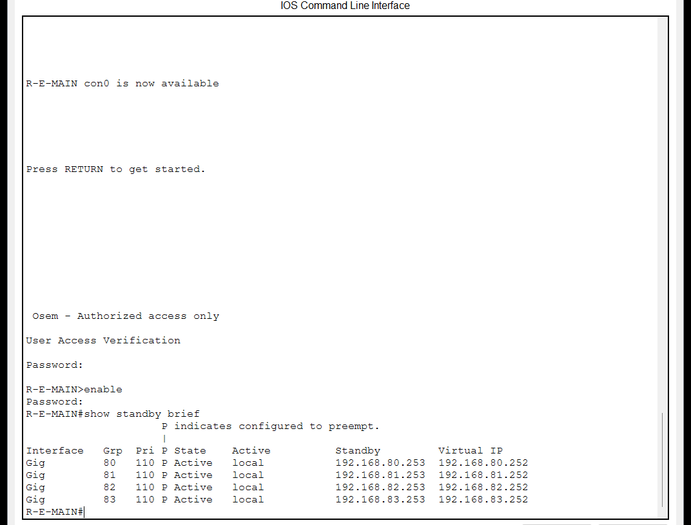

## ‏C9 — אילת: השרת והמחשבים
**🌐 הרשת עכשיו.** שרת ריק, ומחשבים בלי כתובות.

**❗ הבעיה.** כמו ב-C5.

**💡 הפתרון.** אותם שירותים, עם הערכים של אילת.

**📋 מבצעים בפרויקט.** ממלאים את הטפסים.

### 🖱 הפתרון: על מה לוחצים ומה כותבים
**SRV-EILAT** ‏←‏ **Desktop** ‏←‏ **IP Configuration** ‏←‏ Static:

<div dir="rtl">

| ‎Address | ‎Mask | ‎Gateway | ‎DNS |
|---|---|---|---|
| ‎192.168.83.1 | ‎255.255.255.0 | ‎192.168.83.252 | ‎192.168.83.1 |

</div>

‏**Services** ‏←‏ **DHCP**: לכל שורה ממלאים ולוחצים **Add**. בסוף **Service: On** ‏←‏ **Save**.

<div dir="rtl">

| ‎Pool Name | ‎Default Gateway | ‎DNS Server | ‎Start IP | ‎Mask | ‎Max users |
|---|---|---|---|---|---|
| ‎MANAGEMENT | ‎192.168.80.252 | ‎192.168.83.1 | ‎192.168.80.20 | ‎255.255.255.0 | ‎50 |
| ‎DEVICES-ASSEMBLY | ‎192.168.81.252 | ‎192.168.83.1 | ‎192.168.81.20 | ‎255.255.255.0 | ‎50 |
| ‎MEETING | ‎192.168.82.252 | ‎192.168.83.1 | ‎192.168.82.20 | ‎255.255.255.0 | ‎50 |

</div>

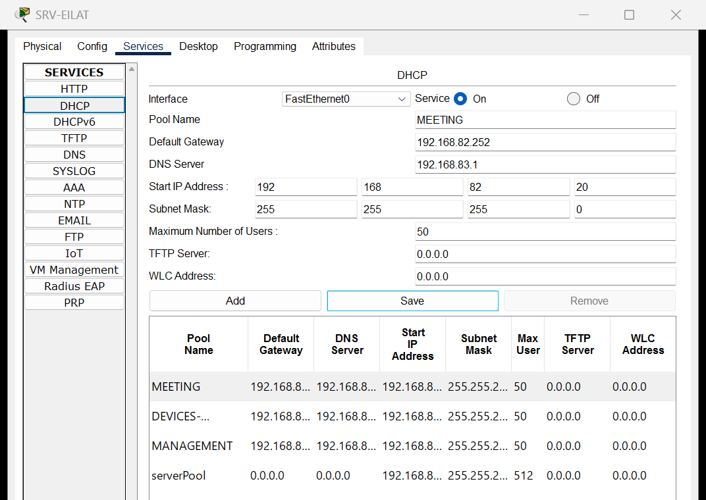

‏**DNS** ‏←‏ On ‏←‏ Name `www.osem.com`, Address ‎`192.168.83.1` ‏←‏ **Add**.

‏**FTP** ‏←‏ Username `eilat`, Password `Osem#Ftp`, כל חמש ההרשאות ‏←‏ **Add**.

‏**EMAIL** ‏←‏ Domain `osem.com` ‏←‏ **Set**. משתמשים `eilat1` ו-`eilat2`, סיסמה `Osem#Mail` ‏←‏ **+**.

אחר כך **כל מחשב** באילת: Desktop ‏←‏ IP Configuration ‏←‏ **DHCP**.

✅ מ-PC-E-MEET-1: כתובת 192.168.82.x, שער .252, והפקודה `ping 192.168.83.1` מצליחה.

‏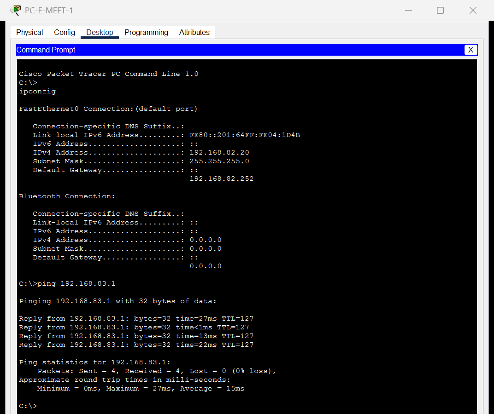

➡ שומרים הכול, ועושים את **[שיעור 4](../lesson-04/)**.

---

<a id="part-d"></a>

# חלק D — חומת האש, והשרתים של אשדוד ואילת

*אחרי שיעור 4, לפני שיעור 5.*

## ‏D1 — המעבדה וחומת האש
**🌐 הרשת עכשיו.** שלושה סניפים באינטרנט.

**❗ הבעיה.** שיעור 5 בונה מעבדת בדיקות מאחורי חומת אש. אין חומת אש ואין מעבדה.

**💡 הפתרון.** מכשיר **ASA 5505** ושני מחשבים. בלי הגדרות: שיעור 5 עושה אותן.

**📋 מבצעים בפרויקט.** מציבים, נותנים שמות ומחברים.

### 🖱 הפתרון: על מה לוחצים ומה כותבים
‏**Network Devices** (1) ‏←‏ **Security** (2) ‏←‏ **5505** (3), בשם `ASA-S`. ושני מחשבים: `PC-LAB-1`, `PC-LAB-2`.

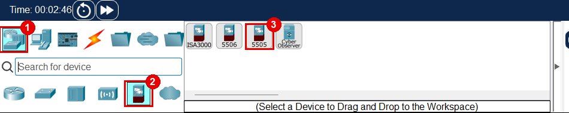

<div dir="rtl">

| ‎# | כבל | מכשיר ראשון | פורט | מכשיר שני | פורט |
|---|---|---|---|---|---|
| ‎1 | ‎Straight-Through | ‎ASA-S | ‎E0/0 | ‎SW-S-MGMT | ‎Fa0/1 |
| ‎2 | ‎Straight-Through | ‎ASA-S | ‎E0/1 | ‎PC-LAB-1 | ‎Fa0 |
| ‎3 | ‎Straight-Through | ‎ASA-S | ‎E0/2 | ‎PC-LAB-2 | ‎Fa0 |

</div>

רושמים במתג מה מחובר לפורט. **SW-S-MGMT**:

```
configure terminal
interface fa0/1
description to ASA-S
end
copy running-config startup-config
```

## ‏D2 — AAA, ‏NTP ו-Syslog בשרתים של אשדוד ואילת
**🌐 הרשת עכשיו.** בשיעור 5, משימה 1, מגדירים את זה בשרת של סכנין.

**❗ הבעיה.** הנתבים של אשדוד ואילת ישאלו את השרתים **שלהם**, ואין מי שיענה.

**💡 הפתרון.** אותם טפסים עם ערכים אחרים. אשדוד = **Radius**, אילת = **Tacacs**.

**📋 מבצעים בפרויקט.** קוראים את שיעור 5, משימה 1 (שם הטפסים עם תמונות), וממלאים בשני השרתים.

### 🖱 הפתרון: על מה לוחצים ומה כותבים
‏**Services** ‏←‏ **AAA** ‏←‏ **On**. לכל שורה ממלאים ולוחצים **Add**:

<div dir="rtl">

| שרת | ‎Client Name | ‎Client IP | ‎Secret | ‎ServerType |
|---|---|---|---|---|
| ‎SRV-ASHDOD | ‎R-A-MAIN | ‎192.168.63.254 | ‎Osem#Aaa | ‎**Radius** |
| ‎SRV-ASHDOD | ‎R-A-BKP | ‎192.168.63.253 | ‎Osem#Aaa | ‎**Radius** |
| ‎SRV-EILAT | ‎R-E-MAIN | ‎192.168.83.254 | ‎Osem#Aaa | ‎**Tacacs** |
| ‎SRV-EILAT | ‎R-E-BKP | ‎192.168.83.253 | ‎Osem#Aaa | ‎**Tacacs** |

</div>

בשני השרתים, למטה: Username `osemuser`, Password `Osem#User` ‏←‏ **Add**.

‏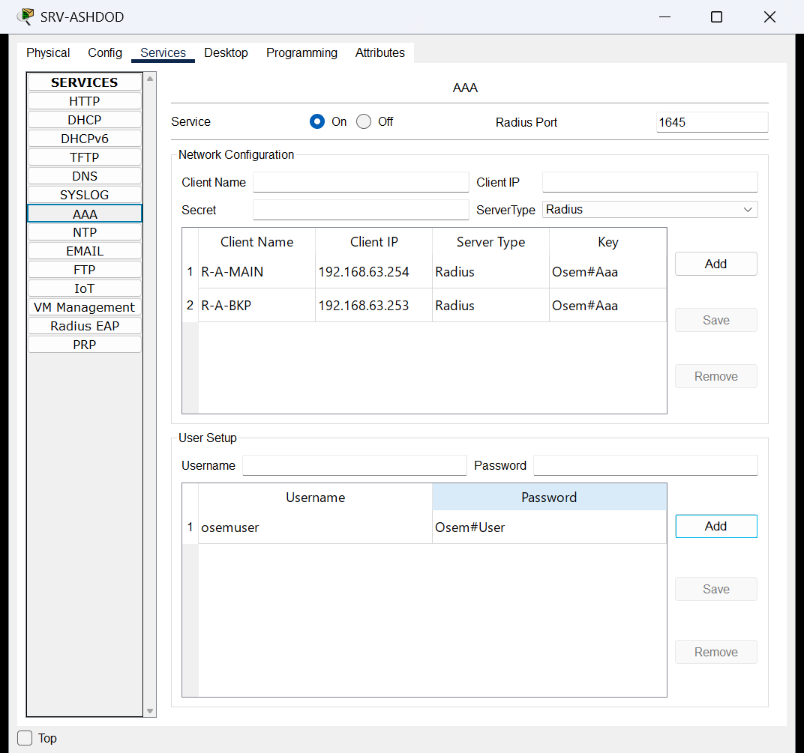

‏**NTP** ‏←‏ Authentication **Enable**, Password `Osem#Ntp`, Key: ‏**2** באשדוד, **3** באילת.

‏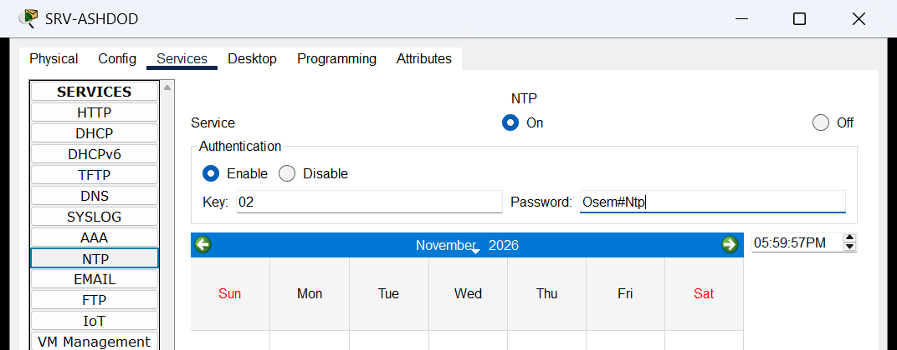

‏**SYSLOG** ‏←‏ בודקים שהוא On.

➡ עכשיו עושים את **[שיעור 5](../lesson-05/)**.

---

<a id="final"></a>

# בדיקה סופית

עושים את הבדיקות לפי הסדר. ה-ping הראשון למקום חדש יכול ללכת לאיבוד (`Request timed out`), וזה רגיל. אם אחת נכשלת, בעמודה האחרונה כתוב איפה לחפש.

<div dir="rtl">

| ‎# | מאיפה | מה כותבים | מה חייבים לראות | ואם לא |
|---|---|---|---|---|
| ‎1 | ‎PC-SAL-1 | ‎`ipconfig /renew` | 192.168.20.x, שער .252 | שיעור 3, משימות 1–4 |
| ‎2 | ‎PC-SAL-1 | `ping` לכתובת של PC-IT-1 | תשובות | שיעור 3, משימות 1–2 |
| ‎3 | ‎PC-SAL-1 | דפדפן: `http://www.osem.com` | ‎Welcome to Osem - Sakhnin branch | שיעור 3, משימה 3 |
| ‎4 | ‎PC-A-MGMT-1 | ‎`ping 192.168.63.1` | תשובות | ‎C3–C5 |
| ‎5 | ‎PC-E-MGMT-1 | ‎`ping 192.168.83.1` | תשובות | ‎C7–C9 |
| ‎6 | ‎PC-SAL-1 | ‎`ping 200.200.0.2` | תשובות | שיעור 4, משימות 1–5 |
| ‎7 | ‎PC-E-MEET-1 | ‎`ping 200.200.0.10` | תשובות (NAT סטטי) | שיעור 4, הבלוק של R-A-EXT |
| ‎8 | ‎PC-E-MEET-1 | ‎`ping 192.168.50.1` | תשובות (VPN, הראשונה יכולה ללכת לאיבוד) | שיעור 5, משימה 3 |
| ‎9 | ‎PC-A-ACC-1 | ‎`ping 192.168.63.1` | **נכשל** (ACL) | שיעור 5, משימה 2 |
| ‎10 | ‎PC-MGMT-1 | ‎`ssh -l osemuser 192.168.10.254` | סיסמה, ואז `R-S-MAIN` | שיעור 5, משימות 1 ו-4 |
| ‎11 | ‎PC-A-MGMT-1 | ‎`ssh -l osemuser 192.168.60.254` | סיסמה, ואז `R-A-MAIN` | ‏D2, ושיעור 5 סעיף 4.3 |
| ‎12 | ‎PC-E-MGMT-1 | ‎`ssh -l osemuser 192.168.80.254` | סיסמה, ואז `R-E-MAIN` | ‏D2, ושיעור 5 סעיף 4.3 |
| ‎13 | ‎PC-LAB-1 | ‎`ping 192.168.50.1` | תשובות, דרך ה-ASA | שיעור 5, משימה 5 |
| ‎14 | ‎PC-MGMT-1 | ‎`ping 192.168.1.10` | **נכשל** (אף אחד מבחוץ לא מגיע למעבדה) | שיעור 5, משימה 5 |

</div>

הסיסמה של `osemuser` היא `Osem#User`. הסיסמאות של הקונסול נמצאות ב[דף הראשי](../README.md).
