# שיעור 01 — המחלקה הראשונה: מכשירים, כבלים, שמות וסיסמאות

<div dir="rtl">

> ⏱ 90 דקות · 🧰 Packet Tracer 9.x · 💾 התוצאה: `lesson01-end.pkt` (בתיקייה הזו)

</div>

## מה יהיה לכם בסוף השיעור
מחלקת **המשכורות** בסניף סכנין של אוסם: 3 מחשבים, מתג מחלקה, וקישור למתג הראשי של הסניף.
לשני המתגים יש שם וסיסמאות, והמחשבים מצליחים לעשות ping זה לזה.

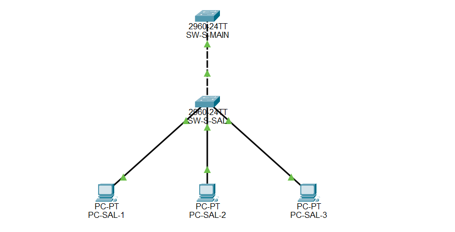

## מהלך השיעור (למורה)

<div dir="rtl">

| דקות | חלק |
|---|---|
| ‎0–20 | חלק 1 — תיאוריה על הלוח |
| ‎20–35 | משימות 1–2 — מציבים מכשירים ונותנים שמות |
| ‎35–50 | משימה 3 — כבלים |
| ‎50–65 | משימה 4 — הגדרת המתגים |
| ‎65–78 | משימות 5–6 — כתובות ובדיקות |
| ‎78–90 | מצאו את הטעות, שאלות, "הפרויקט שלכם" |

</div>

---

## חלק 1 — תיאוריה: קודם מבינים

### 1.1 מה עושה מתג?
מתג מחבר מכשירים ברשת מקומית אחת (LAN). הוא עובד ב**שכבה 2** של מודל OSI, ולכן הוא מחליט לפי
**כתובות MAC** ולא לפי כתובות IP.

1. **לומד:** מסגרת (frame) מגיעה לפורט. המתג רושם "כתובת ה-MAC של השולח נמצאת בפורט הזה".
2. **מעביר:** אם הוא מכיר את ה-MAC של היעד, הוא שולח את המסגרת **רק** לפורט הזה.
3. **מציף (flood):** אם הוא לא מכיר את ה-MAC, או שזו הודעת broadcast, הוא שולח לכל הפורטים
   ב-VLAN, חוץ מהפורט שממנו הגיעה המסגרת.

💬 **במילים פשוטות:** מתג הוא כמו מי שממיין דואר ולומד מי יושב באיזה חדר. את המכתב הראשון הוא מכריז לכולם.
אחרי התשובה, המכתבים מגיעים רק לחדר הנכון.

**דוגמה.** טבלת ה-MAC ריקה. המחשב PC-SAL-1 (פורט Fa0/2) עושה ping ל-PC-SAL-2 (פורט Fa0/3):

<div dir="rtl">

| ‎# | מסגרת | מה המתג לומד | לאן המתג שולח |
|---|---|---|---|
| ‎1 | בקשת ARP, מ-PC-SAL-1 לכולם | PC-SAL-1 נמצא ב-Fa0/2 | **כל** הפורטים חוץ מ-Fa0/2 ‏(flood) |
| ‎2 | תשובת ARP, מ-PC-SAL-2 ל-PC-SAL-1 | PC-SAL-2 נמצא ב-Fa0/3 | רק Fa0/2 |
| ‎3 | ‏ping, מ-PC-SAL-1 ל-PC-SAL-2 | כלום | רק Fa0/3 |

</div>

❓ **שאלו את הכיתה:** האם PC-SAL-3 ראה את מסגרת 1? ואת מסגרת 3?

<details dir="rtl"><summary>תשובה</summary>

את 1 כן, כי זו הודעת broadcast. את 3 לא: המתג כבר יודע איפה PC-SAL-2.

</details>

### 1.2 כתובת MAC, כתובת IP ו-ARP

<div dir="rtl">

| | כתובת MAC | כתובת IP |
|---|---|---|
| שכבה | ‎2 | ‎3 |
| דוגמה | ‎`0007.ec1a.8e6b` | ‎`192.168.20.22` |
| מי קובע | היצרן | אתם, או DHCP |
| למה משמשת | מסירה **בתוך** ה-LAN | מציאת **רשת** היעד |

</div>

המחשב PC-SAL-1 יודע את ה-IP של PC-SAL-2 אבל צריך את ה-MAC שלו. הוא שולח **בקשת ARP בשידור לכולם**:
"למי יש 192.168.20.22?" המחשב PC-SAL-2 עונה עם ה-MAC שלו, ו-PC-SAL-1 שומר אותו בטבלת ה-ARP.

💬 **במילים פשוטות:** כתובת ה-IP היא כמו כתובת מגורים: היא משתנה כשעוברים לרשת אחרת. ה-MAC הוא כמו מספר סידורי
שמוטבע על כרטיס הרשת: הוא נשאר.

### 1.3 מסכת רשת
הכתובת ‎`192.168.20.21` עם המסכה ‎`255.255.255.0` (כלומר ‎`/24`): שלושת המספרים הראשונים הם **הרשת**
(192.168.20), והאחרון הוא **המכשיר**. אותה רשת ‏←‏ מדברים ישירות. רשת אחרת ‏←‏ צריך נתב, שנוסיף
בשיעור מאוחר יותר.

**דוגמה — אותה רשת או לא?** (מסכה 255.255.255.0)

<div dir="rtl">

| מכשיר ראשון | מכשיר שני | אותה רשת? | מה קורה |
|---|---|---|---|
| ‎192.168.20.21 | ‎192.168.20.23 | כן, 192.168.20 | מדברים ישירות |
| ‎192.168.20.21 | ‎192.168.30.23 | לא, 20 מול 30 | צריך נתב |
| ‎192.168.20.21 | ‎192.168.20.254 | כן | ישירות (‎.254 יהיה הנתב שלנו) |

</div>

❓ **שאלו את הכיתה:** כמה מכשירים נכנסים ברשת ‎/24?

<details dir="rtl"><summary>תשובה</summary>

‏**254**: יש 256 מספרים, אבל ‎.0 הוא שם הרשת ו-‎.255 הוא כתובת ה-broadcast שלה.

</details>

### 1.4 איזה כבל?

<div dir="rtl">

| בין | כבל | למה |
|---|---|---|
| מחשב ↔ מתג | Copper **Straight-Through** (קו רציף) | סוגים שונים: פיני השידור של צד אחד כבר מול פיני הקליטה של הצד השני |
| מתג ↔ מתג | Copper **Cross-Over** (קו מקווקו) | אותו סוג: צריך להצליב שידור וקליטה |

</div>

מתגים חדשים יודעים לתקן כבל לא נכון לבד (Auto-MDIX), אבל בבחינה צריך להסביר את הבחירה הנכונה.

### 1.5 למה הנקודות כתומות בהתחלה?
כשפורט עולה, פרוטוקול **Spanning Tree ‏(STP)** בודק שהוא לא יוצר לולאה. זה לוקח כ-30 שניות:
15 שניות listening ועוד 15 שניות learning. כתום = בבדיקה, ירוק = מעביר תעבורה.

### 1.6 שני סוגי סיסמאות

<div dir="rtl">

| פקודה | על מה היא מגינה | איך היא נשמרת |
|---|---|---|
| ‎`line console 0` + `password` + `login` | התחברות בכבל קונסול | סוג 7 אחרי `service password-encryption` (חלש) |
| ‎`enable secret` | כניסה למצב ‎`#`‎ | סוג 5, hash (אי אפשר פשוט להפוך אותו בחזרה) |

</div>

---

## משימה 1 — מציבים את המתגים ונותנים שמות
**🌐 הרשת עכשיו.** משטח עבודה ריק. במשימה הזו מופיעים שני מכשירים: המתג הראשי של הסניף והמתג של מחלקת השכר.

**❗ הבעיה.** עובדים במחלקה אחת רוצים לשתף קבצים ומדפסת, אבל למחשב יש רק פורט רשת **אחד**. שני מחשבים אפשר לחבר בכבל, שלושה כבר לא. ומכשיר בשם `Switch0` לא מספר לאף אחד מה הוא עושה: דמיינו 30 כאלה.

**💡 הפתרון.** ל**מתג** יש 24 פורטים והוא מעביר כל מסגרת לפורט הנכון (תיאוריה 1.1). כלל שמות, ‎`סוג-סניף-תפקיד`‎, מספר מיהו כל מכשיר.

**📋 מבצעים בפרויקט.** מציבים שני מתגי 2960, אחד מעל השני. שם העליון `SW-S-MAIN` ושם התחתון `SW-S-SAL`. נסו לבד, ואז בדקו עם השלבים שלמטה.

### 🖱 הפתרון: על מה לוחצים ומה כותבים
1. למטה משמאל: **Network Devices** (1), אחר כך **Switches** (2), ואז **2960** (3).

   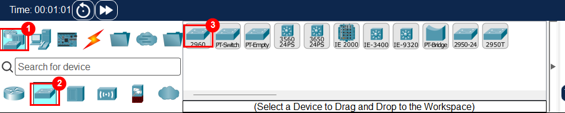
2. לוחצים על מקום ריק במשטח העבודה. המתג מופיע בשם `Switch0`.

   
3. לוחצים על המתג, לשונית **Config** (1), שדה **Display Name** (2). מוחקים `Switch0` ומקלידים `SW-S-MAIN`.

   
4. סוגרים את החלון. מציבים מתג 2960 שני מתחתיו ונותנים לו את השם `SW-S-SAL`.

🧠 **למה השמות האלה?** `SW` = מתג, `S` = סכנין, `MAIN` או `SAL` = התפקיד. מי שקורא את השם יודע מה
המכשיר ואיפה הוא.

## משימה 2 — מציבים את המחשבים ונותנים שמות
**🌐 הרשת עכשיו.** שני מתגים עם שמות, ועדיין אף אחד לא משתמש בהם.

**❗ הבעיה.** רשת בלי משתמשים לא עושה כלום. ואם כל המחשבים נקראים `PC0`, `PC1`..., בשיעור 2 לא תדעו לאיזו מחלקה שייך כל מחשב.

**💡 הפתרון.** שלושה מחשבים, עם שם לפי מחלקה ומספר. `PC-SAL-2` הוא המחשב השני של מחלקת השכר.

**📋 מבצעים בפרויקט.** מציבים שלושה מחשבים מתחת ל-SW-S-SAL ונותנים שמות משמאל לימין: `PC-SAL-1`, `PC-SAL-2`, `PC-SAL-3`.

### 🖱 הפתרון: על מה לוחצים ומה כותבים
1. לוחצים **End Devices** (1), אחר כך **PC** (2), ואז לוחצים מתחת למתג. חוזרים עד שיש 3 מחשבים.

   

   
2. בכל מחשב: לוחצים עליו, לשונית **Config**, שדה **Display Name**. משמאל לימין: `PC-SAL-1`, `PC-SAL-2`, `PC-SAL-3`.

## משימה 3 — כבלים
**🌐 הרשת עכשיו.** חמישה מכשירים בלי שום חיבור ביניהם. בסוף המשימה זה נראה כך (המספרים הם המכשירים שמחברים):


**❗ הבעיה.** בלי כבל לא עובר אות. עם כבל **לא נכון** או **פורט לא נכון** הציור נראה בסדר, אבל ההגדרות של השיעורים הבאים (VLAN בפורט Fa0/2, ‏Trunk בפורט Fa0/4) ייפלו על המכשיר הלא נכון.

**💡 הפתרון.** כבל מוצלב בין מתגים, כבל ישר למחשבים (תיאוריה 1.4), ו**טבלת פורטים** שכולם עובדים לפיה.

**📋 מבצעים בפרויקט.** מבצעים את ארבעת החיבורים שבטבלה. לפני כל חיבור אומרים בקול איזה כבל ולמה.

### 🖱 הפתרון: על מה לוחצים ומה כותבים


בכל שורה: **Connections** (1), בוחרים כבל, לוחצים על המכשיר הראשון ובוחרים פורט, ואז לוחצים על
המכשיר השני ובוחרים פורט.

<div dir="rtl">

| ‎# | כבל | מ- | פורט | אל | פורט |
|---|---|---|---|---|---|
| ‎1 | ‎Cross-Over (2) | ‎SW-S-MAIN | ‎FastEthernet0/3 | ‎SW-S-SAL | ‎FastEthernet0/4 |
| ‎2 | ‎Straight-Through (3) | ‎PC-SAL-1 | ‎FastEthernet0 | ‎SW-S-SAL | ‎FastEthernet0/2 |
| ‎3 | ‎Straight-Through (3) | ‎PC-SAL-2 | ‎FastEthernet0 | ‎SW-S-SAL | ‎FastEthernet0/3 |
| ‎4 | ‎Straight-Through (3) | ‎PC-SAL-3 | ‎FastEthernet0 | ‎SW-S-SAL | ‎FastEthernet0/5 |

</div>

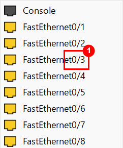

💡 פורטים שכבר בשימוש **נעלמים** מהרשימה. כאן Fa0/2 ו-Fa0/3 תפוסים:

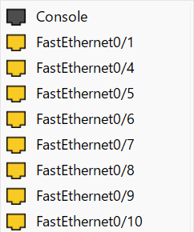

✅ מיד אחרי החיבור, הנקודה בצד המתג כתומה (STP). אחרי כ-30 שניות הכול ירוק:


## משימה 4 — מגדירים את המתגים
**🌐 הרשת עכשיו.** הכול מחובר וירוק. מגדירים שני מכשירים:

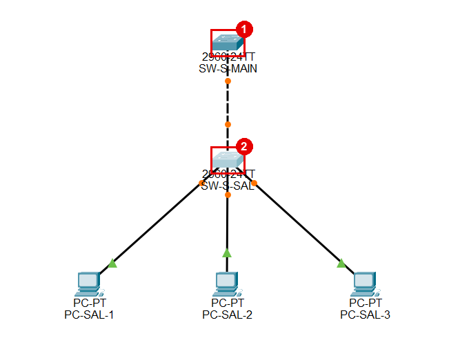

**❗ הבעיה.** למתג חדש **אין שום סיסמה**. לוחצים על SW-S-SAL ‏←‏ **CLI** ‏←‏ Enter ‏←‏ כותבים `enable`:

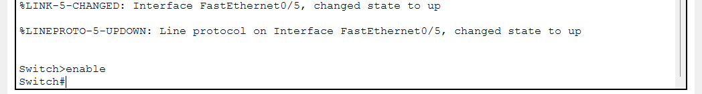

שורת הפקודה הפכה ל-‎`#`‎: מי שמגיע למתג יכול למחוק הכול. וגם השם שלו עדיין `Switch`.

**💡 הפתרון.** שלושה דברים: שם (`hostname`), שתי סיסמאות (קונסול ו-`enable secret`, תיאוריה 1.6) ואזהרה (`banner`). ואז שומרים, אחרת הכול נמחק כשהחשמל נופל.

**📋 מבצעים בפרויקט.** בשני המתגים: שם, בלי חיפוש DNS, ‏enable secret `Osem#En1`, הצפנת הסיסמאות, באנר, סיסמת קונסול `Osem#Con` עם login, ושמירה.

### 🖱 הפתרון: על מה לוחצים ומה כותבים
לוחצים על **SW-S-MAIN**, לשונית **CLI**, ולוחצים **Enter** עד שמופיע `Switch>`‎. מקלידים שורה אחר שורה:

```
enable
configure terminal
hostname SW-S-MAIN
no ip domain-lookup
enable secret Osem#En1
service password-encryption
banner motd # Osem - Authorized access only #
line console 0
password Osem#Con
login
logging synchronous
exec-timeout 10 0
end
copy running-config startup-config
```
כשמופיע `Destination filename [startup-config]?`‎ לוחצים **Enter**. חייב להופיע ‎`[OK]`‎.

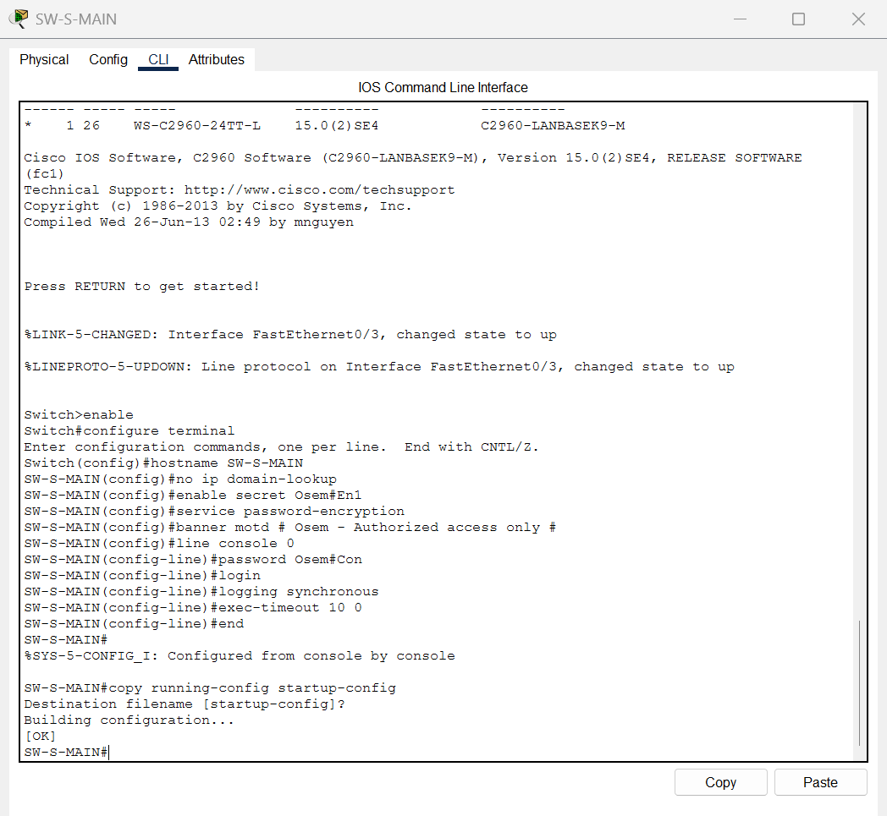

<div dir="rtl">

| פקודה | מה היא עושה | למה |
|---|---|---|
| ‎`enable` | מעבר מ-‎`>`‎ ל-‎`#`‎ | ב-‎`>`‎ רק מסתכלים, ב-‎`#`‎ מנהלים |
| ‎`configure terminal` | כניסה למצב הגדרות | רק כאן משנים הגדרות |
| ‎`hostname` | השם שמופיע בשורת הפקודה | התווית על המסך (משימה 1) לא משנה אותו |
| ‎`no ip domain-lookup` | טעות הקלדה לא נשלחת לחיפוש ב-DNS | חוסך המתנה ארוכה אחרי כל טעות |
| ‎`enable secret` | סיסמה ל-‎`#`‎ | נשמרת כ-hash |
| ‎`service password-encryption` | מסתיר את שאר הסיסמאות | אחרת `show run` מציג אותן כטקסט רגיל |
| ‎`banner motd` | הודעה לפני ההתחברות | אזהרה משפטית למי שלא מורשה |
| ‎`line console 0` | כניסה להגדרות פורט הקונסול | כאן מגדירים את הסיסמה |
| ‎`password` + `login` | קובע סיסמה **ומבקש אותה** | בלי `login` אף אחד לא נשאל |
| ‎`logging synchronous` | הודעות לא שוברות את השורה שאתם מקלידים | נוחות |
| ‎`exec-timeout 10 0` | ניתוק אחרי 10 דקות בלי פעילות | מסך פתוח שנשכח הוא פרצת אבטחה. 10 דקות הן ברירת המחדל, ולכן `show running-config` לא מציג את השורה |
| ‎`copy running-config startup-config` | שמירה ב-NVRAM | ה-running-config נמחק כשהחשמל נופל |

</div>

חוזרים על אותן פקודות ב-**SW-S-SAL** עם `hostname SW-S-SAL`.

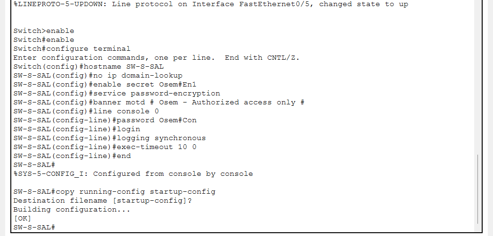

✅ הפקודה `show running-config` מציגה `enable secret 5 $1$...`‎ ולא את הסיסמה עצמה:


✅ ב-SW-S-SAL, הפקודה `show interfaces status` מראה ש-Fa0/2 עד Fa0/5 במצב `connected` (ב-‎`--More--`‎ לוחצים רווח):


## משימה 5 — כתובות למחשבים
**🌐 הרשת עכשיו.** המתגים מוכנים. למחשבים יש כבלים אבל אין כתובות:

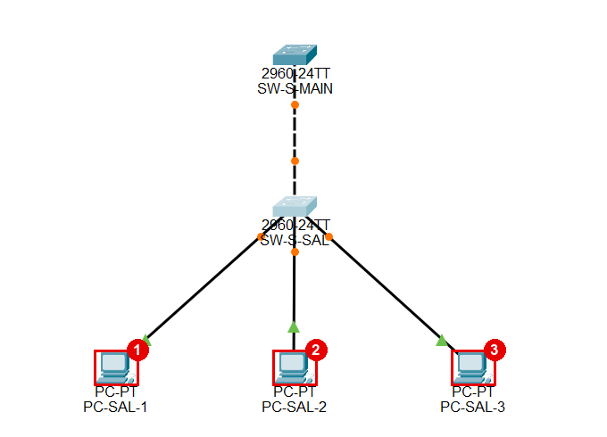

**❗ הבעיה.** מחשב בלי כתובת IP לא יכול לשלוח ping, ואף אחד לא יכול לבקש אותו. שני מחשבים עם **אותה** כתובת זה גרוע באותה מידה.

**💡 הפתרון.** תוכנית: כל המחלקה ברשת 192.168.20.0/24, ולכל מחשב מספר אחרון שונה (תיאוריה 1.3).

**📋 מבצעים בפרויקט.** נותנים לשלושת המחשבים את הכתובות שבטבלה, מסכה 255.255.255.0, בלי שער.

### 🖱 הפתרון: על מה לוחצים ומה כותבים
לוחצים על PC-SAL-1, לשונית **Desktop** (1), ואז **IP Configuration** (2):

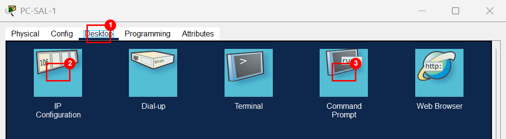

בוחרים **Static** (1), ממלאים IPv4 Address ‏(2), ולוחצים על Subnet Mask ‏(3), שמתמלא לבד. את ה-Gateway
משאירים ריק: עדיין אין נתב.


<div dir="rtl">

| מחשב | ‎IPv4 Address | ‎Subnet Mask |
|---|---|---|
| ‎PC-SAL-1 | ‎192.168.20.21 | ‎255.255.255.0 |
| ‎PC-SAL-2 | ‎192.168.20.22 | ‎255.255.255.0 |
| ‎PC-SAL-3 | ‎192.168.20.23 | ‎255.255.255.0 |

</div>

עושים אותו דבר ב-PC-SAL-2 וב-PC-SAL-3. בסוף הם נראים כך:


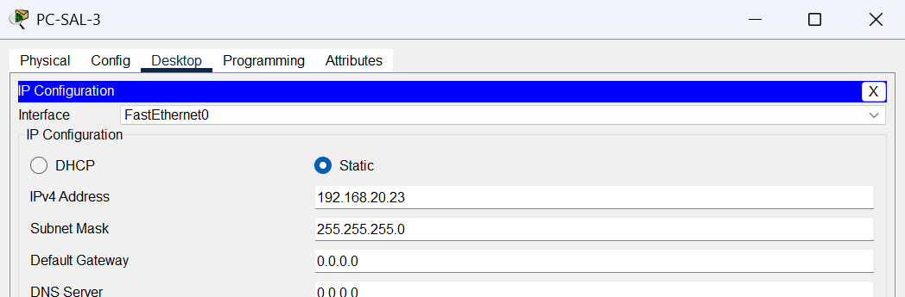

## משימה 6 — בדיקות
**🌐 הרשת עכשיו.** שלמה: שמות, כבלים, סיסמאות וכתובות.

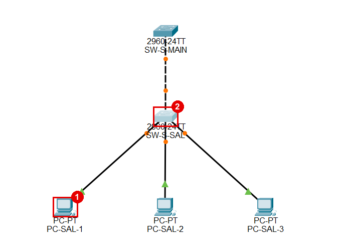

**❗ הבעיה.** "הכול ירוק" לא מוכיח שזה עובד. ירוק אומר רק שהכבל תקין. הכתובת, המסכה או הסיסמה עדיין יכולות להיות שגויות.

**💡 הפתרון.** בודקים כל שכבה: `ping` (כתובת IP), `arp -a` (מ-IP ל-MAC), `show mac address-table` (מה המתג למד), ובדיקת כניסה (הסיסמאות).

**📋 מבצעים בפרויקט.** מוכיחים ארבעה דברים: PC-SAL-1 מגיע לשני האחרים, מוצאים את ה-MAC של PC-SAL-2 במתג, הקונסול מבקש סיסמה, והקובץ שמור.

### 🖱 הפתרון: על מה לוחצים ומה כותבים
1. במחשב PC-SAL-1: לשונית **Desktop**, ואז **Command Prompt** (3 בתמונת שולחן העבודה):
   ```
   ping 192.168.20.22
   ping 192.168.20.23
   arp -a
   ```
   

   ‏`Lost = 0` פירושו הצלחה. הפקודה `arp -a` מציגה את כתובות ה-MAC שהמחשב למד.
2. ב-SW-S-SAL: `show mac address-table`

   

   השוו ל-`arp -a`: הכתובת ‎`0007.ec1a.8e6b` (PC-SAL-2) נמצאת ב-Fa0/3. ה-MAC ב-Fa0/4 שייך לפורט של
   SW-S-MAIN. **אצלכם כתובות ה-MAC יהיו שונות.**
3. ב-SW-S-SAL מקלידים `exit`, לוחצים **Enter** ומתחברים שוב. צריכים להופיע הבאנר, בקשה לסיסמת הקונסול,
   ואחרי `enable` בקשה שנייה. בזמן הקלדת סיסמה לא רואים כלום על המסך.

   
4. שומרים: **File**, אחר כך **Save As**, בשם `lesson01.pkt`.

   

## 👀 רואים את זה קורה — ה-ping, צעד אחר צעד
עד עכשיו הכול היה בלתי נראה. מצב **Simulation** עוצר את הזמן, ורואים כל חבילה.

**איך משתמשים (אותו דבר בכל שיעור):**

‏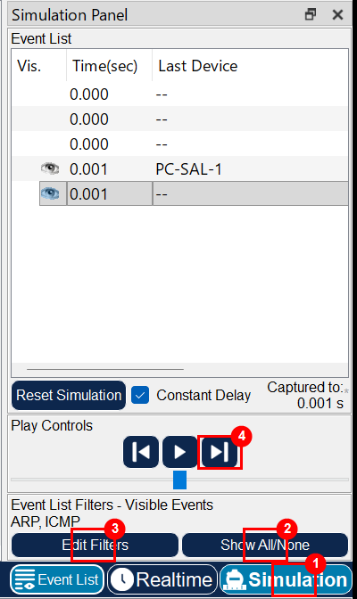

1. למטה מימין: **Simulation** (1). הזמן נעצר.
2. לוחצים **Show All/None** (2) עד שכתוב *None*. אחר כך **Edit Filters** (3) ‏←‏ מסמנים רק מה שצריך.
3. עושים את הפעולה (למשל ping) וסוגרים את חלון המחשב.
4. לוחצים על כפתור **הצעד הבא** (4), לחיצה אחת בכל פעם.
5. לוחצים על **מעטפה**, או על הריבוע הצבעוני בעמודה **Type**, כדי לפתוח את החבילה.
   המשמעות: *In Layers* = איך היא נכנסה, *Out Layers* = איך היא יוצאת. **Next Layer** מסביר כל החלטה.
6. **סיימתם? לוחצים Realtime.** אחרת שום דבר ברשת לא זז.

💡 נפתח חלון *Buffer Full*? לוחצים **View Previous Events**. לא רואים את העמודה Type? גוררים את הקצה השמאלי של החלונית.

**ועכשיו ברשת שלנו.** מסננים: **ARP** ו-**ICMP** (לשונית IPv4). במחשב PC-SAL-1 ‏←‏ Command Prompt:
```
arp -d
ping 192.168.20.22
```
הפקודה `arp -d` מוחקת את מה שהמחשב למד, ולכן הוא חייב לשאול שוב.

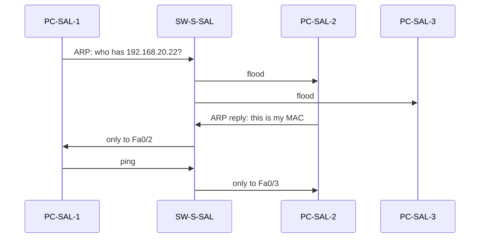

**מסגרת 1: השאלה הולכת לכולם.** ❓ נחשו לפני שלוחצים: כמה מעטפות יהיו?

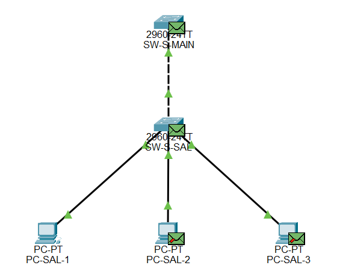

המעטפה נמצאת ב-PC-SAL-2, ב-PC-SAL-3 **וגם** ב-SW-S-MAIN. זו **הצפה** (flood).

**מסגרת 3: ה-ping הולך לפורט אחד.** פותחים את ה-ping במתג SW-S-SAL:

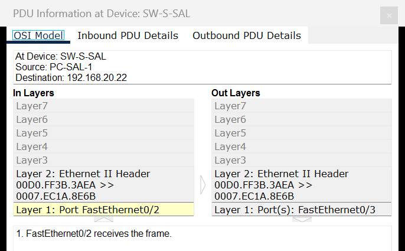

<div dir="rtl">

| מסתכלים על | מה זה מוכיח |
|---|---|
| שכבות 3 עד 7 אפורות | המתג בכלל לא מסתכל על ה-IP |
| כתובות ה-MAC זהות בשני הצדדים | מתג לא משנה את המסגרת |
| נכנס ב-Fa0/2, יוצא **רק** ב-Fa0/3 | הוא למד, אין יותר הצפה |

</div>

לשונית **Inbound PDU Details**: החבילה כולה. מצאו את שתי כתובות ה-MAC ואת שתי כתובות ה-IP, והשוו ל-`arp -a`:


✏️ **נסו:** שוב ping, **בלי** `arp -d`. יש ARP? למה?

<details dir="rtl"><summary>תשובה</summary>

לא. המחשב שמר את ה-MAC בטבלת ה-ARP שלו, ולכן ה-ping יוצא מיד.

</details>

## 🧯 לא עובד?

<div dir="rtl">

| מה רואים | כנראה | מה עושים |
|---|---|---|
| נקודה כתומה יותר מדקה | STP עדיין בודק, או שהסימולציה עצורה | מחכים, בודקים שלמטה מימין מסומן Realtime |
| משולשים אדומים | פורט לא נכון או פורט כבוי | עומדים על הכבל ומשווים לטבלת הפורטים |
| ‎`Request timed out` | כתובת או מסכה שגויה | `ipconfig` בשני המחשבים |
| ‎`% Invalid input detected at '^'`‎ | טעות הקלדה או מצב לא נכון | מסתכלים מתחת ל-‎`^`‎ ובודקים את הסימן: ‎`>`‎, ‎`#`‎ או ‎`(config)#`‎ |
| ה-CLI לא מראה כלום | הקונסול מחכה | לוחצים בתוך החלון ואז Enter |
| הסיסמה נדחית | אותיות גדולות/קטנות, או מקלדת בעברית | Alt+Shift, ‏`Osem#Con` ואחר כך `Osem#En1` |

</div>

---

## 🔎 מצאו את הטעות — מפרויקט אמיתי
בפרויקט המקורי שעליו מבוסס השיעור מצאנו את הדברים הבאים. שאלו את הכיתה **מה לא בסדר ואיך מתקנים**
לפני שפותחים את התשובה.

1. רוב המתגים והנתבים נשארו בשם `Switch` ו-`Router`, ונתב אחד נקרא ‎`123`.
2. הבאנר קיבל את פני המשתמשים בשם של **חברה אחרת**.

<details dir="rtl"><summary>תשובה</summary>

1. בזמן תקלה אי אפשר לדעת באיזה מכשיר נמצאים. התיקון: `hostname` **וגם** Display Name בכל מכשיר.
2. טקסט שנשאר מפרויקט אחר. התיקון: באנר חדש. הבוחן שם לב לזה, וזה נראה כמו העתקה.

</details>

## 🏋 תרגילים
1. שנו את כתובת ה-IP של PC-SAL-3 ל-‎`192.168.30.23` (אותה מסכה). מ-PC-SAL-1 הקלידו `ping 192.168.30.23`. האם זה עובד? למה, אף שהכבל והמתג לא השתנו? החזירו את ‎`192.168.20.23`.
2. נתקו את PC-SAL-2 ועשו אליו ping. איזו הודעה מתקבלת?
3. הסירו את `login` מהקונסול של SW-S-SAL, הקלידו `exit` והיכנסו שוב. מה השתנה? החזירו למצב הקודם.

<details dir="rtl"><summary>תשובות (בדקנו אותן)</summary>

1. ‏**Request timed out.** המחשבים נמצאים עכשיו ברשתות שונות (20 ו-30). בלי שער, ל-PC-SAL-1 אין דרך לרשת אחרת. הכבל והמתג לא מכירים IP.
2. ‏**Request timed out**: המחשב PC-SAL-2 לא עונה.
3. אחרי Enter מופיעים הבאנר ו-`SW-S-SAL>`‎ **בלי סיסמה**. הפקודה `password` לבד לא מספיקה: `login` הוא זה שמבקש אותה.

</details>

## 🎓 מסבירים לבוחן
- איך מתג יודע לאן לשלוח מסגרת?
- למה צריך ARP אם כבר יודעים את ה-IP?
- מה ההבדל בין `enable secret` לבין סיסמת הקונסול?
- למה כבל מוצלב בין מתגים וכבל ישר למחשב?
- מה ההבדל בין running-config ל-startup-config?

<details dir="rtl"><summary>תשובות לדוגמה</summary>

1. הוא לומד את ה-MAC של השולח מכל מסגרת לתוך טבלת ה-MAC, ומחפש בה את ה-MAC של היעד. לא מוכר או broadcast — הוא מציף.
2. ה-IP מוצא את היעד, אבל בתוך ה-LAN מסגרת נמסרת לפי MAC. ‏ARP מתרגם IP ל-MAC.
3. סיסמת הקונסול מאפשרת להתחבר עם הכבל (מגיעים ל-‎`>`‎). ‏`enable secret` מאפשר לנהל (‎`#`‎) ונשמר כ-hash.
4. בין מכשירים מאותו סוג צריך להצליב שידור וקליטה. מחשב ומתג כבר הפוכים זה לזה.
5. ‏running-config נמצא ב-RAM ועובד עכשיו. ‏startup-config נמצא ב-NVRAM ונטען בהדלקה. ‏`copy running-config startup-config` שומר.

</details>

## ✏️ מבחן יציאה (3 דקות)
1. באיזו שכבה במודל OSI עובד מתג 2960?
2. איזו פקודה שומרת את ההגדרות?
3. האם ‎`192.168.10.5/24` באותה רשת כמו ‎`192.168.20.5/24`?
4. מה המתג עושה עם הודעת broadcast?
5. מה חסר: `line console 0`, ‏`password 1234`, ‏`end`?

<details dir="rtl"><summary>תשובות</summary>

1. שכבה 2.
2. ‏`copy running-config startup-config`.
3. לא.
4. שולח לכל הפורטים של ה-VLAN חוץ מזה שממנו הגיעה.
5. חסר `login`, ולכן אף אחד לא נשאל.

</details>

## 🛠 הפרויקט שלכם
בקובץ של החברה **שלכם**, עם שמות, כתובות וסיסמאות **משלכם**:
- [ ] בוחרים כלל לשמות וכותבים אותו.
- [ ] מציבים מתג ראשי, מתג מחלקה אחד ואת המחשבים של המחלקה.
- [ ] מחברים בכבלים וכותבים טבלת פורטים כמו במשימה 3.
- [ ] מגדירים בשני המתגים שם, באנר עם שם החברה **שלכם** וסיסמאות.
- [ ] מצלמים: קישורים ירוקים, ping, ‏`show mac address-table`, והתחברות עם הבאנר.
