# שיעור 01 — המחלקה הראשונה: מכשירים, כבלים, שמות וסיסמאות

<div dir="rtl">

> ⏱ 90 דקות · 🧰 Packet Tracer 9.x · 💾 התוצאה: `lesson01-end.pkt` (בתיקייה הזו)

</div>

## מה יהיה לכם בסוף השיעור
מחלקת **המשכורות** בסניף סכנין של אוסם: 3 מחשבים, מתג מחלקה, וקישור למתג הראשי של הסניף.
לשני המתגים יש שם וסיסמאות, והמחשבים מצליחים לעשות ping זה לזה.


## מהלך השיעור (למורה)

<div dir="rtl">

| דקות | חלק |
|---|---|
| ‎0–20 | חלק 1 — תיאוריה על הלוח |
| ‎20–35 | משימות 1–2 — מציבים מכשירים ונותנים שמות |
| ‎35–50 | משימה 3 — כבלים |
| ‎50–65 | משימה 4 — הגדרת המתגים |
| ‎65–78 | משימות 5–6 — כתובות ובדיקות |
| ‎78–90 | מצאו את הטעות, שאלות, "הפרויקט שלכם" |

</div>

---

## חלק 1 — תיאוריה: קודם מבינים

### 1.1 מה עושה מתג?
מתג מחבר מכשירים ברשת מקומית אחת (LAN). הוא עובד ב**שכבה 2** של מודל OSI, ולכן הוא מחליט לפי
**כתובות MAC** ולא לפי כתובות IP.

1. **לומד:** מסגרת (frame) מגיעה לפורט. המתג רושם "כתובת ה-MAC של השולח נמצאת בפורט הזה".
2. **מעביר:** אם הוא מכיר את ה-MAC של היעד, הוא שולח את המסגרת **רק** לפורט הזה.
3. **מציף (flood):** אם הוא לא מכיר את ה-MAC, או שזו הודעת broadcast, הוא שולח לכל הפורטים
   ב-VLAN, חוץ מהפורט שממנו הגיעה המסגרת.

### 1.2 כתובת MAC, כתובת IP ו-ARP

<div dir="rtl">

| | כתובת MAC | כתובת IP |
|---|---|---|
| שכבה | ‎2 | ‎3 |
| דוגמה | ‎`0007.ec1a.8e6b` | ‎`192.168.20.22` |
| מי קובע | היצרן | אתם, או DHCP |
| למה משמשת | מסירה **בתוך** ה-LAN | מציאת **רשת** היעד |

</div>

המחשב PC-SAL-1 יודע את ה-IP של PC-SAL-2 אבל צריך את ה-MAC שלו. הוא שולח **בקשת ARP בשידור לכולם**:
"למי יש 192.168.20.22?" המחשב PC-SAL-2 עונה עם ה-MAC שלו, ו-PC-SAL-1 שומר אותו בטבלת ה-ARP.

### 1.3 מסכת רשת
הכתובת ‎`192.168.20.21` עם המסכה ‎`255.255.255.0` (כלומר ‎`/24`): שלושת המספרים הראשונים הם **הרשת**
(192.168.20), והאחרון הוא **המכשיר**. אותה רשת ‏←‏ מדברים ישירות. רשת אחרת ‏←‏ צריך נתב, שנוסיף
בשיעור מאוחר יותר.

### 1.4 איזה כבל?

<div dir="rtl">

| בין | כבל | למה |
|---|---|---|
| מחשב ↔ מתג | Copper **Straight-Through** (קו רציף) | סוגים שונים: פיני השידור של צד אחד כבר מול פיני הקליטה של הצד השני |
| מתג ↔ מתג | Copper **Cross-Over** (קו מקווקו) | אותו סוג: צריך להצליב שידור וקליטה |

</div>

מתגים חדשים יודעים לתקן כבל לא נכון לבד (Auto-MDIX), אבל בבחינה צריך להסביר את הבחירה הנכונה.

### 1.5 למה הנקודות כתומות בהתחלה?
כשפורט עולה, פרוטוקול **Spanning Tree ‏(STP)** בודק שהוא לא יוצר לולאה. זה לוקח כ-30 שניות:
15 שניות listening ועוד 15 שניות learning. כתום = בבדיקה, ירוק = מעביר תעבורה.

### 1.6 שני סוגי סיסמאות

<div dir="rtl">

| פקודה | על מה היא מגינה | איך היא נשמרת |
|---|---|---|
| ‎`line console 0` + `password` + `login` | התחברות בכבל קונסול | סוג 7 אחרי `service password-encryption` (חלש) |
| ‎`enable secret` | כניסה למצב ‎`#`‎ | סוג 5, hash (אי אפשר פשוט להפוך אותו בחזרה) |

</div>

---

## משימה 1 — מציבים את המתגים ונותנים שמות
1. למטה משמאל: **Network Devices** (1), אחר כך **Switches** (2), ואז **2960** (3).

   
2. לוחצים על מקום ריק במשטח העבודה. המתג מופיע בשם `Switch0`.

   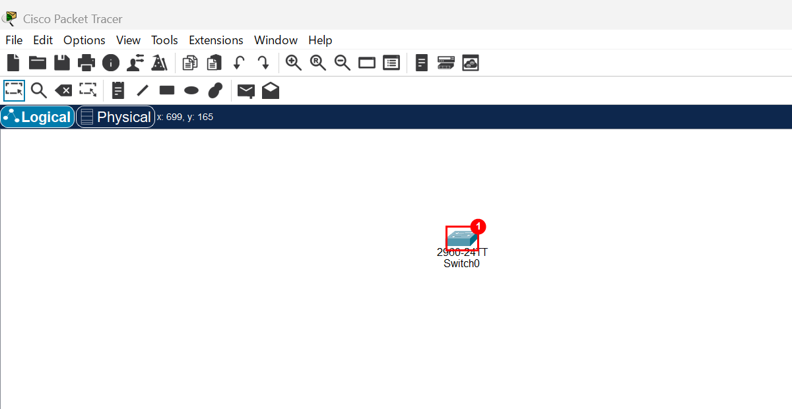
3. לוחצים על המתג, לשונית **Config** (1), שדה **Display Name** (2). מוחקים `Switch0` ומקלידים `SW-S-MAIN`.

   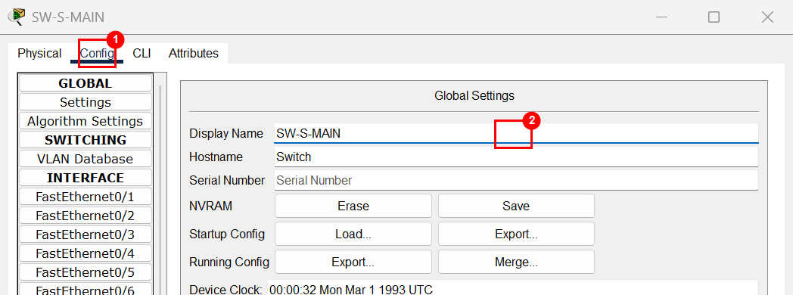
4. סוגרים את החלון. מציבים מתג 2960 שני מתחתיו ונותנים לו את השם `SW-S-SAL`.

🧠 **למה השמות האלה?** `SW` = מתג, `S` = סכנין, `MAIN` או `SAL` = התפקיד. מי שקורא את השם יודע מה
המכשיר ואיפה הוא.

## משימה 2 — מציבים את המחשבים ונותנים שמות
1. לוחצים **End Devices** (1), אחר כך **PC** (2), ואז לוחצים מתחת למתג. חוזרים עד שיש 3 מחשבים.

   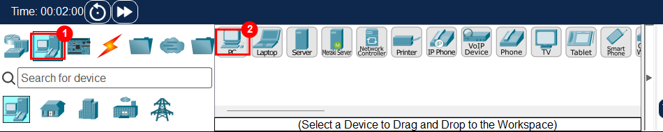

   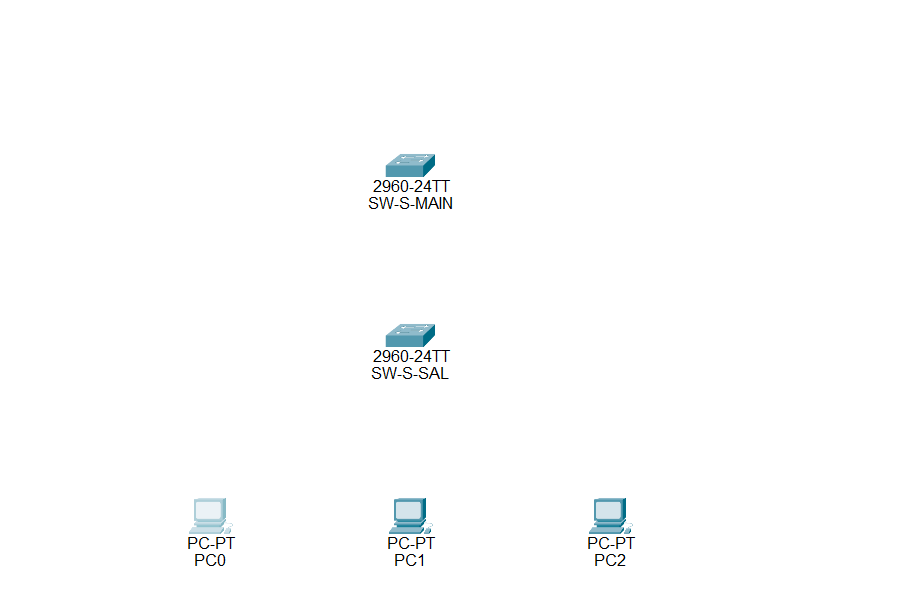
2. בכל מחשב: לוחצים עליו, לשונית **Config**, שדה **Display Name**. משמאל לימין: `PC-SAL-1`, `PC-SAL-2`, `PC-SAL-3`.

## משימה 3 — כבלים
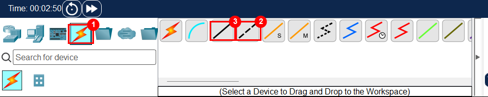

בכל שורה: **Connections** (1), בוחרים כבל, לוחצים על המכשיר הראשון ובוחרים פורט, ואז לוחצים על
המכשיר השני ובוחרים פורט.

<div dir="rtl">

| ‎# | כבל | מ- | פורט | אל | פורט |
|---|---|---|---|---|---|
| ‎1 | ‎Cross-Over (2) | ‎SW-S-MAIN | ‎FastEthernet0/3 | ‎SW-S-SAL | ‎FastEthernet0/4 |
| ‎2 | ‎Straight-Through (3) | ‎PC-SAL-1 | ‎FastEthernet0 | ‎SW-S-SAL | ‎FastEthernet0/2 |
| ‎3 | ‎Straight-Through (3) | ‎PC-SAL-2 | ‎FastEthernet0 | ‎SW-S-SAL | ‎FastEthernet0/3 |
| ‎4 | ‎Straight-Through (3) | ‎PC-SAL-3 | ‎FastEthernet0 | ‎SW-S-SAL | ‎FastEthernet0/5 |

</div>


💡 פורטים שכבר בשימוש **נעלמים** מהרשימה. כאן Fa0/2 ו-Fa0/3 תפוסים:


✅ מיד אחרי החיבור, הנקודה בצד המתג כתומה (STP). אחרי כ-30 שניות הכול ירוק:

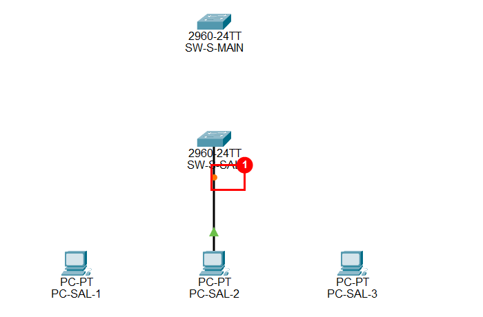

## משימה 4 — מגדירים את המתגים
לוחצים על **SW-S-MAIN**, לשונית **CLI**, ולוחצים **Enter** עד שמופיע `Switch>`‎. מקלידים שורה אחר שורה:

```
enable
configure terminal
hostname SW-S-MAIN
no ip domain-lookup
enable secret Osem#En1
service password-encryption
banner motd # Osem - Authorized access only #
line console 0
password Osem#Con
login
logging synchronous
exec-timeout 10 0
end
copy running-config startup-config
```
כשמופיע `Destination filename [startup-config]?`‎ לוחצים **Enter**. חייב להופיע ‎`[OK]`‎.


<div dir="rtl">

| פקודה | מה היא עושה | למה |
|---|---|---|
| ‎`enable` | מעבר מ-‎`>`‎ ל-‎`#`‎ | ב-‎`>`‎ רק מסתכלים, ב-‎`#`‎ מנהלים |
| ‎`configure terminal` | כניסה למצב הגדרות | רק כאן משנים הגדרות |
| ‎`hostname` | השם שמופיע בשורת הפקודה | התווית על המסך (משימה 1) לא משנה אותו |
| ‎`no ip domain-lookup` | טעות הקלדה לא נשלחת לחיפוש ב-DNS | חוסך המתנה ארוכה אחרי כל טעות |
| ‎`enable secret` | סיסמה ל-‎`#`‎ | נשמרת כ-hash |
| ‎`service password-encryption` | מסתיר את שאר הסיסמאות | אחרת `show run` מציג אותן כטקסט רגיל |
| ‎`banner motd` | הודעה לפני ההתחברות | אזהרה משפטית למי שלא מורשה |
| ‎`line console 0` | כניסה להגדרות פורט הקונסול | כאן מגדירים את הסיסמה |
| ‎`password` + `login` | קובע סיסמה **ומבקש אותה** | בלי `login` אף אחד לא נשאל |
| ‎`logging synchronous` | הודעות לא שוברות את השורה שאתם מקלידים | נוחות |
| ‎`exec-timeout 10 0` | ניתוק אחרי 10 דקות בלי פעילות | מסך פתוח שנשכח הוא פרצת אבטחה. 10 דקות הן ברירת המחדל, ולכן `show running-config` לא מציג את השורה |
| ‎`copy running-config startup-config` | שמירה ב-NVRAM | ה-running-config נמחק כשהחשמל נופל |

</div>

חוזרים על אותן פקודות ב-**SW-S-SAL** עם `hostname SW-S-SAL`.

✅ הפקודה `show running-config` מציגה `enable secret 5 $1$...`‎ ולא את הסיסמה עצמה:

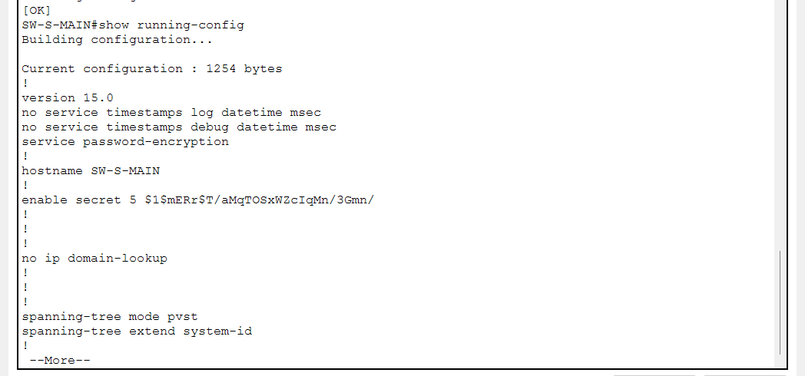

✅ ב-SW-S-SAL, הפקודה `show interfaces status` מראה ש-Fa0/2 עד Fa0/5 במצב `connected` (ב-‎`--More--`‎ לוחצים רווח):

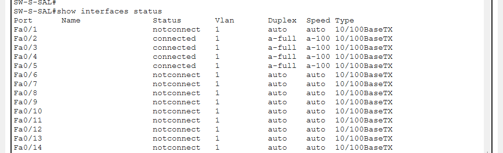

## משימה 5 — כתובות למחשבים
לוחצים על PC-SAL-1, לשונית **Desktop** (1), ואז **IP Configuration** (2):


בוחרים **Static** (1), ממלאים IPv4 Address ‏(2), ולוחצים על Subnet Mask ‏(3), שמתמלא לבד. את ה-Gateway
משאירים ריק: עדיין אין נתב.

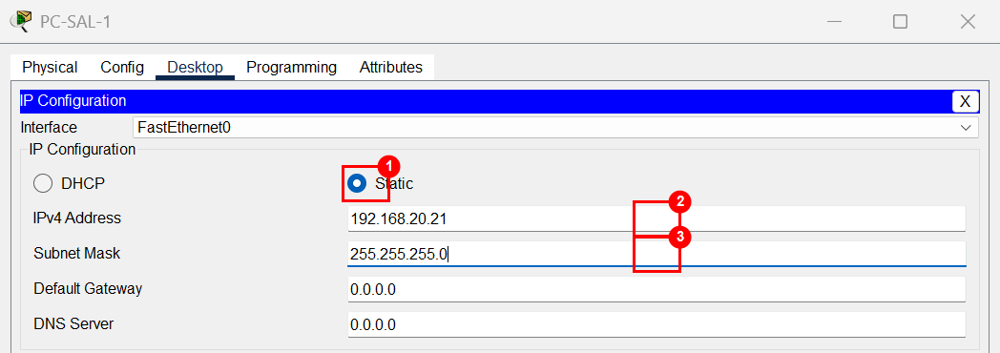

<div dir="rtl">

| מחשב | ‎IPv4 Address | ‎Subnet Mask |
|---|---|---|
| ‎PC-SAL-1 | ‎192.168.20.21 | ‎255.255.255.0 |
| ‎PC-SAL-2 | ‎192.168.20.22 | ‎255.255.255.0 |
| ‎PC-SAL-3 | ‎192.168.20.23 | ‎255.255.255.0 |

</div>

## משימה 6 — בדיקות
1. במחשב PC-SAL-1: לשונית **Desktop**, ואז **Command Prompt** (3 בתמונת שולחן העבודה):
   ```
   ping 192.168.20.22
   ping 192.168.20.23
   arp -a
   ```
   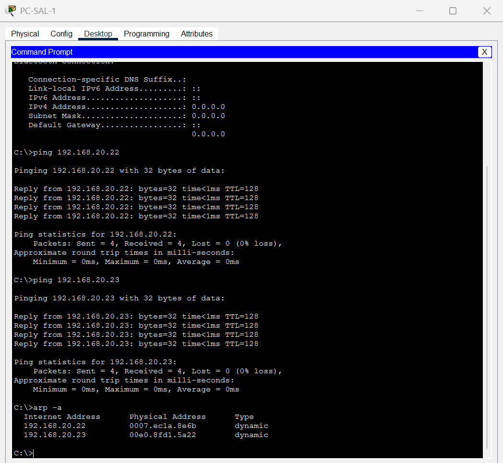

‏   `Lost = 0` פירושו הצלחה. הפקודה `arp -a` מציגה את כתובות ה-MAC שהמחשב למד.
2. ב-SW-S-SAL: `show mac address-table`

   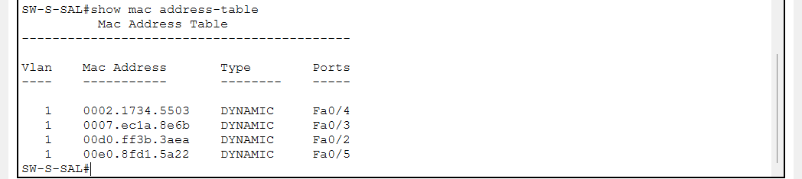

   השוו ל-`arp -a`: הכתובת ‎`0007.ec1a.8e6b` (PC-SAL-2) נמצאת ב-Fa0/3. ה-MAC ב-Fa0/4 שייך לפורט של
   SW-S-MAIN. **אצלכם כתובות ה-MAC יהיו שונות.**
3. ב-SW-S-SAL מקלידים `exit`, לוחצים **Enter** ומתחברים שוב. צריכים להופיע הבאנר, בקשה לסיסמת הקונסול,
   ואחרי `enable` בקשה שנייה. בזמן הקלדת סיסמה לא רואים כלום על המסך.

   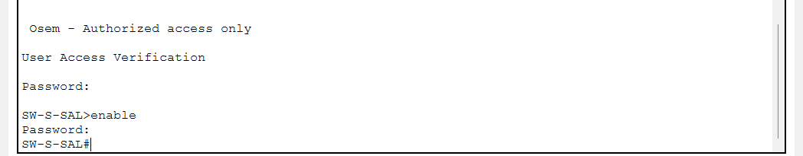
4. שומרים: **File**, אחר כך **Save As**, בשם `lesson01.pkt`.

   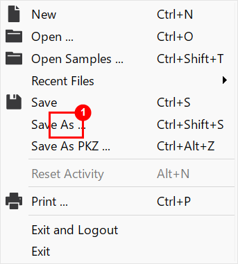

---

## 🔎 מצאו את הטעות — מפרויקט אמיתי
בפרויקט המקורי שעליו מבוסס השיעור מצאנו את הדברים הבאים. שאלו את הכיתה **מה לא בסדר ואיך מתקנים**
לפני שפותחים את התשובה.

1. רוב המתגים והנתבים נשארו בשם `Switch` ו-`Router`, ונתב אחד נקרא ‎`123`.
2. הבאנר קיבל את פני המשתמשים בשם של **חברה אחרת**.

<details dir="rtl"><summary>תשובה</summary>

1. בזמן תקלה אי אפשר לדעת באיזה מכשיר נמצאים. התיקון: `hostname` **וגם** Display Name בכל מכשיר.
2. טקסט שנשאר מפרויקט אחר. התיקון: באנר חדש. הבוחן שם לב לזה, וזה נראה כמו העתקה.

</details>

## 🏋 תרגילים
1. שנו את כתובת ה-IP של PC-SAL-3 ל-‎`192.168.30.23` (אותה מסכה). מ-PC-SAL-1 הקלידו `ping 192.168.30.23`. האם זה עובד? למה, אף שהכבל והמתג לא השתנו? החזירו את ‎`192.168.20.23`.
2. נתקו את PC-SAL-2 ועשו אליו ping. איזו הודעה מתקבלת?
3. הסירו את `login` מהקונסול של SW-S-SAL, הקלידו `exit` והיכנסו שוב. מה השתנה? החזירו למצב הקודם.

## 🎓 מסבירים לבוחן
- איך מתג יודע לאן לשלוח מסגרת?
- למה צריך ARP אם כבר יודעים את ה-IP?
- מה ההבדל בין `enable secret` לבין סיסמת הקונסול?
- למה כבל מוצלב בין מתגים וכבל ישר למחשב?
- מה ההבדל בין running-config ל-startup-config?

## 🛠 הפרויקט שלכם
בקובץ של החברה **שלכם**, עם שמות, כתובות וסיסמאות **משלכם**:
- [ ] בוחרים כלל לשמות וכותבים אותו.
- [ ] מציבים מתג ראשי, מתג מחלקה אחד ואת המחשבים של המחלקה.
- [ ] מחברים בכבלים וכותבים טבלת פורטים כמו במשימה 3.
- [ ] מגדירים בשני המתגים שם, באנר עם שם החברה **שלכם** וסיסמאות.
- [ ] מצלמים: קישורים ירוקים, ping, ‏`show mac address-table`, והתחברות עם הבאנר.
