# שיעור 02 — המיתוג של סכנין: VLAN, VTP, ‏Trunk, ‏STP ו-Port Security

<div dir="rtl">

> ⏱ 90 דקות · 🧰 Packet Tracer 9.x · 📂 קובץ התחלה: [`lesson02-start.pkt`](lesson02-start.pkt) · 💾 שומרים בשם `lesson02.pkt`

</div>

## מה יהיה לכם בסוף השיעור
כל סניף סכנין: כל מחלקה ב-VLAN משלה, מתג גיבוי בלי לולאות, ופורטים שנסגרים כשמישהו זר מתחבר.

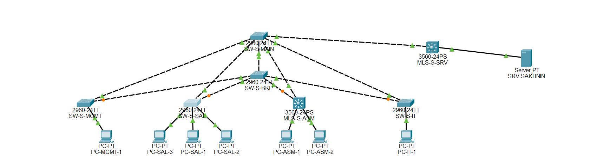

## מהלך השיעור (למורה)

<div dir="rtl">

| דקות | חלק |
|---|---|
| ‎0–20 | חלק 1 — תיאוריה על הלוח |
| ‎20–32 | משימות 1–2 — VLAN ו-VTP |
| ‎32–52 | משימות 3–4 — פורטי Trunk ו-Access (מחלקים את המתגים בין הקבוצות) |
| ‎52–62 | משימה 5 — STP |
| ‎62–78 | משימות 6–7 — בדיקות, והתקפה על Port Security |
| ‎78–90 | מצאו את הטעות, שאלות, "הפרויקט שלכם" |

</div>

בקובץ ההתחלה כל המתגים כבר מחוברים ועם הגדרות הבסיס משיעור 1 (קונסול `Osem#Con`, ‏enable ‏`Osem#En1`). למחשבים כבר יש כתובות.

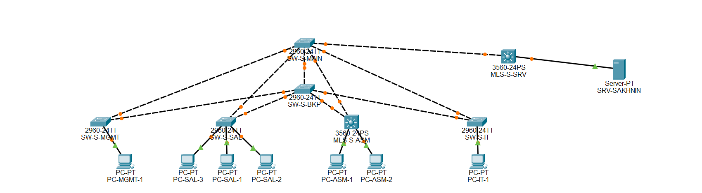

---

## חלק 1 — תיאוריה: קודם מבינים

### 1.1 מה זה VLAN?
‏VLAN מחלק מתג פיזי אחד לכמה רשתות נפרדות. הודעת broadcast ממחלקת המשכורות לא מגיעה ל-IT. יש פחות
broadcast, יותר אבטחה, ועובד יכול לעבור שולחן ולהישאר באותה רשת.

### ‏1.2 Access ו-Trunk

<div dir="rtl">

| | ‎Access | ‎Trunk |
|---|---|---|
| מעביר | ‏VLAN אחד | הרבה VLAN-ים |
| מחבר | מחשב, שרת, מדפסת | מתג ↔ מתג, מתג ↔ נתב |
| תג 802.1Q | אין | יש: 4 בייטים שאומרים "המסגרת הזו שייכת ל-VLAN 20" |

</div>

### ‏1.3 VTP
‏VTP מעתיק את רשימת ה-VLAN בין המתגים דרך ה-Trunk, ולכן יוצרים כל VLAN פעם אחת בלבד.

<div dir="rtl">

| מצב | יוצר VLAN? | לומד מאחרים? |
|---|---|---|
| ‎Server | כן | כן |
| ‎Client | לא | כן |
| ‎Transparent | כן, רק לעצמו | לא |

</div>

הדומיין והסיסמה חייבים להיות **זהים** בכל המתגים. ⚠️ מתג עם מספר **revision** גבוה יותר מוחק את הרשימה
של כולם, לכן נזהרים כשמחברים מתג משומש לרשת.

### ‏1.4 STP — למה מתג גיבוי הוא מסוכן
שני מסלולים = **לולאה**: הודעת broadcast מסתובבת לנצח והרשת קורסת תוך שניות. ‏**Spanning Tree** בוחר
**root bridge** אחד (העדיפות הנמוכה ביותר) וחוסם את הפורטים המיותרים. כשקישור נופל, הפורט החסום מתעורר.

<div dir="rtl">

| תוספת | איפה | מה היא עושה |
|---|---|---|
| ‎PortFast | פורטים של מחשבים | מדלגת על 30 שניות ההמתנה |
| ‎BPDU Guard | פורטים של מחשבים | סוגרת את הפורט אם מישהו חיבר **מתג** |
| ‎Root Guard | במתג הראשי, לכיוון המחלקות | אף מתג מחלקה לא יכול להפוך ל-root |

</div>

### ‏1.5 Port Security
הפורט לומד את ה-MAC של המחשב הראשון (`sticky`) ומרשה רק אותו. ‏MAC אחר ‏←‏ הפורט עובר למצב **err-disabled**.

### 1.6 התוכנית

<div dir="rtl">

| ‎VLAN | שם | רשת | מתג המחלקה |
|---|---|---|---|
| ‎10 | ‎MANAGEMENT | ‎192.168.10.0/24 | ‎SW-S-MGMT |
| ‎20 | ‎DISPLAY-SALARIES | ‎192.168.20.0/24 | ‎SW-S-SAL |
| ‎30 | ‎ASSEMBLY-MEETING | ‎192.168.30.0/24 | ‎MLS-S-ASM |
| ‎40 | ‎IT | ‎192.168.40.0/24 | ‎SW-S-IT |
| ‎50 | ‎SERVERS | ‎192.168.50.0/24 | ‎MLS-S-SRV |

</div>

<div dir="rtl">

| ממכשיר | פורט | למכשיר | פורט |
|---|---|---|---|
| ‎SW-S-MAIN | ‎Fa0/1 | ‎SW-S-MGMT | ‎Fa0/5 |
| ‎SW-S-MAIN | ‎Fa0/2 | ‎MLS-S-SRV | ‎Fa0/1 |
| ‎SW-S-MAIN | ‎Fa0/3 | ‎SW-S-SAL | ‎Fa0/4 |
| ‎SW-S-MAIN | ‎Fa0/4 | ‎MLS-S-ASM | ‎Fa0/1 |
| ‎SW-S-MAIN | ‎Fa0/5, Fa0/6 | ‎R-S-BKP, R-S-MAIN | שיעור 3 |
| ‎SW-S-MAIN | ‎Fa0/7 | ‎SW-S-BKP | ‎Fa0/3 |
| ‎SW-S-MAIN | ‎Fa0/8 | ‎SW-S-IT | ‎Fa0/2 |
| ‎SW-S-BKP | ‎Fa0/1 | ‎SW-S-MGMT | ‎Fa0/3 |
| ‎SW-S-BKP | ‎Fa0/2 | ‎SW-S-SAL | ‎Fa0/1 |
| ‎SW-S-BKP | ‎Fa0/4 | ‎MLS-S-ASM | ‎Fa0/4 |
| ‎SW-S-BKP | ‎Fa0/5 | ‎SW-S-IT | ‎Fa0/3 |

</div>

---

## משימה 1 — יוצרים VLAN במתג הראשי
לוחצים על **SW-S-MAIN** ‏←‏ **CLI** ‏←‏ נכנסים עם הסיסמה ‏←‏ `enable`:
```
configure terminal
vtp domain SAKHNIN
vtp password Osem#Vtp
vtp mode server
vlan 10
name MANAGEMENT
vlan 20
name DISPLAY-SALARIES
vlan 30
name ASSEMBLY-MEETING
vlan 40
name IT
vlan 50
name SERVERS
end
show vlan brief
```
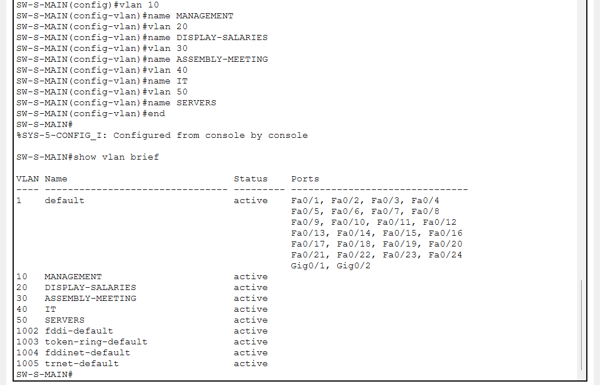

## משימה 2 — VTP client בשאר המתגים
ב-**SW-S-BKP, SW-S-MGMT, SW-S-SAL, SW-S-IT ו-MLS-S-ASM** (לא ב-MLS-S-SRV):
```
configure terminal
vtp domain SAKHNIN
vtp password Osem#Vtp
vtp mode client
end
```
❓ שואלים את הכיתה: מריצים `show vlan brief` ב-SW-S-SAL. ה-VLAN-ים **לא** הגיעו. למה?

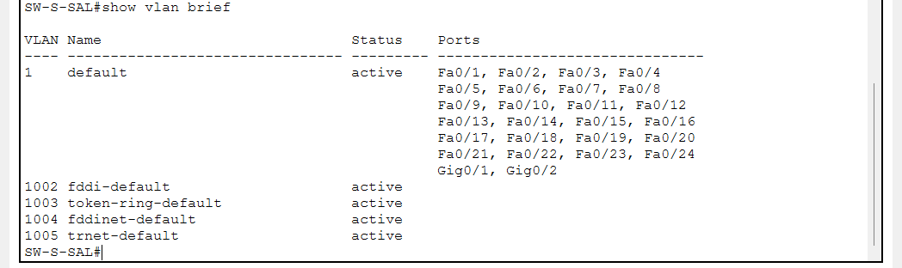

<details dir="rtl"><summary>תשובה</summary>

ה-VTP עובר רק דרך **Trunk**, ועדיין לא הגדרנו אף אחד. זו המשימה הבאה.

</details>

## משימה 3 — Trunk ו-Access במתג הראשי ובמתג הגיבוי
**SW-S-MAIN:**
```
configure terminal
interface range fa0/1 , fa0/3 - 8
switchport mode trunk
exit
interface fa0/2
switchport mode access
switchport access vlan 50
switchport port-security
switchport port-security maximum 2
switchport port-security mac-address sticky
switchport port-security violation shutdown
exit
interface range fa0/9 - 24 , g0/1 - 2
shutdown
end
```
**SW-S-BKP:**
```
configure terminal
interface range fa0/1 - 5
switchport mode trunk
exit
interface range fa0/6 - 24 , g0/1 - 2
shutdown
end
```

<div dir="rtl">

| פקודה | מה היא עושה | למה |
|---|---|---|
| ‎`interface range fa0/1 , fa0/3 - 8` | מגדירה כמה פורטים יחד | שימו לב ל**רווחים** ליד הפסיק והמקף |
| ‎`switchport mode trunk` | מעביר את כל ה-VLAN-ים | בין מתגים ולנתבים |
| ‎`switchport port-security maximum 2` | שתי כתובות MAC ב-Fa0/2 | השרת **וגם** המתג MLS-S-SRV עצמו |
| `shutdown` בפורטים פנויים | סוגרת אותם | אף אחד לא יכול להתחבר לשקע פנוי |

</div>

## משימה 4 — מתגי המחלקות
כל קבוצה מקבלת מתג.

**SW-S-MGMT:**
```
configure terminal
interface range fa0/3 , fa0/5
switchport mode trunk
exit
interface fa0/1
switchport mode access
switchport access vlan 10
spanning-tree portfast
exit
interface fa0/2
switchport mode access
switchport access vlan 10
spanning-tree portfast
spanning-tree bpduguard enable
switchport port-security
switchport port-security maximum 1
switchport port-security mac-address sticky
switchport port-security violation shutdown
exit
interface range fa0/4 , fa0/6 - 24 , g0/1 - 2
shutdown
end
```
הפורט Fa0/1 שמור לחומת האש ASA (שיעור 5), בלי Port Security: יעברו בו כמה כתובות MAC.

**SW-S-SAL:**
```
configure terminal
interface range fa0/1 , fa0/4
switchport mode trunk
exit
interface range fa0/2 - 3 , fa0/5
switchport mode access
switchport access vlan 20
spanning-tree portfast
spanning-tree bpduguard enable
switchport port-security
switchport port-security maximum 1
switchport port-security mac-address sticky
switchport port-security violation shutdown
exit
interface range fa0/6 - 24 , g0/1 - 2
shutdown
end
```
**MLS-S-ASM** (מתג 3560 — פקודה אחת נוספת!):
```
configure terminal
interface range fa0/1 , fa0/4
switchport trunk encapsulation dot1q
switchport mode trunk
exit
interface range fa0/2 - 3
switchport mode access
switchport access vlan 30
spanning-tree portfast
spanning-tree bpduguard enable
switchport port-security
switchport port-security maximum 1
switchport port-security mac-address sticky
switchport port-security violation shutdown
exit
interface range fa0/5 - 24 , g0/1 - 2
shutdown
end
```
**SW-S-IT:**
```
configure terminal
interface range fa0/2 - 3
switchport mode trunk
exit
interface fa0/1
switchport mode access
switchport access vlan 40
spanning-tree portfast
spanning-tree bpduguard enable
switchport port-security
switchport port-security maximum 1
switchport port-security mac-address sticky
switchport port-security violation shutdown
exit
interface range fa0/4 - 24 , g0/1 - 2
shutdown
end
```
**MLS-S-SRV** (מתג 3560):
```
configure terminal
vtp mode transparent
vlan 50
name SERVERS
exit
interface range fa0/1 - 2
switchport mode access
switchport access vlan 50
exit
interface range fa0/3 - 24 , g0/1 - 2
shutdown
exit
interface fa0/2
spanning-tree portfast
spanning-tree bpduguard enable
switchport port-security
switchport port-security maximum 1
switchport port-security mac-address sticky
switchport port-security violation shutdown
end
```
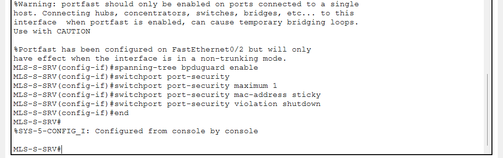

🧠 הקישור SW-S-MAIN ↔ MLS-S-SRV הוא **access VLAN 50**: יש שם רק שרתים, ולכן ה-VTP לא עובר ויוצרים את
VLAN 50 ידנית במצב transparent.

✅ ב-SW-S-SAL: ‏`show vtp status` ו-`show vlan brief`. ה-VLAN-ים הגיעו, ו-Fa0/2, ‏Fa0/3, ‏Fa0/5 נמצאים ב-VLAN 20.

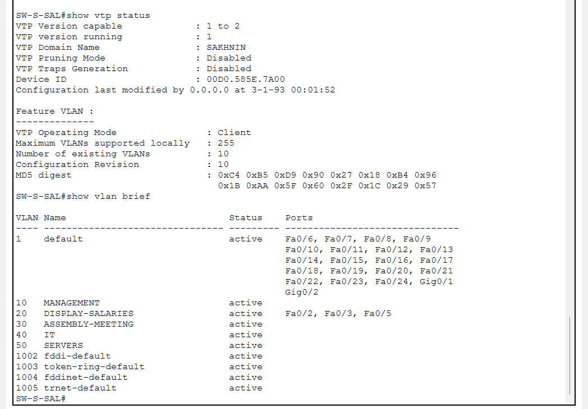

✅ ב-SW-S-MAIN: ‏`show interfaces trunk`. (Fa0/5 ו-Fa0/6 יופיעו רק אחרי שמחברים את הנתבים.)

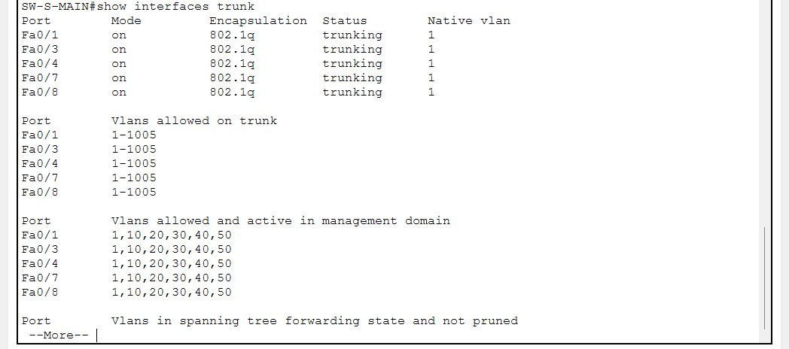

## משימה 5 — STP: אנחנו בוחרים מי ה-root
**SW-S-MAIN:**
```
configure terminal
spanning-tree mode pvst
spanning-tree vlan 1,10,20,30,40,50 root primary
interface range fa0/1 , fa0/3 , fa0/4 , fa0/8
spanning-tree guard root
end
```
**SW-S-BKP:**
```
configure terminal
spanning-tree vlan 1,10,20,30,40,50 root secondary
end
```

<div dir="rtl">

| פקודה | מה היא עושה | למה |
|---|---|---|
| ‎`root primary` | עדיפות 24576 | המתג הראשי הוא המרכז, והמסלול הקצר עובר דרכו |
| ‎`root secondary` | עדיפות 28672 | מחליף אם המתג הראשי נופל |
| ‎`spanning-tree guard root` | ‎‏Root Guard | לא ב-Fa0/7: למתג הגיבוי **מותר** להיות root |

</div>

⚠️ חייבים לכלול את **VLAN 1**. בבדיקה שלנו שכחנו אותו, ו-Root Guard חסם את הפורטים במצב
`root-inconsistent`, כי מתג אחר היה ה-root של VLAN 1.

✅ אחרי כ-50 שניות, `show spanning-tree vlan 20` ב-SW-S-MAIN: ‏**This bridge is the root**.
העדיפות 24596 היא 24576 ועוד 20 (מספר ה-VLAN).

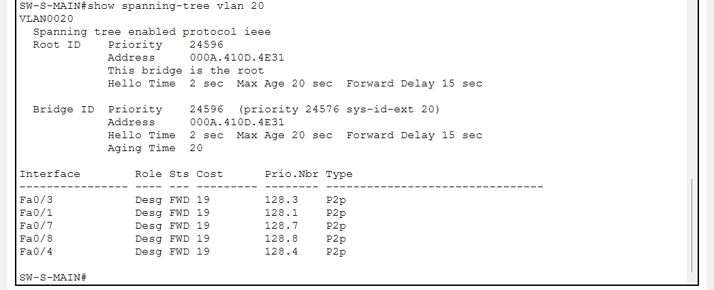

✅ ב-SW-S-SAL: הפורט Fa0/1 (לגיבוי) במצב **Altn BLK** — הוא מחכה — ו-Fa0/4 במצב **Root FWD**.

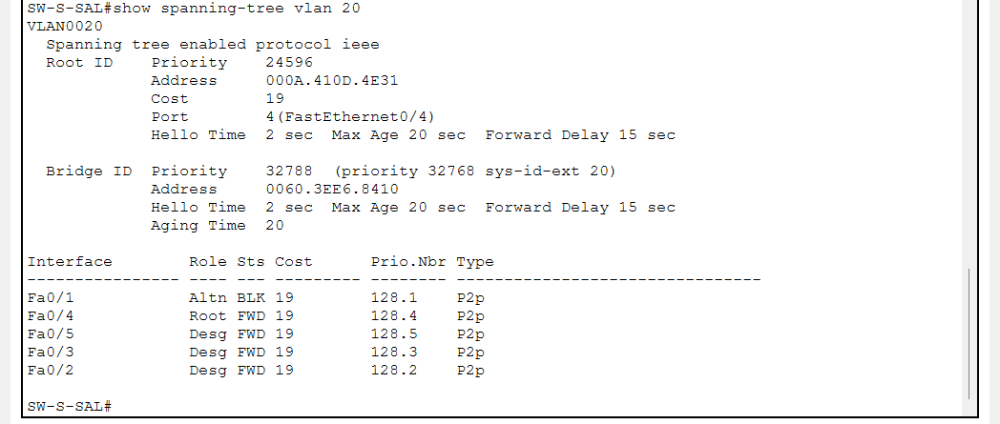

## משימה 6 — בדיקה
**PC-SAL-1** ‏←‏ ‏Command Prompt:
```
ping 192.168.20.22
ping 192.168.10.21
```
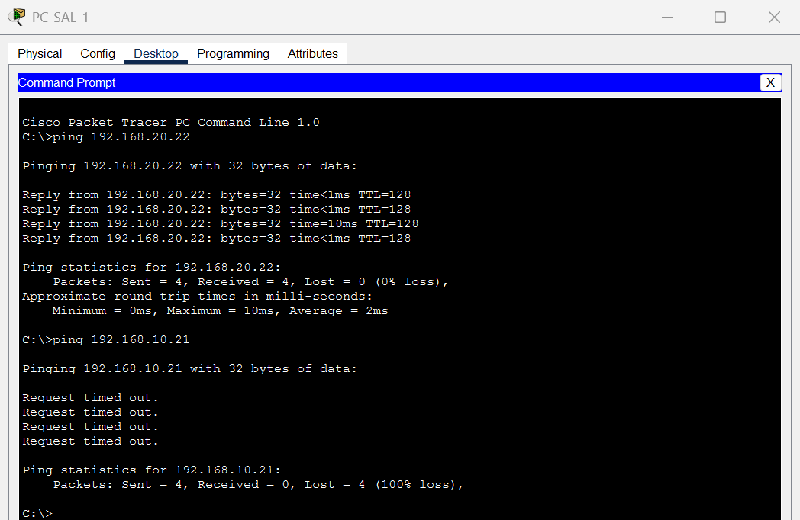

🧠 ה-ping השני **חייב** להיכשל: בין VLAN-ים צריך נתב. זה שיעור 3.

## משימה 7 — התקפה: מישהו זר מתחבר
1. ב-SW-S-SAL: ‏`show port-security interface fa0/2`. המצב **Secure-up**, כתובת sticky אחת.

   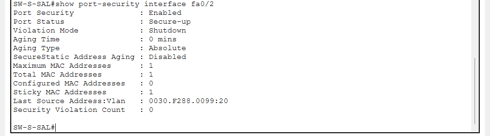
2. מ-**PC-SAL-3** עושים ping ל-192.168.20.21, כדי שהמתג ילמד את ה-MAC שלו.
3. ‏PC-SAL-3 ‏←‏ ‏**Config** (1) ‏←‏ ‏**FastEthernet0** (2) ‏←‏ ‏MAC Address (3): רושמים בצד את הכתובת, ואז משנים את ארבע הספרות האחרונות ל-‎`9999` ולוחצים Tab. עכשיו הוא "זר".

   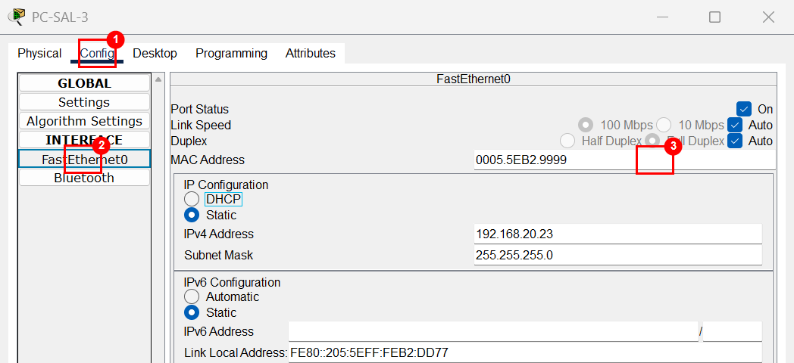
4. שוב ping: נכשל.

   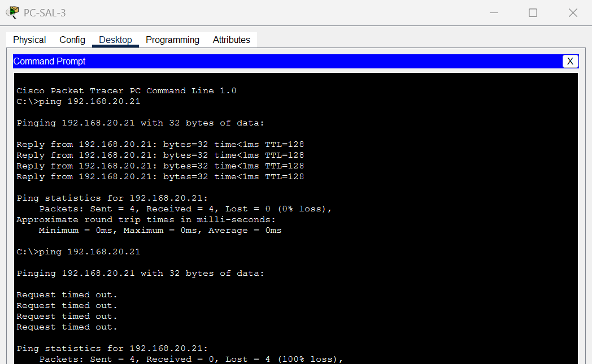
5. ב-SW-S-SAL: ‏`show port-security interface fa0/5` ואחריו `show interfaces status`. המצב **Secure-shutdown**, מונה ההפרות 1, והפורט **err-disabled**.

   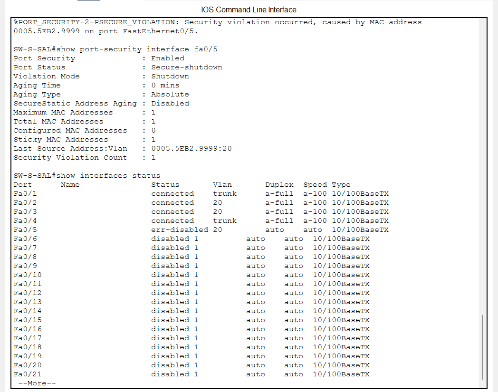
6. משחזרים: קודם מחזירים למחשב את **ה-MAC המקורי**, ואז ב-SW-S-SAL:
   ```
   configure terminal
   interface fa0/5
   shutdown
   no shutdown
   end
   ```
   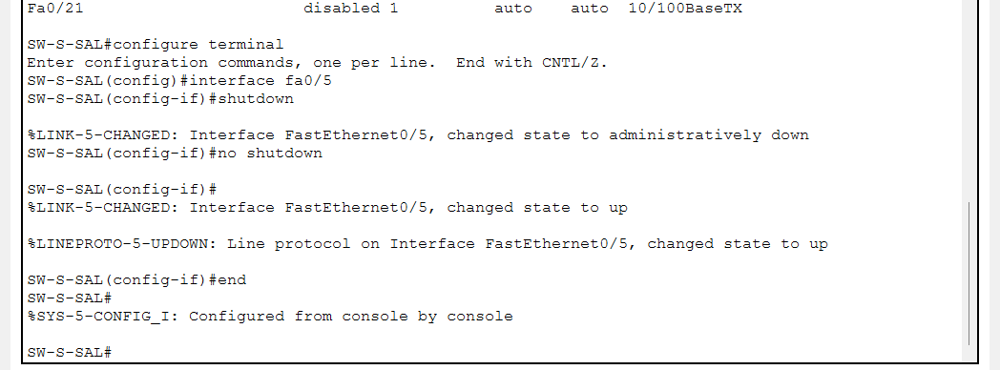

   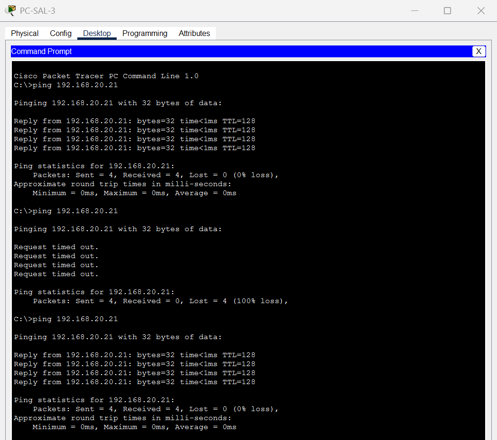
7. שומרים בכל מתג: `copy running-config startup-config`. אחר כך File ‏←‏ Save.

---

## 🔎 מצאו את הטעות — מפרויקט אמיתי
1. הקישורים מתג ראשי ↔ מחלקות היו במצב **access**.
2. מתג הגיבוי לא הוגדר בכלל: הכול ב-VLAN 1.
3. פורטים 9–24 במתג הראשי נשארו **trunk**, למרות שכלום לא מחובר אליהם.
4. ל-VLAN 40 של **IT** קראו "servers".

<details dir="rtl"><summary>תשובה</summary>

1. קישור access מעביר VLAN אחד בלבד, ו-VTP לא עובר דרכו. התיקון: trunk.
2. אם המתג הראשי נופל למחלקות אין מסלול: זה גיבוי רק בציור. התיקון: trunk, ‏VTP client ו-root secondary.
3. מי שמתחבר שם מקבל את **כל** ה-VLAN-ים. התיקון: `shutdown`.
4. תיעוד שגוי גורם לטעויות. השם חייב להתאים לתפקיד.

</details>

## 🏋 תרגילים
1. מחקו את הכבל SW-S-MAIN ↔ SW-S-SAL. כמה זמן עד ש-Fa0/1 נהיה ירוק? ציירו את המסלול החדש וחברו בחזרה.
2. נסו ליצור `vlan 60` ב-SW-S-SAL. איזו הודעה קיבלתם, ולמה?
3. הגדירו `switchport port-security violation restrict` ב-Fa0/5 ותקפו שוב. מה ההבדל מ-`shutdown`? החזירו ל-`shutdown`.

## 🎓 להסביר לבוחן
- מה ההבדל בין access ל-trunk? מה יש בתג 802.1Q?
- מה קורה בלולאה בלי STP? איך נבחר ה-root bridge?
- מה ההבדל בין PortFast, ‏BPDU Guard ו-Root Guard?
- למה VTP מסוכן, ולמה MLS-S-SRV במצב transparent?
- מה זה sticky MAC ו-err-disabled, ואיך משחזרים?

## 🛠 הפרויקט שלכם
- [ ] טבלת VLAN: מספר, שם, רשת, מתג. ‏VLAN לכל מחלקה ועוד אחד לשרתים.
- [ ] טבלת פורטים לכל מתג.
- [ ] דומיין וסיסמת VTP של החברה **שלכם**: הראשי server, המחלקות client.
- [ ] ‏Trunk בין מתגים, access למחשבים, `shutdown` בפורטים פנויים.
- [ ] ‏root primary במתג הראשי ו-secondary בגיבוי (כולל VLAN 1!).
- [ ] ‏Port Security ו-BPDU Guard בכל פורט של מחשב.
- [ ] צילומי מסך: `show vlan brief`, ‏`show vtp status`, ‏`show interfaces trunk`, ‏`show spanning-tree`, וההתקפה.
