# שיעור 03 — ניתוב ושירותים בסכנין: HSRP, ‏DHCP, ‏DNS, ‏Web, ‏FTP, דואר

<div dir="rtl">

> ⏱ 90 דקות · 🧰 Packet Tracer 9.x · 📂 קובץ התחלה: [`lesson03-start.pkt`](lesson03-start.pkt) · 💾 שומרים בשם `lesson03.pkt`

</div>

## מה יהיה לכם בסוף השיעור
המחלקות מדברות זו עם זו דרך **שני נתבים שמגבים אחד את השני**, ושרת אחד נותן לכל הסניף כתובות, שמות, אתר, קבצים ודואר.

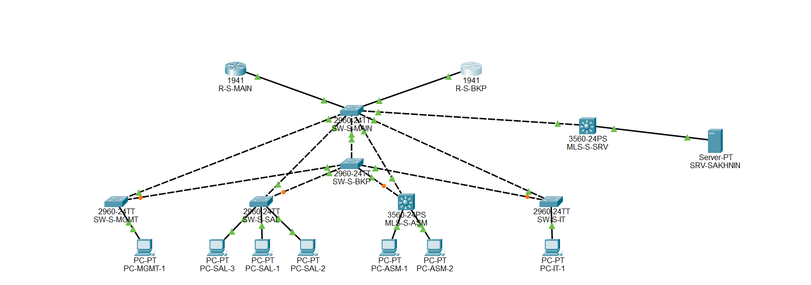

## מהלך השיעור (למורה)

<div dir="rtl">

| דקות | חלק |
|---|---|
| ‎0–20 | חלק 1 — תיאוריה על הלוח |
| ‎20–40 | משימות 1–2 — ממשקי משנה ו-HSRP |
| ‎40–60 | משימה 3 — השרת (תלמיד לכל שירות) |
| ‎60–72 | משימות 4–5 — מחשבים, בדיקות ודואר |
| ‎72–82 | משימות 6–7 — DHCP Snooping ובדיקת נפילה |
| ‎82–90 | מצאו את הטעות, שאלות, "הפרויקט שלכם" |

</div>

קובץ ההתחלה הוא סוף שיעור 2, ועוד הנתבים R-S-MAIN ו-R-S-BKP, מחוברים ועם הגדרות בסיס.

---

## חלק 1 — תיאוריה: קודם מבינים

### ‏1.1 Router-on-a-stick
כבל אחד (trunk) מהמתג לנתב נושא את כל ה-VLAN-ים. חותכים את הפורט הפיזי ל**ממשקי משנה**: ‏g0/0.10 בשביל
VLAN 10, ‏g0/0.20 בשביל VLAN 20... לכל אחד יש IP, והוא **השער (gateway)** של ה-VLAN שלו. לפורט הפיזי עצמו **אין IP**.

### ‏1.2 HSRP — שני נתבים, שער אחד
למחשב יכול להיות **רק שער אחד**. אם הנתב הזה נופל, המחלקה מנותקת. ב-**HSRP** שני נתבים חולקים
**כתובת IP וירטואלית** (VIP). המחשבים פונים ל-VIP ולא יודעים איזה נתב עונה.

<div dir="rtl">

| כתובת | מכשיר |
|---|---|
| ‎.254 | ‏R-S-MAIN, עדיפות 110 ‏←‏ **Active** |
| ‎.253 | ‏R-S-BKP, עדיפות 105 ‏←‏ **Standby** |
| **‎.252** | ‏ה-**VIP**: השער של כל המחשבים ושל השרת |

</div>

‏`preempt` = כשהנתב הראשי חוזר, הוא לוקח בחזרה את תפקיד ה-Active.

### ‏1.3 DHCP וממסר (relay)
‏DHCP נותן למחשב כתובת בארבעה שלבים, **DORA**: ‏**D**iscover ‏←‏ **O**ffer ‏←‏ **R**equest ‏←‏ **A**ck.
ה-Discover הוא **broadcast**, ונתב לא מעביר broadcast. הפקודה `ip helper-address` בנתב הופכת אותו להודעה
ישירה לשרת: זה ה-**relay**.

### 1.4 השירותים

<div dir="rtl">

| שירות | פורט | בשביל מה |
|---|---|---|
| ‎DNS | ‎UDP 53 | שם ‏←‏ IP ‏(`www.osem.com` → 192.168.50.1) |
| ‎HTTP | ‎TCP 80 | אתר |
| ‎FTP | ‎TCP 20/21 | קבצים |
| ‎SMTP | ‎TCP 25 | **שליחת** דואר |
| ‎POP3 | ‎TCP 110 | **קריאת** דואר |

</div>

### ‏1.5 DHCP Snooping
תלמיד מביא נתב ביתי, והנתב נותן לכולם שער שגוי. עם **DHCP Snooping** המתג מקבל תשובות DHCP רק מפורטים **מהימנים (trusted)**.

---

## משימה 1 — ממשקי משנה ו-HSRP ב-R-S-MAIN
‏**R-S-MAIN** ‏←‏ ‏CLI ‏←‏ נכנסים ‏←‏ `enable`:
```
configure terminal
interface g0/0
no shutdown
exit
interface g0/0.10
encapsulation dot1Q 10
ip address 192.168.10.254 255.255.255.0
standby 10 ip 192.168.10.252
standby 10 priority 110
standby 10 preempt
ip helper-address 192.168.50.1
exit
interface g0/0.20
encapsulation dot1Q 20
ip address 192.168.20.254 255.255.255.0
standby 20 ip 192.168.20.252
standby 20 priority 110
standby 20 preempt
ip helper-address 192.168.50.1
exit
interface g0/0.30
encapsulation dot1Q 30
ip address 192.168.30.254 255.255.255.0
standby 30 ip 192.168.30.252
standby 30 priority 110
standby 30 preempt
ip helper-address 192.168.50.1
exit
interface g0/0.40
encapsulation dot1Q 40
ip address 192.168.40.254 255.255.255.0
standby 40 ip 192.168.40.252
standby 40 priority 110
standby 40 preempt
ip helper-address 192.168.50.1
exit
interface g0/0.50
encapsulation dot1Q 50
ip address 192.168.50.254 255.255.255.0
standby 50 ip 192.168.50.252
standby 50 priority 110
standby 50 preempt
end
copy running-config startup-config
```
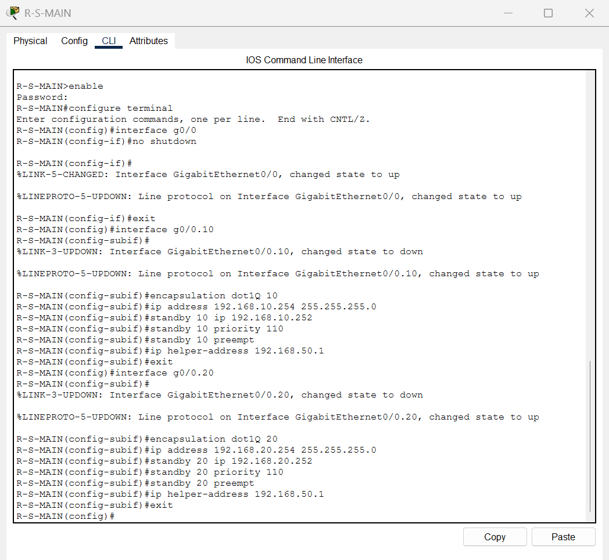

<div dir="rtl">

| פקודה | מה היא עושה | למה |
|---|---|---|
| `interface g0/0` ואז `no shutdown` | מדליקה את הפורט הפיזי | פורטים בנתב כבויים כברירת מחדל |
| ‎`interface g0/0.10` | יוצרת ממשק משנה | אחד לכל VLAN |
| ‎`encapsulation dot1Q 10` | "זה VLAN 10" | **לפני** ה-IP, אחרת הנתב מסרב |
| ‎`standby 10 ip` | ה-VIP של קבוצה 10 | השער של המחשבים |
| ‎`standby 10 priority 110` | הגבוה מנצח | ראשי 110, גיבוי 105 |
| ‎`standby 10 preempt` | מחזיר את ה-Active | אחרת הגיבוי נשאר Active |
| ‎`ip helper-address` | מעביר DHCP לשרת | לא צריך ב-VLAN 50, כי השרת נמצא שם |

</div>

## משימה 2 — R-S-BKP
אותו דבר, עם **‎.253** ו-**priority 105**:
```
configure terminal
interface g0/0
no shutdown
exit
interface g0/0.10
encapsulation dot1Q 10
ip address 192.168.10.253 255.255.255.0
standby 10 ip 192.168.10.252
standby 10 priority 105
standby 10 preempt
ip helper-address 192.168.50.1
exit
interface g0/0.20
encapsulation dot1Q 20
ip address 192.168.20.253 255.255.255.0
standby 20 ip 192.168.20.252
standby 20 priority 105
standby 20 preempt
ip helper-address 192.168.50.1
exit
interface g0/0.30
encapsulation dot1Q 30
ip address 192.168.30.253 255.255.255.0
standby 30 ip 192.168.30.252
standby 30 priority 105
standby 30 preempt
ip helper-address 192.168.50.1
exit
interface g0/0.40
encapsulation dot1Q 40
ip address 192.168.40.253 255.255.255.0
standby 40 ip 192.168.40.252
standby 40 priority 105
standby 40 preempt
ip helper-address 192.168.50.1
exit
interface g0/0.50
encapsulation dot1Q 50
ip address 192.168.50.253 255.255.255.0
standby 50 ip 192.168.50.252
standby 50 priority 105
standby 50 preempt
end
copy running-config startup-config
```
✅ מחכים כ-20 שניות. ‏`show standby brief` בשניהם: הראשי **Active**, הגיבוי **Standby**.


## משימה 3 — השרת
### 3.1 כתובת קבועה
‏**SRV-SAKHNIN** ‏←‏ ‏**Desktop** ‏←‏ ‏**IP Configuration** ‏←‏ ‏Static: כתובת ‎`192.168.50.1` (1), מסכה
‎`255.255.255.0` (2), שער **‎`192.168.50.252`** — ה-VIP (3), ‏DNS ‏‎`192.168.50.1` (4).


🧠 לשרת חייבת להיות כתובת **קבועה**, כי כולם מחפשים אותו שם.

### ‏3.2 DHCP
‏**Services** (1) ‏←‏ ‏**DHCP** (2). לכל שורה ממלאים את הטופס (3) ולוחצים **Add** (4):

<div dir="rtl">

| ‎Pool Name | ‎Default Gateway | ‎DNS Server | ‎Start IP | ‎Mask | ‎Max users |
|---|---|---|---|---|---|
| ‎MANAGEMENT | ‎192.168.10.252 | ‎192.168.50.1 | ‎192.168.10.20 | ‎255.255.255.0 | ‎50 |
| ‎DISPLAY-SALARIES | ‎192.168.20.252 | ‎192.168.50.1 | ‎192.168.20.20 | ‎255.255.255.0 | ‎50 |
| ‎ASSEMBLY-MEETING | ‎192.168.30.252 | ‎192.168.50.1 | ‎192.168.30.20 | ‎255.255.255.0 | ‎50 |
| ‎IT | ‎192.168.40.252 | ‎192.168.50.1 | ‎192.168.40.20 | ‎255.255.255.0 | ‎50 |

</div>

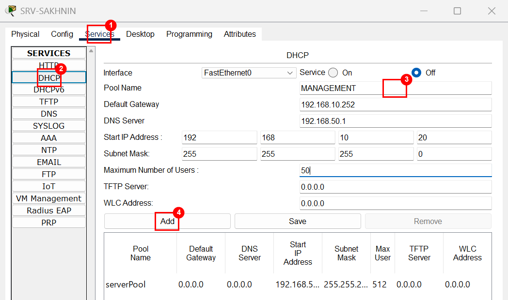

לסיום **Service: On** (1) ו-**Save** (2).


### ‏3.3 DNS
‏**DNS** ‏←‏ ‏On (1). ‏Name (2) ‏`www.osem.com`, ‏Address (3) ‏‎`192.168.50.1` ‏←‏ ‏**Add** (4). שוב בשביל `mail.osem.com`.

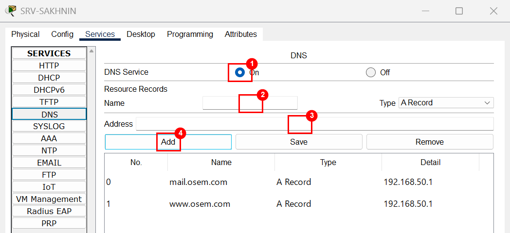

### 3.4 אתר
‏**HTTP** ‏←‏ ליד `index.html` לוחצים **(edit)** ‏←‏ משנים את השורה אחרי ‎`<hr>`‎ ל-`Welcome to Osem - Sakhnin branch` ‏←‏ ‏**Save** (ומאשרים אם שואלים).

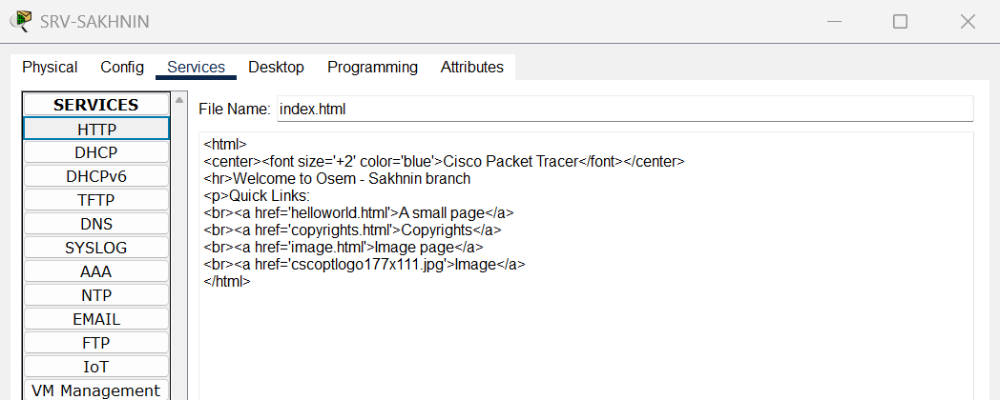

### ‏3.5 FTP
‏**FTP** ‏←‏ ‏Username (1) ‏`sakhnin`, ‏Password (2) ‏`Osem#Ftp`, מסמנים את כל חמש ההרשאות ‏←‏ ‏**Add** (3).

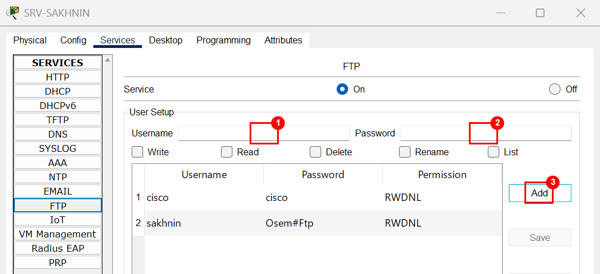

### 3.6 דואר
‏**EMAIL** ‏←‏ ‏Domain Name (1) ‏`osem.com` ‏←‏ ‏**Set** (2). ‏User (3) ‏`sakhnin1`, ‏Password (4) ‏`Osem#Mail` ‏←‏ ‏**+** (5). שוב בשביל `sakhnin2`.


## משימה 4 — המחשבים מקבלים כתובת
כל מחשב ‏←‏ ‏Desktop ‏←‏ ‏**IP Configuration** ‏←‏ ‏**DHCP** (1). השער ‎.252 וה-DNS מגיעים לבד:

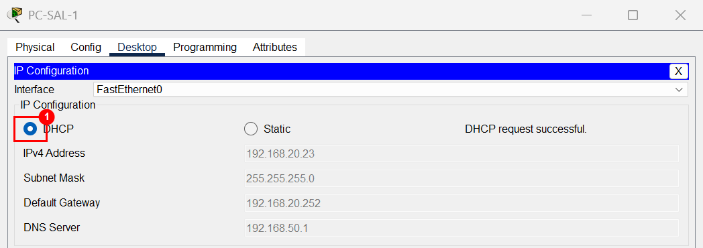

⚠️ לפעמים הבקשה הראשונה נכשלת, כי STP ו-HSRP עדיין עולים. לוחצים Static ואז שוב DHCP, או `ipconfig /renew`.

## משימה 5 — בודקים הכול
1. ‏**PC-IT-1**: ‏`nslookup www.osem.com`

   
2. ‏**PC-SAL-2** ‏←‏ ‏Desktop ‏←‏ ‏**Web Browser** ‏←‏ ‏`http://www.osem.com` ‏←‏ ‏**Go**

   
3. ‏**PC-SAL-1**: ‏`ping 192.168.50.1`, ואז `ftp 192.168.50.1` (משתמש `sakhnin`, סיסמה `Osem#Ftp`), ולסיום `quit`.

‏   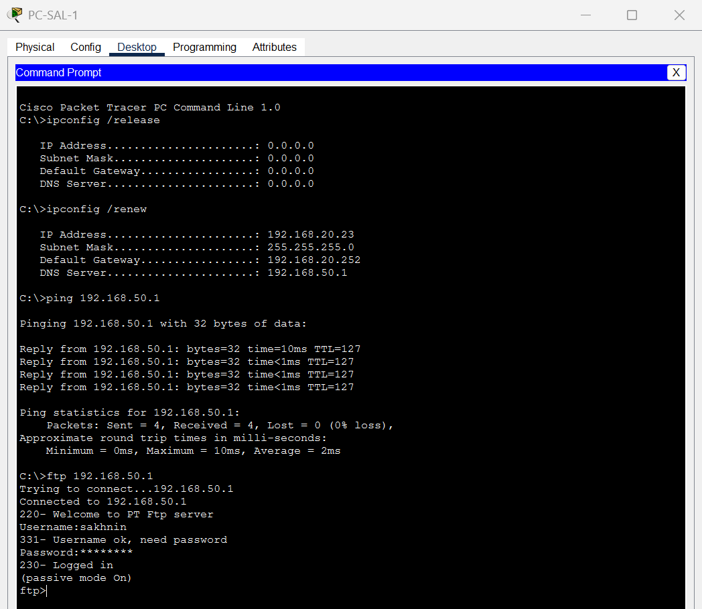
4. ‏**PC-SAL-1**: ‏`tracert 192.168.40.21` (הכתובת של PC-IT-1, בדקו את שלכם עם `ipconfig`). הקפיצה הראשונה היא **‎.254**, הנתב הראשי. זכרו את זה למשימה 7!

   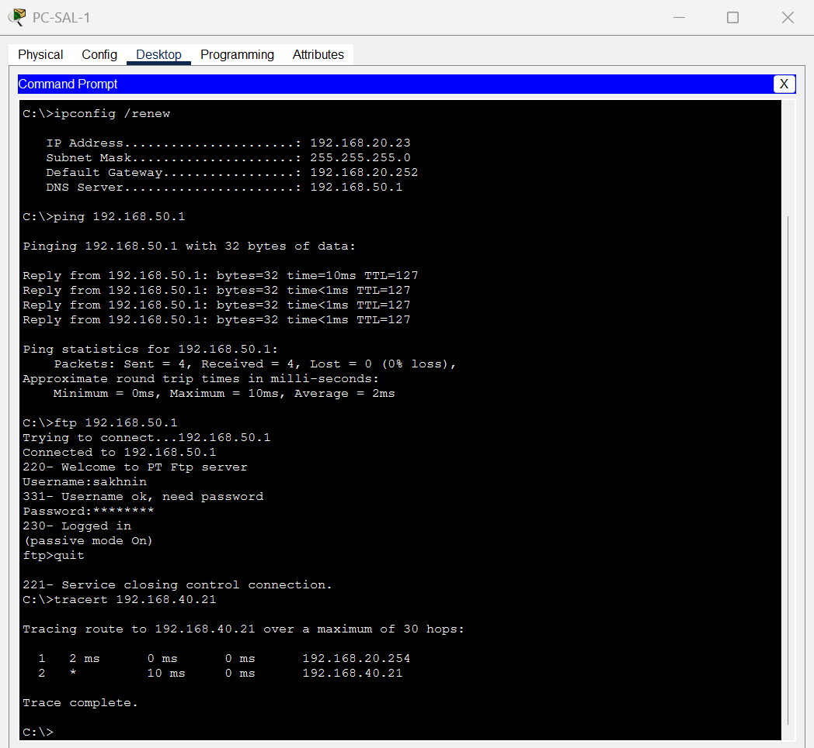
5. **דואר.** ‏PC-SAL-1 ‏←‏ ‏Desktop ‏←‏ ‏**Email** ‏←‏ ממלאים ולוחצים **Save**:

   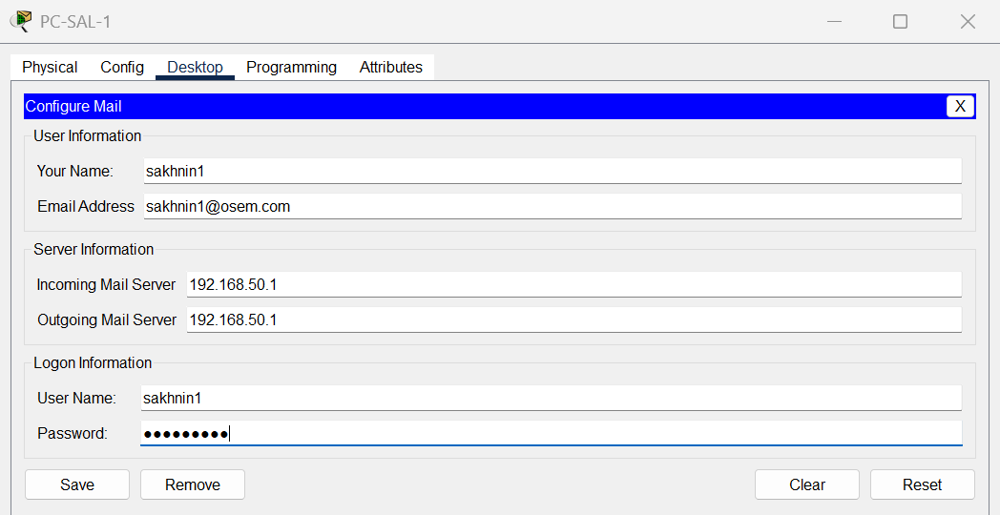

   ב-PC-SAL-2 אותו דבר עם `sakhnin2`. אחר כך ב-PC-SAL-1 ‏←‏ ‏**Compose**: ‏To (1) ‏`sakhnin2@osem.com`, ‏Subject (2) ‏←‏ ‏**Send** (3).

   

   ב-PC-SAL-2 ‏←‏ ‏**Receive** (1):

   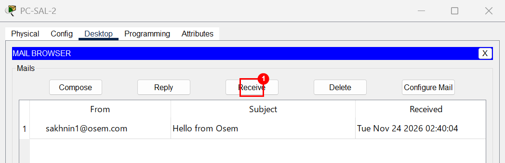

## משימה 6 — DHCP Snooping
**SW-S-MAIN:**
```
configure terminal
ip dhcp snooping
ip dhcp snooping vlan 10,20,30,40
no ip dhcp snooping information option
interface range fa0/2 , fa0/5 - 7
ip dhcp snooping trust
end
copy running-config startup-config
show ip dhcp snooping
```

<div dir="rtl">

| פורט | מחובר ל | למה מהימן |
|---|---|---|
| ‎Fa0/2 | מתג השרת | שם נמצא שרת ה-DHCP האמיתי |
| ‎Fa0/5, Fa0/6 | הנתבים | מהם מגיעות תשובות ה-relay |
| ‎Fa0/7 | מתג הגיבוי | מסלול נוסף לאותה רשת |

</div>

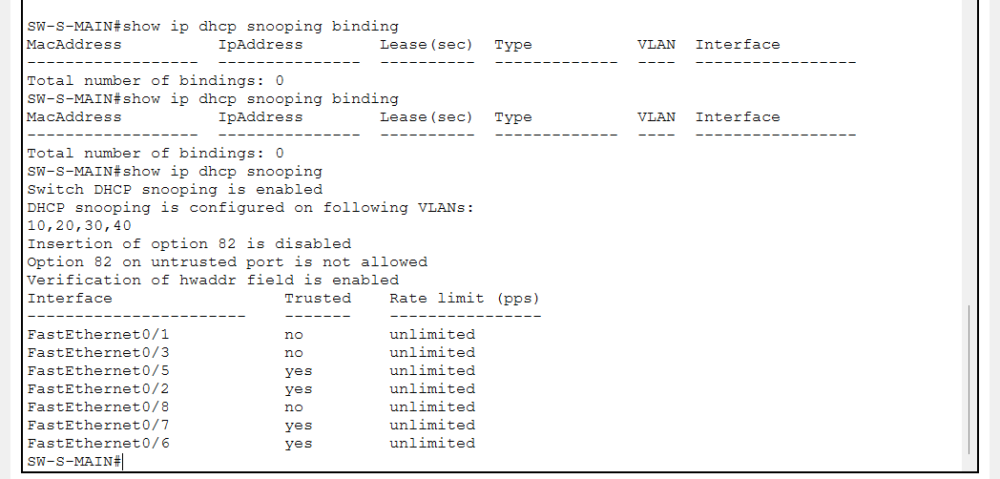

💡 ב-Packet Tracer הטבלה `show ip dhcp snooping binding` נשארה ריקה בבדיקות שלנו, לכן בודקים עם `show ip dhcp snooping`.

✅ במחשב: `ipconfig /release` ואז `ipconfig /renew` עדיין עובדים.

## משימה 7 — מפילים את הנתב הראשי
1. ‏**R-S-MAIN**: ‏`configure terminal` ‏←‏ ‏`interface g0/0` ‏←‏ ‏`shutdown`.
2. אחרי כ-10 שניות ב-**R-S-BKP**: ‏`show standby brief` ‏←‏ **Active**.

   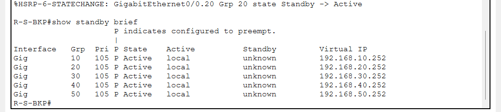
3. ‏**PC-SAL-1**: ‏`ping 192.168.50.1` עובד, ו-`tracert 192.168.40.21` עובר עכשיו דרך **‎.253**. במחשב **לא שינינו כלום**.

   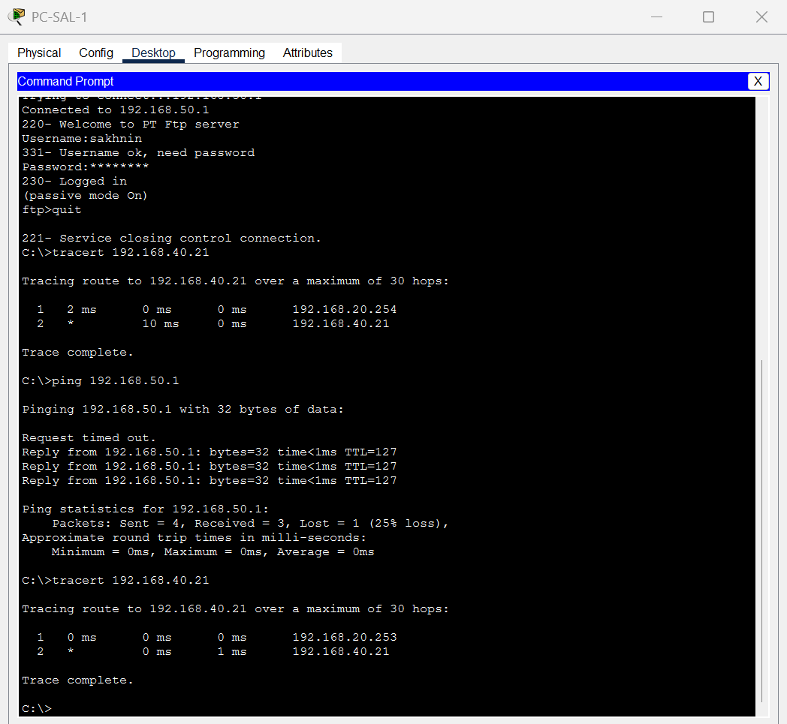
4. מחזירים: `no shutdown`, מחכים 30 שניות. ‏R-S-MAIN שוב Active, בזכות `preempt`.

   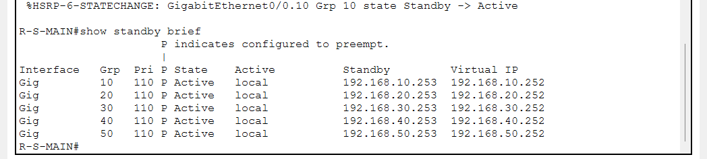
5. ‏`copy running-config startup-config` בנתבים וב-SW-S-MAIN, ו-File ‏←‏ Save.

---

## 🔎 מצאו את הטעות — מפרויקט אמיתי
1. ‏`standby 10 track` הוגדר על פורט ה-**LAN** עצמו.
2. לפורט הפיזי `g0/0` הייתה כתובת IP.
3. השער של השרת היה **‎.254**.
4. ה-pool של ברירת המחדל (`serverPool`) חילק 192.168.50.0–51.255, הרשת של השרתים עצמם.

<details dir="rtl"><summary>תשובה</summary>

1. אם פורט ה-LAN נופל, HSRP יודע בכל מקרה. ה-track עוזר לפורט ש**יוצא לאינטרנט** (שיעור 4).
2. עם ממשקי משנה לכל VLAN יש IP בממשק המשנה שלו. IP בפורט הפיזי שייך ל-native VLAN ומבלבל.
3. ‏‎.254 הוא הנתב הראשי עצמו. כשהוא נופל השרת מנותק. התיקון: ה-VIP ‏**‎.252**.
4. לשרתים יש כתובות קבועות. ‏pool ברשת שלהם עלול לתת למחשב כתובת שכבר תפוסה.

</details>

## 🏋 תרגילים
1. מוחקים את `ip helper-address` מ-g0/0.20 (ב**שני** הנתבים) ועושים `ipconfig /renew` ב-PC-SAL-1. מה קורה? למה רק ב-VLAN 20? החזירו.
2. הפכו את R-S-BKP ל-Active רק ב-VLAN 40 (רמז: priority). בשביל מה זה טוב?
3. הוסיפו `ftp.osem.com` ל-DNS והתחברו עם `ftp ftp.osem.com`.

## 🎓 להסביר לבוחן
- מה זה ממשק משנה ולמה צריך `encapsulation dot1Q`?
- מה זה VIP? מה קורה, שלב אחר שלב, כש-R-S-MAIN נופל?
- הסבירו DORA. למה צריך relay?
- מה ההבדל בין SMTP ל-POP3?
- איזו התקפה מונע DHCP Snooping, ואילו פורטים מהימנים?

## 🛠 הפרויקט שלכם
- [ ] טבלה: VLAN, ראשי ‎.254, גיבוי ‎.253, ‏VIP ‎.252.
- [ ] ממשקי משנה ו-HSRP בשני נתבים.
- [ ] שרת עם כתובת קבועה, ה-VIP כשער, ו-DHCP pool לכל VLAN.
- [ ] ‏DNS, ‏web, ‏FTP ודואר עם הדומיין והמשתמשים **שלכם**.
- [ ] ‏DHCP Snooping.
- [ ] צילומי מסך: `show standby brief` בשני הנתבים, DHCP במחשב, האתר לפי שם, מייל שהגיע, ובדיקת הנפילה עם שני tracert.
