# שיעור 03 — ניתוב ושירותים בסכנין: HSRP, ‏DHCP, ‏DNS, ‏Web, ‏FTP, דואר

<div dir="rtl">

> ⏱ 90 דקות · 🧰 Packet Tracer 9.x · 📂 קובץ התחלה: [`lesson03-start.pkt`](lesson03-start.pkt) או הקובץ שלכם אחרי [חלק B](../from-zero/README.md#part-b) · 💾 שומרים בשם `lesson03.pkt`

</div>

## מה יהיה לכם בסוף השיעור
המחלקות מדברות זו עם זו דרך **שני נתבים שמגבים אחד את השני**, ושרת אחד נותן לכל הסניף כתובות, שמות, אתר, קבצים ודואר.


## 📖 הסיפור — פרק 3: דלתות, ובניין שעובד לבד
**איך הגענו לכאן.** בשיעור 1 חיברנו מחלקה אחת, ובשיעור 2 הפרדנו חמש. המנהל מרוצה יום אחד, ואז הטלפונים מצלצלים: *"‏IT לא מצליחים לשלוח לנו קובץ", "איפה האתר?", "הזזתי שולחן והמחשב איבד את הכתובת".*

**איפה אנחנו עכשיו.** חמש מחלקות שלא רואות זו את זו, מחשבים עם כתובות שהוקלדו ביד ובלי שער, ושרת ריק. הגיעו שני נתבים וחוברו (קובץ ההתחלה, או [חלק B](../from-zero/)).

**מה רוצים היום.** דרך בין המחלקות ש**נשארת גם כשנתב נופל**, ושרת אחד שנותן כתובות, שמות, אתר, קבצים ודואר.

**הדרך של היום:**

<div dir="rtl">

| משימה | על איזו שאלה היא עונה | למה דווקא עכשיו |
|---|---|---|
| 1 נתב ראשי | איך VLAN מדברים? | זה הדבר הראשון שכולם מבקשים |
| 2 נתב גיבוי | ואם הוא נופל? | חמש מחלקות תלויות עכשיו בקופסה אחת |
| 3 שרת | מי נותן את השירותים? | רק עכשיו מגיעים לשרת, דרך הנתבים |
| 4 לקוחות DHCP | איך מחשב מקבל כתובת? | לשרת יש כתובות מוכנות |
| 5 בדיקה | כל שירות עובד? | כל אחד יכול ליפול בדרך אחרת |
| ‎6 Snooping | ואם מישהו אחר מחלק כתובות? | מי ששולט בכתובות שולט בתעבורה |
| 7 תקלה | הגיבוי באמת עובד? | גיבוי שלא נבדק הוא רק תקווה |

</div>

## מהלך השיעור (למורה)

<div dir="rtl">

| דקות | חלק |
|---|---|
| ‎0–20 | חלק 1 — תיאוריה על הלוח |
| ‎20–40 | משימות 1–2 — ממשקי משנה ו-HSRP |
| ‎40–60 | משימה 3 — השרת (תלמיד לכל שירות) |
| ‎60–72 | משימות 4–5 — מחשבים, בדיקות ודואר |
| ‎72–82 | משימות 6–7 — DHCP Snooping ובדיקת נפילה |
| ‎82–90 | מצאו את הטעות, שאלות, "הפרויקט שלכם" |

</div>

קובץ ההתחלה הוא סוף שיעור 2, ועוד הנתבים R-S-MAIN ו-R-S-BKP, מחוברים ועם הגדרות בסיס.

---

## חלק 1 — תיאוריה: קודם מבינים

### ‏1.1 Router-on-a-stick
כבל אחד (trunk) מהמתג לנתב נושא את כל ה-VLAN-ים. חותכים את הפורט הפיזי ל**ממשקי משנה**: ‏g0/0.10 בשביל
VLAN 10, ‏g0/0.20 בשביל VLAN 20... לכל אחד יש IP, והוא **השער (gateway)** של ה-VLAN שלו. לפורט הפיזי עצמו **אין IP**.

💬 **במילים פשוטות:** הנתב הוא המסדרון בין הכיתות (ה-VLAN-ים). דלת פיזית אחת (g0/0) ועליה כמה שלטים: ‎.10, ‎.20, ‎.30...

**דוגמה — PC-SAL-1 ‏(VLAN 20) עושה ping ל-PC-IT-1 ‏(VLAN 40):**

<div dir="rtl">

| ‎# | איפה | תג VLAN | מה קורה |
|---|---|---|---|
| ‎1 | ‎PC-SAL-1 | ‎— | ‏192.168.40.x לא ברשת שלי, אז אני שולח לשער ‎.252 |
| ‎2 | ה-trunk למעלה לנתב | ‎20 | מגיע ל-g0/0.20 |
| ‎3 | בתוך הנתב | ‎— | טבלת הניתוב: 192.168.40.0 נמצאת ב-g0/0.40 |
| ‎4 | ה-trunk למטה למתג | ‎**40** | אותו כבל, תג אחר |
| ‎5 | ‎PC-IT-1 | ‎— | הגיע |

</div>

### ‏1.2 HSRP — שני נתבים, שער אחד
למחשב יכול להיות **רק שער אחד**. אם הנתב הזה נופל, המחלקה מנותקת. ב-**HSRP** שני נתבים חולקים
**כתובת IP וירטואלית** (VIP). המחשבים פונים ל-VIP ולא יודעים איזה נתב עונה.

<div dir="rtl">

| כתובת | מכשיר |
|---|---|
| ‎.254 | ‏R-S-MAIN, עדיפות 110 ‏←‏ **Active** |
| ‎.253 | ‏R-S-BKP, עדיפות 105 ‏←‏ **Standby** |
| **‎.252** | ‏ה-**VIP**: השער של כל המחשבים ושל השרת |

</div>

‏`preempt` = כשהנתב הראשי חוזר, הוא לוקח בחזרה את תפקיד ה-Active.

💬 **במילים פשוטות:** לחנות יש מספר טלפון אחד. שני עובדים יכולים לענות. הלקוחות מחייגים לאותו מספר ולא שמים לב שהעובד התחלף.

**דוגמה — מה כל נתב "אומר":**

<div dir="rtl">

| מצב | ‎R-S-MAIN | ‎R-S-BKP | ‎‏Active |
|---|---|---|---|
| רגיל | ‎110 | ‎105 | ‎R-S-MAIN |
| ‏g0/0 של הראשי נופל | שותק | ‎105 | ‏R-S-BKP (אחרי כ-10 שניות בלי hello) |
| הראשי חוזר, עם `preempt` | ‎110 | ‎105 | שוב R-S-MAIN |
| הראשי חוזר, **בלי** `preempt` | ‎110 | ‎105 | ‏R-S-BKP נשאר |

</div>

### ‏1.3 DHCP וממסר (relay)
‏DHCP נותן למחשב כתובת בארבעה שלבים, **DORA**: ‏**D**iscover ‏←‏ **O**ffer ‏←‏ **R**equest ‏←‏ **A**ck.
ה-Discover הוא **broadcast**, ונתב לא מעביר broadcast. הפקודה `ip helper-address` בנתב הופכת אותו להודעה
ישירה לשרת: זה ה-**relay**.

**דוגמה — PC-SAL-1 מבקש כתובת:**

<div dir="rtl">

| שלב | ממי למי | תוכן |
|---|---|---|
| ‎Discover | מ-0.0.0.0 ל-255.255.255.255 | "יש כאן שרת DHCP?" |
| ‎relay | מ-192.168.20.254 ל-192.168.50.1 | הנתב מעביר ורושם "קיבלתי את זה ב-**192.168.20.254**" |
| ‎Offer | מהשרת למחשב, דרך הנתב | "קח את 192.168.20.20" |
| ‎Request | מהמחשב לכולם | "אני מסכים" |
| ‎Ack | מהשרת למחשב | "היא שלך", ועוד שער ‎.252 ו-DNS |

</div>

❓ **שאלו את הכיתה:** בשרת יש ארבעה pools. איך הוא יודע לתת כתובת מ-192.168.20?

<details dir="rtl"><summary>תשובה</summary>

מהרישום של הנתב (השדה נקרא *giaddr*): הבקשה הגיעה דרך 192.168.20.254, ולכן ה-pool של 192.168.20.0.

</details>

### 1.4 השירותים

<div dir="rtl">

| שירות | פורט | בשביל מה |
|---|---|---|
| ‎DNS | ‎UDP 53 | שם ‏←‏ IP ‏(`www.osem.com` → 192.168.50.1) |
| ‎HTTP | ‎TCP 80 | אתר |
| ‎FTP | ‎TCP 20/21 | קבצים |
| ‎SMTP | ‎TCP 25 | **שליחת** דואר |
| ‎POP3 | ‎TCP 110 | **קריאת** דואר |

</div>

**דוגמה — מה קורה כשפותחים `http://www.osem.com`:** המחשב שואל את ה-DNS ‏(UDP 53) "מה ה-IP?" ומקבל 192.168.50.1. הדפדפן פותח
חיבור לפורט TCP 80 בכתובת הזו, והדף מגיע. אם האתר נפתח לפי IP אבל לא לפי שם, הבעיה ב-DNS.

### ‏1.5 DHCP Snooping
תלמיד מביא נתב ביתי, והנתב נותן לכולם שער שגוי. עם **DHCP Snooping** המתג מקבל תשובות DHCP רק מפורטים **מהימנים (trusted)**.

---

## 🔑 פותחים מכשיר
לוחצים על המכשיר ‏←‏ **CLI** (1) ‏←‏ לוחצים בטקסט ואז Enter ‏←‏ `Osem#Con` ‏←‏ `enable` ‏←‏ `Osem#En1`. עם תמונות: [שיעור 2](../lesson-02/).


**איך בנויה כל משימה:** ‏🌐 הרשת עכשיו ‏←‏ ❗ הבעיה ‏←‏ 💡 הפתרון ‏←‏ 📋 מבצעים לבד ‏←‏ 🖱 הפתרון המלא: על מה לוחצים, מה כותבים ומה חייבים לראות.

## משימה 1 — ממשקי משנה ו-HSRP ב-R-S-MAIN
**📖 איך הגענו לכאן.** שיעור 2 בנה קירות בין המחלקות.

**🌐 הרשת עכשיו.** חמישה VLAN-ים שלא יכולים לדבר אחד עם השני. מגדירים את הנתב הראשי:


**❗ הבעיה.** מחלקת השכר צריכה קובץ מ-IT. ב-PC-SAL-1 ‏←‏ Command Prompt ‏←‏ `ping 192.168.40.21`:


מתג לא מעביר מסגרות מ-VLAN ל-VLAN, ולמחשב אין שער. ולקנות פורט נתב לכל VLAN זה יקר: ל-1941 יש רק שניים.

**🎯 מה רוצים עכשיו.** נתב אחד שעומד בכל חמשת ה-VLAN בבת אחת, דרך כבל אחד, ומעביר ביניהם.

**💡 הפתרון.** Router-on-a-stick: כבל **אחד** וחמישה ממשקי משנה (תיאוריה 1.1). בכל אחד מכינים כבר HSRP ‏(1.2) וממסר DHCP ‏(1.3).

**📋 מבצעים בפרויקט.** ב-R-S-MAIN: מדליקים את g0/0 בלי IP, ולכל VLAN ממשק משנה עם ‎.254, ‏VIP ‎.252, עדיפות 110, ‏preempt, ו-helper ‏192.168.50.1 (לא ב-VLAN 50).

### 🖱 הפתרון: על מה לוחצים ומה כותבים
‏**R-S-MAIN** ‏←‏ ‏CLI ‏←‏ נכנסים ‏←‏ `enable`:
```
configure terminal
interface g0/0
no shutdown
exit
interface g0/0.10
encapsulation dot1Q 10
ip address 192.168.10.254 255.255.255.0
standby 10 ip 192.168.10.252
standby 10 priority 110
standby 10 preempt
ip helper-address 192.168.50.1
exit
interface g0/0.20
encapsulation dot1Q 20
ip address 192.168.20.254 255.255.255.0
standby 20 ip 192.168.20.252
standby 20 priority 110
standby 20 preempt
ip helper-address 192.168.50.1
exit
interface g0/0.30
encapsulation dot1Q 30
ip address 192.168.30.254 255.255.255.0
standby 30 ip 192.168.30.252
standby 30 priority 110
standby 30 preempt
ip helper-address 192.168.50.1
exit
interface g0/0.40
encapsulation dot1Q 40
ip address 192.168.40.254 255.255.255.0
standby 40 ip 192.168.40.252
standby 40 priority 110
standby 40 preempt
ip helper-address 192.168.50.1
exit
interface g0/0.50
encapsulation dot1Q 50
ip address 192.168.50.254 255.255.255.0
standby 50 ip 192.168.50.252
standby 50 priority 110
standby 50 preempt
end
copy running-config startup-config
```

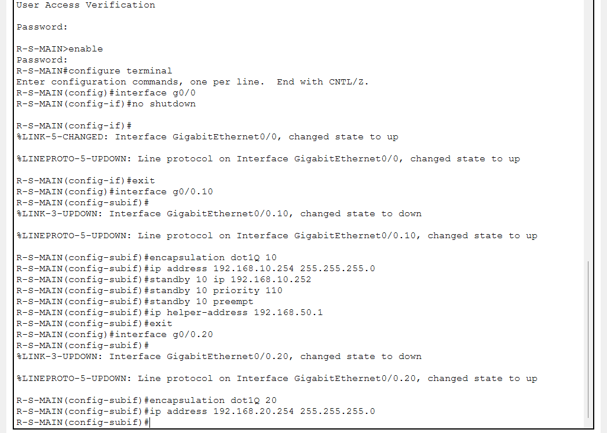

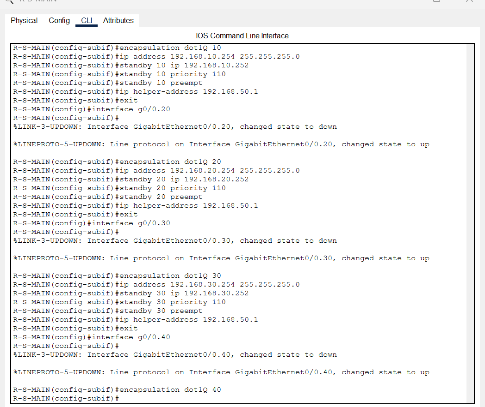


<div dir="rtl">

| פקודה | מה היא עושה | למה |
|---|---|---|
| `interface g0/0` ואז `no shutdown` | מדליקה את הפורט הפיזי | פורטים בנתב כבויים כברירת מחדל |
| ‎`interface g0/0.10` | יוצרת ממשק משנה | אחד לכל VLAN |
| ‎`encapsulation dot1Q 10` | "זה VLAN 10" | **לפני** ה-IP, אחרת הנתב מסרב |
| ‎`standby 10 ip` | ה-VIP של קבוצה 10 | השער של המחשבים |
| ‎`standby 10 priority 110` | הגבוה מנצח | ראשי 110, גיבוי 105 |
| ‎`standby 10 preempt` | מחזיר את ה-Active | אחרת הגיבוי נשאר Active |
| ‎`ip helper-address` | מעביר DHCP לשרת | לא צריך ב-VLAN 50, כי השרת נמצא שם |

</div>

<details dir="rtl" open><summary><b>📘 הסבר שאר הפקודות של המשימה</b></summary>

<div dir="rtl">

| פקודה | מה היא עושה, ולמה היא כאן |
|---|---|
| ‎`ping 192.168.40.21` | שולח 4 הודעות בדיקה. תשובות = הדרך עובדת ב**שני** הכיוונים. |
| ‎`ip address 192.168.10.254 255.255.255.0` | הכתובת והמסכה של הממשק. ברשת מקומית זו כתובת השער. |
| ‎`copy running-config startup-config` | שומר את מה שבזיכרון לקובץ ההפעלה. בלי זה הפסקת חשמל מוחקת את העבודה. |

</div>

</details>

**⏭ מה הלאה.** עכשיו חמש מחלקות תלויות בנתב אחד. זה מסוכן.

## משימה 2 — R-S-BKP
**📖 איך הגענו לכאן.** הנתב R-S-MAIN מנתב לכולם, לבד.

**🌐 הרשת עכשיו.** R-S-MAIN (2) מנתב לכולם. מגדירים את R-S-BKP (1):


**❗ הבעיה.** נתב אחד = תקלה אחת עוצרת חמש מחלקות. ב-R-S-MAIN, ‏`show standby brief`:

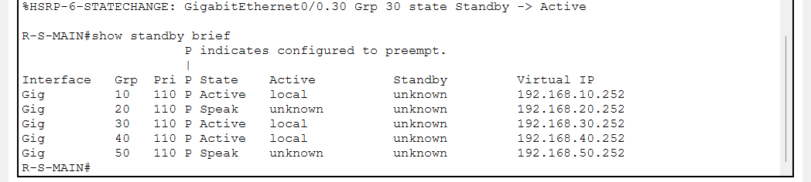

‏`Standby: unknown` אומר שאין גיבוי. (`Speak` = עדיין מתחיל, ואחרי כמה שניות `Active`.)

**🎯 מה רוצים עכשיו.** נתב שני שמשתתף ב**אותה כתובת שער**, וכך המחשבים לא ירגישו אם הראשון נופל.

**💡 הפתרון.** הנתב השני מצטרף **לאותן** קבוצות עם **אותו** VIP ועם עדיפות נמוכה יותר (105). אם הראשי משתתק, הוא נכנס במקומו.

**📋 מבצעים בפרויקט.** מעתיקים את הבלוק של משימה 1 ומשנים רק שני דברים. אילו?

### 🖱 הפתרון: על מה לוחצים ומה כותבים
אותו דבר, עם **‎.253** ו-**priority 105**:
```
configure terminal
interface g0/0
no shutdown
exit
interface g0/0.10
encapsulation dot1Q 10
ip address 192.168.10.253 255.255.255.0
standby 10 ip 192.168.10.252
standby 10 priority 105
standby 10 preempt
ip helper-address 192.168.50.1
exit
interface g0/0.20
encapsulation dot1Q 20
ip address 192.168.20.253 255.255.255.0
standby 20 ip 192.168.20.252
standby 20 priority 105
standby 20 preempt
ip helper-address 192.168.50.1
exit
interface g0/0.30
encapsulation dot1Q 30
ip address 192.168.30.253 255.255.255.0
standby 30 ip 192.168.30.252
standby 30 priority 105
standby 30 preempt
ip helper-address 192.168.50.1
exit
interface g0/0.40
encapsulation dot1Q 40
ip address 192.168.40.253 255.255.255.0
standby 40 ip 192.168.40.252
standby 40 priority 105
standby 40 preempt
ip helper-address 192.168.50.1
exit
interface g0/0.50
encapsulation dot1Q 50
ip address 192.168.50.253 255.255.255.0
standby 50 ip 192.168.50.252
standby 50 priority 105
standby 50 preempt
end
copy running-config startup-config
```


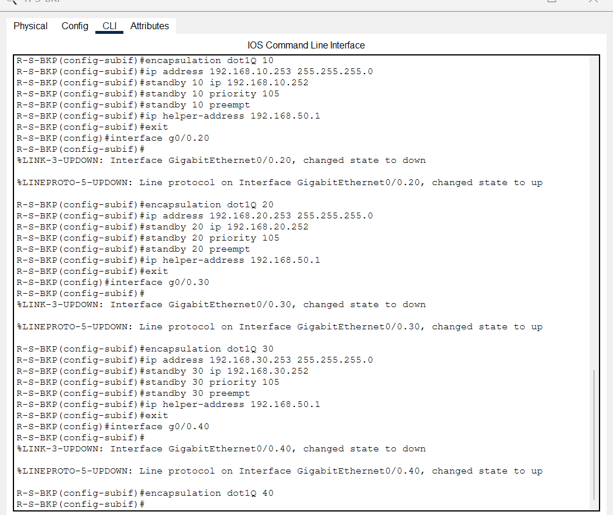


✅ מחכים כ-20 שניות. ‏`show standby brief` בשניהם: הראשי **Active**, הגיבוי **Standby**.


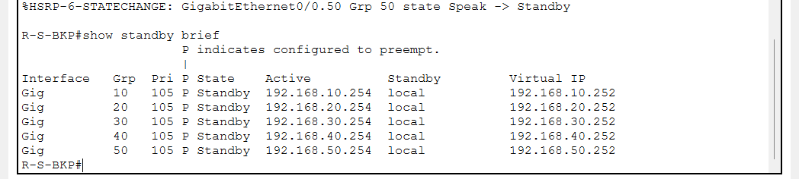

<details dir="rtl" open><summary><b>📘 הסבר הפקודות של המשימה</b></summary>

<div dir="rtl">

| פקודה | מה היא עושה, ולמה היא כאן |
|---|---|
| ‎`show standby brief` | מי Active ומי Standby בכל קבוצה, והעדיפות. |
| ‎`interface g0/0` | בוחרים פורט. כל מה שמתחת חל עליו, עד `exit`. |
| ‎`no shutdown` | מדליק את הפורט. פורטים של נתב כבויים כברירת מחדל. |
| ‎`interface g0/0.10` | **ממשק משנה**: דלת וירטואלית על אותו פורט פיזי, אחת לכל VLAN. |
| ‎`encapsulation dot1Q 10` | "ממשק המשנה הזה הוא VLAN מספר…". חייב לבוא **לפני** כתובת ה-IP. |
| ‎`ip address 192.168.10.253 255.255.255.0` | הכתובת והמסכה של הממשק. ברשת מקומית זו כתובת השער. |
| ‎`standby 10 ip 192.168.10.252` | ‏HSRP: הכתובת הווירטואלית המשותפת (VIP) ששני הנתבים עונים בשמה. זה השער של המחשבים. |
| ‎`standby 10 priority 105` | המספר הגבוה הוא Active. ראשי 110, גיבוי 105. |
| ‎`standby 10 preempt` | נתב עם עדיפות גבוהה יותר לוקח את התפקיד בחזרה כשהוא חוזר. |
| ‎`ip helper-address 192.168.50.1` | ה-relay של DHCP: הופך את השידור של המחשב להודעה ישירה לשרת הזה. |
| ‎`copy running-config startup-config` | שומר את מה שבזיכרון לקובץ ההפעלה. בלי זה הפסקת חשמל מוחקת את העבודה. |

</div>

</details>

**⏭ מה הלאה.** יש דרך לשרת. הגיע הזמן לשים עליו משהו.

## משימה 3 — השרת
**📖 איך הגענו לכאן.** המחלקות מחוברות, והשרת דולק וריק.

**🌐 הרשת עכשיו.** המחלקות מחוברות. השרת דולק, אבל ריק:

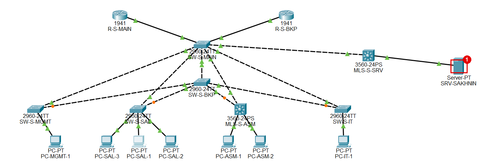

**❗ הבעיה.** ב-PC-SAL-1 ‏←‏ Desktop ‏←‏ **Web Browser** ‏←‏ `http://www.osem.com` ‏←‏ Go. לא מופיע כלום:

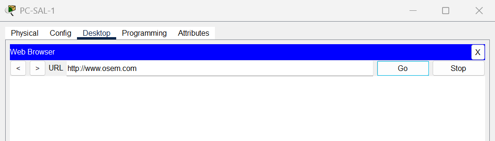

אף אחד לא מכיר את השם, אין אתר, את הכתובות מקלידים ביד בכל מחשב, ואין דואר.

**🎯 מה רוצים עכשיו.** חמישה שירותים בשרת אחד: כתובות (DHCP), שמות (DNS), אתר, קבצים (FTP) ודואר.

**💡 הפתרון.** חמישה שירותים בשרת אחד:

<div dir="rtl">

| שירות | הבעיה בלעדיו | מה הוא עושה |
|---|---|---|
| ‎DHCP | מקלידים כתובת בכל מחשב, עם טעויות | נותן כתובת, שער ו-DNS לבד |
| ‎DNS | צריך לזכור 192.168.50.1 | מתרגם www.osem.com לכתובת IP |
| ‎HTTP | אין אתר לחברה | מציג את הדף |
| ‎FTP | קבצים עוברים על דיסק-און-קי | תיקייה משותפת עם משתמש וסיסמה |
| ‎EMAIL | אין דואר בין עובדים | SMTP שולח, POP3 קורא |

</div>

**📋 מבצעים בפרויקט.** תלמיד אחד לכל שירות, עם הערכים מהטבלאות שלמטה. קודם כתובת קבועה!

### 🖱 הפתרון: על מה לוחצים ומה כותבים
לוחצים על **SRV-SAKHNIN** ‏←‏ **Services** (1). הרשימה משמאל, למשל DHCP ‏(2) ו-DNS ‏(3):

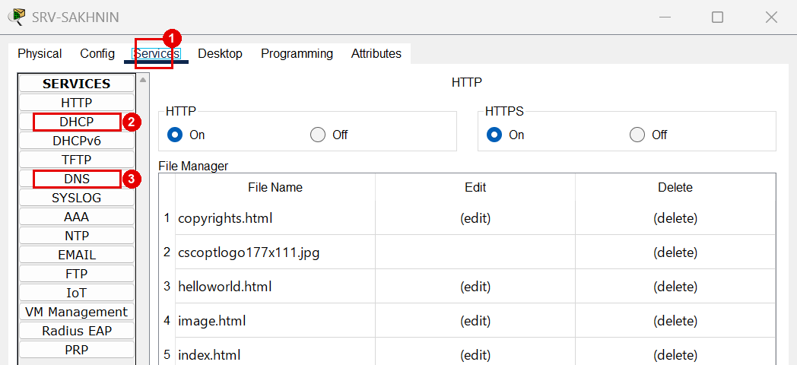

### 3.1 כתובת קבועה

❗ אם הכתובת של השרת משתנה, כל מחשב, רשומת DNS ו-helper מצביעים למקום הלא נכון. 💡 כתובת קבועה, וה-**VIP** בתור שער.

‏**SRV-SAKHNIN** ‏←‏ ‏**Desktop** ‏←‏ ‏**IP Configuration** ‏←‏ ‏Static: כתובת ‎`192.168.50.1` (1), מסכה
‎`255.255.255.0` (2), שער **‎`192.168.50.252`** — ה-VIP (3), ‏DNS ‏‎`192.168.50.1` (4).

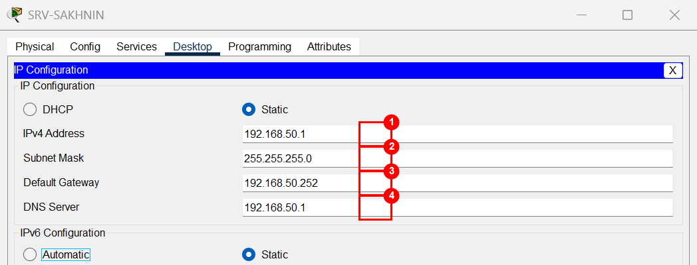

🧠 לשרת חייבת להיות כתובת **קבועה**, כי כולם מחפשים אותו שם.

### ‏3.2 DHCP

❗ מחשבים מארבע רשתות שונות פונים לשרת אחד. 💡 **pool** לכל רשת, וב-pool השער של אותה רשת.

‏**Services** (1) ‏←‏ ‏**DHCP** (2). לכל שורה ממלאים את הטופס (3) ולוחצים **Add** (4):

<div dir="rtl">

| ‎Pool Name | ‎Default Gateway | ‎DNS Server | ‎Start IP | ‎Mask | ‎Max users |
|---|---|---|---|---|---|
| ‎MANAGEMENT | ‎192.168.10.252 | ‎192.168.50.1 | ‎192.168.10.20 | ‎255.255.255.0 | ‎50 |
| ‎DISPLAY-SALARIES | ‎192.168.20.252 | ‎192.168.50.1 | ‎192.168.20.20 | ‎255.255.255.0 | ‎50 |
| ‎ASSEMBLY-MEETING | ‎192.168.30.252 | ‎192.168.50.1 | ‎192.168.30.20 | ‎255.255.255.0 | ‎50 |
| ‎IT | ‎192.168.40.252 | ‎192.168.50.1 | ‎192.168.40.20 | ‎255.255.255.0 | ‎50 |

</div>


לסיום **Service: On** (1) ו-**Save** (2).

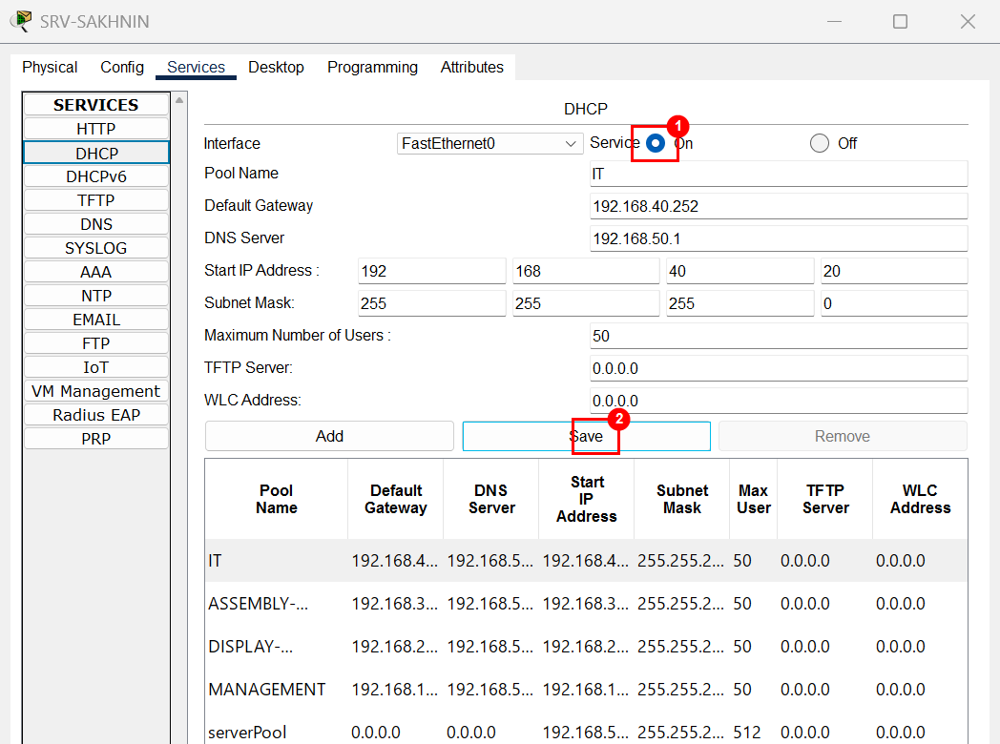

### ‏3.3 DNS

❗ אנשים זוכרים שמות, מחשבים צריכים IP. 💡 **רשומת A**: שם ‏←‏ IP.

‏**DNS** ‏←‏ ‏On (1). ‏Name (2) ‏`www.osem.com`, ‏Address (3) ‏‎`192.168.50.1` ‏←‏ ‏**Add** (4). שוב בשביל `mail.osem.com`.


### 3.4 אתר

❗ לפתוח את דף ברירת המחדל של Cisco לא מוכיח כלום. 💡 טקסט משלנו: אם רואים אותו, הגענו לשרת **שלנו**.

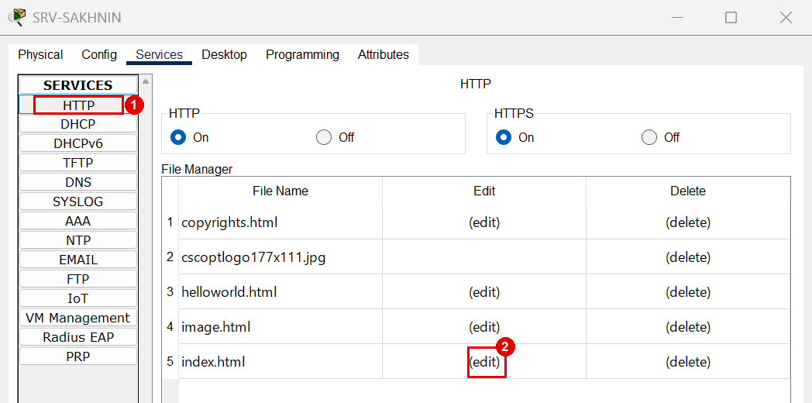

‏**HTTP** ‏←‏ ליד `index.html` לוחצים **(edit)**. בשורה השלישית משאירים את ‎`<hr>`‎ ומחליפים את הטקסט שאחריו (‎`Welcome to Cisco Packet Tracer. … Mind Wide Open.`‎) ב-`Welcome to Osem - Sakhnin branch` ‏←‏ ‏**Save** (1) ‏←‏ ‏**Yes** כדי לדרוס את הקובץ.


### ‏3.5 FTP

❗ כל אחד היה יכול לקחת את הקבצים של החברה. 💡 משתמש, סיסמה והרשאות.

‏**FTP** ‏←‏ ‏Username (1) ‏`sakhnin`, ‏Password (2) ‏`Osem#Ftp`, מסמנים את כל חמש ההרשאות ‏←‏ ‏**Add** (3).


### 3.6 דואר

❗ לשרת אין תיבות דואר והוא לא יודע על איזה דומיין הוא אחראי. 💡 דומיין, ומשתמש לכל עובד.

‏**EMAIL** ‏←‏ ‏Domain Name (1) ‏`osem.com` ‏←‏ ‏**Set** (2). ‏User (3) ‏`sakhnin1`, ‏Password (4) ‏`Osem#Mail` ‏←‏ ‎`+`‎ (5). שוב בשביל `sakhnin2`.

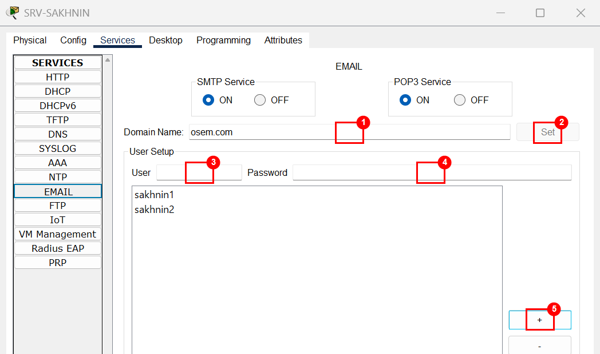

<details dir="rtl" open><summary><b>📘 הטופס, שדה אחר שדה</b></summary>

<div dir="rtl">

| שדה או לחיצה | מה זה, ולמה |
|---|---|
| ‎**DHCP** ‏←‏ Pool Name | שם הרשימה, רק בשבילנו. ‏pool אחד לכל רשת. |
| ‎Default Gateway | השער שהמחשב יקבל: ה-**VIP** ‏(252.), כדי שיישאר מחובר גם כשנתב נופל. |
| ‎DNS Server | את מי המחשב ישאל על שמות: את השרת הזה. |
| ‎Start IP Address | הכתובת הראשונה לחלוקה. מתחילים מ-20, כך שהנמוכות נשארות למכשירים קבועים. |
| ‎Subnet Mask, Maximum Number of Users | גודל הרשת, וכמה כתובות לחלק. |
| **Add**, ואז **Save** | הכפתור Add יוצר שורה חדשה. הכפתור Save שומר את הגדרות השירות. |
| ‎**DNS** ‏←‏ Name / Address | מה שאנשים כותבים, והכתובת שהמחשב צריך. |
| ‎**HTTP** ‏←‏ index.html | הדף הראשון באתר. טקסט משלנו מוכיח שהגענו לשרת **שלנו**. |
| **FTP** ‏←‏ Username, Password, הרשאות | מי נכנס, ומה מותר לו: Write, ‏Read, ‏Delete, ‏Rename, ‏List. |
| ‎**EMAIL** ‏←‏ Domain Name, User | החלק שאחרי ה-‎`@`‎, ותיבת דואר לכל עובד. |

</div>

</details>

**⏭ מה הלאה.** לשרת יש כתובות לתת. המחשבים עדיין עם הכתובות שהקלדנו.

## משימה 4 — המחשבים מקבלים כתובת
**📖 איך הגענו לכאן.** שירות ה-DHCP מחכה, ולמחשבים עדיין כתובות שהוקלדו ביד, בלי שער.

**🌐 הרשת עכשיו.** השרת מחלק כתובות. לשבעת המחשבים יש עדיין כתובות שהוקלדו ביד, **בלי שער**:


**❗ הבעיה.** בלי שער המחשב לא יוצא מה-VLAN שלו, והשרת נמצא ב-VLAN אחר. ועוד יותר גרוע: מחשב שמבקש DHCP שולח broadcast, ו-broadcast נעצר בנתב.

**🎯 מה רוצים עכשיו.** כל מחשב מבקש כתובת, והנתבים מעבירים את הבקשה לשרת.

**💡 הפתרון.** DHCP במחשב ועוד הממסר (`ip helper-address`) שכתבנו במשימות 1 ו-2. ‏DORA מוסבר בתיאוריה 1.3.

**📋 מבצעים בפרויקט.** מעבירים את כל המחשבים ל-DHCP ורושמים לכל אחד: כתובת, שער, DNS. השער הוא ‎.254 או ‎.252? למה?

### 🖱 הפתרון: על מה לוחצים ומה כותבים
כל מחשב ‏←‏ ‏Desktop ‏←‏ ‏**IP Configuration** ‏←‏ ‏**DHCP** (1). השער ‎.252 וה-DNS מגיעים לבד:


⚠️ לפעמים הבקשה הראשונה נכשלת, כי STP ו-HSRP עדיין עולים. לוחצים Static ואז שוב DHCP, או `ipconfig /renew`.

<details dir="rtl" open><summary><b>📘 הטופס, שדה אחר שדה</b></summary>

<div dir="rtl">

| שדה או לחיצה | מה זה, ולמה |
|---|---|
| **DHCP** (במקום Static) | המחשב מבקש לבד. השער וה-DNS מגיעים יחד עם הכתובת. |

</div>

</details>

<details dir="rtl" open><summary><b>📘 הסבר הפקודות של המשימה</b></summary>

<div dir="rtl">

| פקודה | מה היא עושה, ולמה היא כאן |
|---|---|
| ‎`ipconfig /renew` | המחשב מבקש שוב כתובת מ-DHCP. |

</div>

</details>

**⏭ מה הלאה.** הכול נראה תקין. בודקים כל שירות לחוד.

## משימה 5 — בודקים הכול
**📖 איך הגענו לכאן.** הכתובות מגיעות לבד וכל השירותים דולקים.

**🌐 הרשת עכשיו.** חמישה שירותים, שני נתבים ושבעה מחשבים עם כתובות.


**❗ הבעיה.** דף אחד שנפתח לא מוכיח ש-DNS, ‏FTP והדואר עובדים. כשמשהו נכשל צריך לדעת **איזו** חוליה בשרשרת נשברה.

**🎯 מה רוצים עכשיו.** בודקים כל חוליה בשרשרת לבד, כדי לדעת מה נשבר כשמשהו נשבר.

**💡 הפתרון.** בדיקה אחת לכל שירות, מ-VLAN-ים שונים, בסדר הזה: DNS ‏←‏ web ‏←‏ ‏ping ו-FTP ‏←‏ המסלול ‏←‏ דואר.

**📋 מבצעים בפרויקט.** מבצעים את חמש הבדיקות. בכל אחת אומרים איזה שירות ואיזה פורט היא בודקת.

### 🖱 הפתרון: על מה לוחצים ומה כותבים
1. ‏**PC-IT-1**: ‏`nslookup www.osem.com`

   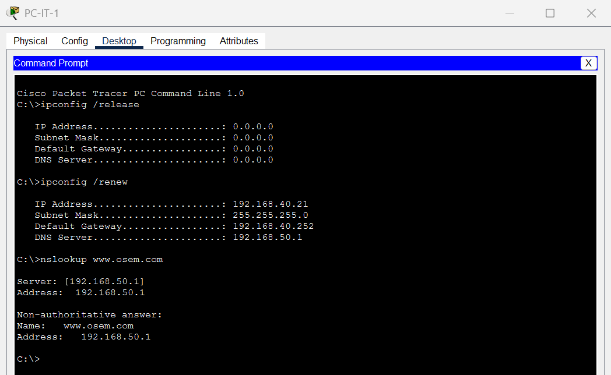
2. ‏**PC-SAL-2** ‏←‏ ‏Desktop ‏←‏ ‏**Web Browser** ‏←‏ ‏`http://www.osem.com` ‏←‏ ‏**Go**

   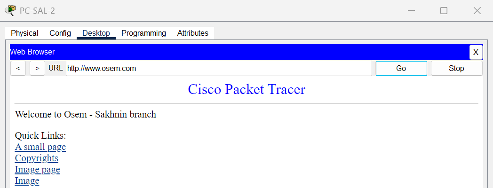
3. ‏**PC-SAL-1**: ‏`ping 192.168.50.1`, ואז `ftp 192.168.50.1` (משתמש `sakhnin`, סיסמה `Osem#Ftp`), ולסיום `quit`.

   ‏
4. ‏**PC-SAL-1**: ‏`tracert 192.168.40.21` (הכתובת של PC-IT-1, בדקו את שלכם עם `ipconfig`). הקפיצה הראשונה היא **‎.254**, הנתב הראשי. זכרו את זה למשימה 7!

   
5. **דואר.** ‏PC-SAL-1 ‏←‏ ‏Desktop ‏←‏ ‏**Email** ‏←‏ ממלאים ולוחצים **Save**:

   

   ב-PC-SAL-2 אותו דבר עם `sakhnin2`. אחר כך ב-PC-SAL-1 ‏←‏ ‏**Compose**: ‏To (1) ‏`sakhnin2@osem.com`, ‏Subject (2) ‏←‏ ‏**Send** (3).

   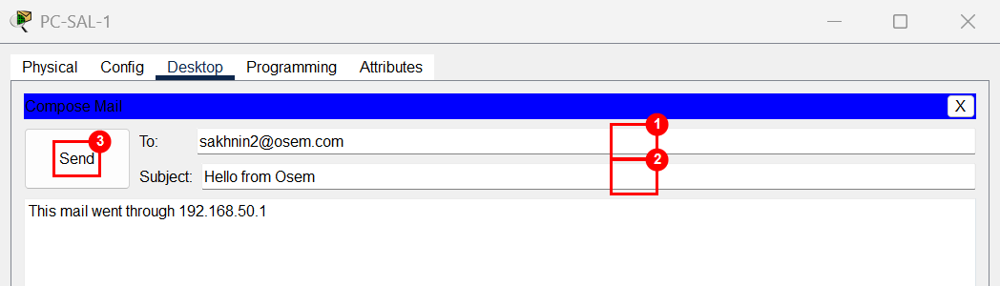

   ב-PC-SAL-2 ‏←‏ ‏**Receive** (1):

   

<details dir="rtl" open><summary><b>📘 הסבר הפקודות של המשימה</b></summary>

<div dir="rtl">

| פקודה | מה היא עושה, ולמה היא כאן |
|---|---|
| ‎`ping 192.168.50.1` | שולח 4 הודעות בדיקה. תשובות = הדרך עובדת ב**שני** הכיוונים. |
| ‎`tracert 192.168.40.21` | מראה כל נתב בדרך. |
| ‎`ipconfig` | מראה את הכתובת, המסכה והשער של המחשב. |

</div>

</details>

**⏭ מה הלאה.** מחשב מאמין למי שעונה ראשון. ומה אם זה לא השרת שלנו?

## משימה 6 — DHCP Snooping
**📖 איך הגענו לכאן.** ה-DHCP עובד, ואף אחד לא בודק מי עונה.

**🌐 הרשת עכשיו.** כולם מקבלים כתובת לבד. מי שעונה **ראשון** מנצח:


**❗ הבעיה.** מחשב מאמין ל**כל** שרת DHCP. נתב ביתי שחובר בטעות, או תוקף, יכול לתת שער מזויף ולקרוא את כל התעבורה. המתג לא בודק. ב-SW-S-MAIN, ‏`show ip dhcp snooping`:

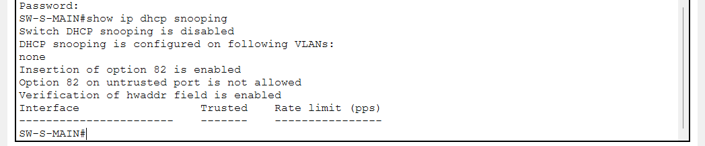

**🎯 מה רוצים עכשיו.** המתגים מקבלים תשובות DHCP רק מהדרכים שמובילות לשרת שלנו.

**💡 הפתרון.** DHCP snooping: תשובות של שרת מתקבלות רק מפורטים **אמינים** (trusted, תיאוריה 1.5).

**📋 מבצעים בפרויקט.** מפעילים ל-VLAN 10–40 ומחליטים אילו פורטים של SW-S-MAIN אמינים. אחר כך תוקפים, ב-6.1.

### 🖱 הפתרון: על מה לוחצים ומה כותבים
**SW-S-MAIN:**
```
configure terminal
ip dhcp snooping
ip dhcp snooping vlan 10,20,30,40
no ip dhcp snooping information option
interface range fa0/2 , fa0/5 - 7
ip dhcp snooping trust
end
copy running-config startup-config
show ip dhcp snooping
```


<div dir="rtl">

| פורט | מחובר ל | למה מהימן |
|---|---|---|
| ‎Fa0/2 | מתג השרת | שם נמצא שרת ה-DHCP האמיתי |
| ‎Fa0/5, Fa0/6 | הנתבים | מהם מגיעות תשובות ה-relay |
| ‎Fa0/7 | מתג הגיבוי | מסלול נוסף לאותה רשת |

</div>


💡 ב-Packet Tracer הטבלה `show ip dhcp snooping binding` נשארה ריקה בבדיקות שלנו, לכן בודקים עם `show ip dhcp snooping`.

✅ במחשב: `ipconfig /release` ואז `ipconfig /renew` עדיין עובדים.

### 6.1 רואים את ההתקפה
"זר" מחלק כתובות. לצורך ההדגמה **R-S-BKP** משחק את התוקף:
```
configure terminal
ip dhcp excluded-address 192.168.20.1 192.168.20.199
ip dhcp pool ROGUE
network 192.168.20.0 255.255.255.0
default-router 192.168.20.99
dns-server 6.6.6.6
end
```


ב-**PC-SAL-2**: ‏`ipconfig /release` ואז `ipconfig /renew`. השער הוא **192.168.20.99** וה-DNS ‏**6.6.6.6**: כל התנועה של המחשב
הולכת עכשיו אל התוקף!

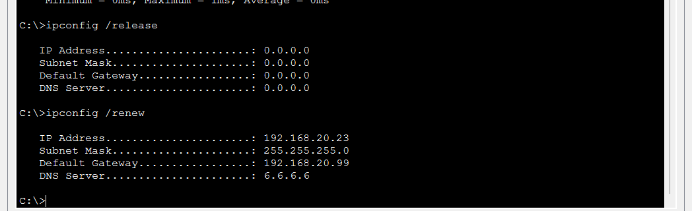

למה ה-snooping לא עצר אותו? כי הפורט אל R-S-BKP הוא **trusted**. ב-**SW-S-MAIN** לוקחים ממנו את האמון:
```
configure terminal
interface fa0/5
no ip dhcp snooping trust
end
```


שוב release ו-renew ב-PC-SAL-2: השער **‎.252** וה-DNS ‏**192.168.50.1**. המתג זרק את ההצעה המזויפת.

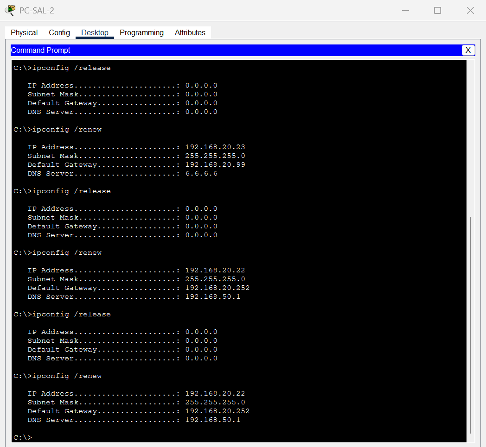

**מנקים** ב-R-S-BKP:
```
configure terminal
no ip dhcp pool ROGUE
no ip dhcp excluded-address 192.168.20.1 192.168.20.199
end
```


וב-SW-S-MAIN, ‏`interface fa0/5`: ‏`ip dhcp snooping trust`.

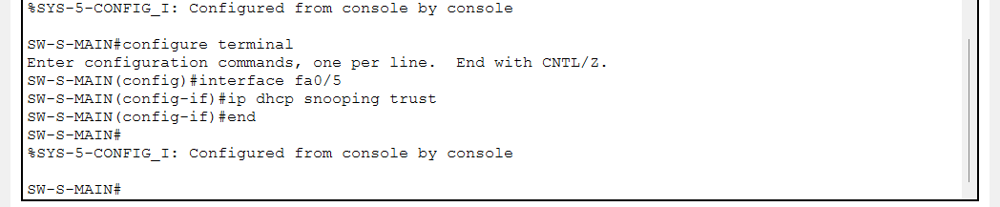

🧠 ה-snooping מגן רק במתג שבו הוא פועל. שרת זר שמחובר ל-SW-S-SAL עדיין יכול לרמות את השכנים שלו **באותו** מתג, ולכן הגנה
מלאה מפעילה אותו בכל מתג מחלקה (תרגיל 4).

<details dir="rtl" open><summary><b>📘 הסבר הפקודות של המשימה</b></summary>

<div dir="rtl">

| פקודה | מה היא עושה, ולמה היא כאן |
|---|---|
| ‎`show ip dhcp snooping` | האם snooping דולק, באילו VLAN, ואילו פורטים אמינים. |
| ‎`ip dhcp snooping` | מפעיל DHCP snooping בכל המתג. |
| ‎`ip dhcp snooping vlan 10,20,30,40` | באילו VLAN בודקים DHCP. |
| ‎`no ip dhcp snooping information option` | לא מוסיף "option 82" לבקשות; בלי השורה הזו ה-relay זורק אותן. |
| ‎`interface range fa0/2 , fa0/5 - 7` | מגדיר כמה פורטים ביחד. שימו לב לרווחים סביב הפסיק והמקף. |
| ‎`ip dhcp snooping trust` | מותר לקבל **תשובות** DHCP מהפורט הזה: הוא מוביל לשרת שלנו. כל השאר לא אמינים. |
| ‎`copy running-config startup-config` | שומר את מה שבזיכרון לקובץ ההפעלה. בלי זה הפסקת חשמל מוחקת את העבודה. |
| ‎`show ip dhcp snooping binding` | הטבלה של מי קיבל איזו כתובת, ובאיזה פורט. |
| ‎`ipconfig /release` | המחשב מחזיר את הכתובת שלו. |
| ‎`ipconfig /renew` | המחשב מבקש שוב כתובת מ-DHCP. |
| ‎`ip dhcp excluded-address 192.168.20.1 192.168.20.199` | כתובות שהשרת הזה לא יחלק. |
| ‎`ip dhcp pool ROGUE` | יוצר רשימת כתובות לחלוקה. כאן: הרשימה של **התוקף**. |
| ‎`network 192.168.20.0 255.255.255.0` | הרשת שממנה ה-pool הזה מחלק כתובות (עם המסכה שלה). |
| ‎`default-router 192.168.20.99` | השער שהלקוחות מקבלים (כאן מזויף). |
| ‎`dns-server 6.6.6.6` | ה-DNS שהלקוחות מקבלים (כאן מזויף). |
| ‎`interface fa0/5` | בוחרים פורט. כל מה שמתחת חל עליו, עד `exit`. |
| ‎`no ip dhcp snooping trust` | מבטל את האמון: תשובות DHCP מכאן נזרקות שוב. |
| ‎`no ip dhcp pool ROGUE` | מוחק את ה-pool של התוקף (ניקיון). |
| ‎`no ip dhcp excluded-address 192.168.20.1 192.168.20.199` | מבטל את הכתובות השמורות (ניקיון אחרי ההתקפה). |

</div>

</details>

**⏭ מה הלאה.** הגנו על הכתובות. השאלה האחרונה להיום: הגיבוי באמת מחליף?

## משימה 7 — מפילים את הנתב הראשי
**📖 איך הגענו לכאן.** שני נתבים, כתובת משותפת אחת, כל השירותים עובדים.

**🌐 הרשת עכשיו.** שני נתבים עם HSRP. שוברים אחד בכוונה:

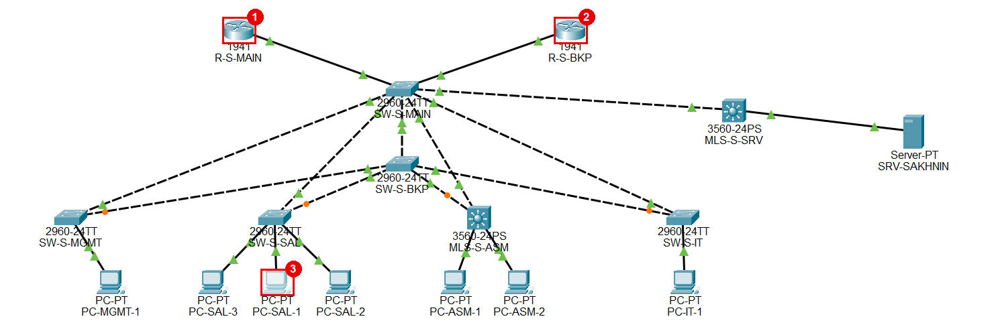

**❗ הבעיה.** גיבוי שלא נבדק הוא לא גיבוי. בפרויקט האמיתי שממנו התחלנו, חלק מהגיבוי אף פעם לא עבד, ואף אחד לא ידע.

**🎯 מה רוצים עכשיו.** מפילים את הנתב הראשי בכוונה באמצע ping, ורואים את הגיבוי לוקח את המקום.

**💡 הפתרון.** תקלה מתוכננת: מכבים את הראשי, בודקים שהעבודה ממשיכה, ומחזירים.

**📋 מבצעים בפרויקט.** לפני: איזה צעד ראשון מראה `tracert`? נחשו מה הוא יראה בזמן התקלה ואחריה.

### 🖱 הפתרון: על מה לוחצים ומה כותבים
1. ‏**R-S-MAIN**: ‏`configure terminal` ‏←‏ ‏`interface g0/0` ‏←‏ ‏`shutdown`.

   

2. אחרי כ-10 שניות ב-**R-S-BKP**: ‏`show standby brief` ‏←‏ **Active**.

   
3. ‏**PC-SAL-1**: ‏`ping 192.168.50.1` עובד, ו-`tracert 192.168.40.21` עובר עכשיו דרך **‎.253**. במחשב **לא שינינו כלום**.

   
4. מחזירים: `no shutdown`, מחכים 30 שניות. ‏R-S-MAIN שוב Active, בזכות `preempt`.

   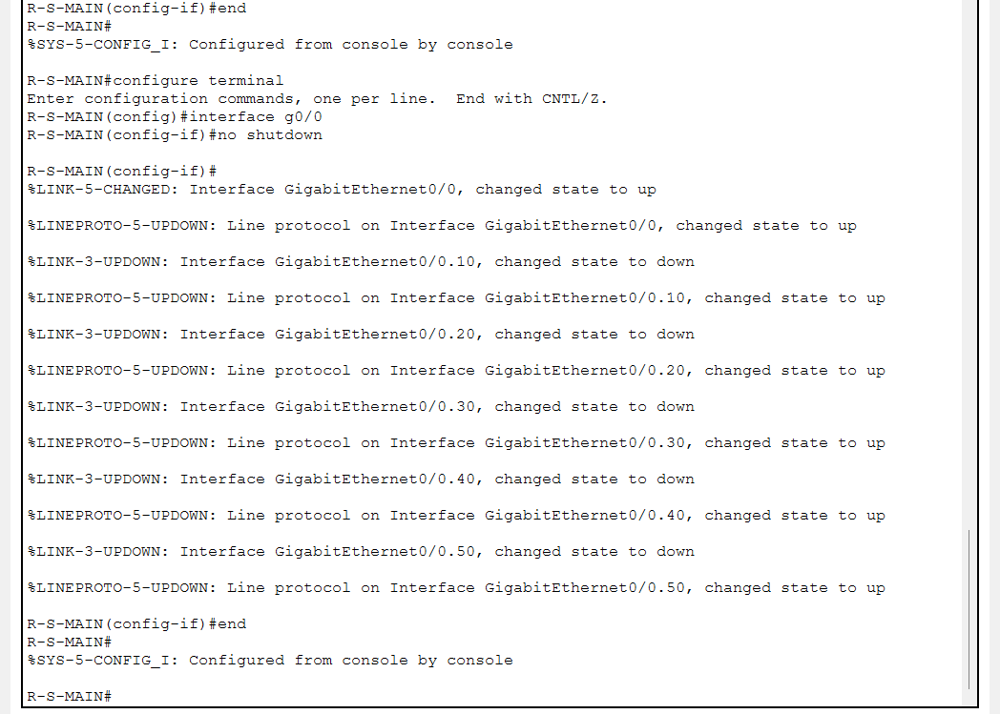

   
5. ‏`copy running-config startup-config` בנתבים וב-SW-S-MAIN, ו-File ‏←‏ Save.

   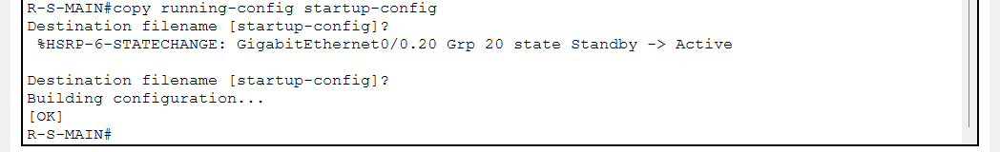

<details dir="rtl" open><summary><b>📘 הסבר הפקודות של המשימה</b></summary>

<div dir="rtl">

| פקודה | מה היא עושה, ולמה היא כאן |
|---|---|
| ‎`tracert` | מראה כל נתב בדרך. |
| ‎`interface g0/0` | בוחרים פורט. כל מה שמתחת חל עליו, עד `exit`. |
| ‎`shutdown` | מכבה את הפורט. |
| ‎`show standby brief` | מי Active ומי Standby בכל קבוצה, והעדיפות. |
| ‎`ping 192.168.50.1` | שולח 4 הודעות בדיקה. תשובות = הדרך עובדת ב**שני** הכיוונים. |
| ‎`no shutdown` | מדליק את הפורט. פורטים של נתב כבויים כברירת מחדל. |

</div>

</details>

**⏭ מה הלאה.** הסניף שורד תקלה. אבל הוא לבד בעולם, וזה שיעור 4.

## 👀 רואים את זה קורה — ה-relay וה-MAC הווירטואלי
על מצב Simulation הסברנו ב[שיעור 1](../lesson-01/).

### א. DHCP דרך ה-relay
1. במחשב PC-SAL-1 ‏←‏ Desktop ‏←‏ **IP Configuration** ‏←‏ **Static**.
2. עוברים ל-**Simulation** ‏←‏ מסננים: רק **DHCP**.
3. ב-IP Configuration לוחצים **DHCP** וסוגרים את החלון.
4. מתקדמים עד ש-**R-S-MAIN** מופיע בעמודה *At Device*, ופותחים את החבילה הזו.

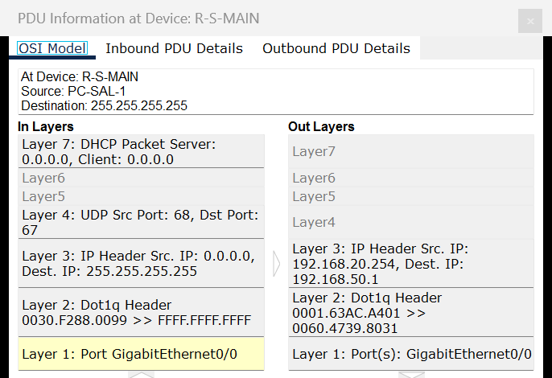

<div dir="rtl">

| | נכנס | יוצא |
|---|---|---|
| IP מקור | 0.0.0.0 (עוד אין כתובת) | ‎**192.168.20.254** |
| IP יעד | 255.255.255.255 (כולם) | **192.168.50.1** (השרת) |

</div>

זו כל המשמעות של `ip helper-address`. הבקשה באה מהרשת 192.168.20.0, ולכן השרת יודע מאיזה pool לתת.

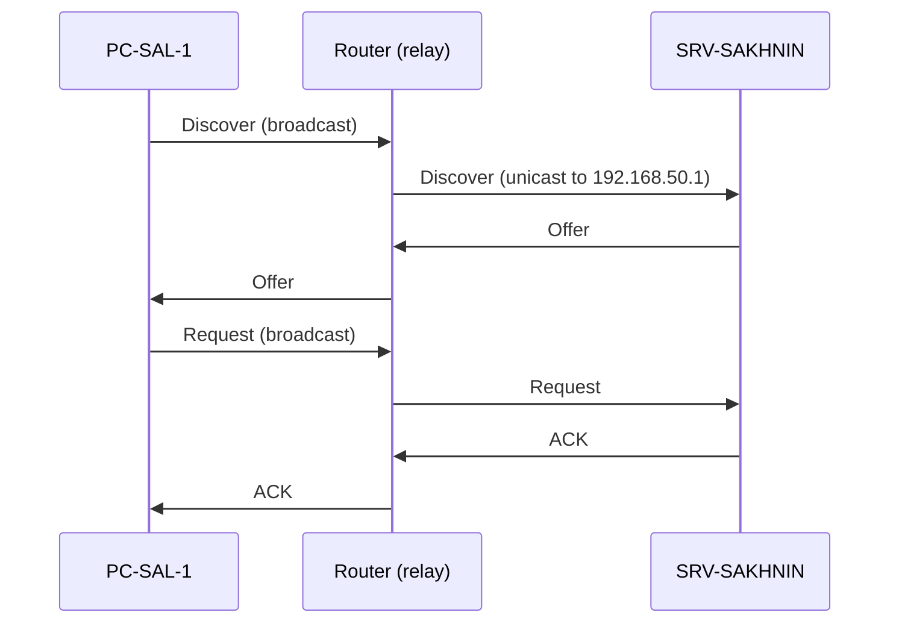

❓ גם R-S-BKP שולח עותק לשרת. זו בעיה?

<details dir="rtl"><summary>תשובה</summary>

לא. לשני הנתבים יש helper, ולכן השרת מקבל את הבקשה פעמיים והמחשב משתמש בהצעה אחת. בגלל זה DHCP עובד גם
כשנתב אחד נפל.

</details>

### ב. ה-ping וה-MAC הווירטואלי
עוברים ל-**Realtime** ומחכים של-PC-SAL-1 תהיה כתובת. אחר כך **Simulation** ‏←‏ רק **ICMP** ‏←‏ `ping 192.168.50.1`. פותחים את החבילה
ב-**R-S-MAIN** ‏←‏ **Next Layer**:


<div dir="rtl">

| מסתכלים על | משמעות |
|---|---|
| נכנס: ‎`0000.0C07.AC14` | ה-**MAC הווירטואלי של HSRP**: המספר 14 בהקסה = 20 = מספר הקבוצה |
| ‎*The subinterface GigabitEthernet0/0.20 accepts frames* | זה router-on-a-stick: התג בחר את ממשק המשנה |
| כתובות ה-IP זהות בשני הצדדים | נתב לא משנה את ה-IP (בלי NAT) |
| כתובות ה-MAC שונות בשני הצדדים | הנתב כותב כותרת שכבה 2 **חדשה** |

</div>

💡 אולי תראו עותקים גם במתגים ובמחשבים אחרים. מתג שעוד לא למד את ה-MAC הווירטואלי מציף, ומי שהחבילה
לא מיועדת לו זורק אותה.

✏️ **נסו:** ping למחשב ב-VLAN 30. מה ה-MAC של היעד כשהחבילה יוצאת מ-PC-SAL-1?

<details dir="rtl"><summary>תשובה</summary>

שוב ‎`0000.0C07.AC14`: כל מה שיוצא מהרשת הולך לשער.

</details>

## 🧯 לא עובד?

<div dir="rtl">

| מה רואים | כנראה | מה עושים |
|---|---|---|
| ‎`% Configuring IP routing on a LAN subinterface is only allowed if...`‎ | ה-IP נכתב לפני `encapsulation dot1Q` | קודם כותבים encapsulation |
| שני הנתבים Active | הם לא רואים זה את זה | ‏trunk ב-Fa0/5 וב-Fa0/6, אותו מספר VLAN |
| ‎`DHCP request failed` | חסר helper, השירות Off, או ש-STP עוד לא מוכן | `show run`, בשרת DHCP על On, מחכים ועושים ‎`/renew` |
| כתובת 169.254.x.x | אף אחד לא ענה לבקשה | כמו בשורה הקודמת |
| ‏ping לפי IP עובד, לפי שם לא | ‎‏DNS | `nslookup`, בודקים את הרשומה ואת ה-DNS במחשב |
| מייל לא נשלח | לא לחצו Set לדומיין, או משתמש שגוי | ‏EMAIL ואז Set, בודקים `sakhnin1` / `Osem#Mail` |

</div>

---

## 🔎 מצאו את הטעות — מפרויקט אמיתי
1. ‏`standby 10 track` הוגדר על פורט ה-**LAN** עצמו.
2. לפורט הפיזי `g0/0` הייתה כתובת IP.
3. השער של השרת היה **‎.254**.
4. ה-pool של ברירת המחדל (`serverPool`) חילק 192.168.50.0–51.255, הרשת של השרתים עצמם.

<details dir="rtl"><summary>תשובה</summary>

1. אם פורט ה-LAN נופל, HSRP יודע בכל מקרה. ה-track עוזר לפורט ש**יוצא לאינטרנט** (שיעור 4).
2. עם ממשקי משנה לכל VLAN יש IP בממשק המשנה שלו. IP בפורט הפיזי שייך ל-native VLAN ומבלבל.
3. ‏‎.254 הוא הנתב הראשי עצמו. כשהוא נופל השרת מנותק. התיקון: ה-VIP ‏**‎.252**.
4. לשרתים יש כתובות קבועות. ‏pool ברשת שלהם עלול לתת למחשב כתובת שכבר תפוסה.

</details>

## 🏋 תרגילים
1. מוחקים את `ip helper-address` מ-g0/0.20 (ב**שני** הנתבים) ועושים `ipconfig /renew` ב-PC-SAL-1. מה קורה? למה רק ב-VLAN 20? החזירו.
2. הפכו את R-S-BKP ל-Active רק ב-VLAN 40 (רמז: priority). בשביל מה זה טוב?
3. הוסיפו `ftp.osem.com` ל-DNS והתחברו עם `ftp ftp.osem.com`.

4. הפעילו DHCP snooping גם ב-**SW-S-SAL**: ‏VLAN 20, אמון רק ב-trunk-ים Fa0/1 ו-Fa0/4. בדקו ש-PC-SAL-2 עדיין מקבל כתובת.

<details dir="rtl"><summary>תשובות (בדקנו אותן)</summary>

1. ‏`DHCP request failed.`‎ המחשב PC-IT-1 ב-VLAN 40 עדיין מקבל כתובת: ה-helper מוגדר בכל ממשק משנה בנפרד. אחרי שמחזירים אותו, הכתובת מגיעה.
2. ב-R-S-BKP, ‏`interface g0/0.40`: ‏`standby 40 priority 120`. הפקודה `show standby brief` מראה שהוא Active בקבוצה 40 ו-Standby בשאר. בשביל מה? לחלק את העומס בין שני הנתבים. מחזירים ל-105.
3. ‏`Connected to ftp.osem.com`, משתמש `sakhnin`. ה-DNS רק מתרגם את השם, וה-FTP עצמו לא השתנה.
4. הפקודות, והמחשב עדיין מקבל כתובת:

<div dir="ltr">

```
configure terminal
ip dhcp snooping
ip dhcp snooping vlan 20
no ip dhcp snooping information option
interface range fa0/1 , fa0/4
ip dhcp snooping trust
end
```

</div>

</details>

## 🎓 להסביר לבוחן
- מה זה ממשק משנה ולמה צריך `encapsulation dot1Q`?
- מה זה VIP? מה קורה, שלב אחר שלב, כש-R-S-MAIN נופל?
- הסבירו DORA. למה צריך relay?
- מה ההבדל בין SMTP ל-POP3?
- איזו התקפה מונע DHCP Snooping, ואילו פורטים מהימנים?

<details dir="rtl"><summary>תשובות לדוגמה</summary>

1. חלק לוגי של פורט פיזי, אחד לכל VLAN. ‏`encapsulation dot1Q 20` אומר שמסגרות עם תג 20 שייכות אליו.
2. כתובת ה-IP הווירטואלית שהמחשבים משתמשים בה כשער. הראשי מפסיק לשלוח hello, אחרי כ-10 שניות הגיבוי נהיה Active ולוקח את ה-VIP ואת ה-MAC הווירטואלי, והמחשבים ממשיכים.
3. ‏Discover, ‏Offer, ‏Request, ‏Ack. ה-Discover הוא broadcast ונתב עוצר broadcast, ולכן הנתב מעביר אותו כהודעה ישירה.
4. ‏SMTP ‏(25) שולח דואר ומעביר בין שרתים. ‏POP3 ‏(110) מוריד דואר מהתיבה.
5. שרת DHCP מזויף שנותן שער שגוי (man in the middle). מהימנים: הפורט של השרת האמיתי, הנתבים והקישור למתג הגיבוי.

</details>

## ✏️ מבחן יציאה (3 דקות)
1. איזו כתובת רושמים כשער במחשב ב-VLAN 30?
2. עדיפות 110 ו-105: מי Active?
3. מה כותבים בפורט הפיזי g0/0?
4. באיזה פורט משתמש DNS?
5. איפה כותבים `ip helper-address`?

<details dir="rtl"><summary>תשובות</summary>

1. ‏192.168.30.252.
2. ‏110.
3. רק `no shutdown`, בלי IP.
4. ‏UDP 53.
5. בממשק המשנה שאליו מגיעה הבקשה של המחשבים.

</details>

## ⏭ מה עשינו, ומה הלאה
**מה עשינו.** סכנין היא סניף שלם. המחלקות מדברות דרך שני נתבים שמחליפים זה את זה, והשרת עושה את העבודה היומית.

**מה עדיין חסר.** סכנין היא **אי**. אשדוד ואילת נבנו באותה דרך, וגם הן איים. אף אחד לא מגיע לאינטרנט או לסניף אחר.

**מה הלאה.** ב[שיעור 4](../lesson-04/) בונים את **הגשרים**: קווים לספק, פרוטוקולי ניתוב, ו-NAT.

## 🛠 הפרויקט שלכם
- [ ] טבלה: VLAN, ראשי ‎.254, גיבוי ‎.253, ‏VIP ‎.252.
- [ ] ממשקי משנה ו-HSRP בשני נתבים.
- [ ] שרת עם כתובת קבועה, ה-VIP כשער, ו-DHCP pool לכל VLAN.
- [ ] ‏DNS, ‏web, ‏FTP ודואר עם הדומיין והמשתמשים **שלכם**.
- [ ] ‏DHCP Snooping.
- [ ] צילומי מסך: `show standby brief` בשני הנתבים, DHCP במחשב, האתר לפי שם, מייל שהגיע, ובדיקת הנפילה עם שני tracert.
