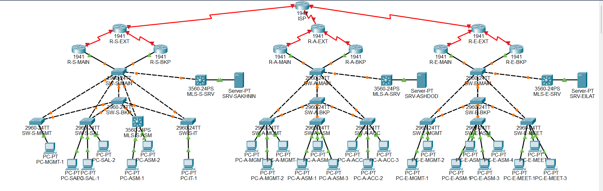
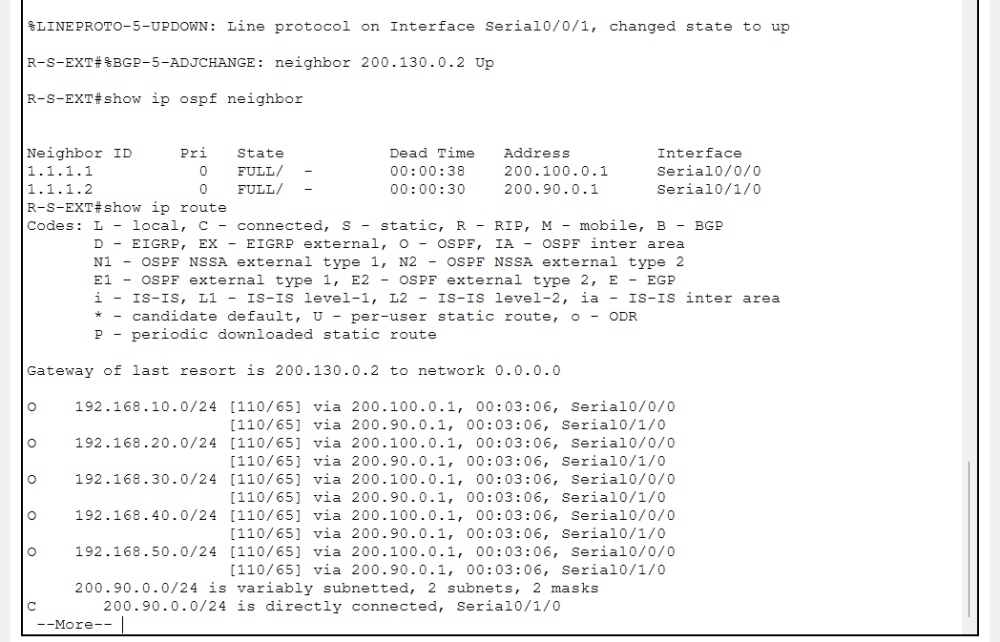
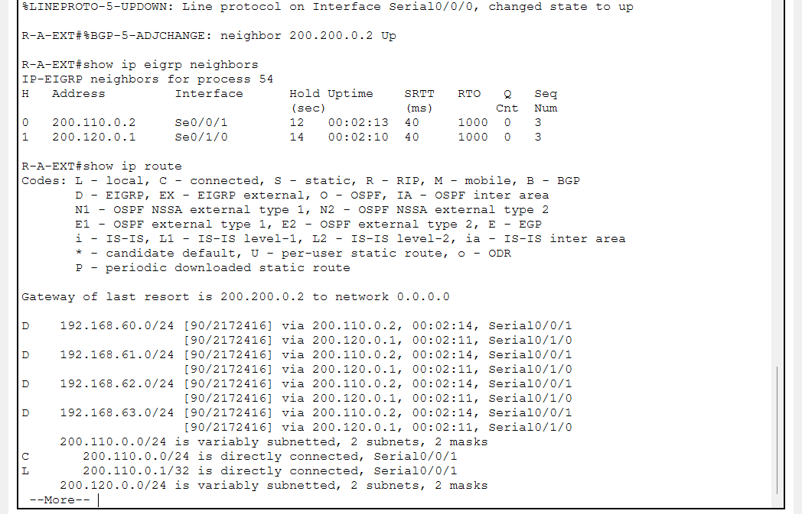
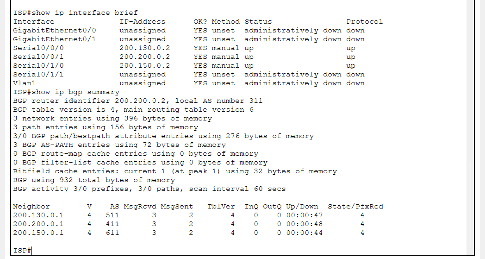
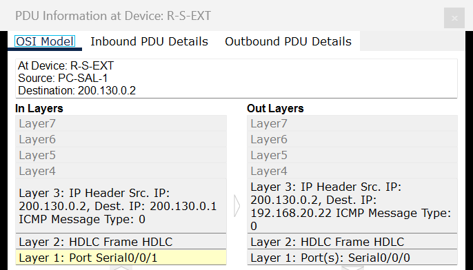
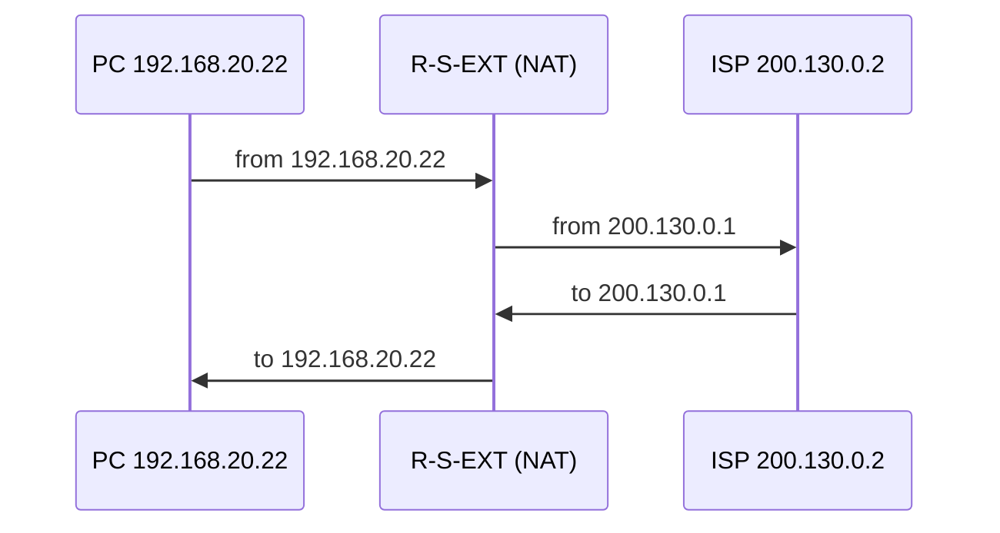

# שיעור 04 — מחברים את הסניפים: WAN, ‏OSPF, ‏EIGRP, ‏BGP ו-NAT

<div dir="rtl">

> ⏱ 90 דקות · 🧰 Packet Tracer 9.x · 📂 קובץ התחלה: [`lesson04-start.pkt`](lesson04-start.pkt) · 💾 שומרים בשם `lesson04.pkt`

</div>

## מה יהיה לכם בסוף השיעור
שלושה סניפים שמחוברים לספק אינטרנט: OSPF בסכנין, EIGRP באשדוד ובאילת, BGP לספק, ושלושה סוגי NAT.


## מהלך השיעור (למורה)

<div dir="rtl">

| דקות | חלק |
|---|---|
| ‎0–20 | חלק 1 — תיאוריה על הלוח |
| ‎20–35 | משימה 1 — כתובות WAN (סכנין ידנית, השאר בהדבקה) |
| ‎35–50 | משימות 2–3 — HSRP track, ‏OSPF, ‏EIGRP |
| ‎50–60 | משימה 4 — BGP |
| ‎60–75 | משימה 5 — NAT |
| ‎75–82 | משימה 6 — בדיקת נפילה |
| ‎82–90 | מצאו את הטעות, שאלות, "הפרויקט שלכם" |

</div>

בקובץ ההתחלה סכנין היא סוף שיעור 3, והרשתות הפנימיות של אשדוד ואילת כבר מוכנות (באותה שיטה כמו סכנין).
קווי ה-WAN מחוברים אבל בלי כתובות, ולכן הם **אדומים**.



💡 **איך מדביקים בלוק:** נכנסים לנתב, כותבים `enable` ואת הסיסמה ‏←‏ מעתיקים את הבלוק ‏←‏ לוחצים **Paste** בפינה
הימנית התחתונה של ה-CLI. בסוף: `copy running-config startup-config`.

---

## חלק 1 — תיאוריה: קודם מבינים

### 1.1 קו Serial ו-clock rate
לקו טורי יש שני קצוות: ה-**DCE** קובע את קצב השעון, וה-**DTE** הולך אחריו. בפרויקט הזה ה-DCE הוא הנתב
שקרוב יותר לספק: EXT לכיוון הסניף, ISP לכיוון EXT.

💬 **במילים פשוטות:** שני אנשים סוחבים ספה, ואחד מהם סופר "אחת, שתיים". מי שקובע את הקצב הוא ה-DCE. הפקודה
`show controllers s0/0/0` אומרת באיזה צד אתם.

### 1.2 שלושה פרוטוקולי ניתוב

<div dir="rtl">

| | ‎OSPF | ‎EIGRP | ‎BGP |
|---|---|---|---|
| סוג | ‎link state | ‎advanced distance vector | ‎path vector |
| עובד | בתוך חברה (IGP) | בתוך חברה (IGP) | **בין** חברות (EGP) |
| מודד | ‏cost (לפי רוחב פס) | רוחב פס + השהיה | רשימת מספרי AS, מדיניות |
| ‎Admin distance | ‎110 | ‎90 | ‏20 (חיצוני) |
| סימון בטבלת הניתוב | ‎`O` | ‎`D` | ‎`B` |
| מספר | תהליך 52, אזור 0 | ‎‏AS 54, ‏AS 84 | ‎‏AS 511, 411, 611, 311 |

</div>

מספר התהליך של OSPF הוא **מקומי**. מספר ה-AS של EIGRP חייב להיות **זהה** בכל נתבי הסניף.

💬 **במילים פשוטות:** ‏OSPF הוא אפליקציית ניווט שמכירה את **כל המפה** ומחשבת את הדרך הטובה. ‏EIGRP מכיר את השכנים ואת מה שהם
סיפרו לו. ‏BGP הוא הסכם בין **מדינות**: דרך אילו מדינות עוברים.

**דוגמה — wildcard** (מה מותר שישתנה). מחסרים את המסכה מ-255.255.255.255:

<div dir="rtl">

| מסכה | ‎‏Wildcard | משמעות |
|---|---|---|
| ‎255.255.255.0 (/24) | ‎0.0.0.255 | רשת אחת |
| ‎255.255.252.0 (/22) | ‎0.0.3.255 | ‏4 רשתות: 192.168.80–83 |
| ‎255.255.192.0 (/18) | ‎0.0.63.255 | ‏64 רשתות: 192.168.0–63 |

</div>

**דוגמה — איך נתב בוחר** (R-S-EXT): קודם הנתיב ה**מדויק ביותר**, ורק בין נתיבים שווים ה-admin distance הנמוך.

<div dir="rtl">

| יעד | נתיבים מתאימים | נבחר |
|---|---|---|
| ‎192.168.20.20 | ‎`O 192.168.20.0/24`, `S* 0.0.0.0/0` | ‏O, כי ‎/24 מדויק יותר |
| ‎200.200.0.10 | ‎`B 200.200.0.0/24`, `S* 0.0.0.0/0` | ‏B, כי ‎/24 מדויק יותר |
| ‎8.8.8.8 | ‎`S* 0.0.0.0/0` | נתיב ברירת המחדל, לספק |

</div>

### ‏1.3 AS
**מערכת אוטונומית (AS)** היא רשת בניהול אחד. כל סניף הוא AS, והספק (311) הוא AS נוסף. ‏**eBGP** = BGP בין
מספרי AS שונים. את השכנים מגדירים **ידנית**, בשני הצדדים.

### ‏1.4 NAT
כתובות פרטיות (192.168.x.x) לא עוברות באינטרנט. נתב הקצה **מתרגם** אותן:

<div dir="rtl">

| סוג | איפה | איך |
|---|---|---|
| ‎**PAT** (overload) | סכנין | כולם יוצאים עם כתובת **אחת**, ומספרי הפורטים מפרידים |
| **סטטי** | אשדוד, השרת | פרטית אחת ↔ ציבורית אחת, כדי שאפשר יהיה **להיכנס** מבחוץ |
| **Pool דינמי** | אילת | לוקחים כתובת פנויה מרשימה (‎.20–‎.30) |

</div>

<div dir="rtl">

| מונח | משמעות |
|---|---|
| ‎Inside local | הכתובת האמיתית של המחשב שלנו (192.168.20.20) |
| ‎Inside global | איך האינטרנט רואה אותו (200.130.0.1) |

</div>

💬 **במילים פשוטות:** משרד עם מספר טלפון חיצוני אחד (PAT). המזכירות זוכרת איזה עובד התקשר ומעבירה אליו את התשובה.
סטטי = עובד עם מספר ישיר. ‏Pool = מגירה עם 11 מספרים ישירים, כל הקודם זוכה.

**דוגמה — שני מחשבים יוצאים יחד ב-PAT:**

<div dir="rtl">

| מחשב (inside local) | פורט | יוצא בתור (inside global) | התשובה חוזרת אל |
|---|---|---|---|
| ‎192.168.20.20 | ‎1025 | ‎200.130.0.1 : 1025 | ‎192.168.20.20 |
| ‎192.168.40.21 | ‎1025 | ‎200.130.0.1 : **1024** | ‎192.168.40.21 |

</div>

שניהם בחרו באותו פורט, ולכן הנתב שינה לאחד מהם: בגלל זה קוראים לזה תרגום **פורטים**. (המספרים להמחשה.)

### 1.5 תוכנית ה-WAN

<div dir="rtl">

| קו | רשת | צד ראשון | צד שני |
|---|---|---|---|
| ‎R-S-MAIN ↔ R-S-EXT | ‎200.100.0.0/24 | ‎S0/0/0 .1 | ‎S0/0/0 .2 (DCE) |
| ‎R-S-BKP ↔ R-S-EXT | ‎200.90.0.0/24 | ‎S0/0/0 .1 | ‎S0/1/0 .2 (DCE) |
| ‎R-S-EXT ↔ ISP | ‎200.130.0.0/24 | ‎S0/0/1 .1 | ‎S0/0/0 .2 (DCE) |
| ‎R-A-MAIN ↔ R-A-EXT | ‎200.110.0.0/24 | ‎S0/0/0 .2 | ‎S0/0/1 .1 (DCE) |
| ‎R-A-BKP ↔ R-A-EXT | ‎200.120.0.0/24 | ‎S0/0/0 .1 | ‎S0/1/0 .2 (DCE) |
| ‎R-A-EXT ↔ ISP | ‎200.200.0.0/24 | ‎S0/0/0 .1 | ‎S0/0/1 .2 (DCE) |
| ‎R-E-MAIN ↔ R-E-EXT | ‎200.140.0.0/24 | ‎S0/0/0 .2 | ‎S0/0/1 .1 (DCE) |
| ‎R-E-BKP ↔ R-E-EXT | ‎200.160.0.0/24 | ‎S0/0/0 .2 | ‎S0/1/0 .1 (DCE) |
| ‎R-E-EXT ↔ ISP | ‎200.150.0.0/24 | ‎S0/0/0 .1 | ‎S0/1/0 .2 (DCE) |

</div>

---

## משימה 1 — כתובות WAN
**R-S-MAIN:**
```
configure terminal
interface s0/0/0
ip address 200.100.0.1 255.255.255.0
no shutdown
end
```
**R-S-BKP:**
```
configure terminal
interface s0/0/0
ip address 200.90.0.1 255.255.255.0
no shutdown
end
```
**R-S-EXT:**
```
configure terminal
interface s0/0/0
ip address 200.100.0.2 255.255.255.0
clock rate 2000000
no shutdown
exit
interface s0/1/0
ip address 200.90.0.2 255.255.255.0
clock rate 2000000
no shutdown
exit
interface s0/0/1
ip address 200.130.0.1 255.255.255.0
no shutdown
end
```
**ISP:**
```
configure terminal
interface s0/0/0
ip address 200.130.0.2 255.255.255.0
clock rate 2000000
no shutdown
exit
interface s0/0/1
ip address 200.200.0.2 255.255.255.0
clock rate 2000000
no shutdown
exit
interface s0/1/0
ip address 200.150.0.2 255.255.255.0
clock rate 2000000
no shutdown
end
```
❓ איזה צד מקבל `clock rate`? רק ה-**DCE**. בצד DTE הפקודה לא נחוצה.

**אשדוד ואילת:** כל קבוצה מדביקה נתב אחד. בבלוקים יש **הכול** לסניף: WAN, ‏HSRP track, ‏EIGRP, ‏BGP ו-NAT.
קוראים אותם תוך כדי משימות 2–5.

<details dir="rtl"><summary>R-A-MAIN, R-A-BKP, R-A-EXT</summary>

**R-A-MAIN**

<div dir="ltr">

```
configure terminal
interface s0/0/0
ip address 200.110.0.2 255.255.255.0
no shutdown
exit
interface g0/0.60
standby 60 track s0/0/0
exit
interface g0/0.61
standby 61 track s0/0/0
exit
interface g0/0.62
standby 62 track s0/0/0
exit
interface g0/0.63
standby 63 track s0/0/0
exit
router eigrp 54
network 192.168.60.0
network 192.168.61.0
network 192.168.62.0
network 192.168.63.0
network 200.110.0.0
no auto-summary
passive-interface g0/0.60
passive-interface g0/0.61
passive-interface g0/0.62
passive-interface g0/0.63
exit
ip route 0.0.0.0 0.0.0.0 200.110.0.1
end
```

</div>

**R-A-BKP**

<div dir="ltr">

```
configure terminal
interface s0/0/0
ip address 200.120.0.1 255.255.255.0
no shutdown
exit
router eigrp 54
network 192.168.60.0
network 192.168.61.0
network 192.168.62.0
network 192.168.63.0
network 200.120.0.0
no auto-summary
passive-interface g0/0.60
passive-interface g0/0.61
passive-interface g0/0.62
passive-interface g0/0.63
exit
ip route 0.0.0.0 0.0.0.0 200.120.0.2
end
```

</div>

**R-A-EXT**

<div dir="ltr">

```
configure terminal
interface s0/0/1
ip address 200.110.0.1 255.255.255.0
clock rate 2000000
no shutdown
exit
interface s0/1/0
ip address 200.120.0.2 255.255.255.0
clock rate 2000000
no shutdown
exit
interface s0/0/0
ip address 200.200.0.1 255.255.255.0
no shutdown
exit
router eigrp 54
network 200.110.0.0
network 200.120.0.0
no auto-summary
exit
ip route 0.0.0.0 0.0.0.0 200.200.0.2
router bgp 411
neighbor 200.200.0.2 remote-as 311
network 200.200.0.0 mask 255.255.255.0
exit
ip nat inside source static 192.168.63.1 200.200.0.10
access-list 1 permit 192.168.60.0 0.0.3.255
ip nat inside source list 1 interface s0/0/0 overload
interface s0/0/1
ip nat inside
interface s0/1/0
ip nat inside
interface s0/0/0
ip nat outside
exit
end
```

</div>

</details>

<details dir="rtl"><summary>R-E-MAIN, R-E-BKP, R-E-EXT</summary>

**R-E-MAIN**

<div dir="ltr">

```
configure terminal
interface s0/0/0
ip address 200.140.0.2 255.255.255.0
no shutdown
exit
interface g0/0.80
standby 80 track s0/0/0
exit
interface g0/0.81
standby 81 track s0/0/0
exit
interface g0/0.82
standby 82 track s0/0/0
exit
interface g0/0.83
standby 83 track s0/0/0
exit
router eigrp 84
network 192.168.80.0
network 192.168.81.0
network 192.168.82.0
network 192.168.83.0
network 200.140.0.0
no auto-summary
passive-interface g0/0.80
passive-interface g0/0.81
passive-interface g0/0.82
passive-interface g0/0.83
exit
ip route 0.0.0.0 0.0.0.0 200.140.0.1
end
```

</div>

**R-E-BKP**

<div dir="ltr">

```
configure terminal
interface s0/0/0
ip address 200.160.0.2 255.255.255.0
no shutdown
exit
router eigrp 84
network 192.168.80.0
network 192.168.81.0
network 192.168.82.0
network 192.168.83.0
network 200.160.0.0
no auto-summary
passive-interface g0/0.80
passive-interface g0/0.81
passive-interface g0/0.82
passive-interface g0/0.83
exit
ip route 0.0.0.0 0.0.0.0 200.160.0.1
end
```

</div>

**R-E-EXT**

<div dir="ltr">

```
configure terminal
interface s0/0/1
ip address 200.140.0.1 255.255.255.0
clock rate 2000000
no shutdown
exit
interface s0/1/0
ip address 200.160.0.1 255.255.255.0
clock rate 2000000
no shutdown
exit
interface s0/0/0
ip address 200.150.0.1 255.255.255.0
no shutdown
exit
router eigrp 84
network 200.140.0.0
network 200.160.0.0
no auto-summary
exit
ip route 0.0.0.0 0.0.0.0 200.150.0.2
router bgp 611
neighbor 200.150.0.2 remote-as 311
network 200.150.0.0 mask 255.255.255.0
exit
ip nat pool EILAT-POOL 200.150.0.20 200.150.0.30 netmask 255.255.255.0
ip access-list extended NAT-E
permit ip 192.168.80.0 0.0.3.255 any
exit
ip nat inside source list NAT-E pool EILAT-POOL
interface s0/0/1
ip nat inside
interface s0/1/0
ip nat inside
interface s0/0/0
ip nat outside
exit
end
```

</div>

</details>

✅ כל הקווים הטוריים ירוקים.

## משימה 2 — HSRP עוקב אחרי קו האינטרנט
בשיעור 3 הגיבוי נכנס רק כשה-LAN נפל. עכשיו הנתב הראשי מאבד עדיפות גם כשה**קו הטורי** שלו נופל. ב-**R-S-MAIN**:
```
configure terminal
interface g0/0.10
standby 10 track s0/0/0
interface g0/0.20
standby 20 track s0/0/0
interface g0/0.30
standby 30 track s0/0/0
interface g0/0.40
standby 40 track s0/0/0
interface g0/0.50
standby 50 track s0/0/0
end
```
🧠 הקו נופל ‏←‏ 110 − 10 = **100**, פחות מ-105 ‏←‏ הגיבוי מחליף.

<div dir="rtl">

| הקו הטורי | ראשי | גיבוי | ‎‏Active |
|---|---|---|---|
| פעיל | ‎110 | ‎105 | ‎R-S-MAIN |
| נפל | ‎110 − 10 = **100** | ‎105 | ‎R-S-BKP |

</div>

❓ **שאלו את הכיתה:** מה היה קורה אם העדיפות של הגיבוי הייתה 99?

<details dir="rtl"><summary>תשובה</summary>

100 עדיין גבוה מ-99: הנתב הראשי היה נשאר Active בלי אינטרנט. ההפרש חייב להיות **קטן מ-10**.

</details>

## משימה 3 — OSPF בסכנין
**R-S-MAIN:**
```
configure terminal
router ospf 52
router-id 1.1.1.1
network 192.168.10.0 0.0.0.255 area 0
network 192.168.20.0 0.0.0.255 area 0
network 192.168.30.0 0.0.0.255 area 0
network 192.168.40.0 0.0.0.255 area 0
network 192.168.50.0 0.0.0.255 area 0
network 200.100.0.0 0.0.0.255 area 0
passive-interface g0/0.10
passive-interface g0/0.20
passive-interface g0/0.30
passive-interface g0/0.40
passive-interface g0/0.50
exit
ip route 0.0.0.0 0.0.0.0 200.100.0.2
end
```
‏**R-S-BKP:** אותו דבר, עם `router-id 1.1.1.2`, עם `network 200.90.0.0 0.0.0.255 area 0` במקום 200.100, ועם
`ip route 0.0.0.0 0.0.0.0 200.90.0.2`.

**R-S-EXT:**
```
configure terminal
router ospf 52
router-id 1.1.1.3
network 200.100.0.0 0.0.0.255 area 0
network 200.90.0.0 0.0.0.255 area 0
exit
ip route 0.0.0.0 0.0.0.0 200.130.0.2
end
```

<div dir="rtl">

| פקודה | מה היא עושה | למה |
|---|---|---|
| ‎`router-id` | השם של הנתב ב-OSPF | קבוע, כדי שלא ישתנה עם הכתובות |
| ‎`network ... 0.0.0.255 area 0` | מפרסמת את הרשת | ‏wildcard: ההפך ממסכת רשת |
| ‎`passive-interface` | אין הודעות OSPF לכיוון המחשבים | אבטחה: אף אחד ב-LAN לא יכול להפוך ל"שכן" |
| ‎`ip route 0.0.0.0 0.0.0.0` | נתיב ברירת מחדל | "כל מה שאני לא מכיר ‏←‏ לאינטרנט" |

</div>

✅ ב-R-S-EXT: ‏`show ip ospf neighbor` ‏←‏ שני שכנים **FULL**. ב-`show ip route` ‏←‏ חמש הרשתות עם `O`, דרך **שני** הנתבים.

‏

✅ ב-R-S-MAIN: ב-`show ip route` ה-gateway of last resort הוא 200.100.0.2.


**אשדוד (EIGRP 54):** מסתכלים בבלוק של R-A. ‏`show ip eigrp neighbors` ב-R-A-EXT מראה שני שכנים:

‏

❓ למה יש `no auto-summary`? כדי ש-EIGRP יפרסם את הרשתות המדויקות ולא class שלם.

## משימה 4 — BGP לספק
**R-S-EXT:**
```
configure terminal
router bgp 511
neighbor 200.130.0.2 remote-as 311
network 200.130.0.0 mask 255.255.255.0
end
```
**ISP:**
```
configure terminal
router bgp 311
neighbor 200.130.0.1 remote-as 511
neighbor 200.200.0.1 remote-as 411
neighbor 200.150.0.1 remote-as 611
end
```

<div dir="rtl">

| פקודה | מה היא עושה |
|---|---|
| ‎`router bgp 511` | מספר ה-AS שלנו |
| ‎`neighbor 200.130.0.2 remote-as 311` | מי השכן ובאיזה AS הוא; שני הצדדים חייבים להסכים |
| ‎`network 200.130.0.0 mask 255.255.255.0` | מפרסמת את הרשת הציבורית שלנו; המסכה חייבת להיות בדיוק כמו בטבלת הניתוב |

</div>

✅ ב-ISP: ‏`show ip bgp summary`. שלושה שכנים, ו-**MsgRcvd** גדול מ-0.



✅ ההוכחה האמיתית — ב-R-E-EXT: ‏`show ip route bgp`. הרשתות הציבוריות של הסניפים האחרים הגיעו עם `B`:


⚠️ בציוד אמיתי, מילה כמו `Idle` בעמודה האחרונה אומרת "לא מחובר". ב-Packet Tracer העמודה מראה מספר **גם כשה-AS שגוי** (בדקנו),
ולכן סומכים על `show ip route bgp`.

✅ ב-ISP: ‏`show ip route`. הוא **לא** מכיר אף רשת 192.168, וזה נכון: הספק לא צריך להכיר את הפנים שלנו.


## משימה 5 — NAT
**R-S-EXT (PAT):**
```
configure terminal
ip access-list extended NAT-S
permit ip 192.168.0.0 0.0.63.255 any
exit
ip nat inside source list NAT-S interface s0/0/1 overload
interface s0/0/0
ip nat inside
interface s0/1/0
ip nat inside
interface s0/0/1
ip nat outside
end
```

<div dir="rtl">

| פקודה | מה היא עושה |
|---|---|
| ‎`permit ip 192.168.0.0 0.0.63.255 any` | את מי מתרגמים: 192.168.0 עד 192.168.63 |
| ‎`overload` | ‏PAT: הרבה מחשבים, כתובת אחת |
| ‎`ip nat inside` / `outside` | איזה צד הוא הבית ואיזה האינטרנט |

</div>

‏✅ **PC-SAL-1**: קודם `ipconfig` (צריך כתובת), ואז `ping 200.130.0.2` ו-`ping 200.200.0.2` (הצד של הספק לכיוון אשדוד).


✅ מיד אחר כך ב-R-S-EXT: ‏`show ip nat translations`. הכתובת 192.168.20.20 יצאה בתור **200.130.0.1**.

‏

‏**NAT סטטי באשדוד** (בבלוק שהודבק): השרת 192.168.63.1 מפורסם בתור **200.200.0.10**.
מ-**PC-E-MEET-1** באילת: `ping 200.200.0.10`, ובדפדפן `http://200.200.0.10`:

‏


ב-R-A-EXT השורה עם ‎`---`‎ קבועה: זה התרגום הסטטי.

‏

‏**Pool באילת:** אותו מחשב יצא בתור 200.150.0.20, הכתובת הראשונה ב-pool.

‏

## משימה 6 — חותכים את הקו
1. ‏**R-S-MAIN**: ‏`interface s0/0/0` ‏←‏ ‏`shutdown`. מחכים 15 שניות, `show standby brief`: העדיפות **100**, והוא כבר לא Active (עובר דרך *Speak* ל-*Standby*).

   
2. ‏**PC-SAL-1**: ‏`tracert 200.130.0.2` ‏←‏ ‏‎.253 ואז 200.90.0.2: דרך הגיבוי, והאינטרנט עדיין עובד.

   
3. ‏`no shutdown`, ואחרי כ-30 שניות R-S-MAIN שוב Active.
4. שומרים בכל הנתבים: `copy running-config startup-config`. ‏File ‏←‏ Save.

## 👀 רואים את זה קורה — NAT משנה את הכתובת
על מצב Simulation הסברנו ב[שיעור 1](../lesson-01/). קודם ב-Realtime: ‏`ping 200.130.0.2` מ-PC-SAL-1 עובד.
אחר כך **Simulation** ‏←‏ רק **ICMP** ‏←‏ שוב `ping 200.130.0.2`, ומתקדמים עד שהחבילה חוזרת.

**בדרך החוצה**, פותחים את החבילה ב-**R-S-EXT**:


**בדרך חזרה**, באותו נתב:



<div dir="rtl">

| | נכנס | יוצא |
|---|---|---|
| בדרך החוצה: המקור | ‎192.168.20.22 | ‎**200.130.0.1** |
| בדרך חזרה: היעד | ‎200.130.0.1 | ‎**192.168.20.22** |

</div>



❓ הספק רואה רק את 200.130.0.1. איך R-S-EXT יודע למי להחזיר את התשובה?

<details dir="rtl"><summary>תשובה</summary>

הוא כתב שורה בטבלת התרגום (`show ip nat translations`) כשהחבילה יצאה, והוא קורא אותה בכיוון ההפוך.

</details>

💡 שכבה 2 היא עכשיו **HDLC** ולא Ethernet: בקו סריאלי יש רק שני צדדים, ולכן לא צריך MAC.

✏️ **נסו:** פתחו את החבילה ב-**ISP**, שכבה 3. יש שם כתובת 192.168?

<details dir="rtl"><summary>תשובה</summary>

לא. בגלל זה הספק גם לא צריך נתיב לרשתות הפרטיות שלכם.

</details>

## 🧯 לא עובד?

<div dir="rtl">

| מה רואים | כנראה | מה עושים |
|---|---|---|
| קו טורי אדום בצד אחד | חסר `no shutdown` באחד הקצוות | `show ip interface brief` בשני הקצוות |
| מצב `up/down` | חסר `clock rate` ב-DCE | `show controllers`, ואז `clock rate 2000000` |
| אין שכן OSPF | ‏network או wildcard שגוי, או אזור אחר | ‎`show ip protocols`, `show run` |
| אין שכן EIGRP | מספר AS שונה | ‏54 באשדוד, 84 באילת, בשלושת הנתבים |
| אין ping לאינטרנט, OSPF תקין | ‎‏NAT | `ip nat inside` ו-`outside` בפורטים הנכונים |
| `show ip nat translations` ריק | הרשומות פגו | עושים ping ומסתכלים מיד |
| ה-ping הראשון אבד | ‏ARP, או שהנתיבים עדיין נלמדים | ‏ping שוב |

</div>

---

## 🔎 מצאו את הטעות — מפרויקט אמיתי
1. אשדוד השתמשה ב-192.168.50.0, אותה רשת של השרתים בסכנין.
2. ה-ISP הריץ OSPF + שני EIGRP + BGP עם **redistribution** בין כולם.
3. הוגדר רק שכן BGP **אחד** מתוך שלושה.
4. בשלושת הסניפים היה רק PAT, למרות שבספר הובטחו סטטי ודינמי.

<details dir="rtl"><summary>תשובה</summary>

1. שני סניפים עם אותה רשת אי אפשר לחבר: הנתב לא יודע לאן לשלוח. התיקון: אשדוד ב-60–63, ומתכננים מראש כתובות ל**כל** החברה.
2. הספק מכיר את כל הרשתות הפרטיות של הלקוחות: לא מציאותי ולא בטוח. התיקון: IGP רק בתוך הסניף, eBGP לספק, ונתיב ברירת מחדל החוצה.
3. ב-BGP אין שכנים אוטומטיים. צריך לכתוב כל צד ידנית.
4. סטטי לשרת שנכנסים אליו מבחוץ, pool לדינמי, PAT לשאר. הבוחן בודק שמה שכתוב בספר קיים בקובץ.

</details>

## 🏋 תרגילים
1. ב-R-S-EXT מוחקים `ip nat inside` מ-s0/0/0 ועושים ping מ-PC-SAL-1. מה קורה ולמה? החזירו.
2. משנים את ה-AS של השכן ב-R-E-EXT ל-312. מה מראה `show ip bgp summary`? החזירו.
3. חשבו את ה-wildcard של 255.255.252.0. אילו רשתות מכסה ‎`192.168.80.0 0.0.3.255`?

<details dir="rtl"><summary>תשובות (את 1 ו-2 בדקנו)</summary>

1. ‏`Request timed out`, וטבלת התרגום ריקה. החבילה יוצאת בתור 192.168.20.x, הספק לא מכיר את הרשת הזו, ולכן התשובה לא יכולה לחזור. אחרי `ip nat inside` ה-ping עובד.
2. ‏‎`%BGP-3-NOTIFICATION ... (peer in wrong AS)`‎, ו-`show ip route bgp` **ריק**. כדי להחזיר: `no neighbor 200.150.0.2 remote-as 312` ואז `neighbor 200.150.0.2 remote-as 311`.

   
3. ‏0.0.3.255. הרשתות 192.168.80.0, ‏81.0, ‏82.0 ו-83.0.

</details>

## 🎓 להסביר לבוחן
- מה ההבדל בין IGP ל-EGP? למה לא OSPF לספק?
- מה זה DCE ו-DTE?
- למה ה-admin distance חשוב כשיש שני פרוטוקולים?
- מה ההבדל בין PAT, סטטי ודינמי? מה זה inside local ו-inside global?
- מה עושה `standby track`, ולמה על הקו הטורי ולא על ה-LAN?

<details dir="rtl"><summary>תשובות לדוגמה</summary>

1. ‏IGP = בתוך חברה אחת (OSPF, ‏EIGRP). ‏EGP = בין חברות (BGP). עם OSPF הספק היה לומד את כל הפנים שלנו, והתקלות שלנו היו מגיעות אליו.
2. שני הקצוות של קו טורי. ה-DCE נותן את השעון, ה-DTE מקבל אותו.
3. אם אותה רשת נלמדת משני פרוטוקולים, נכנס לטבלה זה עם המרחק הנמוך: EIGRP ‏(90) לפני OSPF ‏(110).
4. ‏PAT: רבים לאחד, לפי פורטים. סטטי: אחד לאחד, קבוע, מאפשר להיכנס. דינמי: אחד לאחד, זמני, מתוך pool. ‏Local = הכתובת האמיתית בפנים, global = איך העולם רואה אותה.
5. מוריד את העדיפות כשפורט נופל. נפילה של ה-LAN ‏HSRP מזהה לבד, אבל בלי track הוא לא יודע שקו האינטרנט נפל.

</details>

## ✏️ מבחן יציאה (3 דקות)
1. איזה פרוטוקול רץ בין R-S-EXT ל-ISP?
2. מה ה-wildcard של ‎/24?
3. איזה NAT תבחרו לשרת web?
4. מה אומר `S*`‎ בטבלת הניתוב?
5. ‏EIGRP 54 בנתב אחד ו-EIGRP 84 בשכן שלו. מה קורה?

<details dir="rtl"><summary>תשובות</summary>

1. ‏eBGP.
2. ‏0.0.0.255.
3. סטטי.
4. נתיב ברירת מחדל סטטי.
5. הם לא נהיים שכנים.

</details>

## 🛠 הפרויקט שלכם
- [ ] תוכנית כתובות ל**כל** הסניפים, בלי כפילויות.
- [ ] טבלת WAN עם DCE/DTE.
- [ ] ‏IGP שונה איפה שנדרש, עם passive-interface ונתיב ברירת מחדל.
- [ ] ‏eBGP לספק מכל סניף.
- [ ] לפחות NAT סטטי אחד, pool אחד ו-PAT אחד.
- [ ] צילומי מסך: `show ip ospf neighbor`, ‏`show ip eigrp neighbors`, ‏`show ip bgp summary`, ‏`show ip nat translations`, ובדיקת הנפילה.
