# שיעור 05 — אבטחה וניהול: ACL, ‏VPN, ‏SSH, ‏AAA, ‏NTP, ‏Syslog ו-ASA

<div dir="rtl">

> ⏱ 90 דקות · 🧰 Packet Tracer 9.x · 📂 קובץ התחלה: [`lesson05-start.pkt`](lesson05-start.pkt) · 💾 שומרים בשם `lesson05.pkt`

</div>

## מה יהיה לכם בסוף השיעור
חברה מוגנת: מחלקות שלא מגיעות לאן שאסור, מנהרה מוצפנת סכנין ↔ אילת, ניהול מוצפן עם משתמשים מרכזיים, שעון נכון ויומנים, וחומת אש.

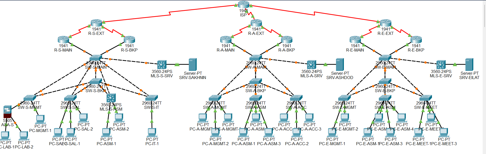

## מהלך השיעור (למורה)

<div dir="rtl">

| דקות | חלק |
|---|---|
| ‎0–15 | חלק 1 — תיאוריה על הלוח |
| ‎15–23 | משימה 1 — השרת (AAA, ‏NTP, ‏Syslog) |
| ‎23–35 | משימה 2 — ACL |
| ‎35–58 | משימה 3 — VPN, כולל הכישלון המתוכנן |
| ‎58–72 | משימה 4 — SSH, ‏AAA, ‏NTP, ‏Syslog (סכנין בכיתה, השאר בהדבקה) |
| ‎72–83 | משימה 5 — ASA |
| ‎83–90 | טבלת הבדיקות הסופית, "הפרויקט שלכם" |

</div>

זה השיעור הצפוף ביותר. אם אין מספיק זמן: SSH במתגים (4.4) וה-ASA הם שיעורי בית טובים.
שירותי AAA ו-NTP בשרתים של אשדוד ואילת כבר מוגדרים בקובץ ההתחלה.

---

## חלק 1 — תיאוריה: קודם מבינים

### ‏1.1 ACL
רשימת כללים שנקראת מ**למעלה למטה**. ההתאמה הראשונה קובעת, ובסוף יש שורה בלתי נראית: **deny הכול**.

<div dir="rtl">

| | סטנדרטי | מורחב |
|---|---|---|
| בודק | מקור בלבד | מקור, יעד, פרוטוקול, פורט |
| מספרים | ‎1–99 | ‎100–199 |
| שמים אותו | קרוב ל**יעד** | קרוב ל**מקור** |

</div>

💬 **במילים פשוטות:** שומר בכניסה עם רשימה. הוא קורא מלמעלה, פועל לפי השורה **הראשונה** שמתאימה, ומי שלא ברשימה לא נכנס.

**דוגמה — קוראים את הרשימה שלנו (משימה 2) כמו הנתב:**

<div dir="rtl">

| חבילה | השורה הראשונה שמתאימה | תוצאה |
|---|---|---|
| מ-0.0.0.0 ל-255.255.255.255, ‏UDP 67 ‏(DHCP) | ‎`permit udp any any eq bootps` | ✅ עוברת |
| מ-192.168.62.22 ל-192.168.60.21, ‏ping | ‎`deny ip ...62.0 ...60.0` | ❌ חסומה |
| מ-192.168.62.22 ל-192.168.63.1, ‏TCP 80 | ‎`permit tcp ... eq www` | ✅ עוברת |
| מ-192.168.62.22 ל-192.168.63.1, ‏ping | ‎`deny ip ...62.0 ...63.0` | ❌ חסומה |
| מ-192.168.62.22 ל-200.200.0.2, ‏ping | ‎`permit ip ...62.0 any` | ✅ עוברת |

</div>

❓ **שאלו את הכיתה:** מה קורה אם כותבים את השורה האחרונה ראשונה?

<details dir="rtl"><summary>תשובה</summary>

היא מתאימה לכל מה ש-VLAN 62 שולח, ולכן לעולם לא מגיעים לשורות ה-deny ושום דבר לא נחסם.

</details>

### ‏1.2 VPN IPsec

<div dir="rtl">

| שלב | מה קורה | פקודה |
|---|---|---|
| ‎‏1 (ISAKMP) | הנתבים מזדהים (מפתח) ומסכימים על הצפנה | ‎`crypto isakmp policy` |
| ‎‏2 (IPsec) | הנתונים עצמם מוצפנים (ESP) | ‎`transform-set` |

</div>

- **הצפנה** (AES) — אף אחד לא קורא. **Hash** ‏(SHA) — אף אחד לא שינה. **מפתח משותף** — זה באמת אתם. **קבוצת DH** — יצירת סוד משותף דרך קו פתוח.
- ‏**Interesting traffic**: ‏ACL שאומר מה נכנס למנהרה.

💬 **במילים פשוטות:** שני סניפים שולחים מכתבים בדואר רגיל, בתוך כספת נעולה. הדואר רואה רק את הכתובות של הסניפים, לא מה
בפנים ולא מי כתב למי.

**דוגמה — ping מ-PC-E-MEET-1 ‏(192.168.82.23) לשרת בסכנין:**

<div dir="rtl">

| איפה | ממי למי | אפשר לקרוא? |
|---|---|---|
| ב-LAN של אילת | מ-192.168.82.23 ל-192.168.50.1 | כן |
| באינטרנט | **מ-200.150.0.1 ל-200.130.0.1** ‏(ESP) | לא, מוצפן |
| ב-LAN של סכנין | מ-192.168.82.23 ל-192.168.50.1 | כן |

</div>

### ‏1.3 AAA

<div dir="rtl">

| | השאלה |
|---|---|
| ‎Authentication | מי אתה? |
| ‎Authorization | מה מותר לך לעשות? |
| ‎Accounting | מה עשית? |

</div>

<div dir="rtl">

| | ‎TACACS+‎ | ‎RADIUS |
|---|---|---|
| פורט | ‎TCP 49 | ‎UDP 1645 / 1812 |
| מצפין | את כל ההודעה | רק את הסיסמה |
| טוב ל | ניהול ציוד רשת | משתמשי Wi-Fi ו-VPN |

</div>

💬 **במילים פשוטות:** נכנסים לבניין של חברה. השומר בודק מי אתם (authentication), הכרטיס פותח רק חלק מהדלתות (authorization),
והמצלמה רושמת איפה הייתם (accounting).

**דוגמה — `ssh -l osemuser 192.168.10.254`:** הנתב שואל את שרת ה-TACACS+‎ "הסיסמה נכונה?". כן — נכנסים. אם השרת **לא עונה**, הנתב בודק את
המשתמשים המקומיים (`local`). אם השרת ענה "לא", **אין** הזדמנות שנייה.

### 1.4 השאר
- ‏**SSH** — ניהול מוצפן. ‏Telnet שולח סיסמאות כטקסט גלוי.
- ‏**NTP** — אותה שעה בכל מקום, אחרת היומנים חסרי ערך. עם אימות, כדי שאף אחד לא יזייף.
- ‏**Syslog** — כל ההודעות לשרת אחד.
- ‏**ASA** — חומת אש: מרמה 100 (inside) לרמה 0 (outside) מותר, בכיוון ההפוך **חסום**. ‏`inspect` מאפשר ל**תשובות** לחזור.

**דוגמה — איך ה-ASA מחליט:**

<div dir="rtl">

| חבילה | רמות | תוצאה |
|---|---|---|
| מ-PC-LAB-1 לשרת, חיבור חדש | מ-100 ל-0 | ‎✅ |
| מהשרת ל-PC-LAB-1, ה**תשובה** | מ-0 ל-100 | ✅ בזכות `inspect` |
| מ-PC-MGMT-1 ל-PC-LAB-1, חיבור חדש | מ-0 ל-100 | ‎❌ |

</div>

---

## משימה 1 — השרת
‏**SRV-SAKHNIN** ‏←‏ ‏Services ‏←‏ ‏**AAA** ‏←‏ ‏On (1). ‏Client Name (2), ‏Client IP (3), ‏Secret (4), ‏ServerType ‏←‏ ‏**Tacacs** ‏←‏ ‏**Add** (5):

<div dir="rtl">

| ‎Client Name | ‎Client IP | ‎Secret | ‎Type |
|---|---|---|---|
| ‎R-S-MAIN | ‎192.168.50.254 | ‎Osem#Aaa | ‎Tacacs |
| ‎R-S-BKP | ‎192.168.50.253 | ‎Osem#Aaa | ‎Tacacs |

</div>

למטה: Username (6) ‏`osemuser`, ‏Password ‏`Osem#User` ‏←‏ ‏**Add** (7).

‏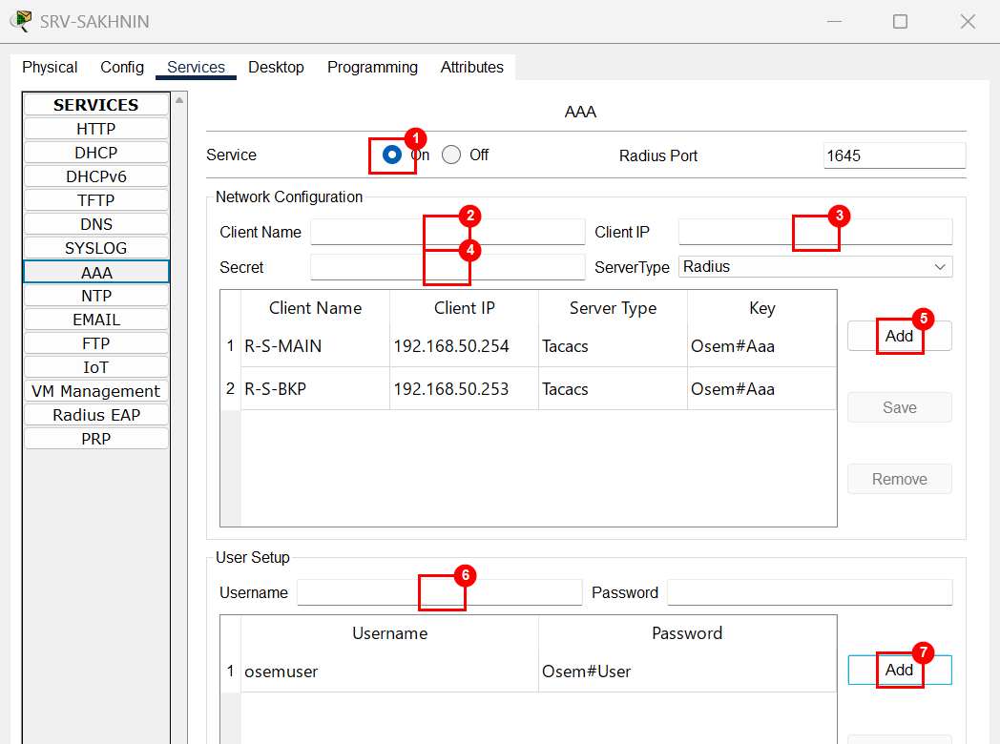

‏**NTP** ‏←‏ ‏Authentication ‏**Enable** (1), ‏Key (2) ‏‎`1`, ‏Password (3) ‏`Osem#Ntp`. זה מוצג בתור ‎`01`, וזה עובד.

‏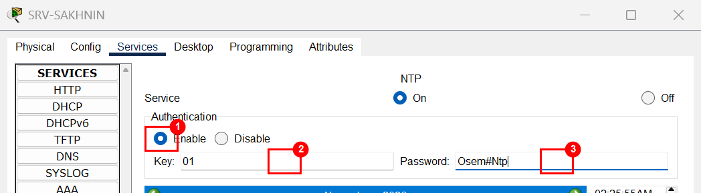

‏**SYSLOG** ‏←‏ בודקים שהוא On.

<div dir="rtl">

| שדה | מה זה | חייב להתאים ל |
|---|---|---|
| ‎Client | הנתב שישאל את השרת | הכתובת שלו לכיוון השרת (VLAN 50) |
| ‎Secret | מפתח בין הנתב לשרת | ‎`tacacs-server host ... key` |
| ‎ServerType | השפה: Tacacs / Radius | `group tacacs+`‎ בנתב |
| ‎Username | מי שמתחבר | רק כאן, לא בנתב |

</div>

## משימה 2 — ACL באשדוד ובאילת
**המטרה:** הנהלת החשבונות (VLAN 62) לא מגיעה להנהלה (VLAN 60), ומהשרת מקבלת רק web, ‏DNS ו-FTP.

לפני: מ-**PC-A-ACC-1** בודקים מה הכתובת של PC-A-MGMT-2 ועושים לו ping. עובד.

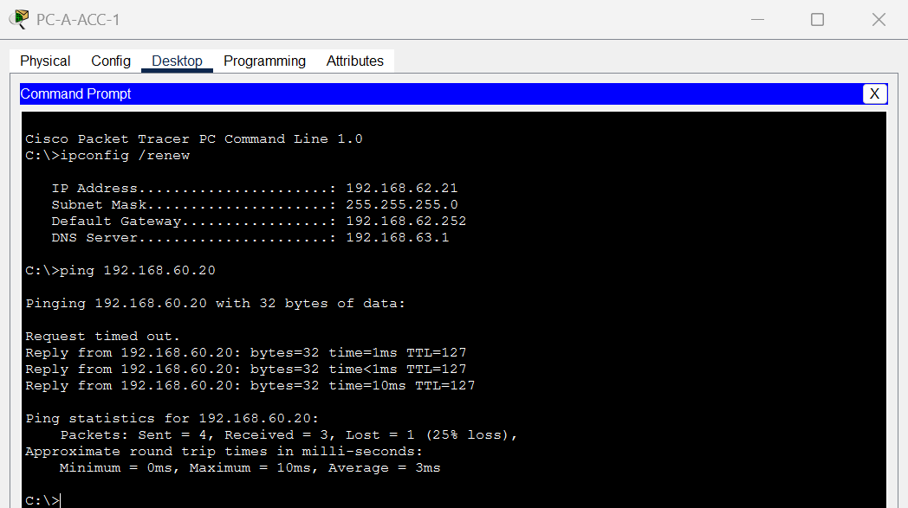

ב-**R-A-MAIN וגם ב-R-A-BKP**:
```
configure terminal
access-list 110 permit udp any any eq bootps
access-list 110 deny ip 192.168.62.0 0.0.0.255 192.168.60.0 0.0.0.255
access-list 110 permit tcp 192.168.62.0 0.0.0.255 host 192.168.63.1 eq www
access-list 110 permit udp 192.168.62.0 0.0.0.255 host 192.168.63.1 eq domain
access-list 110 permit tcp 192.168.62.0 0.0.0.255 host 192.168.63.1 eq ftp
access-list 110 deny ip 192.168.62.0 0.0.0.255 192.168.63.0 0.0.0.255
access-list 110 permit ip 192.168.62.0 0.0.0.255 any
interface g0/0.62
ip access-group 110 in
end
```
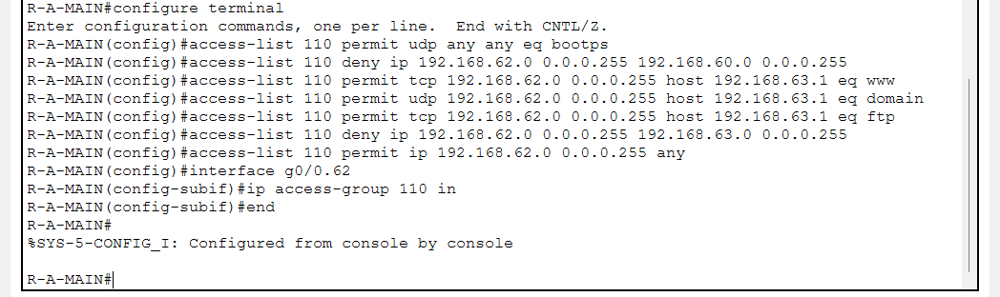

❓ **למה צריך את השורה הראשונה?** למחשב שמבקש DHCP עדיין אין כתובת: הוא שולח מ-0.0.0.0, ואף שורה אחרת לא
מרשה את זה. בדקנו בלעדיה, בשני הנתבים: `ipconfig /renew` נתקע.

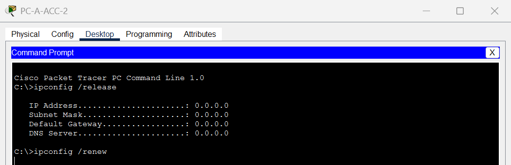

❓ **למה בשני הנתבים?** כל אחד מהם יכול להיות Active. בדקנו גם רק בראשי, בלי שורת bootps: ה-DHCP עדיין עבד, כי **הגיבוי** העביר
את הבקשה. ‏ACL בנתב אחד הוא מלא חורים.

✅ מ-PC-A-ACC-2: הנהלה — חסום, ping לשרת — חסום, אינטרנט — עובד, web — עובד.

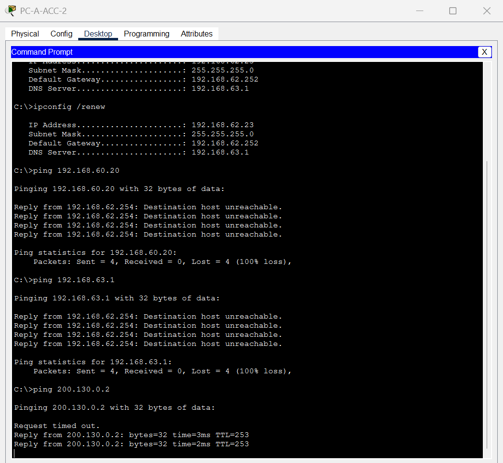

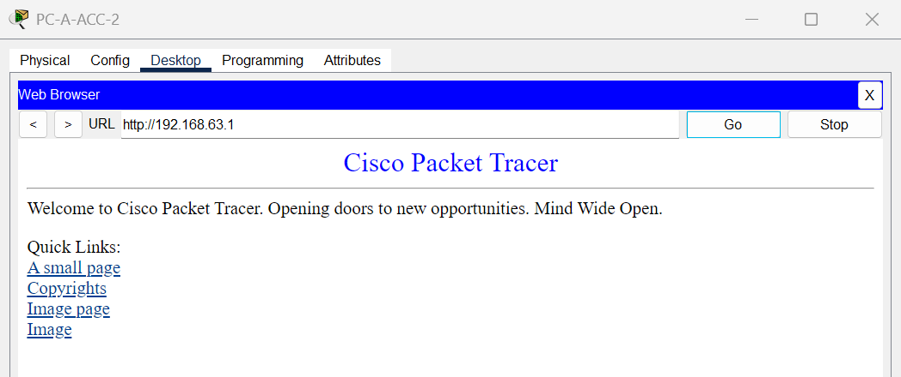

✅ ב-R-A-MAIN: ‏`show access-lists` ‏←‏ המונים עולים.

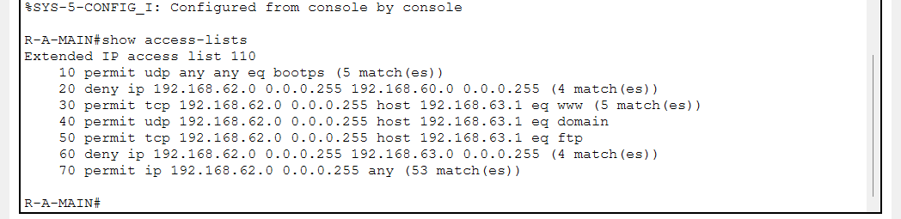

### 2.1 🔎 ה-FTP מתחבר, אבל `dir` נתקע. למה?
מ-**PC-A-ACC-2**: ‏`ftp 192.168.63.1`, משתמש `ashdod`, סיסמה `Osem#Ftp`. הכניסה מצליחה. עכשיו `dir`:

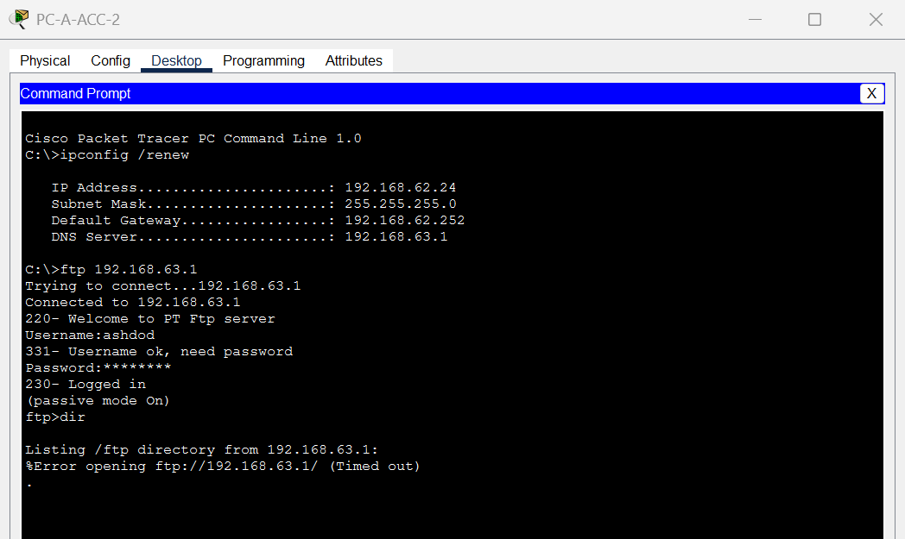

<details dir="rtl"><summary>תשובה</summary>

‏FTP משתמש ב**שני** חיבורים: פקודות בפורט 21, ונתונים בפורט אחר. ב-*passive mode* השרת בוחר פורט גבוה (מעל 1023) לנתונים. פתחנו
רק את 21, ולכן הנתונים נופלים על השורה `deny ip ... 192.168.63.0`.

</details>

התיקון, ב-**R-A-MAIN וב-R-A-BKP**. המספר 52 שם את השורה **לפני** ה-deny ‏(60):
```
configure terminal
ip access-list extended 110
52 permit tcp 192.168.62.0 0.0.0.255 host 192.168.63.1 gt 1023
end
copy running-config startup-config
```
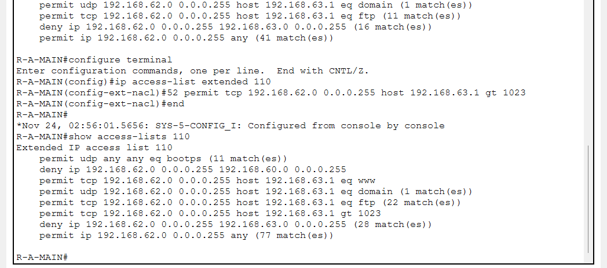

✅ מ-PC-A-ACC-3 הרשימה מגיעה, ו-ping לשרת עדיין חסום. (יוצאים מ-FTP עם `quit`.)

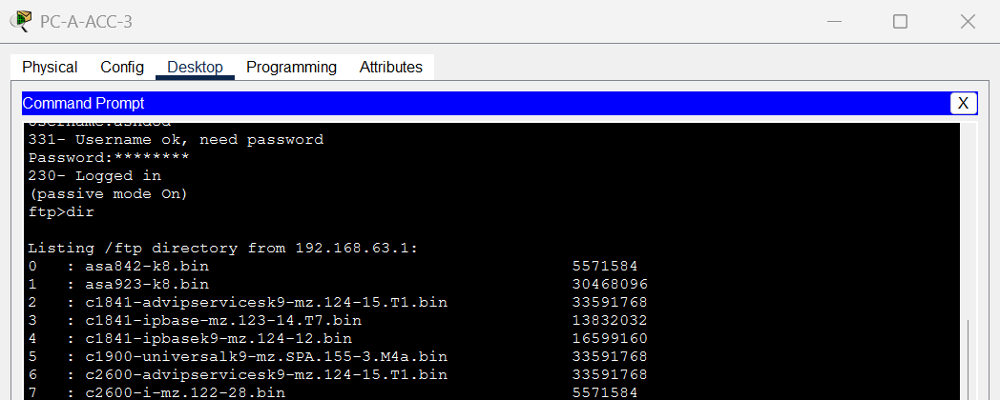

### 2.2 אילת
**אילת** (הרכבה 81 לא מגיעה להנהלה 80), ב-**R-E-MAIN וב-R-E-BKP**:
```
configure terminal
access-list 120 permit udp any any eq bootps
access-list 120 deny ip 192.168.81.0 0.0.0.255 192.168.80.0 0.0.0.255
access-list 120 permit ip 192.168.81.0 0.0.0.255 any
interface g0/0.81
ip access-group 120 in
end
```

## משימה 3 — VPN סכנין ↔ אילת
### 3.1 הרישיון
ב-R-S-EXT מנסים `crypto isakmp policy 10`. ה-1941 לא מכיר את הפקודה:

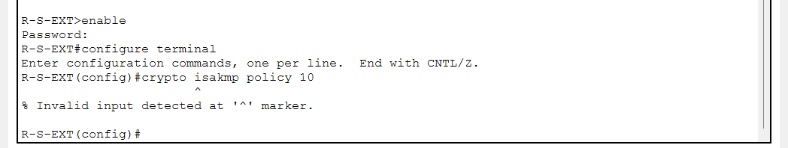

ב-**R-S-EXT וב-R-E-EXT**:
```
configure terminal
license boot module c1900 technology-package securityk9
```
עונים `yes`, ואז:
```
end
copy running-config startup-config
reload
```
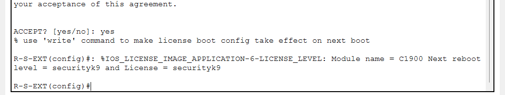

אחרי ההפעלה מחדש נכנסים שוב: `show version | include security` ‏←‏ ‏`securityk9`

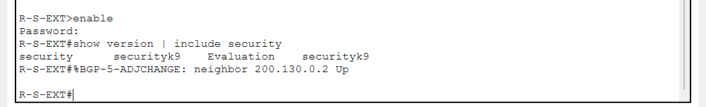

### 3.2 המנהרה
**R-S-EXT:**
```
configure terminal
crypto isakmp policy 10
encryption aes 256
hash sha
authentication pre-share
group 5
lifetime 86400
exit
crypto isakmp key OsemVpn2026 address 200.150.0.1
crypto ipsec transform-set VPN-SET esp-aes 256 esp-sha-hmac
ip access-list extended VPN-S-E
permit ip 192.168.0.0 0.0.63.255 192.168.80.0 0.0.3.255
exit
crypto map VPN-MAP 10 ipsec-isakmp
set peer 200.150.0.1
set transform-set VPN-SET
match address VPN-S-E
exit
interface s0/0/1
crypto map VPN-MAP
end
```
‏**R-E-EXT** (תמונת מראה):
```
configure terminal
crypto isakmp policy 10
encryption aes 256
hash sha
authentication pre-share
group 5
lifetime 86400
exit
crypto isakmp key OsemVpn2026 address 200.130.0.1
crypto ipsec transform-set VPN-SET esp-aes 256 esp-sha-hmac
ip access-list extended VPN-E-S
permit ip 192.168.80.0 0.0.3.255 192.168.0.0 0.0.63.255
exit
crypto map VPN-MAP 10 ipsec-isakmp
set peer 200.130.0.1
set transform-set VPN-SET
match address VPN-E-S
exit
interface s0/0/0
crypto map VPN-MAP
end
```
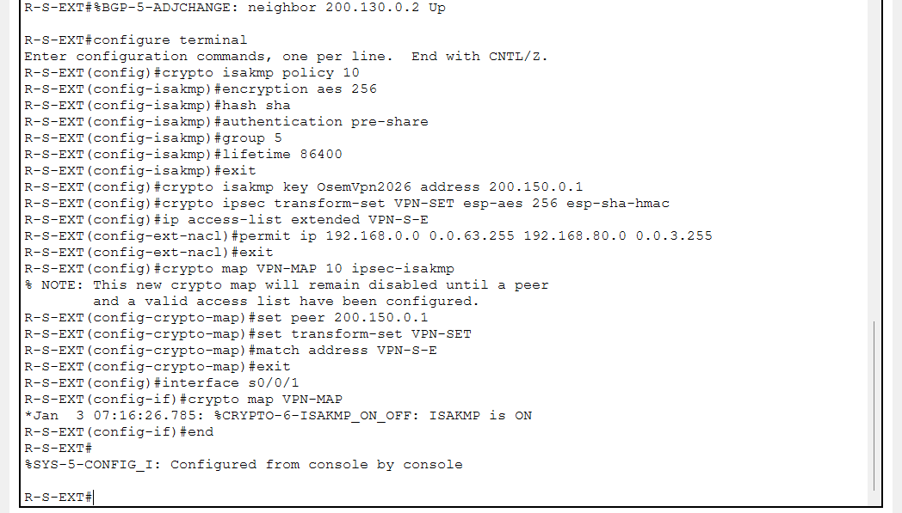

<div dir="rtl">

| פקודה | מה היא עושה |
|---|---|
| ‎`crypto isakmp policy 10` | שלב 1: חייב להיות זהה בשני הצדדים |
| ‎`crypto isakmp key` | אותו מפתח, עם הכתובת של **הצד השני** |
| ‎`transform-set` | איך מצפינים את הנתונים בשלב 2 |
| ‎`match address` | מה נכנס למנהרה; תמונת מראה בצד השני |
| `crypto map` על הממשק | מפעיל, על הפורט **היוצא** |

</div>

⚠️ משתמשים במפתח בלי ‎`#`‎. בבדיקות שלנו מפתח עם ‎`#`‎ לא העלה את המנהרה אף פעם.

### 3.3 🔎 זה לא עובד! למה?
‏**PC-E-MEET-1** ‏←‏ ‏`ping 192.168.50.1`. התשובה "Destination host unreachable" מגיעה מ**הספק**:

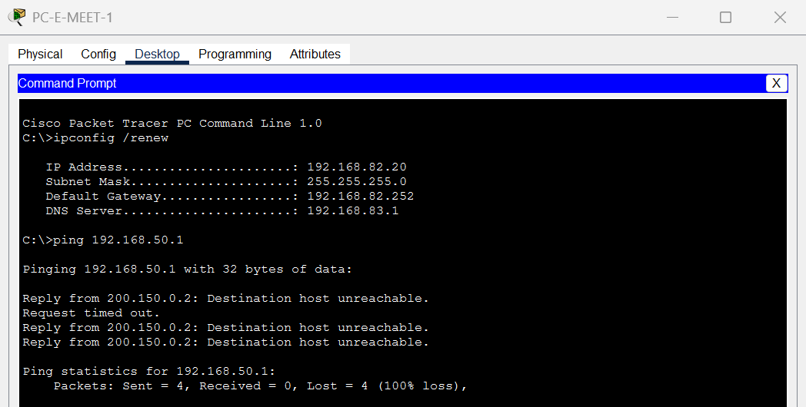

נותנים לכיתה לחקור ב-R-E-EXT: ‏`show ip access-lists`, ‏`show crypto isakmp sa`, ‏`show ip nat translations`.

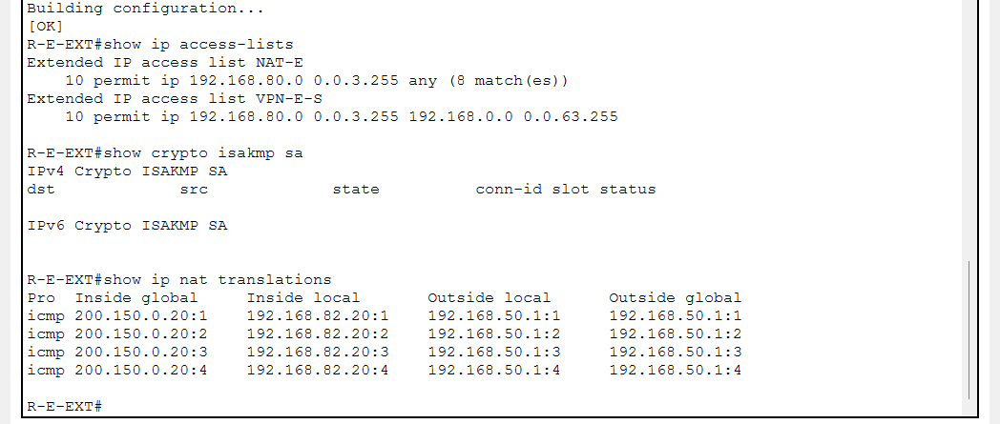

<details dir="rtl"><summary>תשובה</summary>

לרשימת ה-VPN אין התאמות, ולרשימת ה-NAT יש 8. הנתב עושה **NAT לפני ההצפנה**: המקור הפך ל-200.150.0.20, ולכן
החבילה כבר לא מתאימה לרשימת ה-VPN והיא יצאה לאינטרנט, ושם אף אחד לא מכיר את 192.168.50.1. התיקון: אומרים
ל-NAT **לא** לתרגם תנועה לסניף השני. השורה חייבת להיות **לפני** ה-permit, ולכן נותנים לה את המספר 5.

</details>

### 3.4 התיקון
**R-S-EXT:**
```
configure terminal
ip access-list extended NAT-S
5 deny ip 192.168.0.0 0.0.63.255 192.168.80.0 0.0.3.255
end
clear ip nat translation *
copy running-config startup-config
```
**R-E-EXT:**
```
configure terminal
ip access-list extended NAT-E
5 deny ip 192.168.80.0 0.0.3.255 192.168.0.0 0.0.63.255
end
clear ip nat translation *
copy running-config startup-config
```
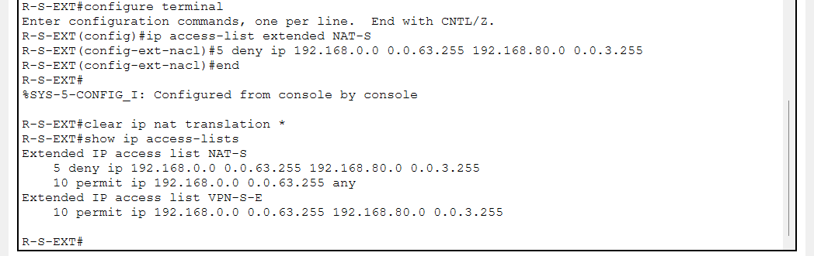

✅ שוב ping, **רק מאילת**. התשובה הראשונה יכולה ללכת לאיבוד בזמן שהמנהרה עולה.

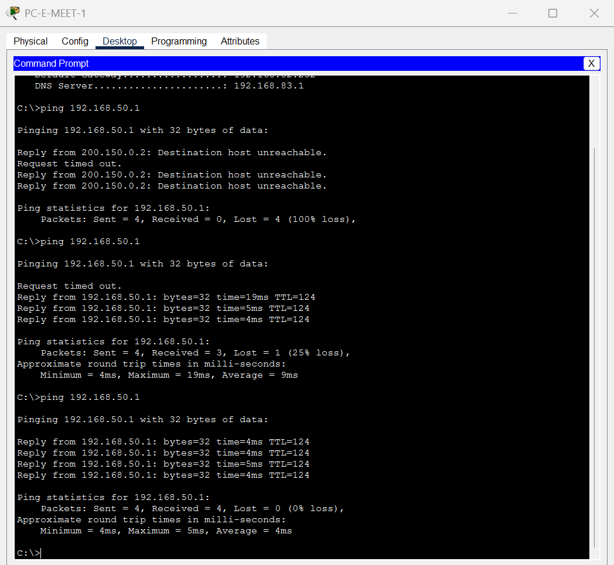

✅ ב-R-E-EXT: ‏`show crypto isakmp sa` ‏←‏ ‏**QM_IDLE**, וב-`show crypto ipsec sa` ‏←‏ ‏encaps ו-decaps עולים.

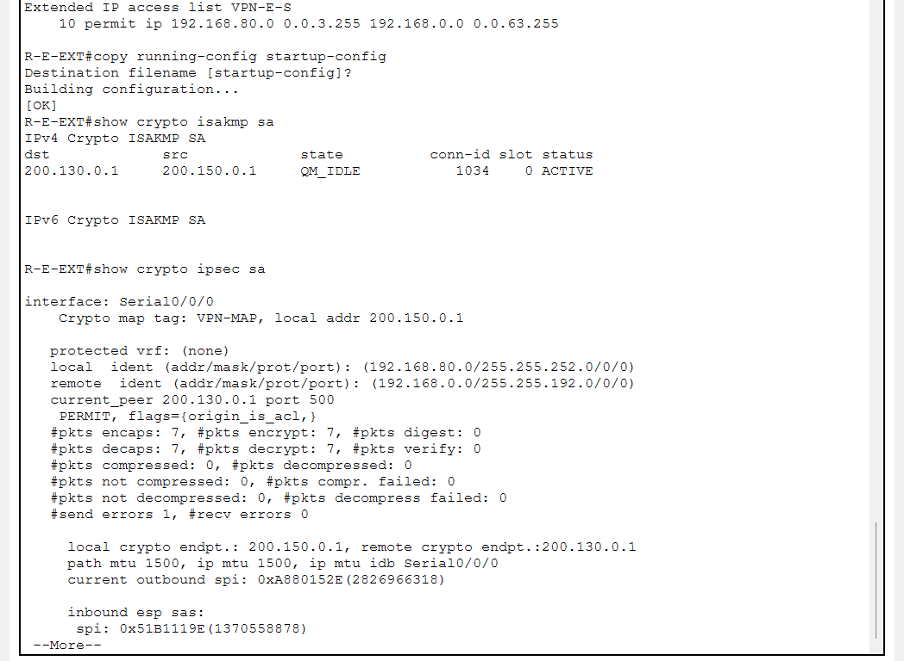

💡 נתקע? מפעילים את המנהרה מחדש: בפורט היוצא של **שני** נתבי הקצה `no crypto map VPN-MAP` ואז `crypto map VPN-MAP`, ו-ping
מצד אחד בלבד. (בנתבים אמיתיים יש גם `clear crypto isakmp`. ב-Packet Tracer אין.)

## משימה 4 — SSH, ‏AAA, ‏NTP ו-Syslog
### 4.1 ב-R-S-MAIN, ואותו דבר ב-R-S-BKP
```
configure terminal
ip domain-name osem.com
username admin privilege 15 secret Osem#Adm1
crypto key generate rsa general-keys modulus 1024
ip ssh version 2
aaa new-model
tacacs-server host 192.168.50.1 key Osem#Aaa
aaa authentication login default group tacacs+ local
aaa authorization exec default group tacacs+ local
aaa authentication login CONSOLE local
line console 0
login authentication CONSOLE
exit
access-list 10 permit 192.168.10.0 0.0.0.255
line vty 0 4
transport input ssh
login authentication default
access-class 10 in
exit
ntp authentication-key 1 md5 Osem#Ntp
ntp authenticate
ntp trusted-key 1
ntp server 192.168.50.1 key 1
ntp update-calendar
logging host 192.168.50.1
service timestamps log datetime msec
end
copy running-config startup-config
```

<div dir="rtl">

| פקודה | מה היא עושה | למה |
|---|---|---|
| `username admin` **לפני** `aaa new-model` | משתמש מקומי | אחרת נועלים את עצמכם בחוץ |
| ‎`crypto key generate rsa ... 1024` | מפתחות ל-SSH | בלעדיהם אין SSH 2 |
| ‎`group tacacs+ local` | קודם השרת, ואם הוא לא עונה — המשתמש המקומי | כדי לא להיתקע |
| ‎`CONSOLE local` | הקונסול עובד עם המשתמש המקומי | עם הכבל תמיד נכנסים |
| ‎`access-class 10 in` | רק VLAN 10 מנהל | ‏ACL סטנדרטי קרוב ליעד |
| `ntp trusted-key` ו-`key 1` | מקבל שעה רק משרת חתום | |

</div>

⚠️ מעכשיו **הקונסול מבקש שם משתמש**: ‏`admin` / ‏`Osem#Adm1`.

### 4.2 בדיקה
1. ‏**PC-MGMT-1**: ‏`ssh -l osemuser 192.168.10.254`, סיסמה `Osem#User`, ואז `show users`. המשתמש קיים **רק בשרת**, כלומר AAA עובד.

   ‏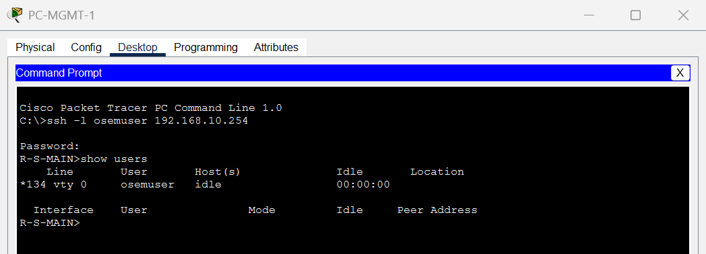
2. ‏`exit`, ואז `telnet 192.168.10.254` ‏←‏ נסגר.

   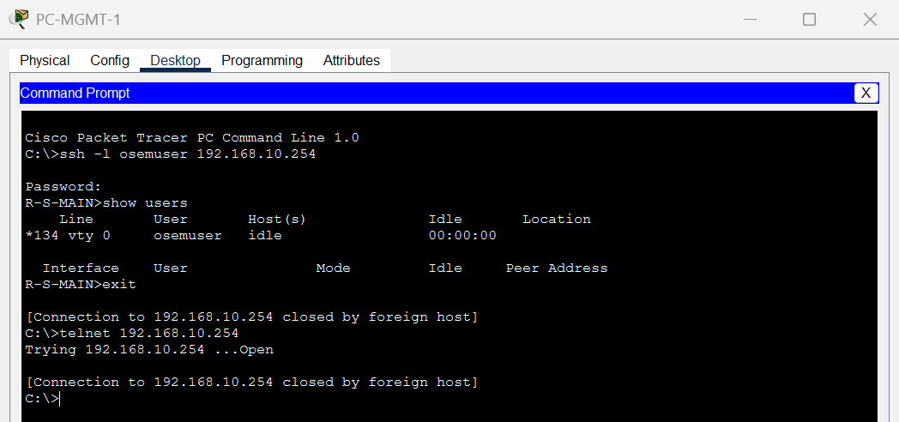
3. ‏**PC-SAL-1**: ‏`ssh -l osemuser 192.168.20.254` ‏←‏ ‏**refused** ‏(access-class).

   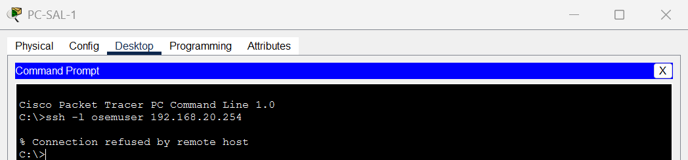
4. ב-R-S-MAIN: ‏`show ntp status` ‏←‏ ‏**synchronized** (יכול לקחת כמה דקות).

   ‏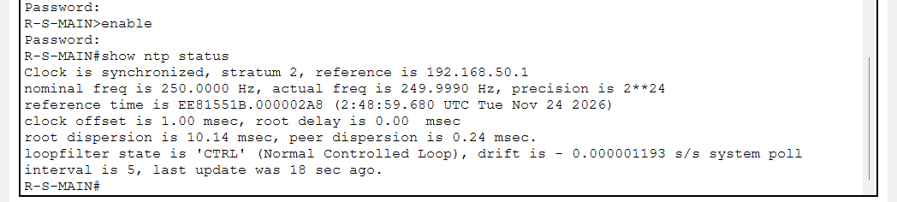
5. ב-R-S-MAIN: ‏`interface g0/1` ‏←‏ ‏`no shutdown` ‏←‏ ‏`shutdown`. בשרת ‏←‏ ‏SYSLOG: ההודעות הגיעו. שימו לב לקפיצה של התאריך מ-1993 להיום: NTP!

   ‏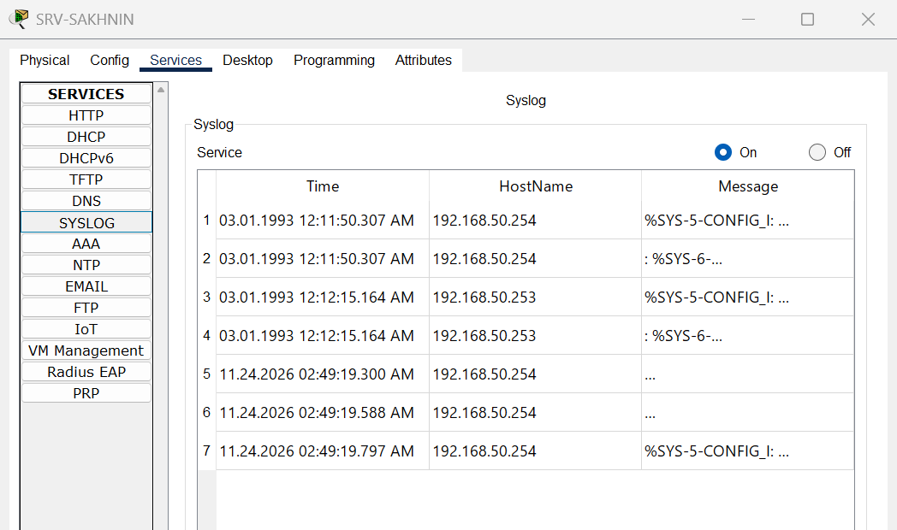

### 4.3 אשדוד ואילת
אשדוד משתמשת ב-**RADIUS**, אילת ב-**TACACS+‎**. הסוג חייב להיות זהה בנתב ובשרת!

<details dir="rtl"><summary>R-A-MAIN, R-A-BKP (מדביקים אותו דבר בשניהם)</summary>


<div dir="ltr">

```
configure terminal
ip domain-name osem.com
username admin privilege 15 secret Osem#Adm1
crypto key generate rsa general-keys modulus 1024
ip ssh version 2
aaa new-model
radius-server host 192.168.63.1 key Osem#Aaa
aaa authentication login default group radius local
aaa authorization exec default group radius local
aaa authentication login CONSOLE local
line console 0
login authentication CONSOLE
exit
line vty 0 4
transport input ssh
login authentication default
exit
ntp authentication-key 2 md5 Osem#Ntp
ntp authenticate
ntp trusted-key 2
ntp server 192.168.63.1 key 2
ntp update-calendar
logging host 192.168.63.1
service timestamps log datetime msec
end
```

</div>

</details>

<details dir="rtl"><summary>R-E-MAIN, R-E-BKP (מדביקים אותו דבר בשניהם)</summary>


<div dir="ltr">

```
configure terminal
ip domain-name osem.com
username admin privilege 15 secret Osem#Adm1
crypto key generate rsa general-keys modulus 1024
ip ssh version 2
aaa new-model
tacacs-server host 192.168.83.1 key Osem#Aaa
aaa authentication login default group tacacs+ local
aaa authorization exec default group tacacs+ local
aaa authentication login CONSOLE local
line console 0
login authentication CONSOLE
exit
line vty 0 4
transport input ssh
login authentication default
exit
ntp authentication-key 3 md5 Osem#Ntp
ntp authenticate
ntp trusted-key 3
ntp server 192.168.83.1 key 3
ntp update-calendar
logging host 192.168.83.1
service timestamps log datetime msec
end
```

</div>

</details>

### 4.4 מתגים ונתבי קצה (שיעורי בית)
ב-ISP ובנתבי EXT כותבים `line vty 0 4`, ובמתגים `line vty 0 15`:
```
configure terminal
ip domain-name osem.com
username admin privilege 15 secret Osem#Adm1
crypto key generate rsa general-keys modulus 1024
ip ssh version 2
line vty 0 15
transport input ssh
login local
end
```
כתובת ניהול למתגים הראשיים, לדוגמה **SW-S-MAIN** (אשדוד: VLAN 60, אילת: VLAN 80):
```
configure terminal
interface vlan 10
ip address 192.168.10.240 255.255.255.0
no shutdown
exit
ip default-gateway 192.168.10.252
end
```
✅ ‏`ssh -l admin 192.168.10.240`

‏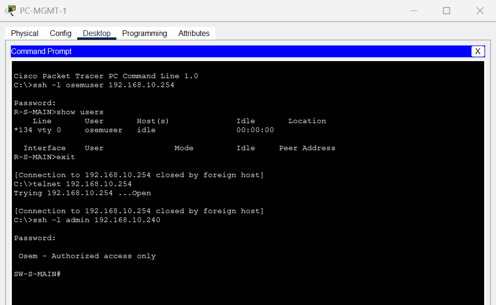

## משימה 5 — חומת האש ASA
‏**ASA-S** ‏←‏ ‏CLI. כותבים `enable`, ובסיסמה לוחצים רק **Enter**:
```
configure terminal
hostname ASA-S
interface Ethernet0/0
switchport access vlan 2
interface Ethernet0/1
switchport access vlan 1
interface Ethernet0/2
switchport access vlan 1
interface Vlan1
nameif inside
security-level 100
ip address 192.168.1.1 255.255.255.0
interface Vlan2
nameif outside
security-level 0
no ip address
ip address 192.168.10.15 255.255.255.0
exit
route outside 0.0.0.0 0.0.0.0 192.168.10.252
object network INSIDE-NET
subnet 192.168.1.0 255.255.255.0
nat (inside,outside) dynamic interface
end
```
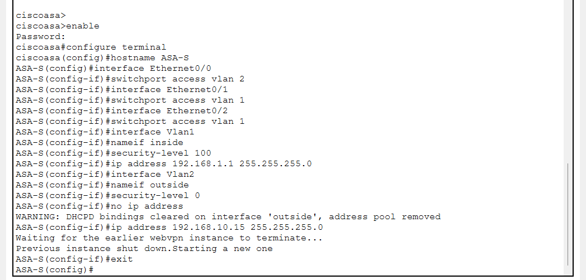

```
configure terminal
no dhcpd auto_config outside
dhcpd address 192.168.1.10-192.168.1.30 inside
dhcpd dns 192.168.50.1
dhcpd enable inside
class-map inspection_default
match default-inspection-traffic
exit
policy-map global_policy
class inspection_default
inspect icmp
inspect http
inspect dns
exit
service-policy global_policy global
end
write memory
```
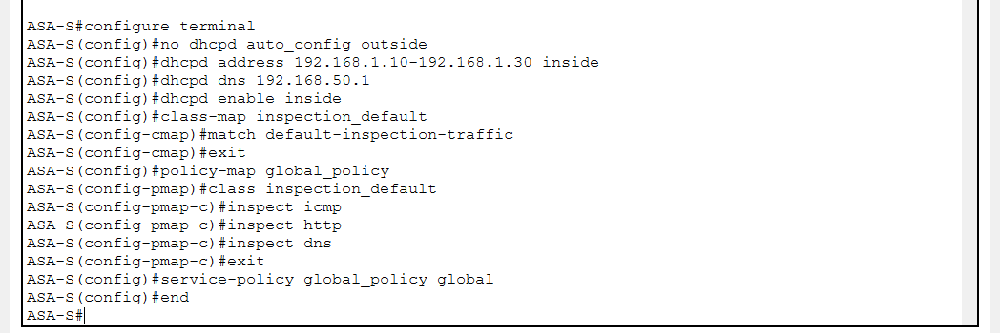

⚠️ ב-Packet Tracer הפקודה `exit` מתוך `object network` קופצת ישר ל-‎`#`‎, לכן כאן כותבים `end` ופותחים שוב `configure terminal`.

✅ ‏`show switch vlan` ו-`show interface ip brief`

‏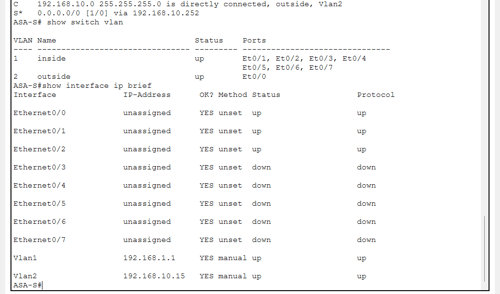

‏✅ **PC-LAB-1** ‏←‏ ‏IP Configuration ‏←‏ ‏**DHCP** (1): ‏192.168.1.10 מה-ASA. (ב-Packet Tracer ה-DNS יכול להישאר 0.0.0.0, לכן בודקים עם כתובות.) אחר כך `ping 192.168.50.1` עובד:

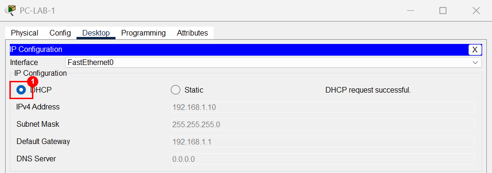

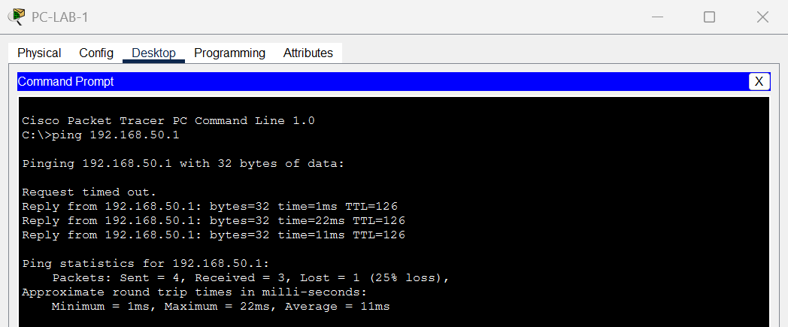

✅ גולשים מ-PC-LAB-1 ל-`http://192.168.50.1`, ותוך 30 שניות ב-ASA: ‏`show xlate`

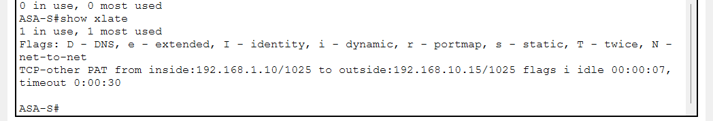

✅ **מבחוץ פנימה.** ‏PC-MGMT-1 ‏←‏ ‏`ping 192.168.1.10` נכשל. בהתחלה כי הנתב לא מכיר את הרשת ("unreachable" מהספק).
כדי שרק ה-ASA יחליט, מוסיפים **לצורך הבדיקה** ב-R-S-MAIN את `ip route 192.168.1.0 255.255.255.0 192.168.10.15` ועושים שוב ping:
‏**timed out**, ה-ASA חסם. אחר כך מוחקים עם `no ip route ...`‎.

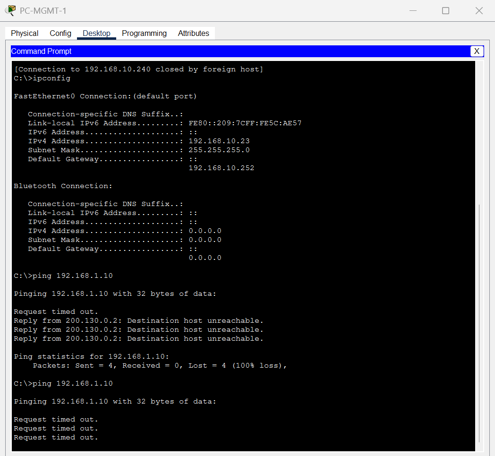

<div dir="rtl">

| פקודה | מה היא עושה | למה |
|---|---|---|
| ‎`nameif inside` / `outside` | נותנת לפורט תפקיד | ה-ASA עובד עם שמות, לא עם מספרים |
| ‎`security-level 100` / ‎`0` | כמה אנחנו סומכים על הצד הזה | מגבוה לנמוך מותר |
| ‎`route outside 0.0.0.0 0.0.0.0 192.168.10.252` | נתיב ברירת מחדל | אחד בלבד, ל-VIP של HSRP |
| `object network` ו-`nat ... dynamic interface` | ‏PAT דרך הפורט החיצוני | הסניף לא מכיר את 192.168.1.0 |
| ‎`dhcpd address ... inside` | ה-ASA הוא שרת DHCP | למחשבי המעבדה |
| ‎`inspect icmp` | זוכר pings שיצאו | אחרת התשובות נחסמות |

</div>

## 👀 רואים את זה קורה — ה-ACL והמנהרה
על מצב Simulation הסברנו ב[שיעור 1](../lesson-01/).

### א. ה-ACL זורק חבילה
ב-Realtime בודקים את הכתובת של PC-A-MGMT-2 (כאן 192.168.60.20). אחר כך **Simulation** ‏←‏ רק **ICMP** ‏←‏ עושים לה ping
מ-PC-A-ACC-1, ומתקדמים עד שמופיעה חבילה אדומה:

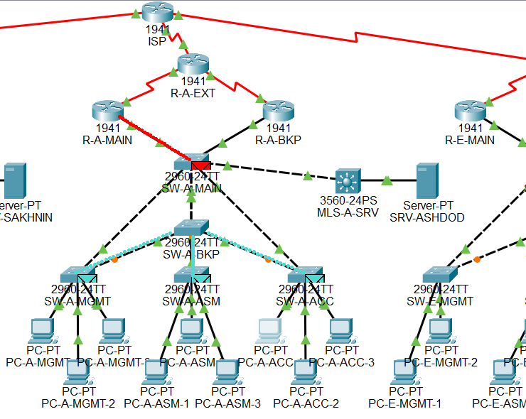

החבילה האדומה היא התשובה של R-A-MAIN. עכשיו פותחים את החבילה ש**נכנסה** ל-R-A-MAIN ‏←‏ לוחצים **Next Layer** פעמיים, עד שכבה 3:

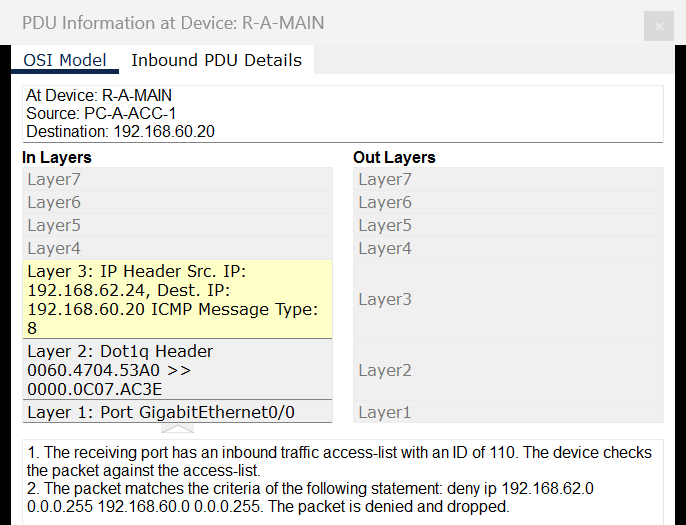

תוכנת Packet Tracer מראה **את השורה המדויקת** שחסמה. זו הדרך הטובה ביותר למצוא טעות ב-ACL.

❓ כל ה-Out Layers ריקות. מה זה אומר?

<details dir="rtl"><summary>תשובה</summary>

החבילה נעצרה כאן. אין לה יציאה.

</details>

### ב. ה-VPN מסתיר את הכתובות
ב-Realtime: ‏`ping 192.168.50.1` מ-PC-E-MEET-1 עד שיש תשובה, כדי שהמנהרה תהיה למעלה. אחר כך **Simulation** ‏←‏ **ICMP** וגם
**IPSec** (לשונית Misc) ‏←‏ שוב ping, ופותחים את החבילה בשלושה מקומות:

**הנתב R-E-EXT, הכניסה למנהרה:**

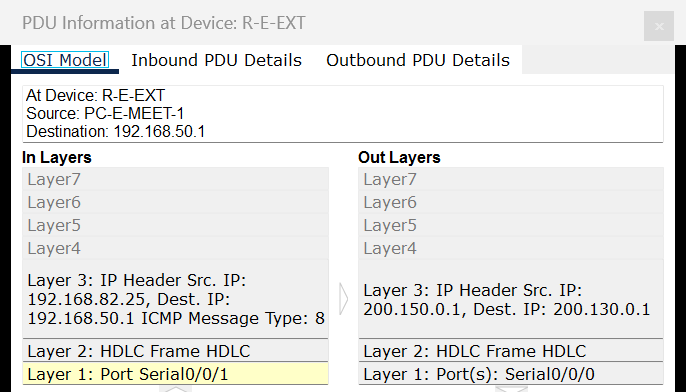

**הנתב ISP, באמצע האינטרנט:**

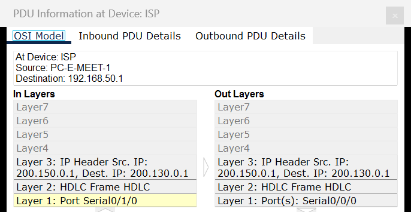

**הנתב R-S-EXT, היציאה מהמנהרה:**

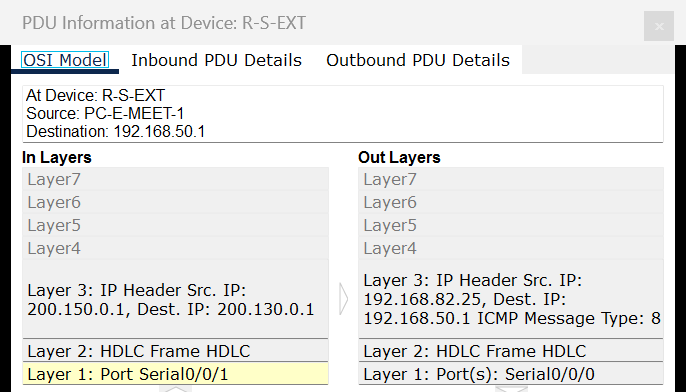

<div dir="rtl">

| איפה | מקור | יעד | רואים שזה ICMP? |
|---|---|---|---|
| אילת | ‎192.168.82.25 | ‎192.168.50.1 | כן |
| האינטרנט | ‎**200.150.0.1** | ‎**200.130.0.1** | **לא** |
| סכנין | ‎192.168.82.25 | ‎192.168.50.1 | כן |

</div>

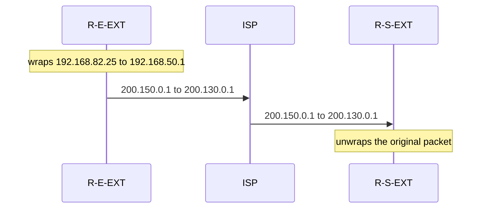

❓ השוו לשיעור 4. מה ההבדל בין זה לבין NAT?

<details dir="rtl"><summary>תשובה</summary>

‏NAT **מחליף** כתובת, ואת שאר החבילה אפשר לקרוא. ה-VPN שם את **כל** החבילה, מוצפנת, בתוך חבילה חדשה,
והצד השני מקבל אותה בדיוק כמו שהייתה.

</details>

✏️ **נסו:** ping ל-200.130.0.2 מ-PC-E-MEET-1. זה עובר במנהרה?

<details dir="rtl"><summary>תשובה</summary>

לא. היעד לא ברשימה של המנהרה, ולכן הוא יוצא עם NAT כרגיל, וב-ISP רואים ICMP.

</details>

## 🧯 לא עובד?

<div dir="rtl">

| מה רואים | כנראה | מה עושים |
|---|---|---|
| ‏`renew` נכשל אחרי ACL | אין שורת bootps, או שהיא רק בנתב אחד | `show access-lists` בשניהם |
| הפקודה `crypto` נותנת `Invalid input` | אין רישיון, או שלא עשו `reload` | `show version` ומחפשים security |
| ה-VPN לא עולה | מפתח, peer או policy שונים | משווים את שתי ההגדרות שורה שורה |
| המנהרה עלתה, ping נכשל | ה-NAT לוקח את החבילה | השורה ‎`5 deny` בשני הצדדים |
| ‏SSH נותן `Connection refused` | אין מפתח RSA, או access-class | `show ip ssh`, מתחברים מ-VLAN 10 |
| ננעלתם בחוץ | ‏AAA בלי משתמש מקומי | בקונסול: `admin` / `Osem#Adm1` |
| ‏NTP לא מסונכרן | המפתח, או מעט מדי זמן | אותו מספר מפתח בשרת, מחכים 5 דקות |

</div>

---

## בדיקות סופיות — כל הפרויקט

<div dir="rtl">

| נושא | בדיקה | התוצאה הנכונה |
|---|---|---|
| ‎VLAN / VTP | ‎`show vlan brief`, `show vtp status` | אותם VLAN-ים בסניף |
| ‎Trunk / STP | ‎`show interfaces trunk`, `show spanning-tree` | המתג הראשי הוא root |
| ‎HSRP | ‎`show standby brief` | ‏Active / Standby, והחלפה בנפילה |
| DHCP / DNS / web / FTP / דואר | מהמחשבים | הכול עובד |
| ‎DHCP Snooping | ‎`show ip dhcp snooping` | הפורטים המהימנים |
| ‎Port Security | ‏MAC זר | ‎‏err-disabled |
| ‎OSPF / EIGRP | ‎`show ip ospf neighbor`, `show ip eigrp neighbors` | ‏FULL / שני שכנים |
| ‎BGP | `show ip route bgp` בנתב EXT | נתיבי `B` לסניפים האחרים |
| ‎NAT | ‎`show ip nat translations` | סטטי, pool, ‏PAT |
| ‎VPN | ‎`show crypto isakmp sa` | ‎QM_IDLE |
| ‎ACL | ‎`show access-lists` | המונים עולים |
| ‎SSH / AAA | ‎`ssh -l osemuser` | נכנס. ‏Telnet נדחה |
| ‎NTP / Syslog | `show ntp status`, השרת | מסונכרן, יש הודעות |
| ‎ASA | ‎`show xlate` | מבפנים החוצה עובד, ההפך לא |

</div>

בסוף: שומרים בכל המכשירים, שומרים את הקובץ, **סוגרים את Packet Tracer, פותחים שוב** ובודקים שהכול נשמר.

## 🔎 מצאו את הטעות — מפרויקט אמיתי
1. ה-ACL היה רק בנתב הגיבוי.
2. הנתב באשדוד השתמש ב-RADIUS, והשרת הוגדר ל-TACACS.
3. ‏`ip ssh version 1` ומשתמשים עם `password 0`.
4. ה-VPN הצפין רק VLAN 10 ↔ VLAN 80, בלי החרגה מה-NAT.
5. ב-ASA היו שלושה נתיבי ברירת מחדל, אחד מהם לכיוון **inside**.

<details dir="rtl"><summary>תשובה</summary>

1. כל עוד הנתב הראשי הוא Active, ה-ACL לא עושה כלום.
2. הם לא מדברים באותה שפה, ולכן הכניסה תמיד נופלת למשתמש המקומי. אותו סוג ואותו מפתח בשני הצדדים.
3. ‏SSH 1 פרוץ, ו-password 0 קריא ב-`show run`. קודם יוצרים מפתחות RSA, אחר כך גרסה 2 ו-`secret`.
4. גם אם המנהרה עולה, ה-NAT לוקח את החבילות. כל הרשתות, ושורת `deny` ברשימת ה-NAT.
5. נתיב ברירת מחדל אחד בלבד, לכיוון outside, אל ה-**VIP** של HSRP.

</details>

## 🏋 תרגילים
1. ב-R-E-EXT מחליפים את המפתח ל-`Osem123` ומפעילים את המנהרה מחדש (`no crypto map VPN-MAP` ואז `crypto map VPN-MAP` ב-s0/0/0). ‏ping מאילת. מה מראה עכשיו `show crypto isakmp sa`? החזירו.
2. אפשרו להנהלת החשבונות (62) גם `ping` לשרת בלבד. איפה ברשימה השורה חייבת להיות?
3. עצרו את שירות ה-AAA בשרת והתחברו ב-SSH עם `admin`. למה זה עובד?

<details dir="rtl"><summary>תשובות (בדקנו אותן)</summary>

1. ה-ping נכשל, ובמקום `QM_IDLE` רואים `MM_KEY_EXCH ... (deleted)`‎: שלב 1 נעצר במפתח. בלי להפעיל מחדש את המנהרה שום דבר לא משתנה, כי המנהרה הישנה ממשיכה לעבוד! כדי להחזיר: `no crypto isakmp key Osem123 address 200.130.0.1`, המפתח המקורי, והפעלה מחדש.

   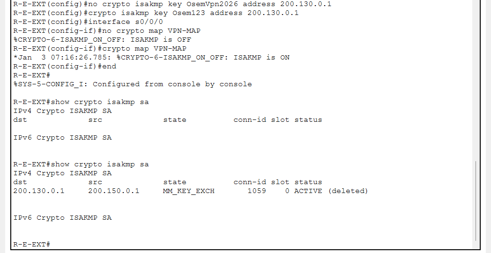
2. לפני ה-deny של 63.0 (שורה 60): ‏`ip access-list extended 110` ואז ‎`55 permit icmp 192.168.62.0 0.0.0.255 host 192.168.63.1`. מוחקים עם `no 55`.
3. המשתמש `osemuser` מקבל `Login invalid`, ו-`admin` נכנס: השרת לא עונה, ולכן משתמשים ב-`local`. מחזירים את השירות ל-On.

</details>

## 🎓 להסביר לבוחן
- למה הסדר של השורות ב-ACL חשוב? מהי השורה הבלתי נראית?
- מה זה שלב 1 ושלב 2? מה זה interesting traffic?
- למה חייבים להחריג את תנועת ה-VPN מה-NAT?
- ‏TACACS+‎ מול RADIUS: שלושה הבדלים.
- מה ההבדל בין ASA לנתב עם ACL? מה עושה `inspect`?

<details dir="rtl"><summary>תשובות לדוגמה</summary>

1. ההתאמה הראשונה קובעת. בסוף יש שורה בלתי נראית `deny ip any any`.
2. שלב 1: הנתבים מזדהים (מפתח) ובונים ערוץ מוגן. שלב 2: מצפין את הנתונים עצמם. ‏Interesting traffic: מה שה-ACL ב-`match address` מרשה.
3. ה-NAT קורה לפני ההצפנה: המקור משתנה, החבילה כבר לא מתאימה לרשימת ה-VPN, והיא יוצאת לא מוצפנת.
4. ‏TCP 49 מול UDP; מצפין הכול מול רק את הסיסמה; מפריד בין authentication ל-authorization, ולכן מתאים לניהול ציוד.
5. חומת אש זוכרת חיבורים (stateful) ויש לה רמות אבטחה. ‏ACL רגיל בודק כל חבילה בנפרד. ‏`inspect` עוקב אחרי פרוטוקול כדי שהתשובות שלו יחזרו.

</details>

## ✏️ מבחן יציאה (3 דקות)
1. ב-ACL יש רק שורה אחת: `deny ip host 1.1.1.1 any`. מה עובר?
2. איזה מצב מראה ששלב 1 תקין?
3. למה המשתמש המקומי חייב להיות קיים לפני `aaa new-model`?
4. מ-inside ‏(100) ל-outside ‏(0): מותר או חסום?
5. למה ליומן צריך NTP?

<details dir="rtl"><summary>תשובות</summary>

1. כלום, בגלל ה-deny הבלתי נראה.
2. ‏QM_IDLE.
3. כדי לא להינעל בחוץ.
4. מותר.
5. כדי שאפשר יהיה להשוות את השעות של כל המכשירים.

</details>

## 🛠 הפרויקט שלכם
- [ ] שני ACL מורחבים ואחד סטנדרטי, ב**כל** נתב שיכול להיות Active.
- [ ] ‏VPN בין סניפים עם החרגה מה-NAT, בין הסניפים שנדרשים בהצעה **שלכם**.
- [ ] ‏SSH 2, ‏AAA מהשרת, משתמש מקומי לגיבוי, NTP עם מפתח, Syslog.
- [ ] ‏ASA עם inside/outside, ‏NAT ו-DHCP.
- [ ] טבלת הבדיקות הסופית עם צילום מסך לכל שורה, לספר הפרויקט.
