# מדריך בנייה צעד אחר צעד – פרויקט רשת לחברת אוסם (3 סניפים)
### לפי פרויקט גמר אמיתי שעבר – סכנין · אשדוד · אילת (Cisco Packet Tracer)

המדריך הזה נכתב אחרי **פירוק מלא של קובץ ה-‎`.pkt` ושל ספר הפרויקט** של פרויקט גמר שעבר בשנה קודמת.
פענחנו את הקובץ ובדקנו כל מכשיר, כל כבל וכל `running-config`. המדריך בונה את **אותה רשת** מאפס:
אותם מכשירים, אותם כבלים ואותם פרוטוקולים.

בקובץ המקורי נמצאו כמה טעויות (למשל רשת שחוזרת בשני סניפים, ACL שחוסם DHCP ושמות ברירת מחדל).
במדריך הן **מתוקנות**, וכל תיקון מסומן ב-🔧. הרשימה המלאה נמצאת ב[נספח א'](#נספח-א--מה-תוקן-לעומת-הקובץ-המקורי).

✅ **כל הפקודות במדריך נבדקו ב-Packet Tracer 9.0.** הרשת המתוקנת נבנתה ונבדקה (HSRP, ‏OSPF/EIGRP, ‏BGP, ‏NAT, ‏VPN, ‏ACL, ‏SSH+AAA, ‏NTP, ‏ASA). הקובץ המוכן: [`Osem.pkt`](Osem.pkt) (באותה תיקייה). כל צילומי המסך במדריך לקוחים ממנו.

<div dir="rtl">

> **חשוב:** זו דוגמה ללמידה. בפרויקט שלכם חייבים חברה, ערים, מחלקות, כתובות וסיסמאות **משלכם**.
> אסור לשני תלמידים להגיש אותו נושא, ואסור להעתיק סניף לסניף.

</div>

<div dir="rtl">

> **לפני שמקלידים:** מקלדת באנגלית, ואת הפקודות מקלידים בדיוק כמו שהן כתובות. שומרים את הקובץ אחרי כל שלב
> (`Ctrl+S`), ובכל מכשיר שסיימתם מריצים `copy running-config startup-config` (או `wr`).

</div>

---

## תוכן עניינים
- [שלב 0 – מה בונים (תמונה כללית)](#שלב-0--מה-בונים)
- [שלב 1 – תוכנית כתובות, VLAN ושמות](#שלב-1--תוכנית-כתובות-vlan-ושמות)
- [שלב 2 – הנחת מכשירים וכבלים](#שלב-2--הנחת-מכשירים-וכבלים)
- [שלב 3 – הגדרות בסיס בכל מכשיר](#שלב-3--הגדרות-בסיס-בכל-מכשיר)
- [שלב 4 – VTP ו-VLAN](#שלב-4--vtp-ו-vlan)
- [שלב 5 – Trunk ופורטי גישה](#שלב-5--trunk-ופורטי-גישה)
- [שלב 6 – STP, PortFast, BPDU Guard, Root Guard](#שלב-6--stp-portfast-bpdu-guard-root-guard)
- [שלב 7 – ממשקי משנה (Router-on-a-stick) ו-HSRP](#שלב-7--ממשקי-משנה-ו-hsrp)
- [שלב 8 – השרתים (DNS, DHCP, HTTP, FTP, MAIL, NTP, SYSLOG, AAA)](#שלב-8--השרתים)
- [שלב 9 – DHCP Snooping ו-Port Security](#שלב-9--dhcp-snooping-ו-port-security)
- [שלב 10 – כתובות ה-WAN (קווי Serial)](#שלב-10--כתובות-ה-wan)
- [שלב 11 – ניתוב בתוך הסניפים: OSPF ו-EIGRP](#שלב-11--ניתוב-בתוך-הסניפים)
- [שלב 12 – BGP מול ספק האינטרנט](#שלב-12--bgp)
- [שלב 13 – NAT (שלושת הסוגים)](#שלב-13--nat)
- [שלב 14 – VPN IPsec בין סכנין לאילת](#שלב-14--vpn-ipsec)
- [שלב 15 – ACL סטנדרטי ומורחב](#שלב-15--acl)
- [שלב 16 – SSH, AAA, NTP ו-SYSLOG בנתבים](#שלב-16--ssh-aaa-ntp-syslog)
- [שלב 17 – חומת אש ASA בסכנין](#שלב-17--asa)
- [שלב 18 – בדיקות סופיות](#שלב-18--בדיקות-סופיות)
- [שלב 19 – כתיבת ספר הפרויקט](#שלב-19--ספר-הפרויקט)
- [נספח א' – מה תוקן לעומת הקובץ המקורי](#נספח-א--מה-תוקן-לעומת-הקובץ-המקורי)
- [נספח ב' – מה חסר בפרויקט הזה לעומת דרישות משרד החינוך](#נספח-ב--מה-חסר-לעומת-דרישות-המשרד)

---

## שלב 0 – מה בונים

שלושה סניפים של אוסם: **סכנין** (הסניף הראשי), **אשדוד** ו**אילת**. כולם מחוברים לנתב ספק אינטרנט אחד (ISP).

```
                              ┌──────────────┐
                              │  ISP (AS 311)│
                              └──┬────┬────┬─┘
                    200.130.0.0  │    │    │  200.150.0.0
               ┌─────────────────┘    │    └──────────────────┐
         R-S-EXT (AS 511)    200.200.0.0│              R-E-EXT (AS 611)
          /        \          R-A-EXT (AS 411)          /         \
   R-S-MAIN    R-S-BKP        /        \          R-E-MAIN     R-E-BKP
        \  OSPF  /        R-A-MAIN  R-A-BKP           \ EIGRP 84 /
       SW-S-MAIN            \ EIGRP 54 /              SW-E-MAIN
     /  |  |  |  \           SW-A-MAIN                /  |  |  \
  מחלקות + שרת + ASA       /  |  |  \             מחלקות + שרת
                       מחלקות + שרת
            ◄═════════ VPN IPsec בין R-S-EXT ל-R-E-EXT ═════════►
```

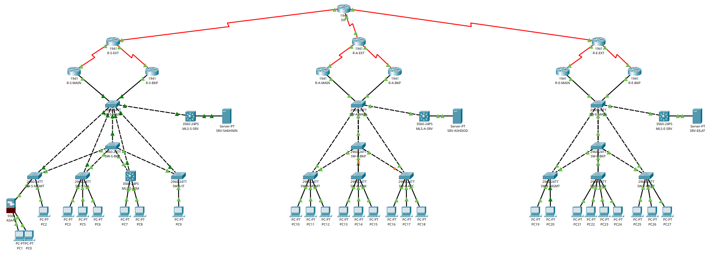

**כל סניף בנוי באותה שיטה:**
- **נתב ראשי (MAIN)** ו**נתב גיבוי (BKP)**: שניהם מחוברים למתג הראשי של הסניף, ועושים יחד ניתוב בין
  VLANים (Router-on-a-stick) עם **HSRP**.
- **נתב חיצוני (EXT)**: מחבר את הסניף לספק. עליו רצים NAT, BGP וה-VPN.
- **מתג ראשי (SW-x-MAIN)**: אליו מחוברים הנתבים, מתגי המחלקות ומתג השרתים.
- **מתג גיבוי (SW-x-BKP)**: מחובר לכל מתגי המחלקות, כדי שיהיה מסלול שני (יתירות בשכבה 2 עם STP).
- **מתג מחלקה** לכל מחלקה (2960), ועליו המחשבים.
- **מתג שכבה 3 (3560)** שאליו מחובר שרת הסניף.

**מה שונה בין הסניפים** (כדי שאף סניף לא יהיה העתק של סניף אחר):

<div dir="rtl">

| | סכנין (ראשי) | אשדוד | אילת |
|---|---|---|---|
| ניתוב פנימי | **OSPF** תהליך 52, אזור 0 | ‎**EIGRP** AS 54 | ‎**EIGRP** AS 84 |
| AS ב-BGP | ‎511 | ‎411 | ‎611 |
| ‎NAT | ‎**PAT** (overload) | **סטטי** לשרת + PAT | **דינמי** (pool) |
| שרת AAA | ‎TACACS+ | ‎**RADIUS** | ‎TACACS+ |
| ‎VPN | ✔ לאילת | ‎– | ✔ לסכנין |
| ‎ASA | ‎✔ (5505) | ‎– | ‎– |
| ‎ACL | סטנדרטי (גישת ניהול) | מורחב (הנהלת חשבונות) | מורחב (פס ייצור) |

</div>

**רשימת ציוד (כמו בקובץ המקורי):**

<div dir="rtl">

| מכשיר | דגם | כמות |
|---|---|---|
| נתבים | ‎Cisco **1941** | 10 (3 בכל סניף + ISP) |
| מתגים | ‎**2960-24TT** | ‎15 |
| מתגי שכבה 3 | ‎**3560-24PS** | ‎4 |
| חומת אש | ‎**ASA 5505** | ‎1 |
| שרתים | ‎Server-PT | ‎3 |
| מחשבים | ‎PC-PT | ‎27 |

</div>

<div dir="rtl">

> ⚠️ דרישת המשרד היא **6 מחלקות** בכל סניף ו**לפחות 8 מחשבים** בכל מחלקה. בפרויקט המקורי היו 3–4
> מחלקות ו-1–4 מחשבים במחלקה. בפרויקט שלכם הוסיפו מחלקות ומחשבים (ראו [נספח ב'](#נספח-ב--מה-חסר-לעומת-דרישות-המשרד)).

</div>

---

## שלב 1 – תוכנית כתובות, VLAN ושמות

### 1.1 טבלת VLAN ורשתות

בכל VLAN: **‎.252 = שער ברירת מחדל וירטואלי (HSRP)**, ‎.254 = הנתב הראשי, ‎.253 = נתב הגיבוי.

<div dir="rtl">

| סניף | ‎VLAN | שם | רשת | שער (HSRP) | הערה |
|---|---|---|---|---|---|
| סכנין | ‎10 | ‎MANAGEMENT | ‎192.168.10.0/24 | ‎192.168.10.252 | גם ה-ASA יושב כאן |
| סכנין | ‎20 | ‎DISPLAY-SALARIES | ‎192.168.20.0/24 | ‎192.168.20.252 | |
| סכנין | ‎30 | ‎ASSEMBLY-MEETING | ‎192.168.30.0/24 | ‎192.168.30.252 | |
| סכנין | ‎40 | ‎IT | ‎192.168.40.0/24 | ‎192.168.40.252 | 🔧 בקובץ המקורי נקרא "servers" |
| סכנין | ‎50 | ‎SERVERS | ‎192.168.50.0/24 | ‎192.168.50.252 | השרת: ‎192.168.50.1 |
| אשדוד | ‎60 | ‎MANAGEMENT | ‎192.168.60.0/24 | ‎192.168.60.252 | 🔧 במקור VLAN 50 |
| אשדוד | ‎61 | ‎ASSEMBLY | ‎192.168.61.0/24 | ‎192.168.61.252 | 🔧 במקור 51 |
| אשדוד | ‎62 | ‎ACCOUNTING | ‎192.168.62.0/24 | ‎192.168.62.252 | 🔧 במקור 52 |
| אשדוד | ‎63 | ‎SERVERS | ‎192.168.63.0/24 | ‎192.168.63.252 | השרת: ‎192.168.63.1 |
| אילת | ‎80 | ‎MANAGEMENT | ‎192.168.80.0/24 | ‎192.168.80.252 | |
| אילת | ‎81 | ‎DEVICES-ASSEMBLY | ‎192.168.81.0/24 | ‎192.168.81.252 | |
| אילת | ‎82 | ‎MEETING | ‎192.168.82.0/24 | ‎192.168.82.252 | |
| אילת | ‎83 | ‎SERVERS | ‎192.168.83.0/24 | ‎192.168.83.252 | השרת: ‎192.168.83.1 |

</div>

<div dir="rtl">

> 🔧 **התיקון הכי חשוב:** בקובץ המקורי, אשדוד השתמשה ב-VLAN 50–53 עם הרשת ‎192.168.50.0, **אותה רשת** של
> השרתים בסכנין. שתי רשתות זהות בשני סניפים שוברות את הניתוב ואת ה-VPN. לכן אשדוד עברה ל-60–63.

</div>

### 1.2 קווי WAN (Serial)

הכתובות נשארו כמו בקובץ המקורי (מסכה ‎/24).

<div dir="rtl">

| קו | צד א' | כתובת | צד ב' | כתובת |
|---|---|---|---|---|
| סכנין ראשי ↔ חיצוני | ‎R-S-MAIN S0/0/0 | ‎200.100.0.1 | ‎R-S-EXT S0/0/0 | ‎200.100.0.2 |
| סכנין גיבוי ↔ חיצוני | ‎R-S-BKP S0/0/0 | ‎200.90.0.1 | ‎R-S-EXT S0/1/0 | ‎200.90.0.2 |
| סכנין חיצוני ↔ ISP | ‎R-S-EXT S0/0/1 | ‎200.130.0.1 | ‎ISP S0/0/0 | ‎200.130.0.2 |
| אשדוד ראשי ↔ חיצוני | ‎R-A-MAIN S0/0/0 | ‎200.110.0.2 | ‎R-A-EXT S0/0/1 | ‎200.110.0.1 |
| אשדוד גיבוי ↔ חיצוני | ‎R-A-BKP S0/0/0 | ‎200.120.0.1 | ‎R-A-EXT S0/1/0 | ‎200.120.0.2 |
| אשדוד חיצוני ↔ ISP | ‎R-A-EXT S0/0/0 | ‎200.200.0.1 | ‎ISP S0/0/1 | ‎200.200.0.2 |
| אילת ראשי ↔ חיצוני | ‎R-E-MAIN S0/0/0 | ‎200.140.0.2 | ‎R-E-EXT S0/0/1 | ‎200.140.0.1 |
| אילת גיבוי ↔ חיצוני | ‎R-E-BKP S0/0/0 | ‎200.160.0.2 | ‎R-E-EXT S0/1/0 | ‎200.160.0.1 |
| אילת חיצוני ↔ ISP | ‎R-E-EXT S0/0/0 | ‎200.150.0.1 | ‎ISP S0/1/0 | ‎200.150.0.2 |

</div>

### 1.3 שמות מכשירים

🔧 בקובץ המקורי רוב המכשירים נשארו עם שם ברירת המחדל (`Router`, `Switch`), ונתב אחד נקרא ‎`123`.
דרישה 22.1 של המשרד היא שם הגיוני לכל מכשיר. נותנים את השם **גם בתווית** (Display Name, לשונית Config)
**וגם** בפקודה `hostname`:

<div dir="rtl">

| תפקיד | סכנין | אשדוד | אילת |
|---|---|---|---|
| נתב ראשי | ‎R-S-MAIN | ‎R-A-MAIN | ‎R-E-MAIN |
| נתב גיבוי | ‎R-S-BKP | ‎R-A-BKP | ‎R-E-BKP |
| נתב חיצוני | ‎R-S-EXT | ‎R-A-EXT | ‎R-E-EXT |
| מתג ראשי | ‎SW-S-MAIN | ‎SW-A-MAIN | ‎SW-E-MAIN |
| מתג גיבוי | ‎SW-S-BKP | ‎SW-A-BKP | ‎SW-E-BKP |
| מתגי מחלקות | ‎SW-S-MGMT, SW-S-SAL, SW-S-IT | ‎SW-A-MGMT, SW-A-ASM, SW-A-ACC | ‎SW-E-MGMT, SW-E-ASM, SW-E-MEET |
| מתגי 3560 | MLS-S-ASM (מחלקת ASSEMBLY), MLS-S-SRV | ‎MLS-A-SRV | ‎MLS-E-SRV |
| שרת | ‎SRV-SAKHNIN | ‎SRV-ASHDOD | ‎SRV-EILAT |
| חומת אש | ‎ASA-S | ‎– | ‎– |
| ספק | ‎ISP | | |

</div>

### 1.4 טבלת סיסמאות (מלאו בערכים **שלכם**)

<div dir="rtl">

| מה | ערך לדוגמה במדריך |
|---|---|
| ‎enable secret | ‎`Osem#En1` |
| משתמש מקומי | ‎`admin` / `Osem#Adm1` |
| ‎VTP | ‎`Osem#Vtp` |
| מפתח TACACS / RADIUS | ‎`Osem#Aaa` |
| מפתח NTP | ‎`Osem#Ntp` |
| מפתח VPN | ‎`OsemVpn2026` (בלי ‎`#`‎ – ראו שלב 14) |

</div>

---

## שלב 2 – הנחת מכשירים וכבלים

### 2.1 נתבים
1. גוררים נתב **1941**, לשונית **Physical**, **מכבים** את הנתב (מתג ההפעלה).
2. מכניסים כרטיס **HWIC-2T** (2 פורטי Serial) לחריץ, ומדליקים.
3. ‏**R-x-EXT ו-ISP צריכים 2 כרטיסים** (שלושה פורטי Serial: ‎S0/0/0, S0/0/1, S0/1/0).
   הנתבים הראשיים והגיבוי צריכים כרטיס אחד.

### 2.2 סוגי כבלים
- מחשב / שרת / נתב ↔ מתג: **Copper Straight-Through**
- מתג ↔ מתג: **Copper Cross-Over**
- נתב ↔ נתב: **Serial DCE**. בצד שבו מתחילים את הכבל צריך `clock rate`.
- ‏ASA ↔ מתג, ומחשב ↔ ASA: Straight-Through

### 2.3 חיבורים – סניף סכנין

<div dir="rtl">

| מ- | פורט | אל | פורט | הערה |
|---|---|---|---|---|
| ‎SW-S-MAIN | ‎Fa0/1 | ‎SW-S-MGMT | ‎Fa0/5 | ‎trunk |
| ‎SW-S-MAIN | ‎Fa0/2 | ‎MLS-S-SRV | ‎Fa0/1 | ‎access VLAN 50 |
| ‎SW-S-MAIN | ‎Fa0/3 | ‎SW-S-SAL | ‎Fa0/4 | ‎trunk |
| ‎SW-S-MAIN | ‎Fa0/4 | ‎MLS-S-ASM | ‎Fa0/1 | ‎trunk |
| ‎SW-S-MAIN | ‎Fa0/5 | ‎R-S-BKP | ‎G0/0 | ‎trunk |
| ‎SW-S-MAIN | ‎Fa0/6 | ‎R-S-MAIN | ‎G0/0 | ‎trunk |
| ‎SW-S-MAIN | ‎Fa0/7 | ‎SW-S-BKP | ‎Fa0/3 | ‎trunk |
| ‎SW-S-MAIN | ‎Fa0/8 | ‎SW-S-IT | ‎Fa0/2 | ‎trunk |
| ‎SW-S-BKP | ‎Fa0/1 | ‎SW-S-MGMT | ‎Fa0/3 | ‎trunk |
| ‎SW-S-BKP | ‎Fa0/2 | ‎SW-S-SAL | ‎Fa0/1 | ‎trunk |
| ‎SW-S-BKP | ‎Fa0/4 | ‎MLS-S-ASM | ‎Fa0/4 | ‎trunk |
| ‎SW-S-BKP | ‎Fa0/5 | ‎SW-S-IT | ‎Fa0/3 | ‎trunk |
| ‎SW-S-MGMT | ‎Fa0/1 | ‎ASA-S | ‎Ethernet0/0 | צד outside של ה-ASA (‏access VLAN 10, **בלי** port-security) |
| ‎SW-S-MGMT | ‎Fa0/2 | ‎PC2 | ‎Fa0 | ‎VLAN 10 |
| ‎ASA-S | ‎Ethernet0/1, 0/2 | ‎PC0, PC1 | ‎Fa0 | רשת פנימית של ה-ASA |
| ‎SW-S-SAL | ‎Fa0/2, 0/3, 0/5 | ‎PC5, PC6, PC3 | ‎Fa0 | ‎VLAN 20 |
| ‎MLS-S-ASM | ‎Fa0/2, 0/3 | ‎PC7, PC8 | ‎Fa0 | ‎VLAN 30 |
| ‎SW-S-IT | ‎Fa0/1 | ‎PC9 | ‎Fa0 | ‎VLAN 40 |
| ‎MLS-S-SRV | ‎Fa0/2 | ‎SRV-SAKHNIN | ‎Fa0 | ‎VLAN 50 |
| ‎R-S-MAIN | ‎S0/0/0 | ‎R-S-EXT | ‎S0/0/0 | ‎Serial |
| ‎R-S-BKP | ‎S0/0/0 | ‎R-S-EXT | ‎S0/1/0 | ‎Serial |
| ‎R-S-EXT | ‎S0/0/1 | ‎ISP | ‎S0/0/0 | ‎Serial |

</div>

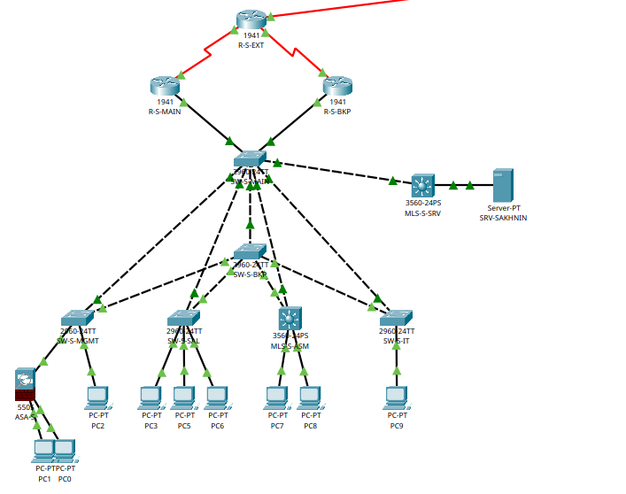

### 2.4 חיבורים – סניף אשדוד

<div dir="rtl">

| מ- | פורט | אל | פורט | הערה |
|---|---|---|---|---|
| ‎SW-A-MAIN | ‎Fa0/1 | ‎SW-A-MGMT | ‎Fa0/4 | ‎trunk |
| ‎SW-A-MAIN | ‎Fa0/2 | ‎R-A-MAIN | ‎G0/0 | ‎trunk |
| ‎SW-A-MAIN | ‎Fa0/3 | ‎SW-A-ASM | ‎Fa0/4 | ‎trunk |
| ‎SW-A-MAIN | ‎Fa0/4 | ‎MLS-A-SRV | ‎Fa0/1 | ‎access VLAN 63 |
| ‎SW-A-MAIN | ‎Fa0/5 | ‎SW-A-ACC | ‎Fa0/4 | ‎trunk |
| ‎SW-A-MAIN | ‎Fa0/6 | ‎R-A-BKP | ‎G0/0 | ‎trunk |
| ‎SW-A-MAIN | ‎Fa0/7 | ‎SW-A-BKP | ‎Fa0/4 | ‎trunk |
| ‎SW-A-BKP | ‎Fa0/1, 0/2, 0/3 | ‎SW-A-MGMT, SW-A-ASM, SW-A-ACC | ‎Fa0/5 | ‎trunk |
| ‎SW-A-MGMT | ‎Fa0/1–0/3 | ‎PC10–PC12 | ‎Fa0 | ‎VLAN 60 |
| ‎SW-A-ASM | ‎Fa0/1–0/3 | ‎PC13–PC15 | ‎Fa0 | ‎VLAN 61 |
| ‎SW-A-ACC | ‎Fa0/1–0/3 | ‎PC16–PC18 | ‎Fa0 | ‎VLAN 62 |
| ‎MLS-A-SRV | ‎Fa0/2 | ‎SRV-ASHDOD | ‎Fa0 | ‎VLAN 63 |
| ‎R-A-MAIN | ‎S0/0/0 | ‎R-A-EXT | ‎S0/0/1 | ‎Serial |
| ‎R-A-BKP | ‎S0/0/0 | ‎R-A-EXT | ‎S0/1/0 | ‎Serial |
| ‎R-A-EXT | ‎S0/0/0 | ‎ISP | ‎S0/0/1 | ‎Serial |

</div>

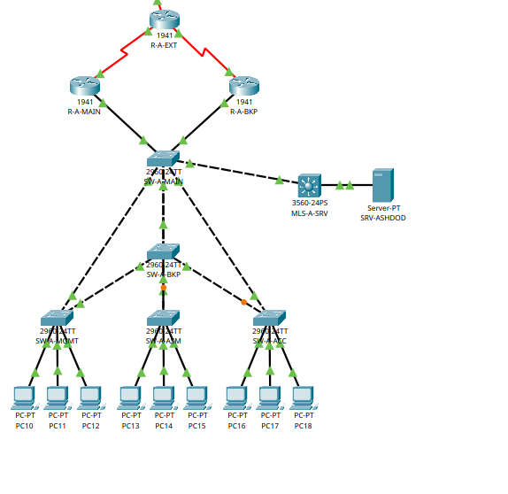

### 2.5 חיבורים – סניף אילת

<div dir="rtl">

| מ- | פורט | אל | פורט | הערה |
|---|---|---|---|---|
| ‎SW-E-MAIN | ‎Fa0/1 | ‎SW-E-MGMT | ‎Fa0/3 | ‎trunk |
| ‎SW-E-MAIN | ‎Fa0/2 | ‎MLS-E-SRV | ‎Fa0/1 | ‎access VLAN 83 |
| ‎SW-E-MAIN | ‎Fa0/3 | ‎SW-E-ASM | ‎Fa0/5 | ‎trunk |
| ‎SW-E-MAIN | ‎Fa0/4 | ‎R-E-MAIN | ‎G0/0 | ‎trunk |
| ‎SW-E-MAIN | ‎Fa0/5 | ‎SW-E-MEET | ‎Fa0/4 | ‎trunk |
| ‎SW-E-MAIN | ‎Fa0/6 | ‎R-E-BKP | ‎G0/0 | ‎trunk |
| ‎SW-E-MAIN | ‎Fa0/7 | ‎SW-E-BKP | ‎Fa0/3 | ‎trunk |
| ‎SW-E-BKP | ‎Fa0/1 | ‎SW-E-MGMT | ‎Fa0/4 | ‎trunk |
| ‎SW-E-BKP | ‎Fa0/2 | ‎SW-E-ASM | ‎Fa0/6 | ‎trunk |
| ‎SW-E-BKP | ‎Fa0/4 | ‎SW-E-MEET | ‎Fa0/5 | ‎trunk |
| ‎SW-E-MGMT | ‎Fa0/1–0/2 | ‎PC19–PC20 | ‎Fa0 | ‎VLAN 80 |
| ‎SW-E-ASM | ‎Fa0/1–0/4 | ‎PC21–PC24 | ‎Fa0 | ‎VLAN 81 |
| ‎SW-E-MEET | ‎Fa0/1–0/3 | ‎PC25–PC27 | ‎Fa0 | ‎VLAN 82 |
| ‎MLS-E-SRV | ‎Fa0/2 | ‎SRV-EILAT | ‎Fa0 | ‎VLAN 83 |
| ‎R-E-MAIN | ‎S0/0/0 | ‎R-E-EXT | ‎S0/0/1 | ‎Serial |
| ‎R-E-BKP | ‎S0/0/0 | ‎R-E-EXT | ‎S0/1/0 | ‎Serial |
| ‎R-E-EXT | ‎S0/0/0 | ‎ISP | ‎S0/1/0 | ‎Serial |

</div>


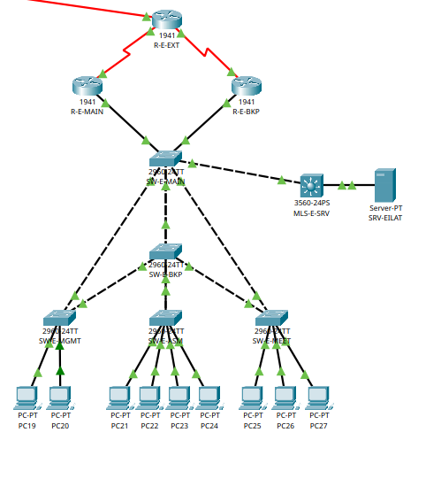

**טיפ:** בתצוגה הלוגית ציירו מלבן (Rectangle) סביב כל סניף, עם תווית "סניף סכנין" וכו'. לספר צריך צילום מסך
של כל הרשת ושל כל סניף בנפרד.

---

## שלב 3 – הגדרות בסיס בכל מכשיר

בכל נתב ובכל מתג (מחליפים את השם בכל מכשיר):
```
enable
configure terminal
hostname R-S-MAIN
no ip domain-lookup
enable secret Osem#En1
service password-encryption
banner motd # Osem - Authorized access only #
line console 0
 password Osem#Con
 login
 logging synchronous
exit
```

<div dir="rtl">

> 🔧 בקובץ המקורי הבאנר היה `welcome to asus comp` ושם הדומיין `asus.com`, שמות שלא שייכים לאוסם.
> בדקו שבפרויקט שלכם לא נשאר אף שם מפרויקט אחר (באנר, דומיין, משתמשים).

</div>

**בדיקה:** יוצאים ונכנסים שוב (`exit`, ‏Enter). צריך להופיע הבאנר, ו-`show run` מראה סיסמאות מוצפנות.

---

## שלב 4 – VTP ו-VLAN

כמו בקובץ המקורי: **דומיין VTP נפרד לכל סניף**. המתג הראשי הוא שרת VTP, ושאר המתגים לקוחות.

### 4.1 המתג הראשי (Server)
**SW-S-MAIN:**
```
vtp domain SAKHNIN
vtp password Osem#Vtp
vtp mode server
vlan 10
 name MANAGEMENT
vlan 20
 name DISPLAY-SALARIES
vlan 30
 name ASSEMBLY-MEETING
vlan 40
 name IT
vlan 50
 name SERVERS
exit
```
**SW-A-MAIN:** אותו דבר עם `vtp domain ASHDOD`, ו-VLAN 60 MANAGEMENT, ‏61 ASSEMBLY, ‏62 ACCOUNTING, ‏63 SERVERS.
**SW-E-MAIN:** ‏`vtp domain EILAT`, ו-VLAN 80 MANAGEMENT, ‏81 DEVICES-ASSEMBLY, ‏82 MEETING, ‏83 SERVERS.

### 4.2 מתג הגיבוי ומתגי המחלקות (Client)
בכל אחד מהם, עם הדומיין של הסניף שלו:
```
vtp domain SAKHNIN
vtp password Osem#Vtp
vtp mode client
```
המתג MLS-S-ASM (3560 עם מחלקת ASSEMBLY בסכנין) הוא גם **client**.

### 4.3 מתגי השרתים (3560: ‏MLS-S-SRV, MLS-A-SRV, MLS-E-SRV)
הם מחוברים ב-access (לא ב-trunk), ולכן לא מקבלים VTP. מגדירים אותם **transparent** ויוצרים את ה-VLAN ידנית:
```
vtp mode transparent
vlan 50
 name SERVERS
```
(באשדוד VLAN 63, באילת VLAN 83.)

<div dir="rtl">

> חשוב: מגדירים את **דומיין ה-VTP לפני** שיוצרים VLANים. הלקוחות לומדים את ה-VLANים רק אחרי שה-trunk עולה (שלב 5).

</div>

**בדיקה:** ‏`show vtp status` ו-`show vlan brief`. אחרי שלב 5, כל הלקוחות בסניף צריכים להראות את אותם VLANים.


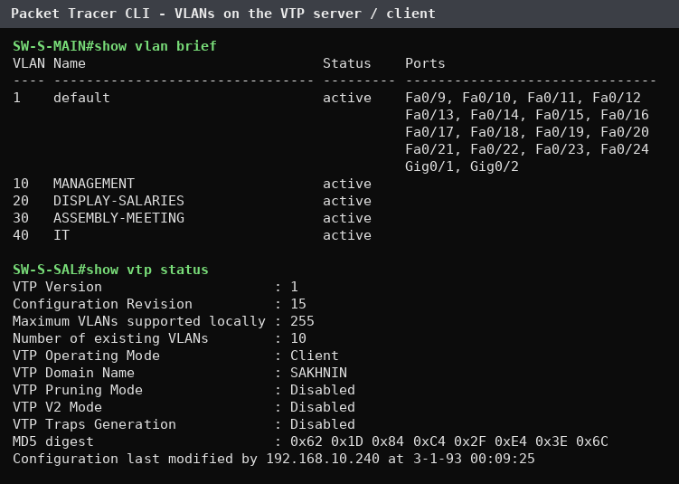

---

## שלב 5 – Trunk ופורטי גישה

🔧 בקובץ המקורי הקישורים מהמתג הראשי למתגי המחלקות היו **access**, ומתג הגיבוי נשאר בלי שום הגדרה (הכול ב-VLAN 1).
כך מתג הגיבוי מחבר בין VLANים שונים, וזה לא עובד. במדריך **כל קישור מתג↔מתג הוא trunk** (חוץ ממתגי השרתים).

### 5.1 המתג הראשי – SW-S-MAIN
```
interface range fa0/1 , fa0/3 - 8
 switchport mode trunk
exit
interface fa0/2
 switchport mode access
 switchport access vlan 50
exit
interface range fa0/9 - 24 , g0/1 - 2
 shutdown
exit
```

<div dir="rtl">

> 🔧 בקובץ המקורי כל הפורטים 9–24 היו במצב trunk. פורט שלא בשימוש **סוגרים** (`shutdown`).

</div>

‏**SW-A-MAIN:** ‏trunk על fa0/1-3, ‏fa0/5-7, ו-fa0/4 הוא access VLAN 63.
**SW-E-MAIN:** ‏trunk על fa0/1, ‏fa0/3-7, ו-fa0/2 הוא access VLAN 83.

### 5.2 מתג הגיבוי – SW-x-BKP
כל הפורטים שמחוברים למתגים הם trunk. בסכנין: `interface range fa0/1 - 5`.

### 5.3 מתגי המחלקות
דוגמה, **SW-S-SAL** (מחלקת DISPLAY-SALARIES, ‏VLAN 20):
```
interface range fa0/1 , fa0/4
 switchport mode trunk
exit
interface range fa0/2 - 3 , fa0/5
 switchport mode access
 switchport access vlan 20
exit
```
טבלה לכל מתגי המחלקות:

<div dir="rtl">

| מתג | פורטי trunk (למעלה) | פורטי מחשבים | ‎VLAN |
|---|---|---|---|
| ‎SW-S-MGMT | ‎fa0/3, fa0/5 | ‎fa0/1 (ASA), fa0/2 | ‎10 |
| ‎SW-S-SAL | ‎fa0/1, fa0/4 | ‎fa0/2, fa0/3, fa0/5 | ‎20 |
| ‎MLS-S-ASM | ‎fa0/1, fa0/4 | ‎fa0/2, fa0/3 | ‎30 |
| ‎SW-S-IT | ‎fa0/2, fa0/3 | ‎fa0/1 | ‎40 |
| ‎SW-A-MGMT / ASM / ACC | ‎fa0/4, fa0/5 | ‎fa0/1-3 | ‎60 / 61 / 62 |
| ‎SW-E-MGMT | ‎fa0/3, fa0/4 | ‎fa0/1-2 | ‎80 |
| ‎SW-E-ASM | ‎fa0/5, fa0/6 | ‎fa0/1-4 | ‎81 |
| ‎SW-E-MEET | ‎fa0/4, fa0/5 | ‎fa0/1-3 | ‎82 |

</div>

### 5.4 מתג 3560 – שימו לב!
ב-3560 צריך לבחור encapsulation **לפני** `mode trunk` (ב-2960 אין צורך):
```
interface range fa0/1 , fa0/4
 switchport trunk encapsulation dot1q
 switchport mode trunk
```
ובמתגי השרתים (3560):
```
interface range fa0/1 - 2
 switchport mode access
 switchport access vlan 50
```

**בדיקה:** ‏`show interfaces trunk` על המתג הראשי: כל הפורטים למתגים ולנתבים מופיעים במצב trunking.

---

## שלב 6 – STP, PortFast, BPDU Guard, Root Guard

### ‏6.1 Root Bridge
המתג הראשי הוא **root**, ומתג הגיבוי הוא root משני (במקור השתמשו ב-`priority 24576` על המתג הראשי):

**SW-S-MAIN:**
```
spanning-tree mode pvst
spanning-tree vlan 10,20,30,40,50 root primary
```
**SW-S-BKP:**
```
spanning-tree vlan 10,20,30,40,50 root secondary
```
(באשדוד 60-63, באילת 80-83.)

### ‏6.2 PortFast + BPDU Guard על פורטי המחשבים (בכל מתג מחלקה)
```
interface range fa0/2 - 3 , fa0/5
 spanning-tree portfast
 spanning-tree bpduguard enable
```

### ‏6.3 Root Guard על המתג הראשי
על הפורטים של המתג הראשי שיורדים **למתגי המחלקות** (לא לכיוון מתג הגיבוי):
```
interface range fa0/1 , fa0/3 , fa0/4 , fa0/8
 spanning-tree guard root
```
(אשדוד: ‏fa0/1, fa0/3, fa0/5. אילת: ‏fa0/1, fa0/3, fa0/5.)

**בדיקה:** ‏`show spanning-tree vlan 20` על SW-S-MAIN מראה **This bridge is the root**.
בדיקת BPDU Guard: מחברים מתג זר לפורט של מחשב, והפורט עובר ל-err-disabled. מצלמים לספר.


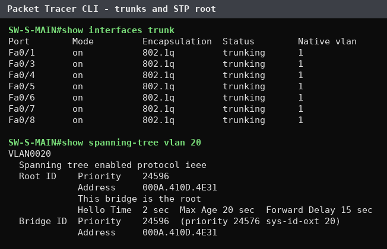

---

## שלב 7 – ממשקי משנה ו-HSRP

כל VLAN מקבל ממשק משנה (sub-interface) בשני הנתבים. **מספר קבוצת ה-HSRP = מספר ה-VLAN** (כמו בקובץ המקורי).

### 7.1 סכנין – R-S-MAIN (הנתב הפעיל, priority 110)
```
interface g0/0
 no shutdown
exit
interface g0/0.10
 encapsulation dot1Q 10
 ip address 192.168.10.254 255.255.255.0
 standby 10 ip 192.168.10.252
 standby 10 priority 110
 standby 10 preempt
 standby 10 track Serial0/0/0
 ip helper-address 192.168.50.1
exit
```
חוזרים על אותו בלוק עבור **20, 30, 40** (מחליפים את המספר בכל מקום).
עבור **VLAN 50** (השרתים) אותו בלוק, אבל **בלי** `ip helper-address`.

<div dir="rtl">

> 🔧 בקובץ המקורי ה-track היה על `GigabitEthernet0/0`, אותו ממשק LAN עצמו, ולכן לא עשה כלום.
> track על **קו ה-Serial** מוריד את העדיפות ב-10 (‏110 → 100) אם הקו לספק נופל, וכך הגיבוי (105) לוקח פיקוד.

</div>

### 7.2 סכנין – R-S-BKP (גיבוי, priority 105)
```
interface g0/0
 no shutdown
exit
interface g0/0.10
 encapsulation dot1Q 10
 ip address 192.168.10.253 255.255.255.0
 standby 10 ip 192.168.10.252
 standby 10 priority 105
 standby 10 preempt
 ip helper-address 192.168.50.1
exit
```
ושוב עבור 20, 30, 40 ו-50.

### 7.3 אשדוד ואילת
בדיוק אותו דבר, עם ה-VLANים של הסניף:
- ‏**R-A-MAIN / R-A-BKP:** ‏VLAN 60, 61, 62, 63. ‏helper = ‎`192.168.63.1`. כתובות ‎.254 / ‎.253, ‏VIP ‎.252.
- ‏**R-E-MAIN / R-E-BKP:** ‏VLAN 80, 81, 82, 83. ‏helper = ‎`192.168.83.1`.

<div dir="rtl">

> 🔧 על הממשק הפיזי `g0/0` לא שמים כתובת IP (בקובץ המקורי הייתה עליו הרשת ‎192.168.54.0, שלא שייכת לשום VLAN).

</div>

**בדיקה:**
```
show standby brief
```
בכל VLAN: ‏R-x-MAIN = **Active**, ‏R-x-BKP = **Standby**.
**בדיקת יתירות:** מתחילים מחשב ב-`ping -t 192.168.10.252` (או לשרת), ובנתב הראשי מריצים `interface g0/0` → `shutdown`.
אחרי כמה שניות הפינג חוזר דרך הגיבוי. מחזירים עם `no shutdown`. מצלמים את שני המצבים לספר.


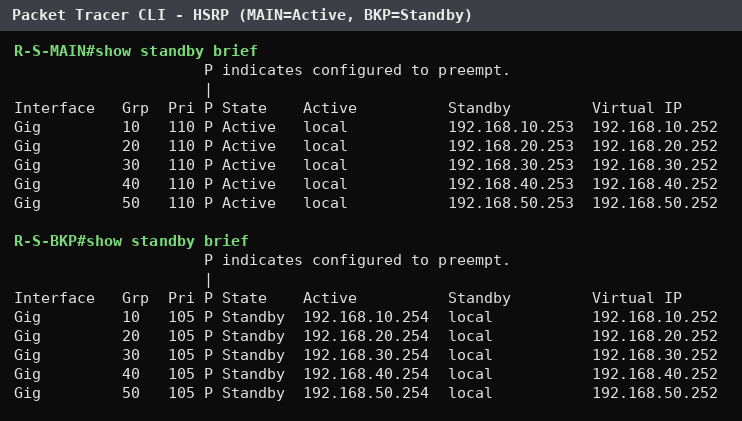

---

## שלב 8 – השרתים

כמו בקובץ המקורי, בכל סניף שרת אחד שמריץ **את כל השירותים**.

### 8.1 כתובת IP קבועה לשרת
‏Desktop → IP Configuration → **Static**:

<div dir="rtl">

| שרת | ‎IP | מסכה | ‎Gateway | ‎DNS |
|---|---|---|---|---|
| ‎SRV-SAKHNIN | ‎192.168.50.1 | ‎255.255.255.0 | ‎192.168.50.252 | ‎192.168.50.1 |
| ‎SRV-ASHDOD | ‎192.168.63.1 | ‎255.255.255.0 | ‎192.168.63.252 | ‎192.168.63.1 |
| ‎SRV-EILAT | ‎192.168.83.1 | ‎255.255.255.0 | ‎192.168.83.252 | ‎192.168.83.1 |

</div>

<div dir="rtl">

> 🔧 בקובץ המקורי ה-Gateway של השרת היה ‎.254 (הנתב הראשי בלבד). צריך את ה-VIP ‎.252, אחרת אם הראשי נופל
> השרת מנותק.

</div>

### ‏8.2 DNS
‏Services → DNS → **On**. מוסיפים רשומות A:

<div dir="rtl">

| שרת | ‎Name | ‎Address |
|---|---|---|
| ‎SRV-SAKHNIN | ‎`www.osem.com` | ‎192.168.50.1 |
| ‎SRV-SAKHNIN | ‎`mail.osem.com` | ‎192.168.50.1 |
| ‎SRV-ASHDOD | ‎`www.osem.com` | ‎192.168.63.1 |
| ‎SRV-EILAT | ‎`www.osem.com` | ‎192.168.83.1 |

</div>

**בדיקה:** במחשב → Command Prompt → `nslookup www.osem.com`.

### ‏8.3 DHCP
‏Services → DHCP → **On**. לכל VLAN של מחלקה יוצרים Pool (‏Add):

<div dir="rtl">

| שרת | ‎Pool Name | ‎Default Gateway | ‎DNS Server | ‎Start IP | ‎Max Users |
|---|---|---|---|---|---|
| ‎SRV-SAKHNIN | ‎MANAGEMENT | ‎192.168.10.252 | ‎192.168.50.1 | ‎192.168.10.20 | ‎50 |
| ‎SRV-SAKHNIN | ‎DISPLAY-SALARIES | ‎192.168.20.252 | ‎192.168.50.1 | ‎192.168.20.20 | ‎50 |
| ‎SRV-SAKHNIN | ‎ASSEMBLY-MEETING | ‎192.168.30.252 | ‎192.168.50.1 | ‎192.168.30.20 | ‎50 |
| ‎SRV-SAKHNIN | ‎IT | ‎192.168.40.252 | ‎192.168.50.1 | ‎192.168.40.20 | ‎50 |
| ‎SRV-ASHDOD | ‎MANAGEMENT / ASSEMBLY / ACCOUNTING | ‎192.168.60/61/62.252 | ‎192.168.63.1 | ‎192.168.6x.20 | ‎50 |
| ‎SRV-EILAT | ‎MANAGEMENT / DEVICES-ASSEMBLY / MEETING | ‎192.168.80/81/82.252 | ‎192.168.83.1 | ‎192.168.8x.20 | ‎50 |

</div>

את ה-`serverPool` שמופיע כברירת מחדל משנים לרשת של השרתים (או משאירים, הוא לא בשימוש).

<div dir="rtl">

> 🔧 בקובץ המקורי ה-serverPool הוגדר מ-‎192.168.50.0 עד ‎192.168.51.255, טווח לא חוקי. ה-Pool מתחיל מ-‎.20
> כדי לא להתנגש עם ה-ASA (‎.15) ועם הנתבים (‎.252–.254).

</div>

**הגדרת המחשבים:** בכל מחשב → Desktop → IP Configuration → **DHCP**. המחשב מקבל כתובת, Gateway ‎.252 ו-DNS.
(עובד בזכות ה-`ip helper-address` משלב 7.)

### ‏8.4 HTTP
‏Services → HTTP → **On**. עורכים את `index.html` ומכניסים "ברוכים הבאים לאוסם – סניף סכנין".
**בדיקה:** מחשב → Web Browser → `http://www.osem.com`.

### ‏8.5 FTP
‏Services → FTP → **On**. מוסיפים משתמש (למשל `sakhnin` / סיסמה) עם כל ההרשאות (Write, Read, Delete, Rename, List).
**בדיקה:** מחשב → Command Prompt:
```
ftp 192.168.50.1
```
מתחברים עם המשתמש ומריצים `dir`.

### ‏8.6 EMAIL
‏Services → EMAIL: ‏SMTP ו-POP3 **On**, ‏Domain Name = `osem.com`. מוסיפים 2 משתמשים (למשל `sakhnin1`, `sakhnin2`).
בשני מחשבים: Desktop → Email → Configure Mail:
Your Name, Email Address = `sakhnin1@osem.com`, Incoming/Outgoing Mail Server = ‎`192.168.50.1`, User Name ו-Password.
**בדיקה:** שולחים מייל מ-sakhnin1 ל-sakhnin2, ובמחשב השני לוחצים Receive.

### ‏8.7 NTP
‏Services → NTP → **On**, ‏**Authentication Enable**, ‏Key = 1, ‏Password = `Osem#Ntp`.
(באשדוד key 2, באילת key 3, כמו בקובץ המקורי.) את הנתבים מגדירים בשלב 16.

### ‏8.8 SYSLOG
‏Services → SYSLOG → **On**. ההודעות יופיעו אחרי שלב 16.

### ‏8.9 AAA
‏Services → AAA → **On**. מוסיפים **Client** לכל נתב (ראשי + גיבוי), בכתובת שלו ב-VLAN השרתים:

<div dir="rtl">

| שרת | ‎Client Name | ‎Client IP | ‎Secret | ‎Server Type |
|---|---|---|---|---|
| ‎SRV-SAKHNIN | ‎R-S-MAIN | ‎192.168.50.254 | ‎`Osem#Aaa` | ‎**Tacacs** |
| ‎SRV-SAKHNIN | ‎R-S-BKP | ‎192.168.50.253 | ‎`Osem#Aaa` | ‎Tacacs |
| ‎SRV-ASHDOD | ‎R-A-MAIN | ‎192.168.63.254 | ‎`Osem#Aaa` | ‎**Radius** |
| ‎SRV-ASHDOD | ‎R-A-BKP | ‎192.168.63.253 | ‎`Osem#Aaa` | ‎Radius |
| ‎SRV-EILAT | ‎R-E-MAIN | ‎192.168.83.254 | ‎`Osem#Aaa` | ‎Tacacs |
| ‎SRV-EILAT | ‎R-E-BKP | ‎192.168.83.253 | ‎`Osem#Aaa` | ‎Tacacs |

</div>

ובחלק **User Setup** מוסיפים משתמש, למשל `osemuser` / `Osem#User`.

<div dir="rtl">

> 🔧 בקובץ המקורי הנתב באשדוד הוגדר ל-RADIUS אבל בשרת הלקוח היה מסוג TACACS, ולכן האימות לא עבד.
> סוג השרת בשני הצדדים חייב להיות זהה.

</div>

---

## שלב 9 – DHCP Snooping ו-Port Security

### ‏9.1 DHCP Snooping (על המתג הראשי של כל סניף)
**SW-S-MAIN:**
```
ip dhcp snooping
ip dhcp snooping vlan 10,20,30,40
no ip dhcp snooping information option
interface range fa0/2 , fa0/5 - 7
 ip dhcp snooping trust
```
פורטים trusted: אל מתג השרת (fa0/2), אל שני הנתבים (fa0/5, fa0/6) ואל מתג הגיבוי (fa0/7).
- ‏**SW-A-MAIN:** ‏`vlan 60,61,62`. ‏trust על fa0/2, fa0/4, fa0/6, fa0/7.
- ‏**SW-E-MAIN:** ‏`vlan 80,81,82`. ‏trust על fa0/2, fa0/4, fa0/6, fa0/7.

<div dir="rtl">

> הפקודה `no ip dhcp snooping information option` חובה. בלעדיה המתג מוסיף Option 82 והנתב (ה-relay) זורק את הבקשות,
> והמחשבים לא יקבלו כתובת.

</div>

**בדיקה:** ‏`show ip dhcp snooping` ו-`show ip dhcp snooping binding`.

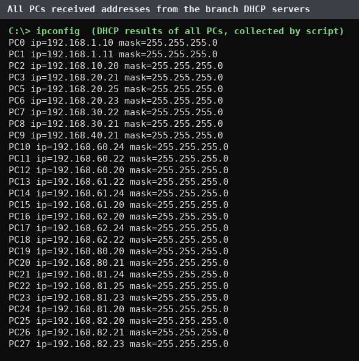

### ‏9.2 Port Security
כמו בקובץ המקורי, על הפורט במתג הראשי שמוביל למתג השרתים:
**SW-S-MAIN** (באשדוד fa0/4, באילת fa0/2):
```
interface fa0/2
 switchport mode access
 switchport port-security
 switchport port-security maximum 2
 switchport port-security mac-address sticky
 switchport port-security violation shutdown
```
וגם על **פורטי המחשבים** בכל מתג מחלקה (דוגמה SW-S-SAL):
```
interface range fa0/2 - 3 , fa0/5
 switchport port-security
 switchport port-security maximum 1
 switchport port-security mac-address sticky
 switchport port-security violation shutdown
```
<div dir="rtl">

> ⚠️ **נמצא בבדיקה:** **לא** שמים port-security על הפורט שמחובר ל-ASA (‏SW-S-MGMT fa0/1). ה-ASA שולח מכמה כתובות MAC
> (אחת לכל VLAN פנימי), ועם `maximum 1` הפורט עבר מיד ל-err-disabled וכל ה-ASA נותק. על הפורט הזה רק
> `switchport mode access`, ‏`switchport access vlan 10` ו-`spanning-tree portfast`.

</div>

**בדיקה:** ‏`show port-security interface fa0/2`.
מחברים "מחשב זר" במקום מחשב קיים ושולחים פינג: הפורט עובר ל-**err-disabled** (צילום לספר).
כדי לשחרר: `shutdown`, ואז `no shutdown` על הפורט.

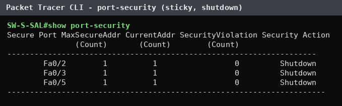

---

## שלב 10 – כתובות ה-WAN

לפי טבלה 1.2. דוגמה, **R-S-MAIN:**
```
interface s0/0/0
 ip address 200.100.0.1 255.255.255.0
 clock rate 2000000
 no shutdown
```

<div dir="rtl">

> ‏`clock rate` נדרש רק בצד **DCE** של הכבל. כדי לדעת מי הצד הזה: `show controllers s0/0/0`.
> אם תקלידו `clock rate` בצד DTE, ה-Packet Tracer פשוט יתעלם.

</div>

**ISP:**
```
hostname ISP
interface s0/0/0
 ip address 200.130.0.2 255.255.255.0
 no shutdown
interface s0/0/1
 ip address 200.200.0.2 255.255.255.0
 no shutdown
interface s0/1/0
 ip address 200.150.0.2 255.255.255.0
 no shutdown
```
**בדיקה:** ‏`show ip interface brief`: כל הקווים **up/up**. פינג לצד השני של כל קו.

---

## שלב 11 – ניתוב בתוך הסניפים

בכל סניף, הנתב הראשי, נתב הגיבוי והנתב החיצוני מריצים פרוטוקול ניתוב פנימי. כך הנתב החיצוני לומד את רשתות הסניף.
**היציאה לאינטרנט היא ב-route סטטי** (דרישת משרד 22.17).

### 11.1 סכנין – OSPF (תהליך 52, אזור 0)
**R-S-MAIN:**
```
router ospf 52
 router-id 1.1.1.1
 network 192.168.10.0 0.0.0.255 area 0
 network 192.168.20.0 0.0.0.255 area 0
 network 192.168.30.0 0.0.0.255 area 0
 network 192.168.40.0 0.0.0.255 area 0
 network 192.168.50.0 0.0.0.255 area 0
 network 200.100.0.0 0.0.0.255 area 0
 passive-interface g0/0.10
 passive-interface g0/0.20
 passive-interface g0/0.30
 passive-interface g0/0.40
 passive-interface g0/0.50
exit
ip route 0.0.0.0 0.0.0.0 200.100.0.2
```
**R-S-BKP:** אותו דבר עם `router-id 1.1.1.2`, ‏`network 200.90.0.0 0.0.0.255 area 0` (במקום 200.100), ו-`ip route 0.0.0.0 0.0.0.0 200.90.0.2`.
**R-S-EXT:**
```
router ospf 52
 router-id 1.1.1.3
 network 200.100.0.0 0.0.0.255 area 0
 network 200.90.0.0 0.0.0.255 area 0
exit
ip route 0.0.0.0 0.0.0.0 200.130.0.2
```

<div dir="rtl">

> 🔧 בקובץ המקורי לא הייתה הרשת 200.130 ב-OSPF של הסניף, וה-ISP הריץ OSPF של הסניף. ה-ISP לא אמור להכיר את
> הרשתות הפרטיות של הסניפים. הוא מקבל רק כתובות ציבוריות דרך BGP (שלב 12).

</div>

### 11.2 אשדוד – EIGRP ‏54
**R-A-MAIN:**
```
router eigrp 54
 network 192.168.60.0
 network 192.168.61.0
 network 192.168.62.0
 network 192.168.63.0
 network 200.110.0.0
 no auto-summary
 passive-interface g0/0.60
 passive-interface g0/0.61
 passive-interface g0/0.62
 passive-interface g0/0.63
exit
ip route 0.0.0.0 0.0.0.0 200.110.0.1
```
**R-A-BKP:** אותו דבר, עם `network 200.120.0.0` ו-`ip route 0.0.0.0 0.0.0.0 200.120.0.2`.
**R-A-EXT:**
```
router eigrp 54
 network 200.110.0.0
 network 200.120.0.0
 no auto-summary
exit
ip route 0.0.0.0 0.0.0.0 200.200.0.2
```

### 11.3 אילת – EIGRP ‏84
‏**R-E-MAIN:** ‏`router eigrp 84` עם הרשתות 192.168.80.0 עד 192.168.83.0, ו-`network 200.140.0.0`, ‏`no auto-summary`, passive על ממשקי המשנה,
ו-`ip route 0.0.0.0 0.0.0.0 200.140.0.1`.
**R-E-BKP:** אותו דבר, עם `network 200.160.0.0` ו-`ip route 0.0.0.0 0.0.0.0 200.160.0.1`.
**R-E-EXT:**
```
router eigrp 84
 network 200.140.0.0
 network 200.160.0.0
 no auto-summary
exit
ip route 0.0.0.0 0.0.0.0 200.150.0.2
```

**בדיקה:**
```
show ip ospf neighbor          (סכנין: R-S-EXT רואה 2 שכנים, FULL)
show ip eigrp neighbors        (אשדוד ואילת: הנתב החיצוני רואה 2 שכנים)
show ip route                  (בנתב החיצוני: כל רשתות ה-VLAN של הסניף, O או D)
```


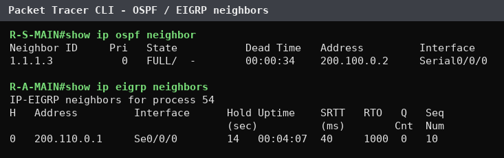

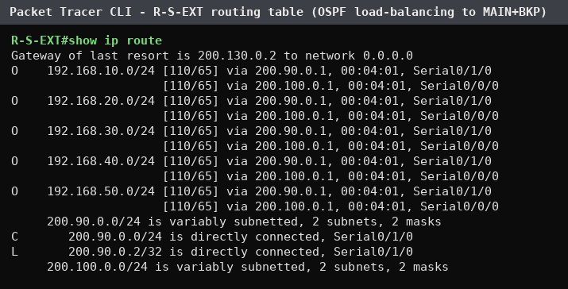

---

## שלב 12 – BGP

כל נתב חיצוני הוא AS נפרד, ומדבר eBGP עם ה-ISP (‏AS 311, כמו בקובץ המקורי).
**מפרסמים ב-BGP רק את הרשתות הציבוריות** של הקו לספק, ולא את הרשתות הפרטיות.

**ISP:**
```
router bgp 311
 neighbor 200.130.0.1 remote-as 511
 neighbor 200.200.0.1 remote-as 411
 neighbor 200.150.0.1 remote-as 611
```
**R-S-EXT:**
```
router bgp 511
 neighbor 200.130.0.2 remote-as 311
 network 200.130.0.0 mask 255.255.255.0
```
**R-A-EXT:**
```
router bgp 411
 neighbor 200.200.0.2 remote-as 311
 network 200.200.0.0 mask 255.255.255.0
```
**R-E-EXT:**
```
router bgp 611
 neighbor 200.150.0.2 remote-as 311
 network 200.150.0.0 mask 255.255.255.0
```

<div dir="rtl">

> 🔧 בקובץ המקורי הייתה רק שכנות BGP אחת (בין אשדוד ל-ISP), וה-ISP עשה redistribute בין OSPF, שני EIGRP ו-BGP.
> זה מסובך ומדליף רשתות פרטיות. כאן יש 3 שכנויות eBGP נקיות.

</div>

**בדיקה:** ‏`show ip bgp summary` ב-ISP: שלושה שכנים, ובעמודה State/PfxRcd יש **מספר** (ולא Idle/Active).
‏`show ip route bgp` ב-R-S-EXT מראה את 200.200.0.0 ואת 200.150.0.0 (רשומות B).


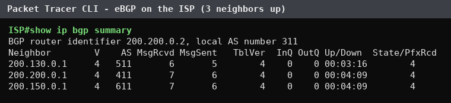

---

## שלב 13 – NAT

דרישת המשרד: שלושת סוגי ה-NAT, לפחות סוג אחד בכל סניף. ה-NAT רץ על **הנתבים החיצוניים**.
‏inside = הקווים לראשי ולגיבוי, ‏outside = הקו ל-ISP.

### 13.1 סכנין – PAT (overload), כולל החרגת VPN
**R-S-EXT:**
```
ip access-list extended NAT-S
 deny   ip 192.168.0.0 0.0.63.255 192.168.80.0 0.0.3.255
 permit ip 192.168.0.0 0.0.63.255 any
exit
ip nat inside source list NAT-S interface s0/0/1 overload
interface s0/0/0
 ip nat inside
interface s0/1/0
 ip nat inside
interface s0/0/1
 ip nat outside
```

<div dir="rtl">

> שורת ה-`deny` מוציאה מה-NAT את התנועה לאילת, כי היא צריכה לעבור ב-VPN עם הכתובות הפרטיות.
> בלי השורה הזו ה-VPN לא יעבוד.

</div>

### 13.2 אשדוד – NAT סטטי לשרת + PAT למחשבים
**R-A-EXT:**
```
ip nat inside source static 192.168.63.1 200.200.0.10
access-list 1 permit 192.168.60.0 0.0.3.255
ip nat inside source list 1 interface s0/0/0 overload
interface s0/0/1
 ip nat inside
interface s0/1/0
 ip nat inside
interface s0/0/0
 ip nat outside
```
כך שרת ה-WEB של אשדוד זמין מבחוץ בכתובת ‎`200.200.0.10`.

### 13.3 אילת – NAT דינמי (pool) + החרגת VPN
**R-E-EXT:**
```
ip nat pool EILAT-POOL 200.150.0.20 200.150.0.30 netmask 255.255.255.0
ip access-list extended NAT-E
 deny   ip 192.168.80.0 0.0.3.255 192.168.0.0 0.0.63.255
 permit ip 192.168.80.0 0.0.3.255 any
exit
ip nat inside source list NAT-E pool EILAT-POOL
interface s0/0/1
 ip nat inside
interface s0/1/0
 ip nat inside
interface s0/0/0
 ip nat outside
```

**בדיקה:** פינג ממחשב באשדוד ל-‎`200.200.0.2` (ה-ISP), ואז ב-R-A-EXT:
```
show ip nat translations
show ip nat statistics
```
וממחשב באילת: Web Browser → `http://200.200.0.10`. אמור להיפתח האתר של אשדוד דרך ה-NAT הסטטי.


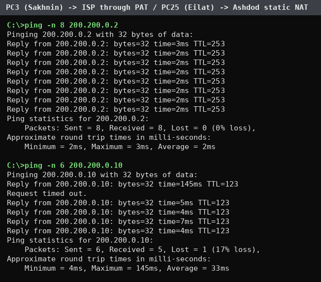

---

## שלב 14 – VPN IPsec

כמו בקובץ המקורי: VPN בין **הנתב החיצוני של סכנין** ל**נתב החיצוני של אילת**.

**שלב מקדים – רישיון אבטחה (חובה ב-1941!)**. בלי הרישיון הנתב לא מכיר את פקודות `crypto isakmp`.
ב-**R-S-EXT וב-R-E-EXT**:
```
configure terminal
license boot module c1900 technology-package securityk9
```
עונים `yes` על ההסכם, ואז:
```
end
copy running-config startup-config
reload
```
אחרי שהנתב עולה: `show version` → בטבלת ה-License צריך להופיע `securityk9` בשורת `security`.

🔧 בקובץ המקורי ה-VPN הצפין רק VLAN 10 ↔ VLAN 80. כאן הוא מכסה את **כל** רשתות שני הסניפים, כך שגם השרתים
בסכנין זמינים מאילת (דרישת משרד 21).

**R-S-EXT:**
```
crypto isakmp policy 10
 encryption aes 256
 hash sha
 authentication pre-share
 group 5
 lifetime 86400
exit
crypto isakmp key OsemVpn2026 address 200.150.0.1
crypto ipsec transform-set VPN-SET esp-aes 256 esp-sha-hmac
ip access-list extended VPN-S-E
 permit ip 192.168.0.0 0.0.63.255 192.168.80.0 0.0.3.255
exit
crypto map VPN-MAP 10 ipsec-isakmp
 description VPN Sakhnin-Eilat
 set peer 200.150.0.1
 set transform-set VPN-SET
 match address VPN-S-E
exit
interface s0/0/1
 crypto map VPN-MAP
```
**R-E-EXT** (תמונת מראה):
```
crypto isakmp policy 10
 encryption aes 256
 hash sha
 authentication pre-share
 group 5
 lifetime 86400
exit
crypto isakmp key OsemVpn2026 address 200.130.0.1
crypto ipsec transform-set VPN-SET esp-aes 256 esp-sha-hmac
ip access-list extended VPN-E-S
 permit ip 192.168.80.0 0.0.3.255 192.168.0.0 0.0.63.255
exit
crypto map VPN-MAP 10 ipsec-isakmp
 description VPN Eilat-Sakhnin
 set peer 200.130.0.1
 set transform-set VPN-SET
 match address VPN-E-S
exit
interface s0/0/0
 crypto map VPN-MAP
```

<div dir="rtl">

> כדי שתנועה מאילת לסכנין תגיע לנתב החיצוני (ומשם ל-VPN), מספיק ה-default route של הראשי/גיבוי לכיוון EXT.
>
> ⚠️ **נמצא בבדיקה:** עם מפתח שמכיל ‎`#`‎ (למשל `Osem#Vpn`) המנהרה נתקעה ב-`MM_KEY_EXCH` / `MM_NO_STATE` ולא עלתה.
> עם מפתח של אותיות ומספרים בלבד היא עלתה מיד. השתמשו במפתח בלי סימנים מיוחדים.
>
> ⚠️ בפינג הראשון שלחו מ**צד אחד בלבד**. אם שני הצדדים מתחילים את המנהרה באותו רגע, היא יכולה להיתקע.
> במקרה כזה: `clear crypto isakmp` בשני הנתבים, ושוב פינג מצד אחד.

</div>

**בדיקה:**
1. ממחשב באילת: `ping 192.168.50.1` (השרת בסכנין). 1–2 הפינגים הראשונים יכולים להיכשל, כי המנהרה רק עולה.
2. ב-R-S-EXT:
```
show crypto isakmp sa        (state = QM_IDLE)
show crypto ipsec sa         (#pkts encaps / decaps עולים)
```
3. ממחשב באילת: Web Browser → `http://192.168.50.1`. אתר סכנין נפתח בכתובת **פרטית**, דרך ה-VPN.

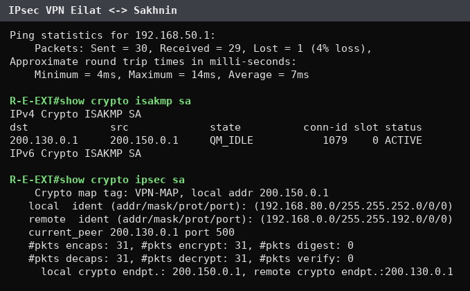

---

## שלב 15 – ACL

### ‏15.1 ACL מורחב – אשדוד (מחלקת הנהלת חשבונות)
**המטרה (כמו בקובץ המקורי):** מחלקת ACCOUNTING (‏VLAN 62) לא יכולה לגשת למחלקת ההנהלה (‏VLAN 60), ומהשרת מקבלת רק
WEB, ‏DNS ו-FTP. לאינטרנט מותר.

‏**R-A-MAIN וגם R-A-BKP** (חובה בשניהם, כי כל אחד מהם יכול להיות ה-Active):
```
access-list 110 permit udp any any eq bootps
access-list 110 deny   ip 192.168.62.0 0.0.0.255 192.168.60.0 0.0.0.255
access-list 110 permit tcp 192.168.62.0 0.0.0.255 host 192.168.63.1 eq www
access-list 110 permit udp 192.168.62.0 0.0.0.255 host 192.168.63.1 eq domain
access-list 110 permit tcp 192.168.62.0 0.0.0.255 host 192.168.63.1 eq ftp
access-list 110 deny   ip 192.168.62.0 0.0.0.255 192.168.63.0 0.0.0.255
access-list 110 permit ip 192.168.62.0 0.0.0.255 any
interface g0/0.62
 ip access-group 110 in
```

<div dir="rtl">

> 🔧 שני תיקונים לעומת המקור:
> 1. **השורה הראשונה** (`bootps`) מאפשרת DHCP. בקשת DHCP יוצאת מהכתובת 0.0.0.0 ובלי השורה הזו ה-ACL חוסם אותה.
> 2. בקובץ המקורי ה-ACL היה רק על נתב הגיבוי, ולכן לא השפיע בזמן שהראשי פעיל.

</div>

### ‏15.2 ACL מורחב – אילת (פס ייצור)
מחלקת DEVICES-ASSEMBLY (‏81) לא יכולה לגשת להנהלה (‏80). **R-E-MAIN וגם R-E-BKP:**
```
access-list 120 permit udp any any eq bootps
access-list 120 deny   ip 192.168.81.0 0.0.0.255 192.168.80.0 0.0.0.255
access-list 120 permit ip 192.168.81.0 0.0.0.255 any
interface g0/0.81
 ip access-group 120 in
```

### ‏15.3 ACL סטנדרטי – סכנין (רק מחלקת ההנהלה מנהלת את הנתבים)
‏**R-S-MAIN ו-R-S-BKP:**
```
access-list 10 permit 192.168.10.0 0.0.0.255
line vty 0 4
 access-class 10 in
```

<div dir="rtl">

> ‏ACL מורחב שמים **קרוב למקור**, ו-ACL סטנדרטי **קרוב ליעד**.

</div>

**בדיקה:** ממחשב ב-ACCOUNTING: פינג למחשב ב-MANAGEMENT **נכשל**, ‏`http://www.osem.com` **עובד**, פינג לשרת **נכשל**.
‏`show access-lists` מראה את מספר ה-matches בכל שורה. מצלמים לספר גם את מה שעובד וגם את מה שנחסם.

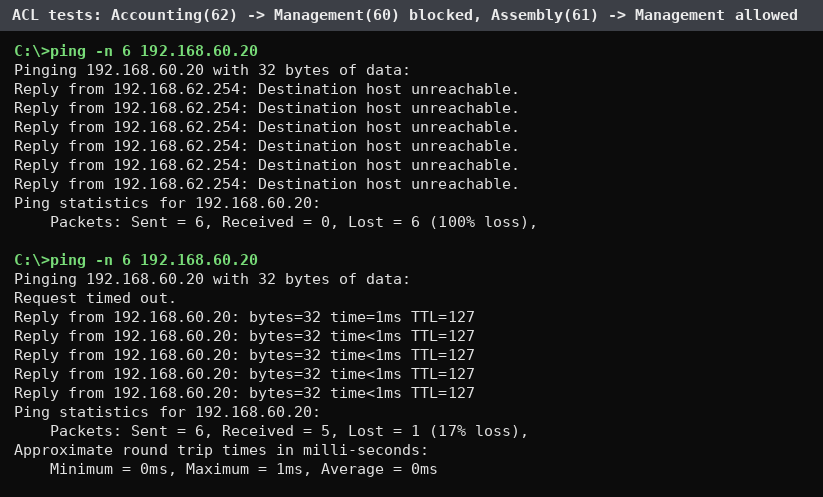

---

## שלב 16 – SSH, AAA, NTP, SYSLOG

### 16.1 נתבים ראשיים וגיבוי בסכנין ובאילת (TACACS+)
דוגמה, **R-S-MAIN** (ב-R-S-BKP אותו דבר. באילת השרת הוא ‎192.168.83.1):
```
ip domain-name osem.com
username admin privilege 15 secret Osem#Adm1
crypto key generate rsa general-keys modulus 1024
ip ssh version 2
aaa new-model
tacacs-server host 192.168.50.1 key Osem#Aaa
aaa authentication login default group tacacs+ local
aaa authorization exec default group tacacs+ local
aaa authentication login CONSOLE local
line console 0
 login authentication CONSOLE
exit
line vty 0 4
 transport input ssh
 login authentication default
exit
ntp authentication-key 1 md5 Osem#Ntp
ntp authenticate
ntp trusted-key 1
ntp server 192.168.50.1 key 1
ntp update-calendar
logging host 192.168.50.1
service timestamps log datetime msec
```

<div dir="rtl">

> 🔧 בקובץ המקורי הוגדר `ip ssh version 1` כי לא נוצר מפתח RSA. צריך קודם `crypto key generate rsa` עם 1024 ביט,
> ואז אפשר גרסה 2.
> ⚠️ קודם יוצרים `username admin`, ורק אחר כך `aaa new-model`. אחרת אפשר לנעול את עצמכם מחוץ לנתב.
> ⚠️ הרשימה `CONSOLE local` גורמת לקונסול להשתמש במשתמש המקומי (`admin`). כך אם שרת ה-AAA לא זמין עדיין
> נכנסים לנתב מהקונסול בלי בעיה, וה-SSH (‏vty) עדיין עובר דרך שרת ה-TACACS/RADIUS.

</div>

### 16.2 אשדוד (RADIUS)
‏**R-A-MAIN ו-R-A-BKP**, כמו למעלה, אבל:
```
radius-server host 192.168.63.1 key Osem#Aaa
aaa authentication login default group radius local
aaa authorization exec default group radius local
aaa authentication login CONSOLE local
line console 0
 login authentication CONSOLE
exit
ntp authentication-key 2 md5 Osem#Ntp
ntp trusted-key 2
ntp server 192.168.63.1 key 2
logging host 192.168.63.1
```

### 16.3 מתגים (SSH עם משתמש מקומי)
ב-2960 של Packet Tracer אין TACACS לכניסה, ולכן משתמשים ב-`login local`.
כתובת ניהול: ‎.240 ב-VLAN הניהול (סכנין 10, אשדוד 60, אילת 80). דוגמה, **SW-S-MAIN:**
```
interface vlan 10
 ip address 192.168.10.240 255.255.255.0
 no shutdown
exit
ip default-gateway 192.168.10.252
ip domain-name osem.com
username admin privilege 15 secret Osem#Adm1
crypto key generate rsa general-keys modulus 1024
ip ssh version 2
line vty 0 15
 transport input ssh
 login local
```

**בדיקות:**
- ממחשב ב-VLAN 10 (‏PC2): `ssh -l osemuser 192.168.10.254`. הכניסה עובדת עם משתמש ה-AAA מהשרת (המשתמש הזה **לא** קיים בנתב, רק בשרת).
- אותה פקודה ממחשב ב-VLAN 20 (‏PC5) → ‏`Connection refused`. זה ה-ACL הסטנדרטי (‏`access-class 10`) עובד.
- ‏`telnet 192.168.10.254` **נדחה**.
- ‏`show ntp status` → **synchronized**.
- בשרת: Services → SYSLOG. מופיעות הודעות (למשל אחרי `shutdown` / `no shutdown` על ממשק).

‏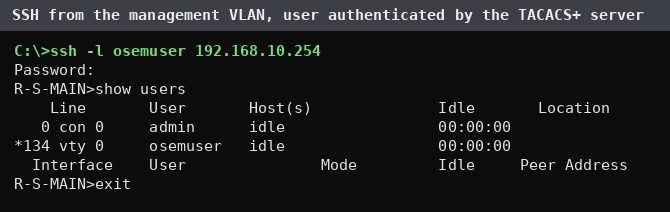

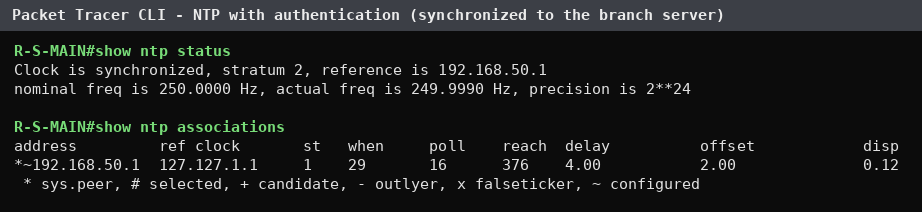

---

## שלב 17 – ASA

כמו בקובץ המקורי: **ASA 5505 בסניף סכנין**, שמגן על רשת קטנה (PC0, PC1). ה-ASA מחובר למתג ההנהלה
(צד outside ב-VLAN 10), והמחשבים מאחוריו מקבלים כתובות מה-ASA עצמו.

**ASA-S:**
```
enable
configure terminal
hostname ASA-S
interface Ethernet0/0
 switchport access vlan 2
interface Ethernet0/1
 switchport access vlan 1
interface Ethernet0/2
 switchport access vlan 1
interface Vlan1
 nameif inside
 security-level 100
 ip address 192.168.1.1 255.255.255.0
interface Vlan2
 nameif outside
 security-level 0
 ip address 192.168.10.15 255.255.255.0
exit
route outside 0.0.0.0 0.0.0.0 192.168.10.252
object network INSIDE-NET
 subnet 192.168.1.0 255.255.255.0
 nat (inside,outside) dynamic interface
exit
no dhcpd auto_config outside
dhcpd address 192.168.1.10-192.168.1.30 inside
dhcpd dns 192.168.50.1
dhcpd enable inside
class-map inspection_default
 match default-inspection-traffic
policy-map global_policy
 class inspection_default
  inspect icmp
  inspect http
  inspect dns
exit
exit
service-policy global_policy global
```
‏PC0 ו-PC1: ‏IP Configuration → **DHCP** (מקבלים ‎192.168.1.x).

<div dir="rtl">

> 🔧 בקובץ המקורי היו שלושה default routes שונים, ועוד `route inside 0.0.0.0` (שגוי). נשאר `dhcpd auto_config outside`
> מהגדרות היצרן, ו-`nameif` על VLAN חדש. כאן יש route אחד ל-VIP של ה-HSRP.

</div>

**בדיקה:** מ-PC0: `ping 192.168.50.1` עובד (NAT של ה-ASA). מ-PC2 (מחוץ ל-ASA): `ping 192.168.1.10` **נכשל**, כי
ה-ASA חוסם תנועה שנכנסת מ-outside ל-inside.
ב-ASA: `show nameif`, ‏`show xlate`, ‏`show route`.

---

## שלב 18 – בדיקות סופיות

מצלמים כל שורה לספר:

<div dir="rtl">

| נושא | פקודה / בדיקה | התוצאה הנכונה |
|---|---|---|
| ‎VLAN / VTP | ‎`show vlan brief`, `show vtp status` | אותם VLANים בכל מתגי הסניף |
| ‎Trunk | ‎`show interfaces trunk` | כל הקישורים בין מתגים |
| ‎STP | ‎`show spanning-tree` | המתג הראשי root |
| ‎HSRP | ‎`show standby brief` | Active / Standby, והחלפה בנפילה |
| ‎DHCP | מחשב → IP Configuration | כתובת, Gateway ‎.252, DNS |
| ‎DHCP Snooping | ‎`show ip dhcp snooping binding` | רשומות של המחשבים |
| ‎Port Security | מחשב זר | ‎err-disabled |
| ‎OSPF | ‎`show ip ospf neighbor` | ‎FULL |
| ‎EIGRP | ‎`show ip eigrp neighbors` | 2 שכנים לכל EXT |
| ‎BGP | ‎`show ip bgp summary` | 3 שכנים ב-ISP |
| ניתוב | `show ip route` בכל נתב ראשי | פרק נפרד בספר |
| ‎NAT | ‎`show ip nat translations` | רשומות אחרי פינג |
| ‎VPN | ‎`show crypto isakmp sa`, `show crypto ipsec sa` | QM_IDLE, מונים עולים |
| ‎ACL | ‎`show access-lists` | ‎matches |
| ‎SSH / AAA | ‎`ssh -l osemuser ...`‎ | נכנס. telnet נדחה |
| ‎NTP / SYSLOG | `show ntp status` / לשונית SYSLOG | מסונכרן / הודעות |
| ‎DNS / WEB / FTP / MAIL | מהמחשבים | הכול עובד |
| ‎ASA | ‎`show nameif`, `show xlate` | inside / outside, תרגומים |

</div>

**בדיקת נפילה (HSRP failover):** ב-R-S-MAIN: `interface g0/0` → `shutdown`. אחרי כמה שניות R-S-BKP הופך ל-Active,
והמחשבים ממשיכים לגלוש. `no shutdown` מחזיר את R-S-MAIN להיות Active (בזכות `preempt`).

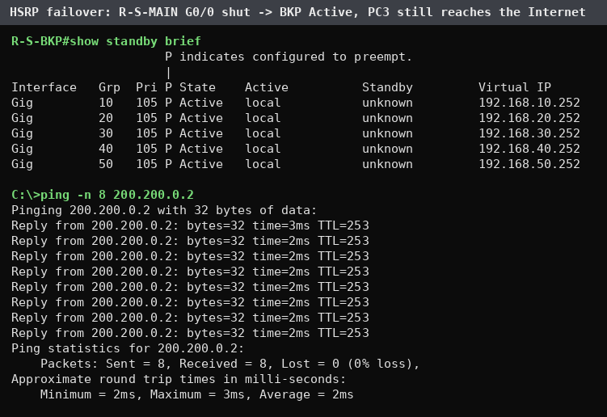

בסוף: שומרים את הקובץ, סוגרים את Packet Tracer, פותחים מחדש ובודקים שהכול נשמר.

---

## שלב 19 – ספר הפרויקט

הספר המקורי בנוי בדיוק לפי התבנית של כל הספרים שעברו. הסדר:

1. **שער** (פעמיים): מכללה, סמל מוסד, מגמה, שם הפרויקט ("בניית 3 סניפים לחברת אוסם"), סטודנט, מנחה, שנה
2. **הצעת פרויקט**: הקדמה, רקע, מטרות, חשיבות, מבנה העבודה, **אודות החברה** (מי אנחנו, מה אנחנו עושים, למה לבחור בנו),
   פריסת הסניפים
3. **הצהרת הסטודנט**, **אישור המנחים**, **הבעת תודה**
4. **תוכן עניינים**, **רשימת איורים**, **רשימת טבלאות**
5. **מבוא**
6. **טופולוגיות**: כל הרשת, ואז סניף סכנין, אשדוד ואילת
7. **פרק השרתים**: ‏DNS → ‏DHCP → ‏DHCP Snooping → ‏HTTP → ‏FTP → ‏MAIL → ‏NTP → ‏SYSLOG → ‏AAA → ‏Banner MOTD
8. **פרקי המיתוג והניתוב**: ‏Switch Layer 3 → ‏VLAN → ‏HSRP (לכל סניף: פקודות, צילומים, show run) → ‏STP → ‏BPDU Guard →
   ‏Root Guard → ‏Trunk → ‏VTP → ‏SSH → ‏Port Security → ‏ACL סטנדרטי → ‏ACL מורחב → ‏NAT → ‏VPN IPsec → ‏ASA →
   ‏OSPF → ‏EIGRP → ‏BGP
9. ‏**show running-config**: נתב ראשי ×3, נתב גיבוי ×3, נתב חיצוני ×3, מתג ראשי ×3
10. ‏**show ip route**: הנתב הראשי בכל סניף
11. **סיכום** ו**מקורות**

**בכל פרק:** הסבר קצר במילים שלכם (מה זה ולמה צריך) → הפקודות שהקלדתם (כטקסט) → צילומי מסך של
**הבדיקה** שמוכיחה שזה עובד.
**טיפים:** תנו כיתוב לכל איור (Word → הפניות → הוסף כיתוב), כך שרשימת האיורים תיבנה לבד. אל תעתיקו הסבר
מתורגם אוטומטית, כי הבוחן שואל עליו. בקובץ ‎`מאגר שאלות לפרויקט יד תשפד.pdf` נמצאות השאלות שהבוחן ישאל.

---

## נספח א' – מה תוקן לעומת הקובץ המקורי

<div dir="rtl">

| ‎# | בקובץ המקורי | במדריך |
|---|---|---|
| ‎1 | אשדוד ב-VLAN 50–53 עם ‎192.168.50.0, אותה רשת של השרתים בסכנין | אשדוד ב-60–63 |
| ‎2 | שמות ברירת מחדל (`Router`, `Switch`), ונתב בשם ‎`123` | שמות לפי תפקיד וסניף |
| ‎3 | קישורי מתג ראשי ↔ מחלקות ב-access, מתג גיבוי לא מוגדר | הכול trunk, מתג גיבוי VTP client + root secondary |
| ‎4 | פורטים 9–24 במצב trunk | פורטים לא בשימוש בסגירה |
| ‎5 | ‏`standby track` על ממשק ה-LAN עצמו | track על קו ה-Serial |
| ‎6 | כתובת IP על `g0/0` הפיזי | בלי כתובת על הפיזי |
| ‎7 | ‏Gateway של השרתים = ‎.254 | ‎‏VIP ‎.252 |
| ‎8 | ‏ISP מריץ OSPF + 2×EIGRP + BGP עם redistribute | ‏IGP רק בתוך הסניף, eBGP נקי, default סטטי |
| ‎9 | שכנות BGP אחת בלבד | 3 שכנויות eBGP |
| ‎10 | ‏NAT רק PAT | ‏PAT, סטטי ודינמי |
| ‎11 | ‏VPN רק בין VLAN 10 ל-VLAN 80, בלי החרגה מה-NAT | כל רשתות שני הסניפים, עם deny ב-ACL של ה-NAT |
| ‎12 | ‏ACL מורחב רק על נתב הגיבוי, וחוסם DHCP | על שני הנתבים + שורת bootps |
| ‎13 | ‏RADIUS בנתב ו-TACACS בשרת (אשדוד) | אותו סוג בשני הצדדים |
| ‎14 | ‏SSH גרסה 1, סיסמאות `password 0` | מפתח RSA 1024, ‏SSH 2, ‏secret |
| ‎15 | ‏ASA עם הגדרות יצרן ו-3 default routes | ‏inside/outside נקי, route אחד, DHCP ל-inside |
| ‎16 | באנר ודומיין עם שם של חברה אחרת | ‎`osem.com` |

</div>

### מה נמצא כשבנינו ובדקנו את המדריך ב-Packet Tracer

<div dir="rtl">

| ‎# | בעיה | התיקון במדריך |
|---|---|---|
| ‎1 | ‏VPN לא עלה עם מפתח שמכיל ‎`#`‎ | מפתח `OsemVpn2026` (שלב 14) |
| ‎2 | ב-1941 אין פקודות crypto בלי רישיון | ‏`license boot module c1900 technology-package securityk9` + ‏reload (שלב 14) |
| ‎3 | ‏port-security על הפורט של ה-ASA ניתק את ה-ASA (err-disabled) | בלי port-security על הפורט הזה (שלב 9.2) |
| ‎4 | אחרי `aaa new-model` גם הקונסול עובר לשרת ה-AAA | רשימה `CONSOLE local` לקונסול (שלב 16) |
| ‎5 | ‏`crypto key generate rsa` שואל שאלה באמצע | ‏`crypto key generate rsa general-keys modulus 1024` בשורה אחת |

</div>

בקובץ המקורי היה גם **VPN לגישה מרחוק (Easy VPN)** על R-E-MAIN. הוא לא חובה, ולכן לא נכנס למדריך.

---

## נספח ב' – מה חסר לעומת דרישות המשרד

הפרויקט המקורי עבר, אבל לפי ההנחיות (`Network Project.pdf`) חסרים בו כמה דברים. בפרויקט שלכם כדאי להוסיף אותם:

<div dir="rtl">

| דרישה | סעיף | מה להוסיף |
|---|---|---|
| 6 מחלקות, ≥ 8 מחשבים בכל אחת | ‎20.2 | עוד VLANים ומחשבים בכל סניף |
| 3 בניינים / קומות במבנה access–distribution–core | ‎20.1 | שכבת distribution בין המתג הראשי למחלקות |
| מדפסות ונקודות אלחוט בכל סניף | ‎20.5–20.6 | ‎Printer-PT, ‏Access Point |
| רשת אלחוטית לעובדים ולאורחים | ‎18 | שני SSID עם WPA2, ‏VLAN אורחים |
| סניף אחד כולו IPv6 | ‎7 | למשל אילת: `ipv6 unicast-routing`, ‏OSPFv3, ‏HSRP v2 |
| ‏OSPF רב-אזורי + virtual link | ‎8, 22.16 | בסכנין: אזור 1 ואזור 2 שלא נוגע באזור 0 |
| ‏Collapsed core על מתגי שכבה 3 | ‎5 | ב-3560: ‏`ip routing` ו-SVI במקום Router-on-a-stick |
| ‏HSRP על מתגי שכבה 3 | ‎17 | ‏`standby` על ה-SVI ב-3560 |
| ‎‏EtherChannel | ‎22.14 | ‏`channel-group 1 mode active` בין הראשי לגיבוי |
| ‏DMZ עם DNS, ‏EMAIL, ‏WEB, ‏NTP, ‏FTP, ‏AAA | ‎11, 21 | ‏ASA 5506-X עם inside / outside / dmz |
| ‏DHCP על נתב בסניף אחד | ‎22.11 | ‏`ip dhcp pool` באחד הסניפים במקום השרת |
| סיכום נתיבים ואימות בפרוטוקולי הניתוב | ‎22.15, 22.18 | ‎‏`ip summary-address eigrp`, ‏`ip ospf message-digest-key` |
| ‏NTP של הסניפים מסונכרן מול הראשי | ‎20.8 | נתבי אשדוד ואילת מסתנכרנים מול סכנין |
| חשבון מייל ב-2 מחשבים בכל מחלקה | ‎22.19 | עוד משתמשים בשרת המייל |

</div>

פירוט ופקודות לכל אחד מהנושאים האלה יש בשלבי הקורס: [04](../../steps/04-etherchannel-and-stp/),
[08](../../steps/08-core-ospf-servers/)–[10](../../steps/10-wireless/), [11](../../steps/11-asa-firewall-dmz/) ו-[14](../../steps/14-kiryat-gat-ipv6/).
