# מקובץ ריק ועד הפרויקט המלא

<div dir="rtl">

> ‏🧰 Packet Tracer 9.0.1 · 🏠 בבית, בקצב שלכם · 💾 הקובץ שלכם: `tesla-full.pkt`

</div>

לחמשת השיעורים יש **קבצי התחלה**, כדי שאפשר להתחיל מכל שיעור בלי להציב 60 מכשירים. הדף הזה מיועד לתלמיד שרוצה לבנות
**הכול לבד**: יש בו כל שלב שקובצי ההתחלה עושים במקומכם. יחד עם חמשת השיעורים זה הפרויקט השלם.

<div dir="rtl">

| עושים | ואז יש לכם |
|---|---|
| שיעור 1 | 2 מתגים ו-3 מחשבים |
| **[חלק A](#part-a)** | אותו דבר כמו `lesson02-start.pkt` |
| שיעור 2 | המיתוג של הרצליה |
| **[חלק B](#part-b)** | אותו דבר כמו `lesson03-start.pkt` |
| שיעור 3 | סניף שלם |
| **[חלק C](#part-c)** | אותו דבר כמו `lesson04-start.pkt` |
| שיעור 4 | שלושה סניפים מחוברים |
| **[חלק D](#part-d)** | אותו דבר כמו `lesson05-start.pkt` |
| שיעור 5, ו**[הבדיקה הסופית](#final)** | הפרויקט המוכן |

</div>

**שלושה כללים.** (1) שמות בדיוק כמו שכתוב. (2) פורטים בדיוק כמו בטבלאות: כל הפקודות תלויות בהם.
(3) אחרי כל משימה: `copy running-config startup-config` בכל מכשיר שנגעתם בו, ו-**File ‏←‏ Save** (Ctrl+S). לפעמים Packet Tracer נסגר לבד, ולכן שומרים הרבה.

✔️ **נבדק.** כל הפקודות וכל טופסי השרתים שבדף הזה ובחמשת השיעורים הוקלדו, אחד אחרי השני, במכשירים ריקים מהמפעל.
התוצאה זהה לפרויקט המוכן (30 מתוך 30 מכשירים מוגדרים, 3 שרתים), ו-14 הבדיקות של [הבדיקה הסופית](#final) הורצו על הקובץ המוכן ועברו.

גם טבלאות הבנייה נבדקו, שורה אחר שורה מול הפרויקט המוכן: כל 60 המכשירים, 14 כרטיסי ה-HWIC ו-72 הכבלים זהים, כולל צד ה-DCE של תשעת הקווים הטוריים. כך זה נראה כשהכול מונח ומחובר:

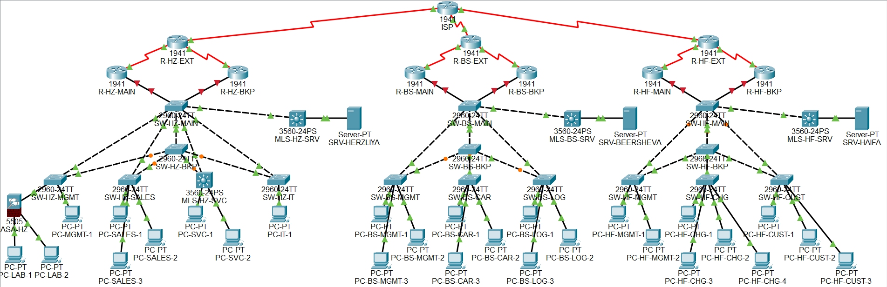

**איך בנויה כל משימה:** 🌐 הרשת עכשיו ‏←‏ ❗ הבעיה ‏←‏ 💡 הפתרון ‏←‏ 📋 מבצעים לבד ‏←‏ 🖱 הפתרון המלא.

הפרויקט כולו, כשהוא מוכן:

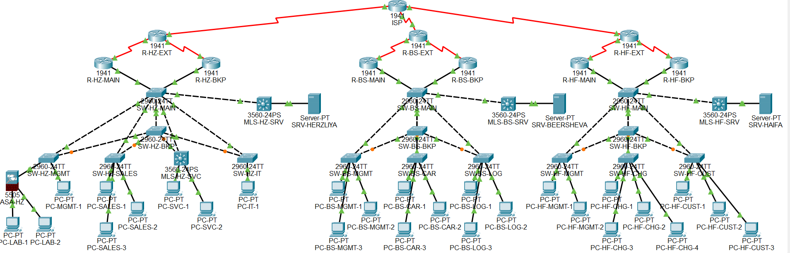

## 📖 הסיפור — החלקים שקובצי ההתחלה מסתירים
**איך הגענו לכאן.** כל שיעור מתחיל בקובץ שבו מישהו כבר חיבר מכשירים חדשים. זה חוסך זמן, אבל בעולם האמיתי **אף אחד לא עושה את זה במקומכם**. הדף הזה מספר את החלק החסר.

**מה רוצים.** קובץ משלכם, מריק ועד מוכן, בלי אף שלב שמופיע בקסם.

<div dir="rtl">

| חלק | מה קרה בסיפור | מה בונים | כדי ש |
|---|---|---|---|
| ‎A | המחלקות האחרות ביקשו להצטרף | חמישה מתגים, שרת, ארבעה מחשבים | לשיעור 2 יהיה מה להפריד |
| ‎B | המחלקות לא מדברות, ולכן קנו נתבים | שני נתבים עם כרטיס טורי | לשיעור 3 תהיה דרך לבנות |
| ‎C | החברה פתחה את באר שבע ואת חיפה | שני סניפים שלמים, ספק, תשעה קווים | לשיעור 4 יהיו איים לחבר |
| ‎D | נוספה מעבדת בדיקות, והתחילה תוכנית האבטחה | חומת אש, שני מחשבים, משתמשים בשני שרתים | לשיעור 5 יהיה על מה להגן |

</div>

---

<a id="part-a"></a>

# חלק A — שאר הרצליה

*אחרי שיעור 1, לפני שיעור 2. ממשיכים בקובץ ששמרתם בשיעור 1.*

## ‏A1 — מציבים את המכשירים
**📖 איך הגענו לכאן.** המכירות עובדות (שיעור 1), והמחלקות האחרות רוצות אותו דבר.

**🌐 הרשת עכשיו.** SW-HZ-MAIN, ‏SW-HZ-SALES ושלושה מחשבים, משיעור 1.

**❗ הבעיה.** בסניף יש חמש רשתות (ארבע מחלקות והשרתים), ולכם יש מחלקה אחת.

**🎯 מה רוצים עכשיו.** כל המכשירים של הסניף על השולחן, עם השמות של התוכנית.

**💡 הפתרון.** מתג לכל מחלקה, מתג גיבוי, מתג לשרת, והשרת עצמו. מחלקת השירות והשרתים מקבלים **3560**: מתג רב-שכבתי.

**📋 מבצעים בפרויקט.** מציבים את המכשירים שבטבלה ונותנים להם את השמות האלה.

### 🖱 הפתרון: על מה לוחצים ומה כותבים
1. ‏**Network Devices** (1) ‏←‏ **Switches** (2) ‏←‏ **2960** (3) או **3560-24PS** (4; לא ה-3650 שלידו), ולוחצים על משטח העבודה.

   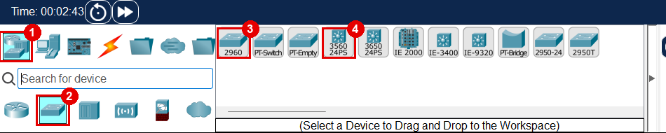
2. למחשבים ולשרת: **End Devices** (1) ‏←‏ **PC** (2) או **Server** (3).

‏   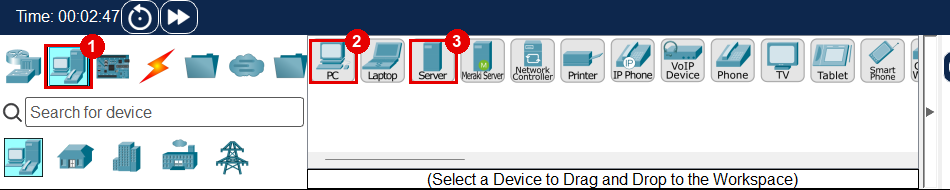
3. משנים את השם של כל מכשיר כמו בשיעור 1: לוחצים עליו ‏←‏ **Config** ‏←‏ **Display Name**.

<div dir="rtl">

| שם | דגם |
|---|---|
| ‎SW-HZ-BKP | ‎2960 |
| ‎SW-HZ-IT | ‎2960 |
| ‎SW-HZ-MGMT | ‎2960 |
| ‎MLS-HZ-SVC | ‎3560-24PS |
| ‎MLS-HZ-SRV | ‎3560-24PS |
| ‎SRV-HERZLIYA | ‎Server |
| ‎PC-SVC-1 | ‎PC |
| ‎PC-SVC-2 | ‎PC |
| ‎PC-IT-1 | ‎PC |
| ‎PC-MGMT-1 | ‎PC |

</div>

מסדרים כך. התווית בקצה של כל כבל היא הפורט (למשימה הבאה). קו מקווקו הוא כבל מוצלב:

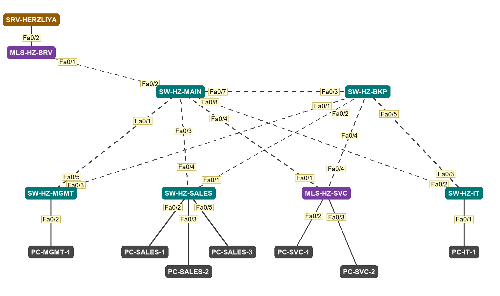

**⏭ מה הלאה.** מכשירים לבד הם רהיטים. עכשיו מחברים אותם.

## ‏A2 — הכבלים
**📖 איך הגענו לכאן.** חמישה עשר מכשירים עומדים בהרצליה, ורק המכירות מחוברות.

**🌐 הרשת עכשיו.** מכשירים בלי כבלים.

**❗ הבעיה.** בשיעור 2 כל פקודה מזכירה פורט. כבל בפורט אחר = VLAN על המכשיר הלא נכון.

**🎯 מה רוצים עכשיו.** שתי דרכים למעלה מכל מחלקה, בדיוק בפורטים של התוכנית.

**💡 הפתרון.** טבלת פורטים. לכל מתג מחלקה יש **שני** קישורים למעלה: אחד למתג הראשי ואחד לגיבוי.

**📋 מבצעים בפרויקט.** מחברים לפי הטבלה. בכל שורה אומרים בקול: ישר או מוצלב, ולמה?

### 🖱 הפתרון: על מה לוחצים ומה כותבים
‏**Connections** (1) ‏←‏ **Copper Straight-Through** (2) או **Copper Cross-Over** (3) ‏←‏ לוחצים על המכשיר הראשון ובוחרים פורט ‏←‏ לוחצים על המכשיר השני ובוחרים פורט.

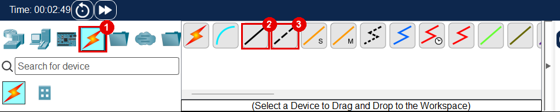

<div dir="rtl">

| ‎# | כבל | מכשיר ראשון | פורט | מכשיר שני | פורט |
|---|---|---|---|---|---|
| ‎1 | ‎Cross-Over | ‎SW-HZ-MAIN | ‎Fa0/1 | ‎SW-HZ-MGMT | ‎Fa0/5 |
| ‎2 | ‎Cross-Over | ‎SW-HZ-MAIN | ‎Fa0/2 | ‎MLS-HZ-SRV | ‎Fa0/1 |
| ‎3 | ‎Cross-Over | ‎SW-HZ-MAIN | ‎Fa0/4 | ‎MLS-HZ-SVC | ‎Fa0/1 |
| ‎4 | ‎Cross-Over | ‎SW-HZ-MAIN | ‎Fa0/7 | ‎SW-HZ-BKP | ‎Fa0/3 |
| ‎5 | ‎Cross-Over | ‎SW-HZ-MAIN | ‎Fa0/8 | ‎SW-HZ-IT | ‎Fa0/2 |
| ‎6 | ‎Cross-Over | ‎SW-HZ-BKP | ‎Fa0/1 | ‎SW-HZ-MGMT | ‎Fa0/3 |
| ‎7 | ‎Cross-Over | ‎SW-HZ-BKP | ‎Fa0/2 | ‎SW-HZ-SALES | ‎Fa0/1 |
| ‎8 | ‎Cross-Over | ‎SW-HZ-BKP | ‎Fa0/4 | ‎MLS-HZ-SVC | ‎Fa0/4 |
| ‎9 | ‎Cross-Over | ‎SW-HZ-BKP | ‎Fa0/5 | ‎SW-HZ-IT | ‎Fa0/3 |
| ‎10 | ‎Straight-Through | ‎SW-HZ-IT | ‎Fa0/1 | ‎PC-IT-1 | ‎Fa0 |
| ‎11 | ‎Straight-Through | ‎SW-HZ-MGMT | ‎Fa0/2 | ‎PC-MGMT-1 | ‎Fa0 |
| ‎12 | ‎Straight-Through | ‎MLS-HZ-SVC | ‎Fa0/2 | ‎PC-SVC-1 | ‎Fa0 |
| ‎13 | ‎Straight-Through | ‎MLS-HZ-SVC | ‎Fa0/3 | ‎PC-SVC-2 | ‎Fa0 |
| ‎14 | ‎Straight-Through | ‎MLS-HZ-SRV | ‎Fa0/2 | ‎SRV-HERZLIYA | ‎Fa0 |

</div>

✅ אחרי כדקה: ירוק, ובחלק מהקישורים כתום בצד אחד. זה STP שחוסם לולאה, וכך צריך להיות.

**⏭ מה הלאה.** הכול מחובר, וחמישה מתגים פתוחים לכולם.

## ‏A3 — הגדרות בסיס בחמישה מתגים
**📖 איך הגענו לכאן.** בשיעור 1 נעלנו שני מתגים. חמישה חדשים עדיין פתוחים.

**🌐 הרשת עכשיו.** SW-HZ-MAIN ו-SW-HZ-SALES הוגדרו בשיעור 1. חמישה מתגים חדשים עדיין נקראים `Switch`, בלי סיסמה.

**❗ הבעיה.** כל מי שיש לו כבל קונסול נכנס, ולא רואים באיזה מתג נמצאים.

**🎯 מה רוצים עכשיו.** אותו שם, סיסמה ובאנר בכל מתג. שום דבר חדש, וזה העניין: תקן אחיד.

**💡 הפתרון.** הבלוק משיעור 1, ורק שורה אחת משתנה: `hostname`.

**📋 מבצעים בפרויקט.** מגדירים את SW-HZ-BKP, ‏SW-HZ-MGMT, ‏SW-HZ-IT, ‏MLS-HZ-SVC, ‏MLS-HZ-SRV. את הראשון מנסים מהזיכרון.

### 🖱 הפתרון: על מה לוחצים ומה כותבים
לוחצים על המתג ‏←‏ **CLI** ‏←‏ **Enter** עד שמופיע `Switch>`‎. כותבים את הבלוק של **SW-HZ-BKP** (כשמופיע `Destination filename` לוחצים Enter):

```
enable
configure terminal
hostname SW-HZ-BKP
no ip domain-lookup
enable secret Tesla#En1
service password-encryption
banner motd # Tesla - Authorized access only #
line console 0
password Tesla#Con
login
logging synchronous
exec-timeout 10 0
end
copy running-config startup-config
```

‏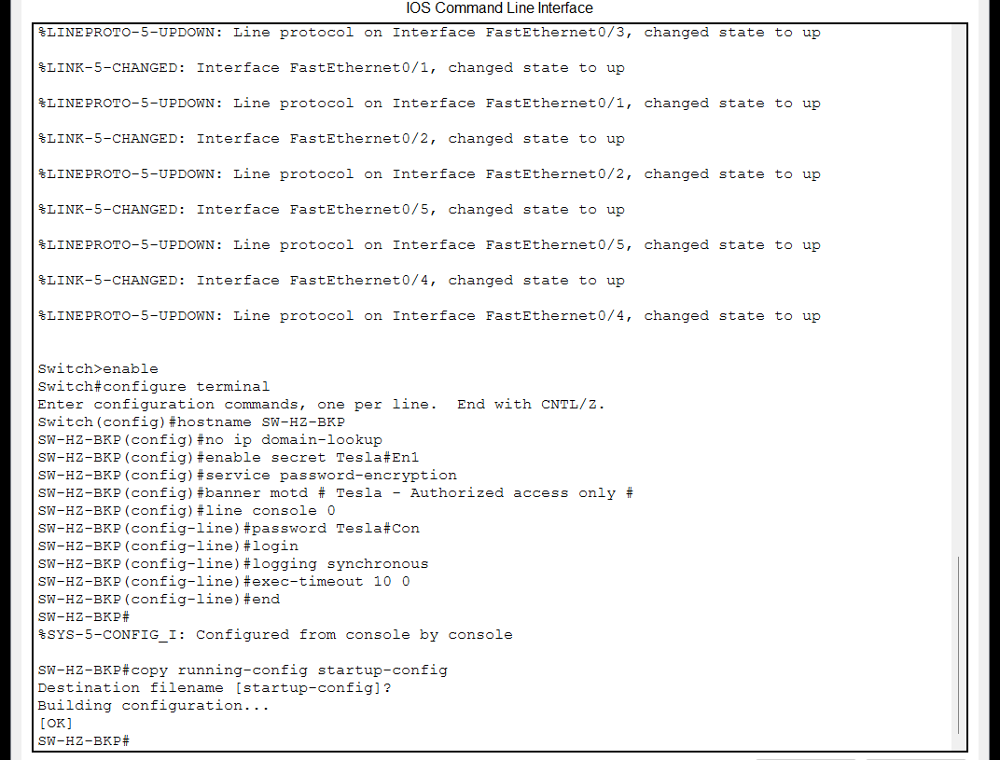

בארבעת האחרים אותו בלוק. רק שורה אחת משתנה:

<div dir="rtl">

| מכשיר | השורה שמשתנה |
|---|---|
| ‎SW-HZ-MGMT | ‎`hostname SW-HZ-MGMT` |
| ‎SW-HZ-IT | ‎`hostname SW-HZ-IT` |
| ‎MLS-HZ-SVC | ‎`hostname MLS-HZ-SVC` |
| ‎MLS-HZ-SRV | ‎`hostname MLS-HZ-SRV` |

</div>

⚠️ ה-**3560** (המכשירים MLS) מתחיל בשאלה, כמו נתב: `Would you like to enter the initial configuration dialog? [yes/no]:`‎. כותבים `no`, לוחצים Enter, ושוב Enter עד `Switch>`‎. אחר כך הוא מקבל בדיוק אותן פקודות:

⚠️ **או שרואים ‎`(config)#`‎ ואין שאלה.** פתיחת הלשונית **Config** (כדי לשנות שם) עונה על השאלה ונכנסת לבד למצב הגדרות. כותבים `end`, לוחצים Enter, ואז כותבים את הבלוק מהשורה הראשונה. זה נכון לכל מתג ולכל נתב:

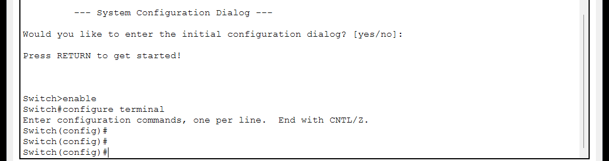

‏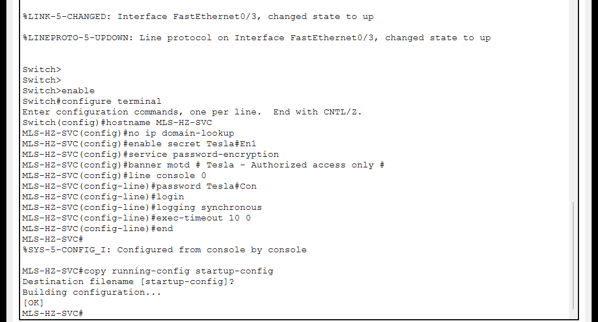

<details dir="rtl"><summary><b>📘 הסבר הפקודות של המשימה</b></summary>

<div dir="rtl">

| פקודה | מה היא עושה, ולמה היא כאן |
|---|---|
| ‎`enable` | עוברים ממצב צפייה (‎`>`‎) למצב ניהול (‎`#`‎). כאן נשאלים על סיסמת ה-enable. |
| ‎`hostname SW-HZ-BKP` | נותן למכשיר שם, זה שרואים בשורת הפקודה. כך לא כותבים במכשיר הלא נכון. |
| ‎`no ip domain-lookup` | שגיאת הקלדה לא נשלחת לחיפוש ב-DNS, ולכן לא מחכים אחרי כל טעות. |
| ‎`enable secret Tesla#En1` | הסיסמה ל-‎`#`‎, נשמרת כ-hash (אי אפשר לקרוא אותה). |
| ‎`service password-encryption` | מסתיר את שאר הסיסמאות ב-`show run`. חלש, אבל עדיף מטקסט גלוי. |
| ‎`banner motd # Tesla - Authorized access only #`‎ | אזהרה שמופיעה לפני הכניסה. סימני ה-‎`#`‎ מסמנים את תחילת הטקסט ואת סופו. |
| ‎`line console 0` | נכנסים להגדרות של פורט הקונסול (הכבל הכחול / לשונית CLI). |
| ‎`password Tesla#Con` | הסיסמה של הקו הזה. |
| ‎`login` | "תשאל על הסיסמה". בלי זה הסיסמה קיימת ואף אחד לא נשאל. |
| ‎`logging synchronous` | הודעות מערכת לא חותכות את השורה שאתם כותבים. |
| ‎`exec-timeout 10 0` | מנתק אחרי מספר כזה של דקות ושניות בלי הקלדה (10 דקות, 0 שניות). |
| ‎`copy running-config startup-config` | שומר את מה שבזיכרון לקובץ ההפעלה. בלי זה הפסקת חשמל מוחקת את העבודה. |

</div>

</details>

**⏭ מה הלאה.** המתגים מוכנים. לארבעה מחשבים עדיין אין כתובת.

## ‏A4 — כתובות למחשבים
**📖 איך הגענו לכאן.** המתגים נעולים, ורק למכירות יש כתובות.

**🌐 הרשת עכשיו.** רק למחשבי השכר יש כתובות (שיעור 1).

**❗ הבעיה.** בשיעור 2 מראים אילו מחשבים מדברים ואילו לא. מחשב בלי כתובת לא מוכיח כלום.

**🎯 מה רוצים עכשיו.** כתובת זמנית לכל מחשב, ברשת של ה-VLAN העתידי שלו.

**💡 הפתרון.** כתובת קבועה לכל מחשב, ברשת של ה-VLAN העתידי שלו. בשיעור 3 עוברים ל-DHCP.

**📋 מבצעים בפרויקט.** נותנים כתובת לארבעת המחשבים החדשים. אילו מחשבים יכולים לעשות ping זה לזה עכשיו? למה?

### 🖱 הפתרון: על מה לוחצים ומה כותבים
מחשב ‏←‏ **Desktop** ‏←‏ **IP Configuration** ‏←‏ **Static**, כמו בשיעור 1. ה-Gateway נשאר ריק.

<div dir="rtl">

| מחשב | ‎IPv4 Address | ‎Subnet Mask |
|---|---|---|
| ‎PC-MGMT-1 | ‎192.168.12.21 | ‎255.255.255.0 |
| ‎PC-SVC-1 | ‎192.168.32.21 | ‎255.255.255.0 |
| ‎PC-SVC-2 | ‎192.168.32.22 | ‎255.255.255.0 |
| ‎PC-IT-1 | ‎192.168.42.21 | ‎255.255.255.0 |

</div>

‏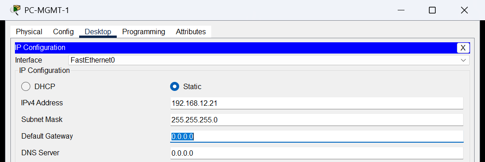

✅ מ-PC-SVC-1: הפקודה `ping 192.168.32.22` מצליחה, והפקודה `ping 192.168.42.21` נכשלת (רשת אחרת, ועדיין אין נתב).

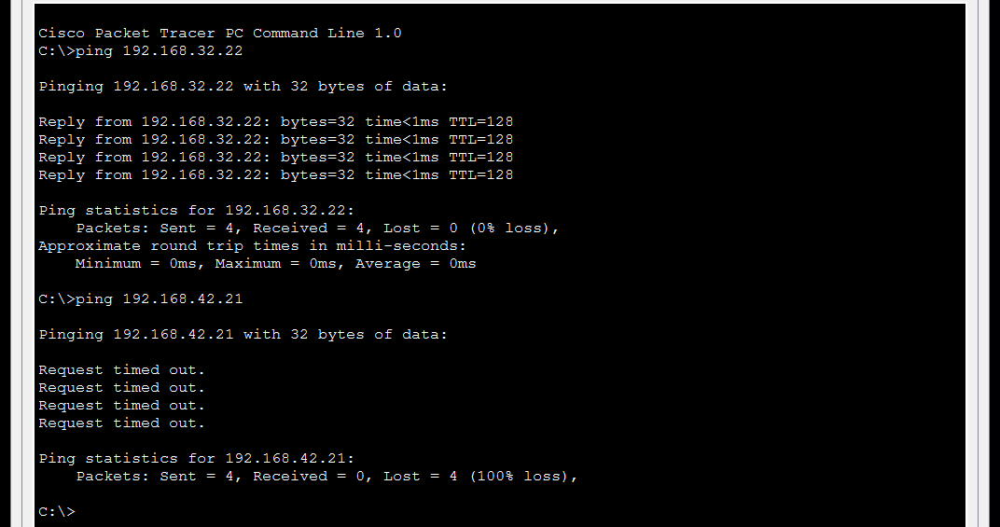

<details dir="rtl"><summary><b>📘 הטופס, שדה אחר שדה</b></summary>

<div dir="rtl">

| שדה או לחיצה | מה זה, ולמה |
|---|---|
| ‎**Static**, IPv4 Address, Subnet Mask | כמו בשיעור 1, משימה 5. כל מחשב כבר מקבל את הרשת של ה-VLAN ה**עתידי** שלו, וכך בשיעור 2 נראה את ההפרדה. |

</div>

</details>

<details dir="rtl"><summary><b>📘 הסבר הפקודות של המשימה</b></summary>

<div dir="rtl">

| פקודה | מה היא עושה, ולמה היא כאן |
|---|---|
| ‎`ping 192.168.32.22` | שולח 4 הודעות בדיקה. תשובות = הדרך עובדת ב**שני** הכיוונים. |

</div>

</details>

**⏭ מה הלאה.** כולם מחוברים לכולם. שיעור 2 מפריד אותם.

➡ עכשיו עושים את **[שיעור 2](../lesson-02/)** בקובץ שלכם.

---

<a id="part-b"></a>

# חלק B — שני נתבים להרצליה

*אחרי שיעור 2, לפני שיעור 3.*

## ‏B1 — מציבים שני נתבים ומוסיפים כרטיס טורי
**📖 איך הגענו לכאן.** שיעור 2 בנה קירות, ועכשיו אף מחלקה לא מדברת עם אחרת.

**🌐 הרשת עכשיו.** חמישה VLAN, ממותגים ומוגנים. שום דבר לא מנתב ביניהם.

**❗ הבעיה.** צריך שני נתבים, ובהמשך קו טורי לאינטרנט. בנתב 1941 חדש יש שני פורטי Ethernet ו**אין אף פורט טורי**.

**🎯 מה רוצים עכשיו.** שני נתבים (אחד לגיבוי), עם כרטיס לקו האינטרנט שיגיע בשיעור 4.

**💡 הפתרון.** שני נתבי **1941**, ובכל אחד כרטיס **HWIC-2T**: שני פורטים טוריים. כרטיס נכנס רק כשהחשמל **כבוי**.

**📋 מבצעים בפרויקט.** מציבים את R-HZ-MAIN ואת R-HZ-BKP, ובכל אחד כרטיס HWIC-2T בחריץ **הימני**.

### 🖱 הפתרון: על מה לוחצים ומה כותבים
1. ‏**Network Devices** (1) ‏←‏ **Routers** (2) ‏←‏ **1941** (3). השמות: `R-HZ-MAIN`, `R-HZ-BKP`.

   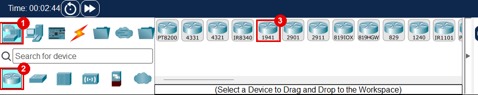
2. לוחצים על הנתב ‏←‏ לשונית **Physical**. לוחצים על **מתג החשמל** (1): האור הירוק שלו נכבה.
3. גוררים את **HWIC-2T** (2) מהרשימה אל החריץ **הימני** (3). לוחצים עם העכבר על השם **HWIC-2T**, ממשיכים ללחוץ עד שנמצאים מעל החריץ השחור, ומשחררים.
4. לוחצים שוב על מתג החשמל (1): האור ירוק.

   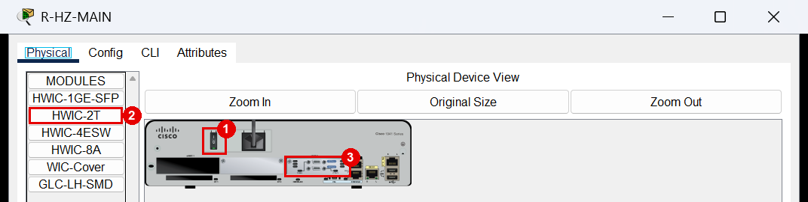

⚠️ החריץ **הימני** הוא חריץ 0: הפורטים שלו הם `S0/0/0` ו-`S0/0/1`. השמאלי הוא חריץ 1: `S0/1/0` ו-`S0/1/1`. כרטיס בחריץ
הלא נכון = הפקודות הטוריות של שיעור 4 נדחות.

**⏭ מה הלאה.** הנתבים על השולחן. מחברים אותם למתג הראשי.

## ‏B2 — כבלים והגדרות בסיס
**📖 איך הגענו לכאן.** שני נתבים עם כרטיסים, שלא מחוברים לכלום.

**🌐 הרשת עכשיו.** שני נתבים שלא מחוברים לכלום.

**❗ הבעיה.** נתב חדש לא מתחיל ב-`Router>`‎ אלא ב**שאלה**. מי שעונה `yes` נכנס לשאלון ארוך.

**🎯 מה רוצים עכשיו.** כבל מכל אחד למתג הראשי, ואותם מנעולים כמו במתגים.

**💡 הפתרון.** עונים `no`, וכותבים את בלוק הבסיס.

**📋 מבצעים בפרויקט.** מחברים את שני הנתבים ל-SW-HZ-MAIN ומגדירים. איזה כבל עובר בין נתב למתג?

### 🖱 הפתרון: על מה לוחצים ומה כותבים

<div dir="rtl">

| ‎# | כבל | מכשיר ראשון | פורט | מכשיר שני | פורט |
|---|---|---|---|---|---|
| ‎1 | ‎Straight-Through | ‎R-HZ-BKP | ‎G0/0 | ‎SW-HZ-MAIN | ‎Fa0/5 |
| ‎2 | ‎Straight-Through | ‎R-HZ-MAIN | ‎G0/0 | ‎SW-HZ-MAIN | ‎Fa0/6 |

</div>

המשולשים נשארים **אדומים**: פורטים של נתב כבויים עד `no shutdown` (שיעור 3).

לוחצים על **R-HZ-MAIN** ‏←‏ **CLI**. כשמופיע `Would you like to enter the initial configuration dialog? [yes/no]:`‎ כותבים `no` ולוחצים Enter. לוחצים שוב Enter עד `Router>`‎:

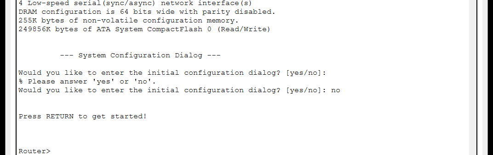

אין שאלה, ורואים `Router(config)#`‎? פתחתם את הלשונית **Config** אחרי שהנתב הודלק. כותבים `end`, לוחצים Enter, וממשיכים עם הבלוק.

**R-HZ-MAIN**:

```
enable
configure terminal
hostname R-HZ-MAIN
no ip domain-lookup
enable secret Tesla#En1
service password-encryption
banner motd # Tesla - Authorized access only #
line console 0
password Tesla#Con
login
logging synchronous
exec-timeout 10 0
end
copy running-config startup-config
```

‏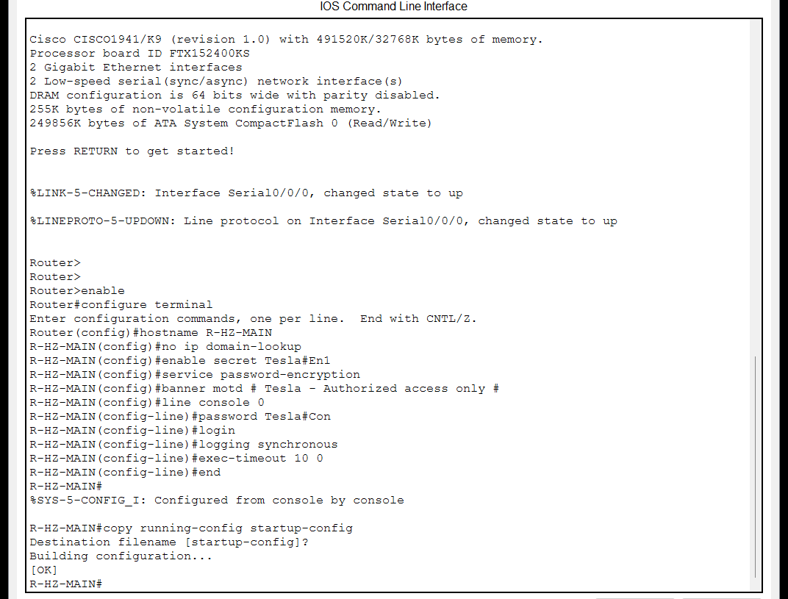

‏**R-HZ-BKP**: קודם `no`, ואז אותו בלוק. רק שורה אחת משתנה: `hostname R-HZ-BKP`.

<details dir="rtl"><summary><b>📘 הסבר הפקודות של המשימה</b></summary>

<div dir="rtl">

| פקודה | מה היא עושה, ולמה היא כאן |
|---|---|
| ‎`no shutdown` | מדליק את הפורט. פורטים של נתב כבויים כברירת מחדל. |
| ‎`enable` | עוברים ממצב צפייה (‎`>`‎) למצב ניהול (‎`#`‎). כאן נשאלים על סיסמת ה-enable. |
| ‎`hostname R-HZ-MAIN` | נותן למכשיר שם, זה שרואים בשורת הפקודה. כך לא כותבים במכשיר הלא נכון. |
| ‎`no ip domain-lookup` | שגיאת הקלדה לא נשלחת לחיפוש ב-DNS, ולכן לא מחכים אחרי כל טעות. |
| ‎`enable secret Tesla#En1` | הסיסמה ל-‎`#`‎, נשמרת כ-hash (אי אפשר לקרוא אותה). |
| ‎`service password-encryption` | מסתיר את שאר הסיסמאות ב-`show run`. חלש, אבל עדיף מטקסט גלוי. |
| ‎`banner motd # Tesla - Authorized access only #`‎ | אזהרה שמופיעה לפני הכניסה. סימני ה-‎`#`‎ מסמנים את תחילת הטקסט ואת סופו. |
| ‎`line console 0` | נכנסים להגדרות של פורט הקונסול (הכבל הכחול / לשונית CLI). |
| ‎`password Tesla#Con` | הסיסמה של הקו הזה. |
| ‎`login` | "תשאל על הסיסמה". בלי זה הסיסמה קיימת ואף אחד לא נשאל. |
| ‎`logging synchronous` | הודעות מערכת לא חותכות את השורה שאתם כותבים. |
| ‎`exec-timeout 10 0` | מנתק אחרי מספר כזה של דקות ושניות בלי הקלדה (10 דקות, 0 שניות). |
| ‎`copy running-config startup-config` | שומר את מה שבזיכרון לקובץ ההפעלה. בלי זה הפסקת חשמל מוחקת את העבודה. |

</div>

</details>

**⏭ מה הלאה.** הדרך סלולה אבל סגורה. שיעור 3 פותח אותה.

➡ עכשיו עושים את **[שיעור 3](../lesson-03/)**.

---

<a id="part-c"></a>

# חלק C — הספק, באר שבע וחיפה

*אחרי שיעור 3, לפני שיעור 4. החלק הארוך ביותר.*

## ‏C1 — נתבי הקצה, הספק והקווים הטוריים
**📖 איך הגענו לכאן.** הרצליה שלמה (שיעור 3), והיא אי.

**🌐 הרשת עכשיו.** הרצליה עובדת, אבל היא אי.

**❗ הבעיה.** אין נתב לכיוון האינטרנט, אין ספק, ואין סניפים אחרים.

**🎯 מה רוצים עכשיו.** השלד של העולם: נתב קצה לכל סניף, הספק, ותשעה קווים טוריים.

**💡 הפתרון.** בכל סניף **נתב קצה** אחד (EXT), ונתב **ISP** אחד לכולם. הנתבים האלה מחוברים בכבלים **טוריים**.

**📋 מבצעים בפרויקט.** מציבים את שמונת הנתבים עם הכרטיסים הנכונים, ומחברים את תשעת הקווים הטוריים.

### 🖱 הפתרון: על מה לוחצים ומה כותבים
1. מציבים את נתבי **1941** ומכניסים את הכרטיסים כמו ב-B1 (מכבים ‏←‏ גוררים ‏←‏ מדליקים):

   | נתב | כרטיסים | איפה |
   |---|---|---|
   | ISP, R-HZ-EXT, R-BS-EXT, R-HF-EXT | **שני** HWIC-2T | חריץ ימני **וגם** שמאלי |
   | R-BS-MAIN, R-BS-BKP, R-HF-MAIN, R-HF-BKP | HWIC-2T אחד | חריץ ימני |

   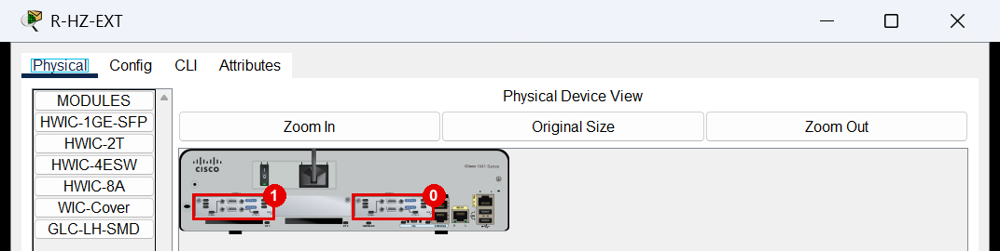
2. ‏**Connections** (1) ‏←‏ **Serial DCE** (2) ‏←‏ לוחצים **קודם** על מכשיר ה-DCE שבטבלה, ואחר כך על השני.

   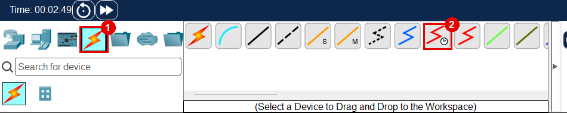

   | # | ראשון (DCE) | פורט | שני | פורט |
   |---|---|---|---|---|
   | 1 | R-HZ-EXT | S0/0/0 | R-HZ-MAIN | S0/0/0 |
   | 2 | R-HZ-EXT | S0/1/0 | R-HZ-BKP | S0/0/0 |
   | 3 | ISP | S0/0/0 | R-HZ-EXT | S0/0/1 |
   | 4 | R-BS-EXT | S0/0/1 | R-BS-MAIN | S0/0/0 |
   | 5 | R-BS-EXT | S0/1/0 | R-BS-BKP | S0/0/0 |
   | 6 | ISP | S0/0/1 | R-BS-EXT | S0/0/0 |
   | 7 | R-HF-EXT | S0/0/1 | R-HF-MAIN | S0/0/0 |
   | 8 | R-HF-EXT | S0/1/0 | R-HF-BKP | S0/0/0 |
   | 9 | ISP | S0/1/0 | R-HF-EXT | S0/0/0 |

   ⚠️ המכשיר **הראשון** שלוחצים עליו הוא ה-DCE: הוא נותן את השעון. בשיעור 4 כותבים `clock rate` בצד הזה.
3. הגדרות בסיס: בכל נתב חדש עונים `no`, וכותבים את הבלוק של B2 עם השם שלו:

<div dir="rtl">

| מכשיר | השורה שמשתנה |
|---|---|
| ‎R-HZ-EXT | ‎`hostname R-HZ-EXT` |
| ‎ISP | ‎`hostname ISP` |
| ‎R-BS-EXT | ‎`hostname R-BS-EXT` |
| ‎R-BS-MAIN | ‎`hostname R-BS-MAIN` |
| ‎R-BS-BKP | ‎`hostname R-BS-BKP` |
| ‎R-HF-EXT | ‎`hostname R-HF-EXT` |
| ‎R-HF-MAIN | ‎`hostname R-HF-MAIN` |
| ‎R-HF-BKP | ‎`hostname R-HF-BKP` |

</div>

כל הקווים הטוריים נשארים **אדומים** עד שיעור 4. כך צריך להיות.

<details dir="rtl"><summary><b>📘 הטופס, שדה אחר שדה</b></summary>

<div dir="rtl">

| שדה או לחיצה | מה זה, ולמה |
|---|---|
| ‎**Serial DCE** | הכבל הטורי. המכשיר ה**ראשון** שלוחצים עליו הוא צד ה-DCE, זה שקובע את השעון. |

</div>

</details>

**⏭ מה הלאה.** הקווים מובילים למקומות שעוד לא קיימים. בונים אותם: קודם באר שבע.

## ‏C2 — באר שבע: מכשירים, כבלים, בסיס
**📖 איך הגענו לכאן.** הנתבים של באר שבע עומדים לבד.

**🌐 הרשת עכשיו.** הנתבים של באר שבע עומדים לבד.

**❗ הבעיה.** חסר סניף שלם: הנהלה, שירות רכב, לוגיסטיקה ושרתים.

**🎯 מה רוצים עכשיו.** סניף שלם לפי אותה תוכנית של הרצליה: אותם מכשירים, שמות ופורטים אחרים.

**💡 הפתרון.** בדיוק אותו תכנון כמו הרצליה. **זה המבחן של מה שלמדתם**: אין כאן שום דבר חדש.

**📋 מבצעים בפרויקט.** מציבים, נותנים שמות, מחברים, ונותנים לכל מתג הגדרות בסיס.

### 🖱 הפתרון: על מה לוחצים ומה כותבים

<div dir="rtl">

| שם | דגם |
|---|---|
| ‎SW-BS-MAIN | ‎2960 |
| ‎SW-BS-BKP | ‎2960 |
| ‎SW-BS-LOG | ‎2960 |
| ‎SW-BS-CAR | ‎2960 |
| ‎SW-BS-MGMT | ‎2960 |
| ‎MLS-BS-SRV | ‎3560-24PS |
| ‎SRV-BEERSHEVA | ‎Server |
| ‎PC-BS-LOG-1 | ‎PC |
| ‎PC-BS-LOG-2 | ‎PC |
| ‎PC-BS-LOG-3 | ‎PC |
| ‎PC-BS-CAR-1 | ‎PC |
| ‎PC-BS-CAR-2 | ‎PC |
| ‎PC-BS-CAR-3 | ‎PC |
| ‎PC-BS-MGMT-1 | ‎PC |
| ‎PC-BS-MGMT-2 | ‎PC |
| ‎PC-BS-MGMT-3 | ‎PC |

</div>

<div dir="rtl">

| ‎# | כבל | מכשיר ראשון | פורט | מכשיר שני | פורט |
|---|---|---|---|---|---|
| ‎1 | ‎Straight-Through | ‎R-BS-BKP | ‎G0/0 | ‎SW-BS-MAIN | ‎Fa0/6 |
| ‎2 | ‎Straight-Through | ‎R-BS-MAIN | ‎G0/0 | ‎SW-BS-MAIN | ‎Fa0/2 |
| ‎3 | ‎Cross-Over | ‎SW-BS-MAIN | ‎Fa0/1 | ‎SW-BS-MGMT | ‎Fa0/4 |
| ‎4 | ‎Cross-Over | ‎SW-BS-MAIN | ‎Fa0/3 | ‎SW-BS-CAR | ‎Fa0/4 |
| ‎5 | ‎Cross-Over | ‎SW-BS-MAIN | ‎Fa0/4 | ‎MLS-BS-SRV | ‎Fa0/1 |
| ‎6 | ‎Cross-Over | ‎SW-BS-MAIN | ‎Fa0/5 | ‎SW-BS-LOG | ‎Fa0/4 |
| ‎7 | ‎Cross-Over | ‎SW-BS-MAIN | ‎Fa0/7 | ‎SW-BS-BKP | ‎Fa0/4 |
| ‎8 | ‎Cross-Over | ‎SW-BS-BKP | ‎Fa0/1 | ‎SW-BS-MGMT | ‎Fa0/5 |
| ‎9 | ‎Cross-Over | ‎SW-BS-BKP | ‎Fa0/2 | ‎SW-BS-CAR | ‎Fa0/5 |
| ‎10 | ‎Cross-Over | ‎SW-BS-BKP | ‎Fa0/3 | ‎SW-BS-LOG | ‎Fa0/5 |
| ‎11 | ‎Straight-Through | ‎SW-BS-LOG | ‎Fa0/1 | ‎PC-BS-LOG-1 | ‎Fa0 |
| ‎12 | ‎Straight-Through | ‎SW-BS-LOG | ‎Fa0/2 | ‎PC-BS-LOG-2 | ‎Fa0 |
| ‎13 | ‎Straight-Through | ‎SW-BS-LOG | ‎Fa0/3 | ‎PC-BS-LOG-3 | ‎Fa0 |
| ‎14 | ‎Straight-Through | ‎SW-BS-CAR | ‎Fa0/1 | ‎PC-BS-CAR-1 | ‎Fa0 |
| ‎15 | ‎Straight-Through | ‎SW-BS-CAR | ‎Fa0/2 | ‎PC-BS-CAR-2 | ‎Fa0 |
| ‎16 | ‎Straight-Through | ‎SW-BS-CAR | ‎Fa0/3 | ‎PC-BS-CAR-3 | ‎Fa0 |
| ‎17 | ‎Straight-Through | ‎SW-BS-MGMT | ‎Fa0/1 | ‎PC-BS-MGMT-1 | ‎Fa0 |
| ‎18 | ‎Straight-Through | ‎SW-BS-MGMT | ‎Fa0/2 | ‎PC-BS-MGMT-2 | ‎Fa0 |
| ‎19 | ‎Straight-Through | ‎SW-BS-MGMT | ‎Fa0/3 | ‎PC-BS-MGMT-3 | ‎Fa0 |
| ‎20 | ‎Straight-Through | ‎MLS-BS-SRV | ‎Fa0/2 | ‎SRV-BEERSHEVA | ‎Fa0 |

</div>

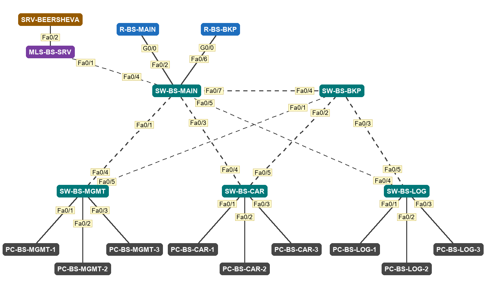

בלוק הבסיס של A3 בכל מתג, עם השם שלו (ב-MLS: קודם עונים `no`):

<div dir="rtl">

| מכשיר | השורה שמשתנה |
|---|---|
| ‎SW-BS-MAIN | ‎`hostname SW-BS-MAIN` |
| ‎SW-BS-BKP | ‎`hostname SW-BS-BKP` |
| ‎SW-BS-MGMT | ‎`hostname SW-BS-MGMT` |
| ‎SW-BS-CAR | ‎`hostname SW-BS-CAR` |
| ‎SW-BS-LOG | ‎`hostname SW-BS-LOG` |
| ‎MLS-BS-SRV | ‎`hostname MLS-BS-SRV` |

</div>

**⏭ מה הלאה.** מחובר, וכולם ברשת אחת, בדיוק כמו בתחילת שיעור 2.

## ‏C3 — באר שבע: מיתוג
**📖 איך הגענו לכאן.** באר שבע מחוברת ולא מופרדת.

**🌐 הרשת עכשיו.** הכול מחובר, הכול ב-VLAN 1.

**❗ הבעיה.** כמו בשיעור 2: רשת אחת גדולה, לולאות, ופורטים פתוחים.

**🎯 מה רוצים עכשיו.** כל שיעור 2 וה-snooping של שיעור 3, בבלוק אחד לכל מתג.

**💡 הפתרון.** כל שיעור 2 ו-DHCP Snooping משיעור 3, בבלוק אחד לכל מתג.

**📋 מבצעים בפרויקט.** כותבים לבד את הבלוק של SW-BS-LOG, לפי התוכנית. אחר כך משווים.

<div dir="rtl">

| ‎VLAN | שם | רשת | מתג |
|---|---|---|---|
| ‎64 | ‎MANAGEMENT | ‎192.168.64.0/24 | ‎SW-BS-MGMT |
| ‎65 | ‎CAR-SERVICE | ‎192.168.65.0/24 | ‎SW-BS-CAR |
| ‎66 | ‎LOGISTICS | ‎192.168.66.0/24 | ‎SW-BS-LOG |
| ‎67 | ‎SERVERS | ‎192.168.67.0/24 | ‎MLS-BS-SRV |

</div>

### 🖱 הפתרון: על מה לוחצים ומה כותבים
בכל מתג: נכנסים, `enable`, וכותבים את הבלוק. הודעות על פורטים שנכבים והודעות `PVID` הן רגילות כאן.

**SW-BS-MAIN:**
```
configure terminal
vtp domain BEERSHEVA
vtp password Tesla#Vtp
vtp mode server
vlan 64
name MANAGEMENT
vlan 65
name CAR-SERVICE
vlan 66
name LOGISTICS
vlan 67
name SERVERS
exit
spanning-tree vlan 1,64,65,66,67 root primary
ip dhcp snooping
ip dhcp snooping vlan 64,65,66
no ip dhcp snooping information option
interface range fa0/1 - 3 , fa0/5 - 7
switchport mode trunk
exit
interface range fa0/1 , fa0/3 , fa0/5
spanning-tree guard root
exit
interface fa0/4
switchport mode access
switchport access vlan 67
switchport port-security
switchport port-security maximum 2
switchport port-security mac-address sticky
switchport port-security violation shutdown
exit
interface range fa0/2 , fa0/4 , fa0/6 - 7
ip dhcp snooping trust
exit
interface range fa0/8 - 24 , g0/1 - 2
shutdown
end
copy running-config startup-config
```
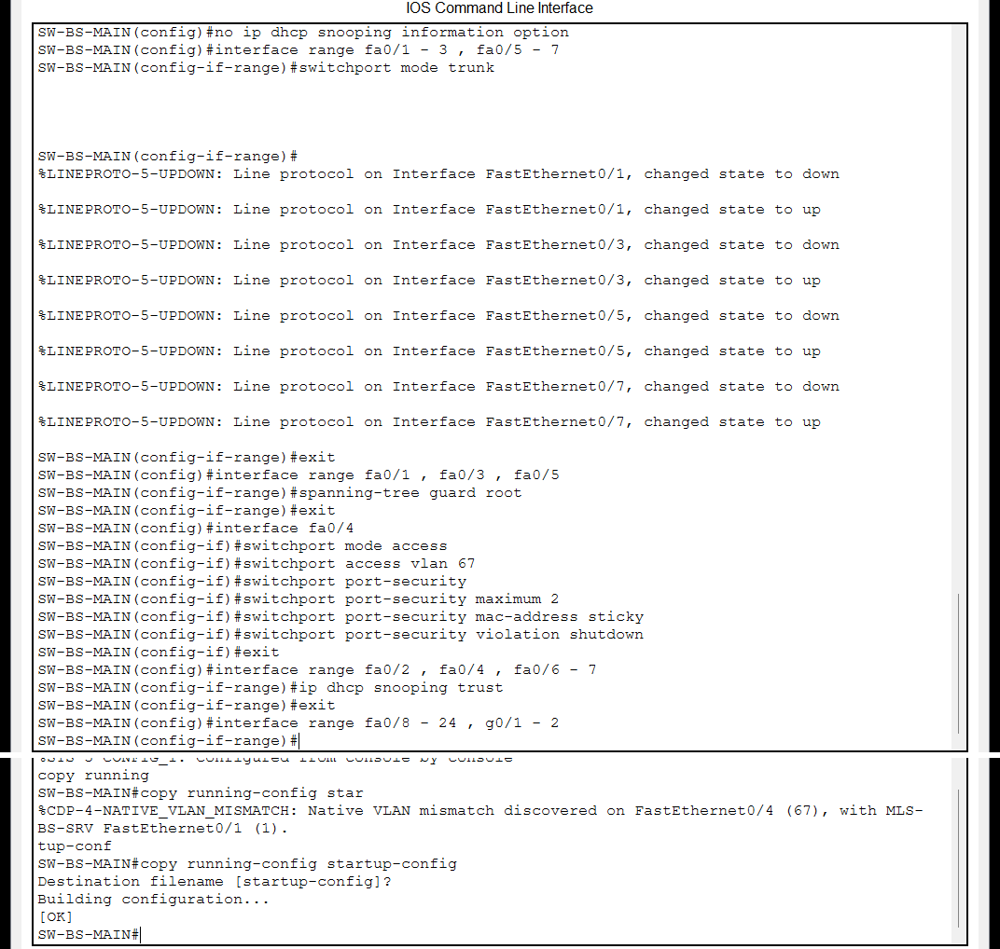

**SW-BS-BKP:**
```
configure terminal
vtp domain BEERSHEVA
vtp password Tesla#Vtp
vtp mode client
spanning-tree vlan 1,64,65,66,67 root secondary
interface range fa0/1 - 4
switchport mode trunk
exit
interface range fa0/5 - 24 , g0/1 - 2
shutdown
end
copy running-config startup-config
```
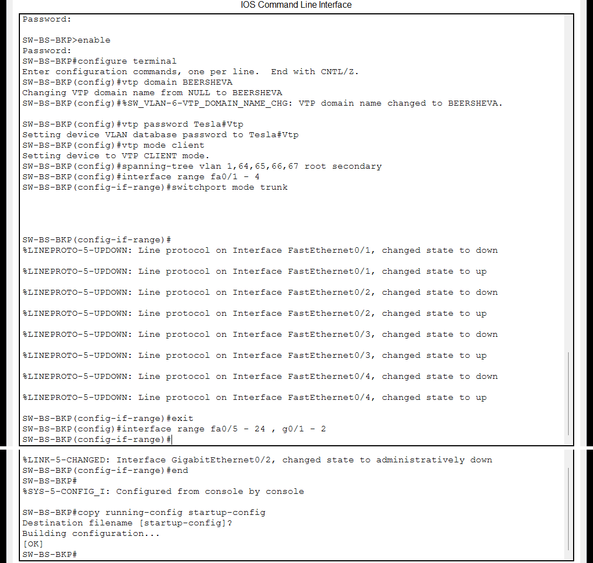

**SW-BS-MGMT:**
```
configure terminal
vtp domain BEERSHEVA
vtp password Tesla#Vtp
vtp mode client
interface range fa0/4 - 5
switchport mode trunk
exit
interface range fa0/1 - 3
switchport mode access
switchport access vlan 64
spanning-tree portfast
spanning-tree bpduguard enable
switchport port-security
switchport port-security maximum 1
switchport port-security mac-address sticky
switchport port-security violation shutdown
exit
interface range fa0/6 - 24 , g0/1 - 2
shutdown
end
copy running-config startup-config
```
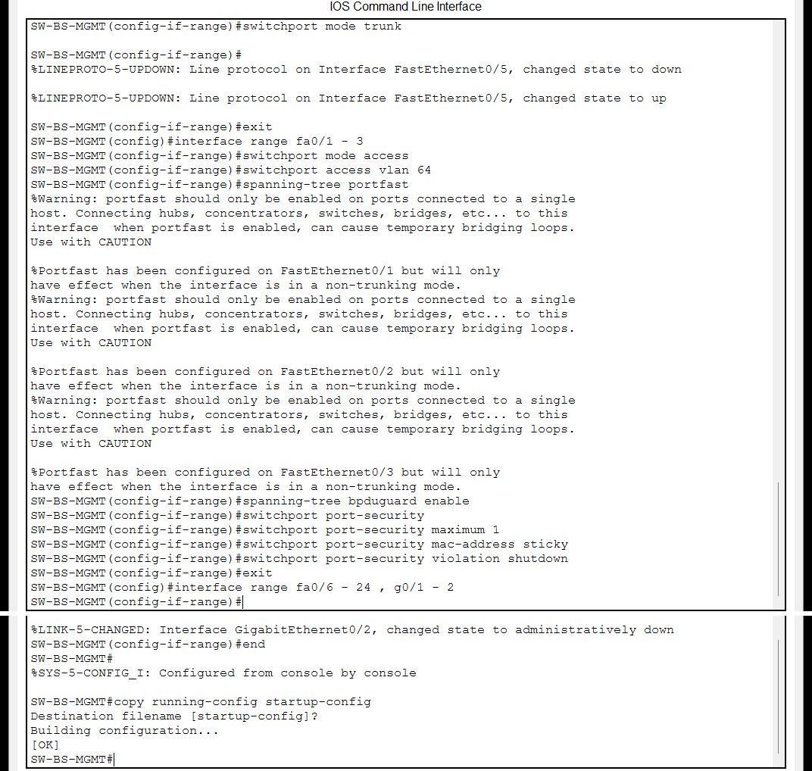

**SW-BS-CAR:**
```
configure terminal
vtp domain BEERSHEVA
vtp password Tesla#Vtp
vtp mode client
interface range fa0/4 - 5
switchport mode trunk
exit
interface range fa0/1 - 3
switchport mode access
switchport access vlan 65
spanning-tree portfast
spanning-tree bpduguard enable
switchport port-security
switchport port-security maximum 1
switchport port-security mac-address sticky
switchport port-security violation shutdown
exit
interface range fa0/6 - 24 , g0/1 - 2
shutdown
end
copy running-config startup-config
```


**SW-BS-LOG:**
```
configure terminal
vtp domain BEERSHEVA
vtp password Tesla#Vtp
vtp mode client
interface range fa0/4 - 5
switchport mode trunk
exit
interface range fa0/1 - 3
switchport mode access
switchport access vlan 66
spanning-tree portfast
spanning-tree bpduguard enable
switchport port-security
switchport port-security maximum 1
switchport port-security mac-address sticky
switchport port-security violation shutdown
exit
interface range fa0/6 - 24 , g0/1 - 2
shutdown
end
copy running-config startup-config
```
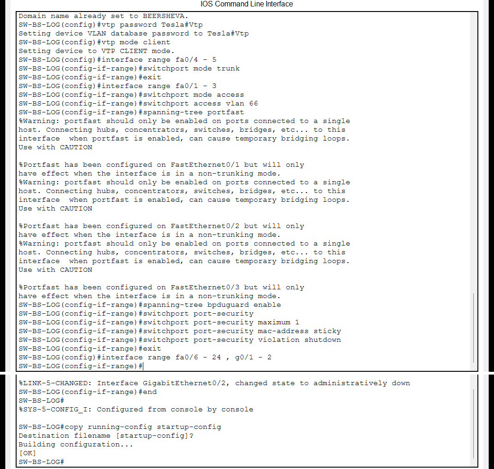

**MLS-BS-SRV:**
```
configure terminal
vtp mode transparent
vlan 67
name SERVERS
exit
interface range fa0/1 - 2
switchport mode access
switchport access vlan 67
exit
interface range fa0/3 - 24 , g0/1 - 2
shutdown
exit
interface fa0/2
spanning-tree portfast
spanning-tree bpduguard enable
switchport port-security
switchport port-security maximum 1
switchport port-security mac-address sticky
switchport port-security violation shutdown
end
copy running-config startup-config
```


✅ ב-SW-BS-LOG: הפקודה `show vtp status` (client, תחום BEERSHEVA) והפקודה `show vlan brief`: הרשתות 64–67, ו-Fa0/1–3 ב-VLAN 66.

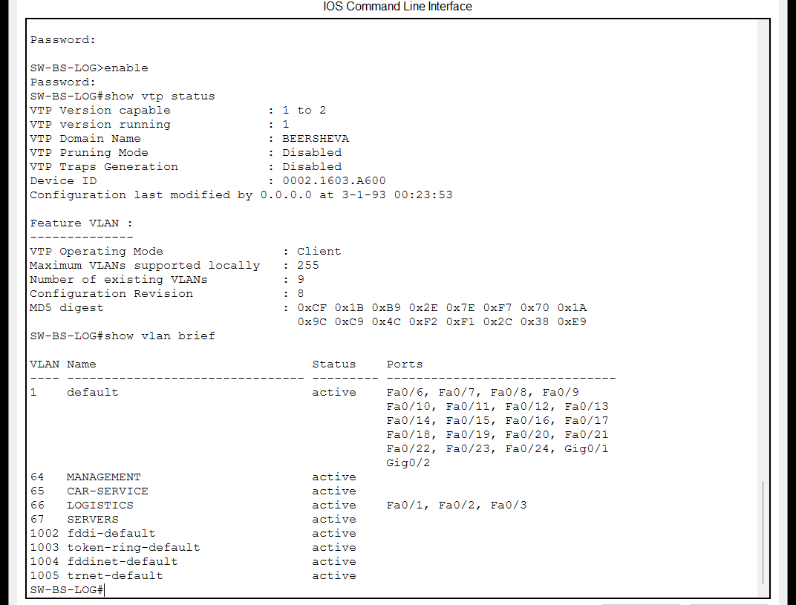

<details dir="rtl"><summary><b>📘 הסבר הפקודות של המשימה</b></summary>

<div dir="rtl">

| פקודה | מה היא עושה, ולמה היא כאן |
|---|---|
| ‎`vtp domain BEERSHEVA` | שם קבוצת ה-VTP. רק מתגים עם שם **זהה לגמרי** חולקים את רשימת ה-VLAN (אותיות גדולות משנות). |
| ‎`vtp password Tesla#Vtp` | סוד משותף, כדי שמתג זר לא ישנה את ה-VLAN שלנו. חייב להיות זהה בכולם. |
| ‎`vtp mode server` | המתג הזה רשאי ליצור VLAN וללמד את האחרים. |
| ‎`vlan 64` | יוצר את ה-VLAN עם המספר הזה. המספר הוא מה שנוסע בתג. |
| ‎`name MANAGEMENT` | שם ל-VLAN, בשביל בני אדם. המתג עובד עם המספר. |
| ‎`spanning-tree vlan 1,64,65,66,67 root primary` | הופך את המתג הזה ל-root של ה-VLAN האלה (עדיפות 24576; הנמוך מנצח). |
| ‎`ip dhcp snooping` | מפעיל DHCP snooping בכל המתג. |
| ‎`ip dhcp snooping vlan 64,65,66` | באילו VLAN בודקים DHCP. |
| ‎`no ip dhcp snooping information option` | לא מוסיף "option 82" לבקשות; בלי השורה הזו ה-relay זורק אותן. |
| ‎`interface range fa0/1 - 3 , fa0/5 - 7` | מגדיר כמה פורטים ביחד. שימו לב לרווחים סביב הפסיק והמקף. |
| ‎`switchport mode trunk` | הפורט מעביר את **כל** ה-VLAN, עם תג. בין מתגים ובין מתג לנתב. |
| ‎`spanning-tree guard root` | ‏Root Guard: למתג שמחובר כאן **אסור** להפוך ל-root. |
| ‎`interface fa0/4` | בוחרים פורט. כל מה שמתחת חל עליו, עד `exit`. |
| ‎`switchport mode access` | הפורט שייך ל-VLAN אחד, למכשיר קצה אחד. |
| ‎`switchport access vlan 67` | לאיזה VLAN הפורט שייך. |
| ‎`switchport port-security` | **מפעיל** port security. בלי השורה הזו שלוש האחרות לא עושות כלום. |
| ‎`switchport port-security maximum 2` | כמה כתובות MAC מותרות בפורט. |
| ‎`switchport port-security mac-address sticky` | לומד את ה-MAC שמחובר עכשיו וזוכר אותו. |
| ‎`switchport port-security violation shutdown` | מה עושים עם זר: מכבים את הפורט. |
| ‎`ip dhcp snooping trust` | מותר לקבל **תשובות** DHCP מהפורט הזה: הוא מוביל לשרת שלנו. כל השאר לא אמינים. |
| ‎`shutdown` | מכבה את הפורט. |
| ‎`copy running-config startup-config` | שומר את מה שבזיכרון לקובץ ההפעלה. בלי זה הפסקת חשמל מוחקת את העבודה. |
| ‎`vtp mode client` | המתג הזה רק מקבל את הרשימה. `vlan 12` בו נדחה. |
| ‎`spanning-tree vlan 1,64,65,66,67 root secondary` | הסגן (עדיפות 28672): root רק אם הראשון נופל. |
| ‎`spanning-tree portfast` | הפורט נהיה ירוק מיד. רק למכשירי קצה: מחשב לא יוצר לולאה. |
| ‎`spanning-tree bpduguard enable` | אם מחברים מתג לפורט הזה, הוא נכבה. מגן על PortFast. |
| ‎`vtp mode transparent` | המתג הזה שומר רשימה משלו ולא לומד מ-VTP. מתאים למתג שצריך VLAN אחד בלבד. |
| ‎`show vtp status` | ‏domain, מצב ומספר גרסה. ה-domain חייב להיות זהה בכולם. |
| ‎`show vlan brief` | רשימת ה-VLAN והפורטים בכל אחד. פורטים של trunk לא מופיעים. |

</div>

</details>

**⏭ מה הלאה.** המחלקות מופרדות. עכשיו הדרך ביניהן.

## ‏C4 — באר שבע: נתבים
**📖 איך הגענו לכאן.** ארבעה VLAN בבאר שבע, בלי שער.

**🌐 הרשת עכשיו.** ארבעה VLAN, ואין שער.

**❗ הבעיה.** אין דרך בין המחלקות, ואין דרך לשרת ה-DHCP.

**🎯 מה רוצים עכשיו.** משימות 1–2 של שיעור 3: ממשקי משנה, HSRP, ו-helper לכיוון השרת.

**💡 הפתרון.** ממשקי משנה, HSRP ו-helper, כמו בשיעור 3.

**📋 מבצעים בפרויקט.** מעתיקים את הבלוק שלכם של R-HZ-MAIN ומשנים את ה-VLAN, הכתובות וה-helper. באיזה VLAN אין helper?

### 🖱 הפתרון: על מה לוחצים ומה כותבים
**R-BS-MAIN:**
```
configure terminal
interface g0/0
no shutdown
exit
interface g0/0.64
encapsulation dot1Q 64
ip address 192.168.64.2 255.255.255.0
standby 64 ip 192.168.64.1
standby 64 priority 110
standby 64 preempt
ip helper-address 192.168.67.10
exit
interface g0/0.65
encapsulation dot1Q 65
ip address 192.168.65.2 255.255.255.0
standby 65 ip 192.168.65.1
standby 65 priority 110
standby 65 preempt
ip helper-address 192.168.67.10
exit
interface g0/0.66
encapsulation dot1Q 66
ip address 192.168.66.2 255.255.255.0
standby 66 ip 192.168.66.1
standby 66 priority 110
standby 66 preempt
ip helper-address 192.168.67.10
exit
interface g0/0.67
encapsulation dot1Q 67
ip address 192.168.67.2 255.255.255.0
standby 67 ip 192.168.67.1
standby 67 priority 110
standby 67 preempt
exit
end
copy running-config startup-config
```
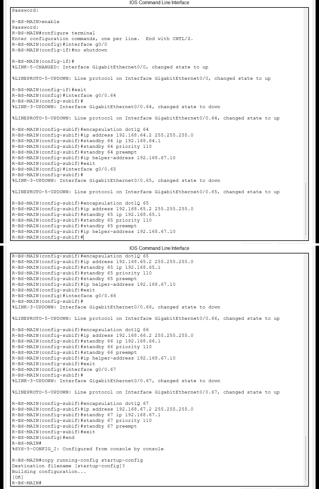

**R-BS-BKP:**
```
configure terminal
interface g0/0
no shutdown
exit
interface g0/0.64
encapsulation dot1Q 64
ip address 192.168.64.3 255.255.255.0
standby 64 ip 192.168.64.1
standby 64 priority 105
standby 64 preempt
ip helper-address 192.168.67.10
exit
interface g0/0.65
encapsulation dot1Q 65
ip address 192.168.65.3 255.255.255.0
standby 65 ip 192.168.65.1
standby 65 priority 105
standby 65 preempt
ip helper-address 192.168.67.10
exit
interface g0/0.66
encapsulation dot1Q 66
ip address 192.168.66.3 255.255.255.0
standby 66 ip 192.168.66.1
standby 66 priority 105
standby 66 preempt
ip helper-address 192.168.67.10
exit
interface g0/0.67
encapsulation dot1Q 67
ip address 192.168.67.3 255.255.255.0
standby 67 ip 192.168.67.1
standby 67 priority 105
standby 67 preempt
exit
end
copy running-config startup-config
```


✅ אחרי 20 שניות, `show standby brief` ב-R-BS-MAIN: מצב **Active** בארבע קבוצות.

‏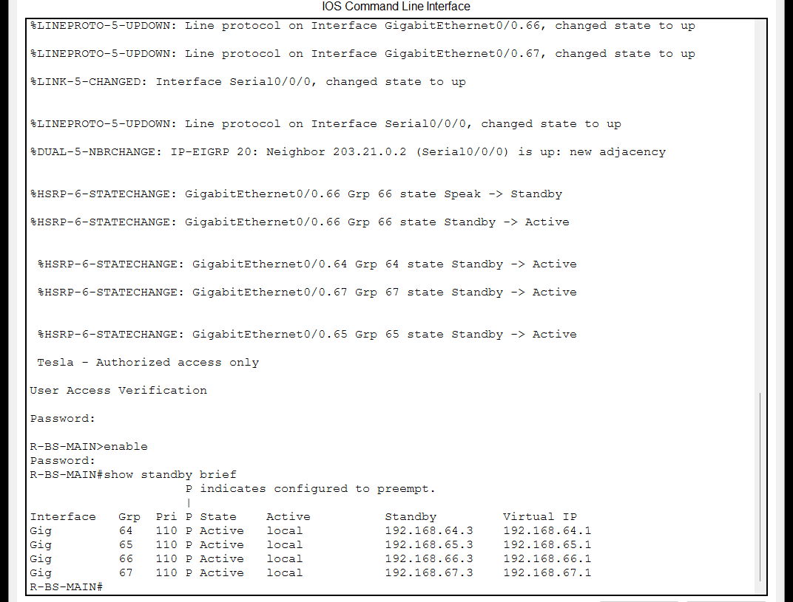

<details dir="rtl"><summary><b>📘 הסבר הפקודות של המשימה</b></summary>

<div dir="rtl">

| פקודה | מה היא עושה, ולמה היא כאן |
|---|---|
| ‎`interface g0/0` | בוחרים פורט. כל מה שמתחת חל עליו, עד `exit`. |
| ‎`no shutdown` | מדליק את הפורט. פורטים של נתב כבויים כברירת מחדל. |
| ‎`interface g0/0.64` | **ממשק משנה**: דלת וירטואלית על אותו פורט פיזי, אחת לכל VLAN. |
| ‎`encapsulation dot1Q 64` | "ממשק המשנה הזה הוא VLAN מספר…". חייב לבוא **לפני** כתובת ה-IP. |
| ‎`ip address 192.168.64.2 255.255.255.0` | הכתובת והמסכה של הממשק. ברשת מקומית זו כתובת השער. |
| ‎`standby 64 ip 192.168.64.1` | ‏HSRP: הכתובת הווירטואלית המשותפת (VIP) ששני הנתבים עונים בשמה. זה השער של המחשבים. |
| ‎`standby 64 priority 110` | המספר הגבוה הוא Active. ראשי 110, גיבוי 105. |
| ‎`standby 64 preempt` | נתב עם עדיפות גבוהה יותר לוקח את התפקיד בחזרה כשהוא חוזר. |
| ‎`ip helper-address 192.168.67.10` | ה-relay של DHCP: הופך את השידור של המחשב להודעה ישירה לשרת הזה. |
| ‎`copy running-config startup-config` | שומר את מה שבזיכרון לקובץ ההפעלה. בלי זה הפסקת חשמל מוחקת את העבודה. |
| ‎`show standby brief` | מי Active ומי Standby בכל קבוצה, והעדיפות. |

</div>

</details>

**⏭ מה הלאה.** הדרך מוכנה, והשרת ריק.

## ‏C5 — באר שבע: השרת והמחשבים
**📖 איך הגענו לכאן.** הנתבים והמתגים עובדים, ולאף אחד אין כתובת.

**🌐 הרשת עכשיו.** הנתבים והמתגים עובדים, ולאף אחד אין כתובת.

**❗ הבעיה.** שרת ריק.

**🎯 מה רוצים עכשיו.** השירותים של שיעור 3 עם הערכים של באר שבע, ואז DHCP בכל מחשב.

**💡 הפתרון.** אותם שירותים כמו בשיעור 3, עם הערכים של באר שבע. (האתר נשאר דף ברירת המחדל: כך מזהים בשיעור 4 את השרת של באר שבע.)

**📋 מבצעים בפרויקט.** ממלאים לפי הטבלאות. קודם כתובת קבועה!

### 🖱 הפתרון: על מה לוחצים ומה כותבים
כל הטפסים מוסברים עם תמונות ב[שיעור 3, משימה 3](../lesson-03/). רק הערכים משתנים.

**SRV-BEERSHEVA** ‏←‏ **Desktop** ‏←‏ **IP Configuration** ‏←‏ Static:

<div dir="rtl">

| ‎Address | ‎Mask | ‎Gateway | ‎DNS |
|---|---|---|---|
| ‎192.168.67.10 | ‎255.255.255.0 | ‎192.168.67.1 | ‎192.168.67.10 |

</div>

‏**Services** ‏←‏ **DHCP**: לכל שורה ממלאים ולוחצים **Add**. בסוף **Service: On** ‏←‏ **Save**.

<div dir="rtl">

| ‎Pool Name | ‎Default Gateway | ‎DNS Server | ‎Start IP | ‎Mask | ‎Max users |
|---|---|---|---|---|---|
| ‎MANAGEMENT | ‎192.168.64.1 | ‎192.168.67.10 | ‎192.168.64.20 | ‎255.255.255.0 | ‎50 |
| ‎CAR-SERVICE | ‎192.168.65.1 | ‎192.168.67.10 | ‎192.168.65.20 | ‎255.255.255.0 | ‎50 |
| ‎LOGISTICS | ‎192.168.66.1 | ‎192.168.67.10 | ‎192.168.66.20 | ‎255.255.255.0 | ‎50 |

</div>

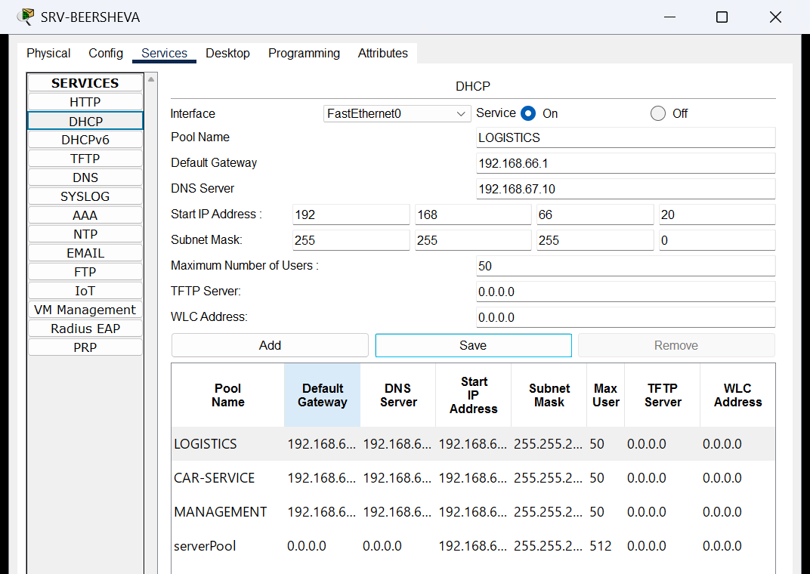

‏**DNS** ‏←‏ On ‏←‏ Name `www.tesla.lab`, Address ‎`192.168.67.10` ‏←‏ **Add**.

‏**FTP** ‏←‏ Username `beersheva`, Password `Tesla#Ftp`, כל חמש ההרשאות ‏←‏ **Add**.

‏**EMAIL** ‏←‏ Domain `tesla.lab` ‏←‏ **Set**. משתמשים `beersheva1` ו-`beersheva2`, סיסמה `Tesla#Mail` ‏←‏ **+**.

אחר כך **כל מחשב** בבאר שבע: Desktop ‏←‏ IP Configuration ‏←‏ **DHCP**.

✅ מ-PC-BS-LOG-1: כתובת 192.168.66.x, שער .1, והפקודה `ping 192.168.67.10` מצליחה.

‏

<details dir="rtl"><summary><b>📘 הטופס, שדה אחר שדה</b></summary>

<div dir="rtl">

| שדה או לחיצה | מה זה, ולמה |
|---|---|
| כל שדה | מוסבר בשיעור 3, משימה 3. רק הערכים משתנים, ו**למה**: הרשתות של באר שבע הן 64–67, והשרת שלה ב-67. |

</div>

</details>

<details dir="rtl"><summary><b>📘 הסבר הפקודות של המשימה</b></summary>

<div dir="rtl">

| פקודה | מה היא עושה, ולמה היא כאן |
|---|---|
| ‎`ping 192.168.67.10` | שולח 4 הודעות בדיקה. תשובות = הדרך עובדת ב**שני** הכיוונים. |

</div>

</details>

**⏭ מה הלאה.** באר שבע היא סניף מוכן. נשאר עוד אחד.

## ‏C6 — חיפה: מכשירים, כבלים, בסיס
**📖 איך הגענו לכאן.** שני סניפים מוכנים.

**🌐 הרשת עכשיו.** הרצליה ובאר שבע מוכנות.

**❗ הבעיה.** הסניף השלישי. השמות, המספרים ו**הפורטים** שונים מבאר שבע.

**🎯 מה רוצים עכשיו.** השלישי, שבו השמות, המספרים **וגם הפורטים** שונים. כאן רואים אם מבינים או מעתיקים.

**💡 הפתרון.** אותו תכנון בפעם השלישית.

**📋 מבצעים בפרויקט.** בונים רק לפי הטבלאות, בלי להסתכל על באר שבע.

### 🖱 הפתרון: על מה לוחצים ומה כותבים

<div dir="rtl">

| שם | דגם |
|---|---|
| ‎SW-HF-MAIN | ‎2960 |
| ‎SW-HF-BKP | ‎2960 |
| ‎SW-HF-CHG | ‎2960 |
| ‎SW-HF-CUST | ‎2960 |
| ‎SW-HF-MGMT | ‎2960 |
| ‎MLS-HF-SRV | ‎3560-24PS |
| ‎SRV-HAIFA | ‎Server |
| ‎PC-HF-CHG-1 | ‎PC |
| ‎PC-HF-CHG-2 | ‎PC |
| ‎PC-HF-CHG-3 | ‎PC |
| ‎PC-HF-CHG-4 | ‎PC |
| ‎PC-HF-CUST-1 | ‎PC |
| ‎PC-HF-CUST-2 | ‎PC |
| ‎PC-HF-CUST-3 | ‎PC |
| ‎PC-HF-MGMT-1 | ‎PC |
| ‎PC-HF-MGMT-2 | ‎PC |

</div>

<div dir="rtl">

| ‎# | כבל | מכשיר ראשון | פורט | מכשיר שני | פורט |
|---|---|---|---|---|---|
| ‎1 | ‎Straight-Through | ‎R-HF-BKP | ‎G0/0 | ‎SW-HF-MAIN | ‎Fa0/6 |
| ‎2 | ‎Straight-Through | ‎R-HF-MAIN | ‎G0/0 | ‎SW-HF-MAIN | ‎Fa0/4 |
| ‎3 | ‎Cross-Over | ‎SW-HF-MAIN | ‎Fa0/1 | ‎SW-HF-MGMT | ‎Fa0/3 |
| ‎4 | ‎Cross-Over | ‎SW-HF-MAIN | ‎Fa0/2 | ‎MLS-HF-SRV | ‎Fa0/1 |
| ‎5 | ‎Cross-Over | ‎SW-HF-MAIN | ‎Fa0/3 | ‎SW-HF-CHG | ‎Fa0/5 |
| ‎6 | ‎Cross-Over | ‎SW-HF-MAIN | ‎Fa0/5 | ‎SW-HF-CUST | ‎Fa0/4 |
| ‎7 | ‎Cross-Over | ‎SW-HF-MAIN | ‎Fa0/7 | ‎SW-HF-BKP | ‎Fa0/3 |
| ‎8 | ‎Cross-Over | ‎SW-HF-BKP | ‎Fa0/1 | ‎SW-HF-MGMT | ‎Fa0/4 |
| ‎9 | ‎Cross-Over | ‎SW-HF-BKP | ‎Fa0/2 | ‎SW-HF-CHG | ‎Fa0/6 |
| ‎10 | ‎Cross-Over | ‎SW-HF-BKP | ‎Fa0/4 | ‎SW-HF-CUST | ‎Fa0/5 |
| ‎11 | ‎Straight-Through | ‎SW-HF-CHG | ‎Fa0/1 | ‎PC-HF-CHG-1 | ‎Fa0 |
| ‎12 | ‎Straight-Through | ‎SW-HF-CHG | ‎Fa0/2 | ‎PC-HF-CHG-2 | ‎Fa0 |
| ‎13 | ‎Straight-Through | ‎SW-HF-CHG | ‎Fa0/3 | ‎PC-HF-CHG-3 | ‎Fa0 |
| ‎14 | ‎Straight-Through | ‎SW-HF-CHG | ‎Fa0/4 | ‎PC-HF-CHG-4 | ‎Fa0 |
| ‎15 | ‎Straight-Through | ‎SW-HF-CUST | ‎Fa0/1 | ‎PC-HF-CUST-1 | ‎Fa0 |
| ‎16 | ‎Straight-Through | ‎SW-HF-CUST | ‎Fa0/2 | ‎PC-HF-CUST-2 | ‎Fa0 |
| ‎17 | ‎Straight-Through | ‎SW-HF-CUST | ‎Fa0/3 | ‎PC-HF-CUST-3 | ‎Fa0 |
| ‎18 | ‎Straight-Through | ‎SW-HF-MGMT | ‎Fa0/1 | ‎PC-HF-MGMT-1 | ‎Fa0 |
| ‎19 | ‎Straight-Through | ‎SW-HF-MGMT | ‎Fa0/2 | ‎PC-HF-MGMT-2 | ‎Fa0 |
| ‎20 | ‎Straight-Through | ‎MLS-HF-SRV | ‎Fa0/2 | ‎SRV-HAIFA | ‎Fa0 |

</div>

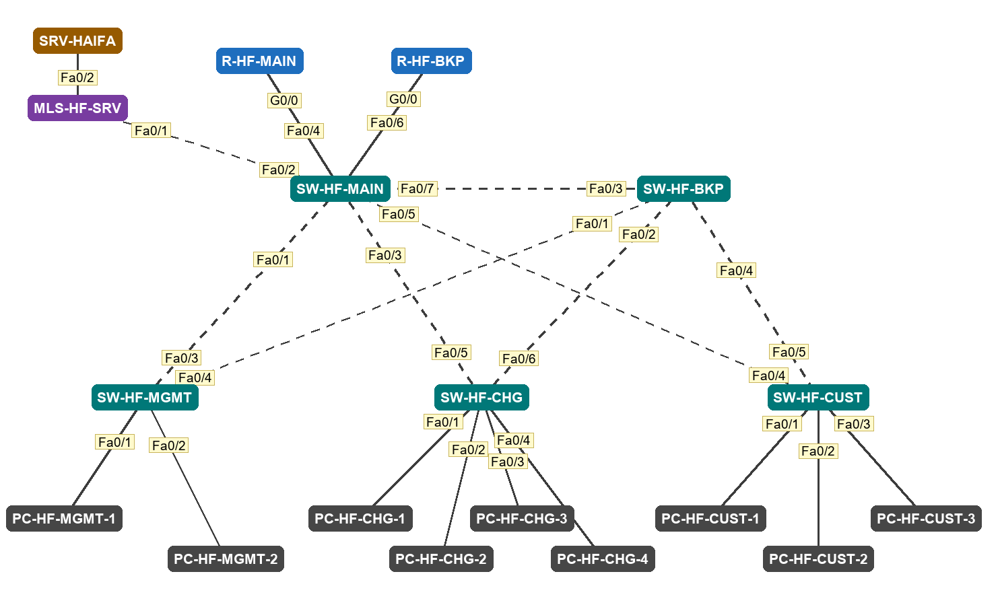

בלוק הבסיס של A3 בכל מתג, עם השם שלו (ב-MLS: קודם עונים `no`):

<div dir="rtl">

| מכשיר | השורה שמשתנה |
|---|---|
| ‎SW-HF-MAIN | ‎`hostname SW-HF-MAIN` |
| ‎SW-HF-BKP | ‎`hostname SW-HF-BKP` |
| ‎SW-HF-MGMT | ‎`hostname SW-HF-MGMT` |
| ‎SW-HF-CHG | ‎`hostname SW-HF-CHG` |
| ‎SW-HF-CUST | ‎`hostname SW-HF-CUST` |
| ‎MLS-HF-SRV | ‎`hostname MLS-HF-SRV` |

</div>

**⏭ מה הלאה.** מחובר, ושוב ברשת אחת.

## ‏C7 — חיפה: מיתוג
**📖 איך הגענו לכאן.** חיפה מחוברת ולא מופרדת.

**🌐 הרשת עכשיו.** מחובר, והכול ב-VLAN 1.

**❗ הבעיה.** כמו ב-C3. בחיפה מתג השרתים מחובר ל-**Fa0/2** של המתג הראשי, ו-R-HF-MAIN ל-**Fa0/4**. העתקה מבאר שבע בלי לחשוב מנתקת את הסניף.

**🎯 מה רוצים עכשיו.** אותם בלוקים כמו ב-C3, לפי התוכנית של חיפה. מתג השרתים בפורט אחר.

**💡 הפתרון.** אותם בלוקים, לפי התוכנית של חיפה.

**📋 מבצעים בפרויקט.** כותבים לבד את הבלוק של SW-HF-CHG. כמה פורטים של מחשבים יש לו?

<div dir="rtl">

| ‎VLAN | שם | רשת | מתג |
|---|---|---|---|
| ‎96 | ‎MANAGEMENT | ‎192.168.96.0/24 | ‎SW-HF-MGMT |
| ‎97 | ‎CHARGING | ‎192.168.97.0/24 | ‎SW-HF-CHG |
| ‎98 | ‎CUSTOMERS | ‎192.168.98.0/24 | ‎SW-HF-CUST |
| ‎99 | ‎SERVERS | ‎192.168.99.0/24 | ‎MLS-HF-SRV |

</div>

### 🖱 הפתרון: על מה לוחצים ומה כותבים
**SW-HF-MAIN:**
```
configure terminal
vtp domain HAIFA
vtp password Tesla#Vtp
vtp mode server
vlan 96
name MANAGEMENT
vlan 97
name CHARGING
vlan 98
name CUSTOMERS
vlan 99
name SERVERS
exit
spanning-tree vlan 1,96,97,98,99 root primary
ip dhcp snooping
ip dhcp snooping vlan 96,97,98
no ip dhcp snooping information option
interface range fa0/1 , fa0/3 - 7
switchport mode trunk
exit
interface range fa0/1 , fa0/3 , fa0/5
spanning-tree guard root
exit
interface fa0/2
switchport mode access
switchport access vlan 99
switchport port-security
switchport port-security maximum 2
switchport port-security mac-address sticky
switchport port-security violation shutdown
exit
interface range fa0/2 , fa0/4 , fa0/6 - 7
ip dhcp snooping trust
exit
interface range fa0/8 - 24 , g0/1 - 2
shutdown
end
copy running-config startup-config
```
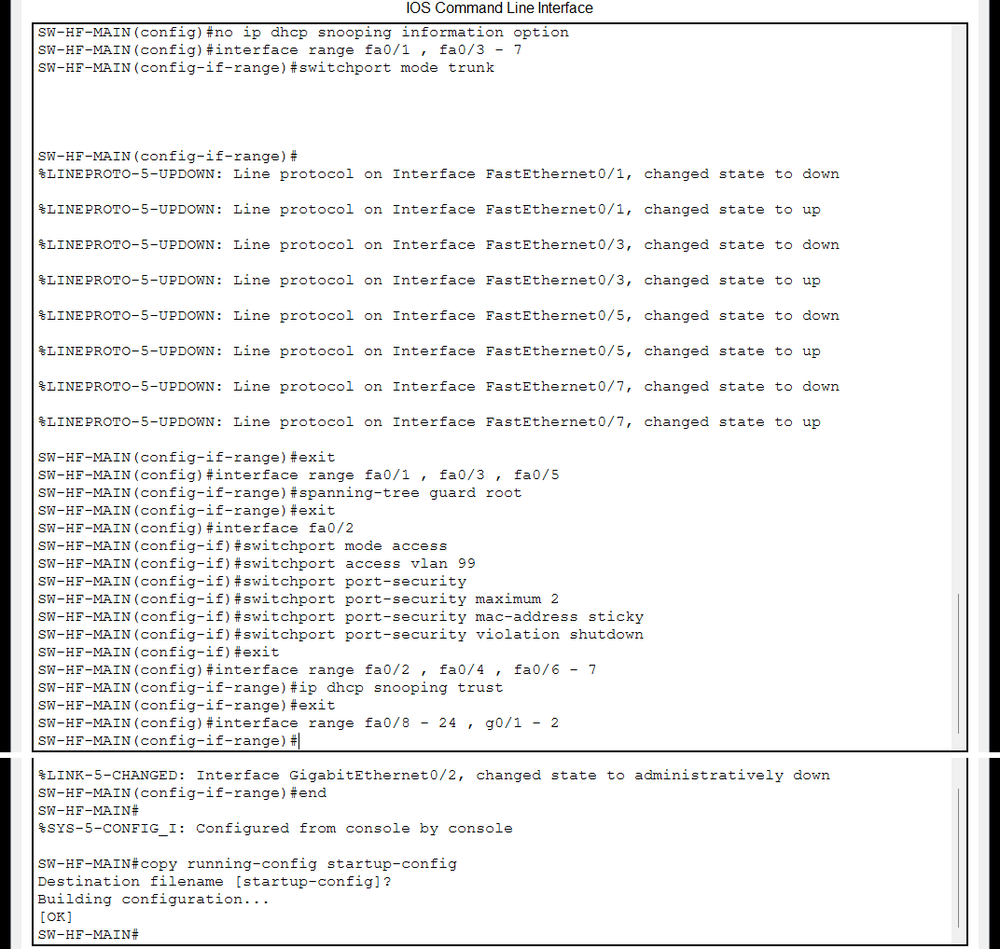

**SW-HF-BKP:**
```
configure terminal
vtp domain HAIFA
vtp password Tesla#Vtp
vtp mode client
spanning-tree vlan 1,96,97,98,99 root secondary
interface range fa0/1 - 4
switchport mode trunk
exit
interface range fa0/5 - 24 , g0/1 - 2
shutdown
end
copy running-config startup-config
```
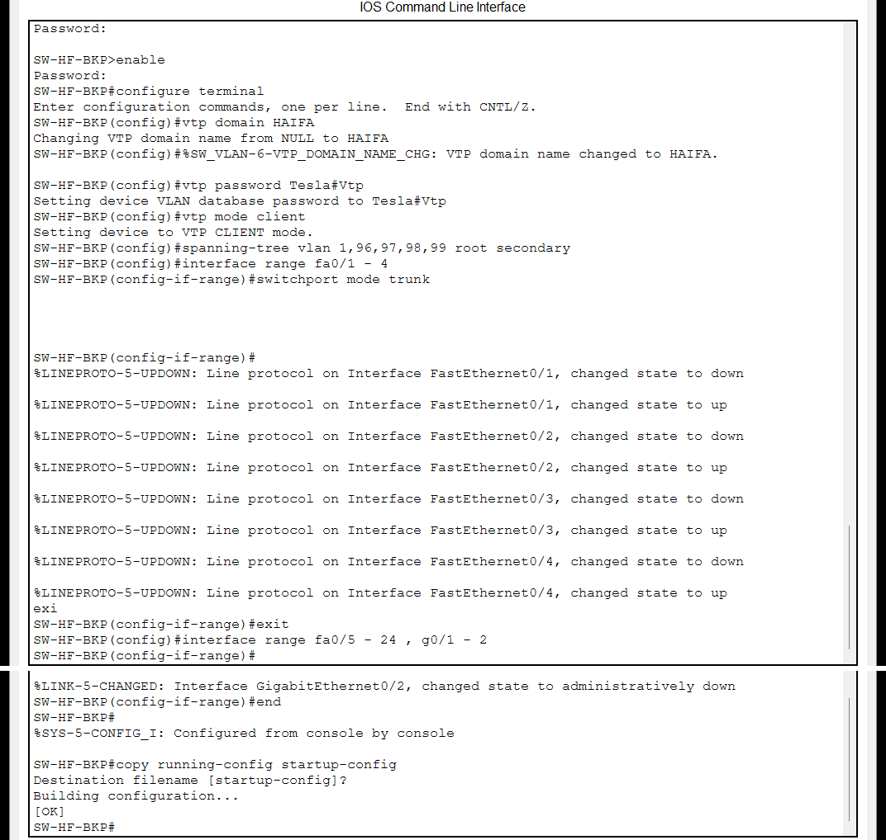

**SW-HF-MGMT:**
```
configure terminal
vtp domain HAIFA
vtp password Tesla#Vtp
vtp mode client
interface range fa0/3 - 4
switchport mode trunk
exit
interface range fa0/1 - 2
switchport mode access
switchport access vlan 96
spanning-tree portfast
spanning-tree bpduguard enable
switchport port-security
switchport port-security maximum 1
switchport port-security mac-address sticky
switchport port-security violation shutdown
exit
interface range fa0/5 - 24 , g0/1 - 2
shutdown
end
copy running-config startup-config
```
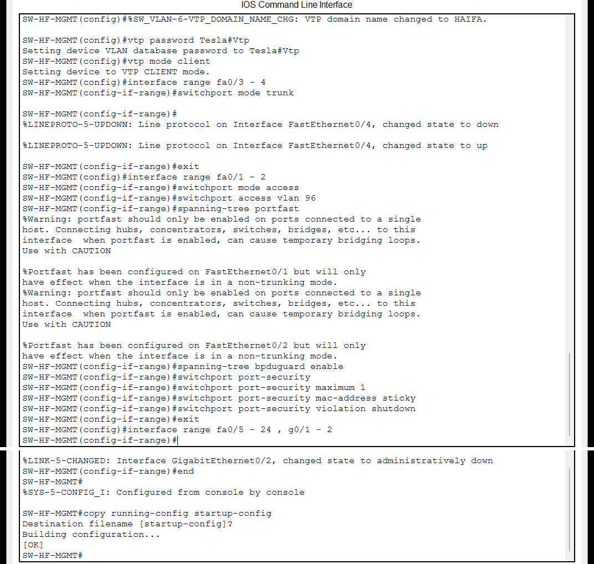

**SW-HF-CHG:**
```
configure terminal
vtp domain HAIFA
vtp password Tesla#Vtp
vtp mode client
interface range fa0/5 - 6
switchport mode trunk
exit
interface range fa0/1 - 4
switchport mode access
switchport access vlan 97
spanning-tree portfast
spanning-tree bpduguard enable
switchport port-security
switchport port-security maximum 1
switchport port-security mac-address sticky
switchport port-security violation shutdown
exit
interface range fa0/7 - 24 , g0/1 - 2
shutdown
end
copy running-config startup-config
```
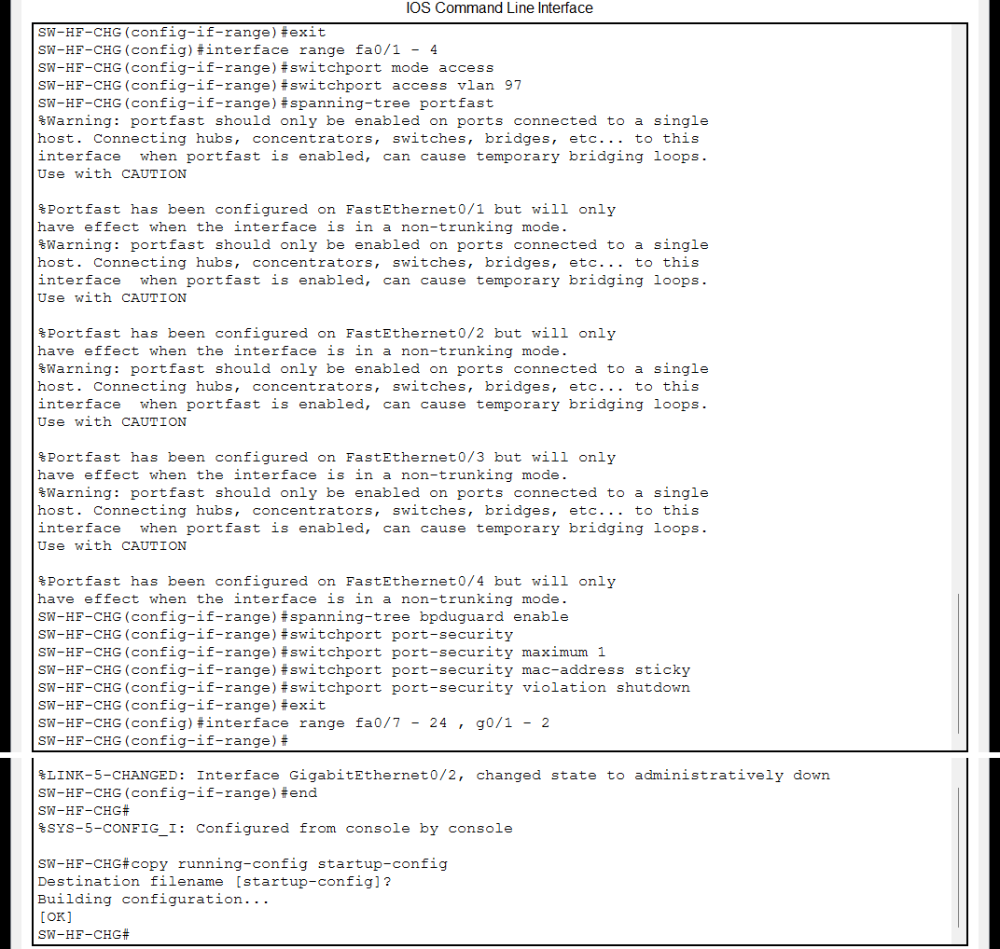

**SW-HF-CUST:**
```
configure terminal
vtp domain HAIFA
vtp password Tesla#Vtp
vtp mode client
interface range fa0/4 - 5
switchport mode trunk
exit
interface range fa0/1 - 3
switchport mode access
switchport access vlan 98
spanning-tree portfast
spanning-tree bpduguard enable
switchport port-security
switchport port-security maximum 1
switchport port-security mac-address sticky
switchport port-security violation shutdown
exit
interface range fa0/6 - 24 , g0/1 - 2
shutdown
end
copy running-config startup-config
```
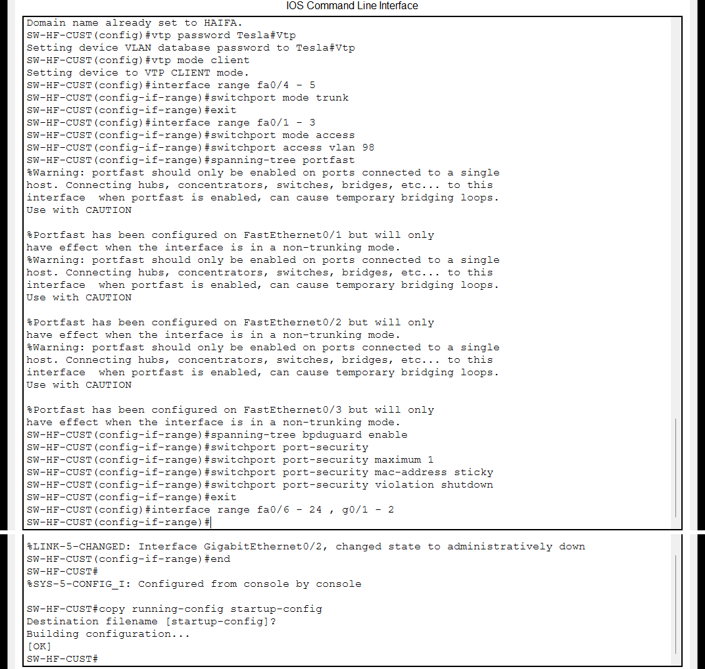

**MLS-HF-SRV:**
```
configure terminal
vtp mode transparent
vlan 99
name SERVERS
exit
interface range fa0/1 - 2
switchport mode access
switchport access vlan 99
exit
interface range fa0/3 - 24 , g0/1 - 2
shutdown
exit
interface fa0/2
spanning-tree portfast
spanning-tree bpduguard enable
switchport port-security
switchport port-security maximum 1
switchport port-security mac-address sticky
switchport port-security violation shutdown
end
copy running-config startup-config
```
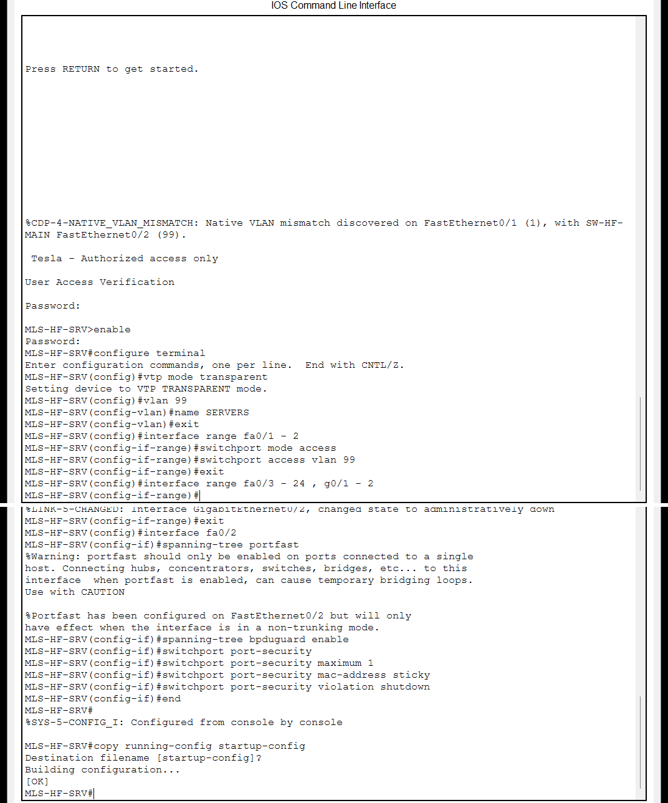

✅ ב-SW-HF-CUST: הפקודות `show vtp status` ו-`show vlan brief`: הרשתות 96–99, ו-Fa0/1–3 ב-VLAN 98.

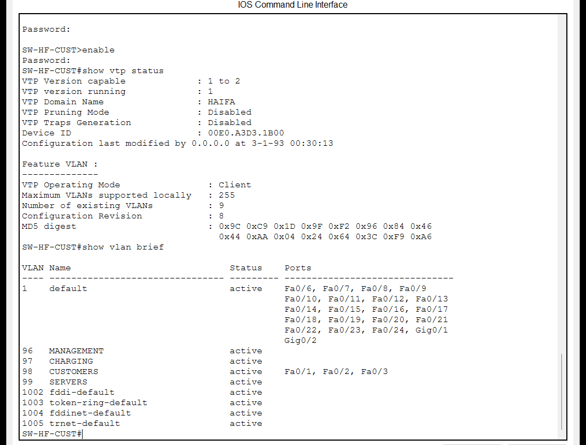

<details dir="rtl"><summary><b>📘 הסבר הפקודות של המשימה</b></summary>

<div dir="rtl">

| פקודה | מה היא עושה, ולמה היא כאן |
|---|---|
| ‎`vtp domain HAIFA` | שם קבוצת ה-VTP. רק מתגים עם שם **זהה לגמרי** חולקים את רשימת ה-VLAN (אותיות גדולות משנות). |
| ‎`vtp password Tesla#Vtp` | סוד משותף, כדי שמתג זר לא ישנה את ה-VLAN שלנו. חייב להיות זהה בכולם. |
| ‎`vtp mode server` | המתג הזה רשאי ליצור VLAN וללמד את האחרים. |
| ‎`vlan 96` | יוצר את ה-VLAN עם המספר הזה. המספר הוא מה שנוסע בתג. |
| ‎`name MANAGEMENT` | שם ל-VLAN, בשביל בני אדם. המתג עובד עם המספר. |
| ‎`spanning-tree vlan 1,96,97,98,99 root primary` | הופך את המתג הזה ל-root של ה-VLAN האלה (עדיפות 24576; הנמוך מנצח). |
| ‎`ip dhcp snooping` | מפעיל DHCP snooping בכל המתג. |
| ‎`ip dhcp snooping vlan 96,97,98` | באילו VLAN בודקים DHCP. |
| ‎`no ip dhcp snooping information option` | לא מוסיף "option 82" לבקשות; בלי השורה הזו ה-relay זורק אותן. |
| ‎`interface range fa0/1 , fa0/3 - 7` | מגדיר כמה פורטים ביחד. שימו לב לרווחים סביב הפסיק והמקף. |
| ‎`switchport mode trunk` | הפורט מעביר את **כל** ה-VLAN, עם תג. בין מתגים ובין מתג לנתב. |
| ‎`spanning-tree guard root` | ‏Root Guard: למתג שמחובר כאן **אסור** להפוך ל-root. |
| ‎`interface fa0/2` | בוחרים פורט. כל מה שמתחת חל עליו, עד `exit`. |
| ‎`switchport mode access` | הפורט שייך ל-VLAN אחד, למכשיר קצה אחד. |
| ‎`switchport access vlan 99` | לאיזה VLAN הפורט שייך. |
| ‎`switchport port-security` | **מפעיל** port security. בלי השורה הזו שלוש האחרות לא עושות כלום. |
| ‎`switchport port-security maximum 2` | כמה כתובות MAC מותרות בפורט. |
| ‎`switchport port-security mac-address sticky` | לומד את ה-MAC שמחובר עכשיו וזוכר אותו. |
| ‎`switchport port-security violation shutdown` | מה עושים עם זר: מכבים את הפורט. |
| ‎`ip dhcp snooping trust` | מותר לקבל **תשובות** DHCP מהפורט הזה: הוא מוביל לשרת שלנו. כל השאר לא אמינים. |
| ‎`shutdown` | מכבה את הפורט. |
| ‎`copy running-config startup-config` | שומר את מה שבזיכרון לקובץ ההפעלה. בלי זה הפסקת חשמל מוחקת את העבודה. |
| ‎`vtp mode client` | המתג הזה רק מקבל את הרשימה. `vlan 12` בו נדחה. |
| ‎`spanning-tree vlan 1,96,97,98,99 root secondary` | הסגן (עדיפות 28672): root רק אם הראשון נופל. |
| ‎`spanning-tree portfast` | הפורט נהיה ירוק מיד. רק למכשירי קצה: מחשב לא יוצר לולאה. |
| ‎`spanning-tree bpduguard enable` | אם מחברים מתג לפורט הזה, הוא נכבה. מגן על PortFast. |
| ‎`vtp mode transparent` | המתג הזה שומר רשימה משלו ולא לומד מ-VTP. מתאים למתג שצריך VLAN אחד בלבד. |
| ‎`show vtp status` | ‏domain, מצב ומספר גרסה. ה-domain חייב להיות זהה בכולם. |
| ‎`show vlan brief` | רשימת ה-VLAN והפורטים בכל אחד. פורטים של trunk לא מופיעים. |

</div>

</details>

**⏭ מה הלאה.** המחלקות מופרדות, ושוב בלי שער.

## ‏C8 — חיפה: נתבים
**📖 איך הגענו לכאן.** ארבעה VLAN בחיפה, בלי שער.

**🌐 הרשת עכשיו.** ארבעה VLAN בלי שער.

**❗ הבעיה.** כמו ב-C4.

**🎯 מה רוצים עכשיו.** ממשקי משנה ו-HSRP בפעם האחרונה. כותבים מהזיכרון.

**💡 הפתרון.** ממשקי משנה 96–99, HSRP, ו-helper ‏192.168.99.10.

**📋 מבצעים בפרויקט.** כותבים את R-HF-MAIN מהזיכרון ובודקים.

### 🖱 הפתרון: על מה לוחצים ומה כותבים
**R-HF-MAIN:**
```
configure terminal
interface g0/0
no shutdown
exit
interface g0/0.96
encapsulation dot1Q 96
ip address 192.168.96.2 255.255.255.0
standby 96 ip 192.168.96.1
standby 96 priority 110
standby 96 preempt
ip helper-address 192.168.99.10
exit
interface g0/0.97
encapsulation dot1Q 97
ip address 192.168.97.2 255.255.255.0
standby 97 ip 192.168.97.1
standby 97 priority 110
standby 97 preempt
ip helper-address 192.168.99.10
exit
interface g0/0.98
encapsulation dot1Q 98
ip address 192.168.98.2 255.255.255.0
standby 98 ip 192.168.98.1
standby 98 priority 110
standby 98 preempt
ip helper-address 192.168.99.10
exit
interface g0/0.99
encapsulation dot1Q 99
ip address 192.168.99.2 255.255.255.0
standby 99 ip 192.168.99.1
standby 99 priority 110
standby 99 preempt
exit
end
copy running-config startup-config
```


**R-HF-BKP:**
```
configure terminal
interface g0/0
no shutdown
exit
interface g0/0.96
encapsulation dot1Q 96
ip address 192.168.96.3 255.255.255.0
standby 96 ip 192.168.96.1
standby 96 priority 105
standby 96 preempt
ip helper-address 192.168.99.10
exit
interface g0/0.97
encapsulation dot1Q 97
ip address 192.168.97.3 255.255.255.0
standby 97 ip 192.168.97.1
standby 97 priority 105
standby 97 preempt
ip helper-address 192.168.99.10
exit
interface g0/0.98
encapsulation dot1Q 98
ip address 192.168.98.3 255.255.255.0
standby 98 ip 192.168.98.1
standby 98 priority 105
standby 98 preempt
ip helper-address 192.168.99.10
exit
interface g0/0.99
encapsulation dot1Q 99
ip address 192.168.99.3 255.255.255.0
standby 99 ip 192.168.99.1
standby 99 priority 105
standby 99 preempt
exit
end
copy running-config startup-config
```


✅ אחרי 20 שניות, `show standby brief` ב-R-HF-MAIN: מצב **Active** בארבע קבוצות.

‏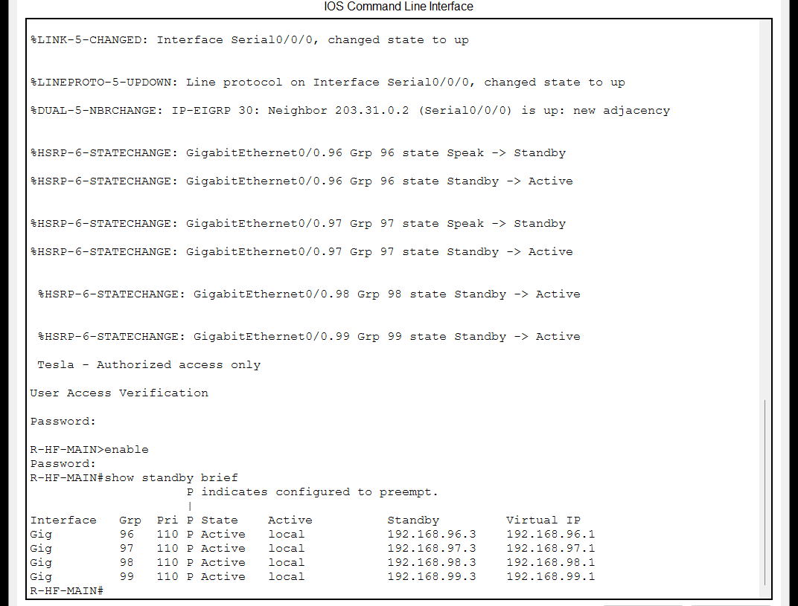

<details dir="rtl"><summary><b>📘 הסבר הפקודות של המשימה</b></summary>

<div dir="rtl">

| פקודה | מה היא עושה, ולמה היא כאן |
|---|---|
| ‎`interface g0/0` | בוחרים פורט. כל מה שמתחת חל עליו, עד `exit`. |
| ‎`no shutdown` | מדליק את הפורט. פורטים של נתב כבויים כברירת מחדל. |
| ‎`interface g0/0.96` | **ממשק משנה**: דלת וירטואלית על אותו פורט פיזי, אחת לכל VLAN. |
| ‎`encapsulation dot1Q 96` | "ממשק המשנה הזה הוא VLAN מספר…". חייב לבוא **לפני** כתובת ה-IP. |
| ‎`ip address 192.168.96.2 255.255.255.0` | הכתובת והמסכה של הממשק. ברשת מקומית זו כתובת השער. |
| ‎`standby 96 ip 192.168.96.1` | ‏HSRP: הכתובת הווירטואלית המשותפת (VIP) ששני הנתבים עונים בשמה. זה השער של המחשבים. |
| ‎`standby 96 priority 110` | המספר הגבוה הוא Active. ראשי 110, גיבוי 105. |
| ‎`standby 96 preempt` | נתב עם עדיפות גבוהה יותר לוקח את התפקיד בחזרה כשהוא חוזר. |
| ‎`ip helper-address 192.168.99.10` | ה-relay של DHCP: הופך את השידור של המחשב להודעה ישירה לשרת הזה. |
| ‎`copy running-config startup-config` | שומר את מה שבזיכרון לקובץ ההפעלה. בלי זה הפסקת חשמל מוחקת את העבודה. |
| ‎`show standby brief` | מי Active ומי Standby בכל קבוצה, והעדיפות. |

</div>

</details>

**⏭ מה הלאה.** נשארו רק השרת והמחשבים.

## ‏C9 — חיפה: השרת והמחשבים
**📖 איך הגענו לכאן.** הדרכים של חיפה מוכנות.

**🌐 הרשת עכשיו.** שרת ריק, ומחשבים בלי כתובות.

**❗ הבעיה.** כמו ב-C5.

**🎯 מה רוצים עכשיו.** השירותים, ו-DHCP בכל מחשב.

**💡 הפתרון.** אותם שירותים, עם הערכים של חיפה.

**📋 מבצעים בפרויקט.** ממלאים את הטפסים.

### 🖱 הפתרון: על מה לוחצים ומה כותבים
**SRV-HAIFA** ‏←‏ **Desktop** ‏←‏ **IP Configuration** ‏←‏ Static:

<div dir="rtl">

| ‎Address | ‎Mask | ‎Gateway | ‎DNS |
|---|---|---|---|
| ‎192.168.99.10 | ‎255.255.255.0 | ‎192.168.99.1 | ‎192.168.99.10 |

</div>

‏**Services** ‏←‏ **DHCP**: לכל שורה ממלאים ולוחצים **Add**. בסוף **Service: On** ‏←‏ **Save**.

<div dir="rtl">

| ‎Pool Name | ‎Default Gateway | ‎DNS Server | ‎Start IP | ‎Mask | ‎Max users |
|---|---|---|---|---|---|
| ‎MANAGEMENT | ‎192.168.96.1 | ‎192.168.99.10 | ‎192.168.96.20 | ‎255.255.255.0 | ‎50 |
| ‎CHARGING | ‎192.168.97.1 | ‎192.168.99.10 | ‎192.168.97.20 | ‎255.255.255.0 | ‎50 |
| ‎CUSTOMERS | ‎192.168.98.1 | ‎192.168.99.10 | ‎192.168.98.20 | ‎255.255.255.0 | ‎50 |

</div>

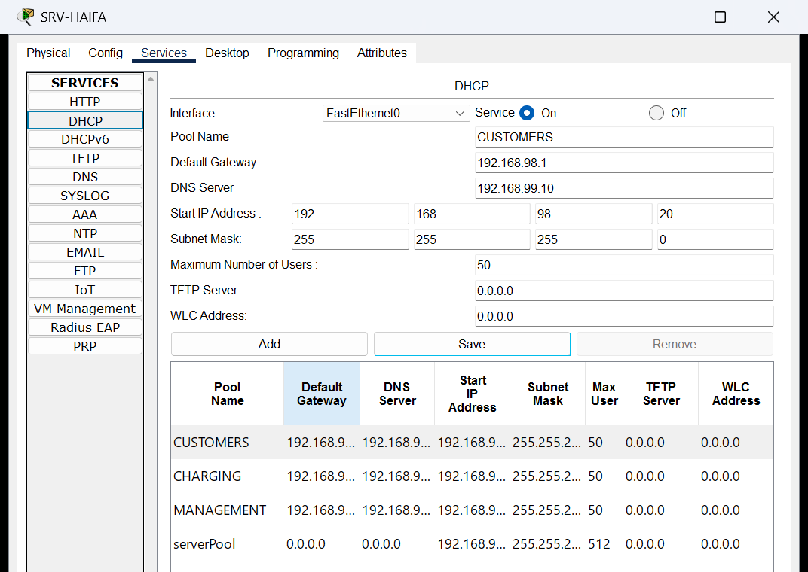

‏**DNS** ‏←‏ On ‏←‏ Name `www.tesla.lab`, Address ‎`192.168.99.10` ‏←‏ **Add**.

‏**FTP** ‏←‏ Username `haifa`, Password `Tesla#Ftp`, כל חמש ההרשאות ‏←‏ **Add**.

‏**EMAIL** ‏←‏ Domain `tesla.lab` ‏←‏ **Set**. משתמשים `haifa1` ו-`haifa2`, סיסמה `Tesla#Mail` ‏←‏ **+**.

אחר כך **כל מחשב** בחיפה: Desktop ‏←‏ IP Configuration ‏←‏ **DHCP**.

✅ מ-PC-HF-CUST-1: כתובת 192.168.98.x, שער .1, והפקודה `ping 192.168.99.10` מצליחה.

‏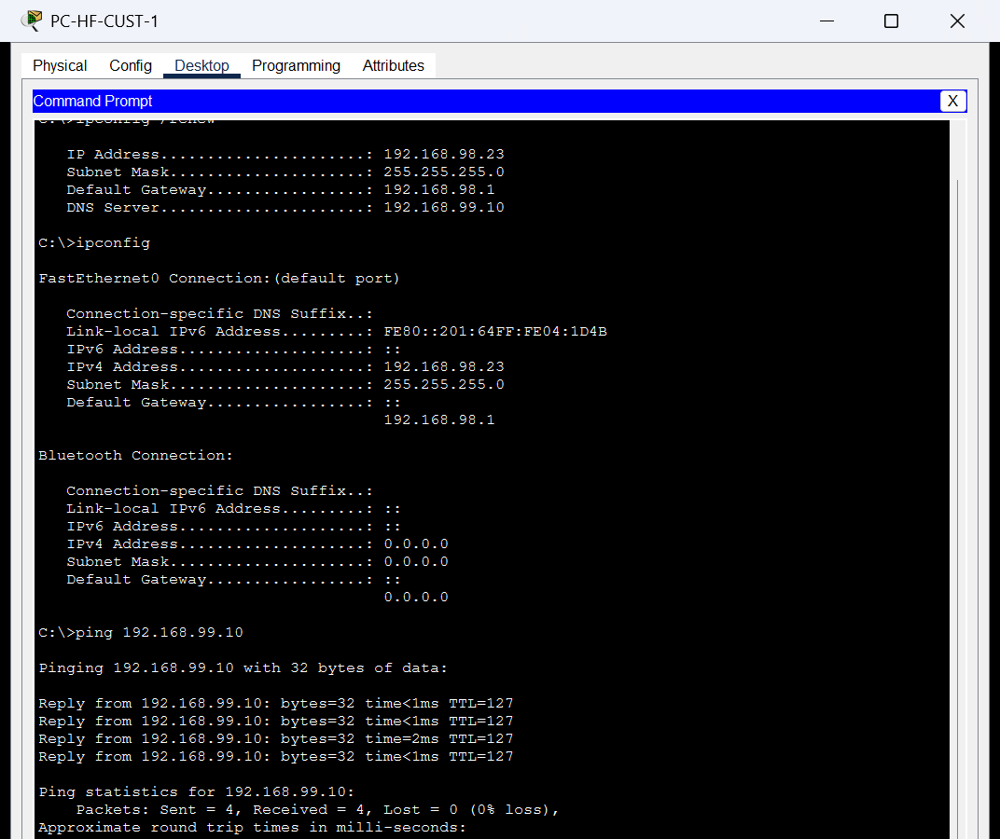

<details dir="rtl"><summary><b>📘 הטופס, שדה אחר שדה</b></summary>

<div dir="rtl">

| שדה או לחיצה | מה זה, ולמה |
|---|---|
| כל שדה | מוסבר בשיעור 3, משימה 3. הרשתות של חיפה הן 96–99, והשרת שלה ב-99. |

</div>

</details>

<details dir="rtl"><summary><b>📘 הסבר הפקודות של המשימה</b></summary>

<div dir="rtl">

| פקודה | מה היא עושה, ולמה היא כאן |
|---|---|
| ‎`ping 192.168.99.10` | שולח 4 הודעות בדיקה. תשובות = הדרך עובדת ב**שני** הכיוונים. |

</div>

</details>

**⏭ מה הלאה.** שלושה סניפים, שלושה איים, תשעה קווים אדומים. בדיוק תחילת שיעור 4.

➡ שומרים הכול, ועושים את **[שיעור 4](../lesson-04/)**.

---

<a id="part-d"></a>

# חלק D — חומת האש, והשרתים של באר שבע וחיפה

*אחרי שיעור 4, לפני שיעור 5.*

## ‏D1 — המעבדה וחומת האש
**📖 איך הגענו לכאן.** שלושה סניפים באינטרנט (שיעור 4).

**🌐 הרשת עכשיו.** שלושה סניפים באינטרנט.

**❗ הבעיה.** שיעור 5 בונה מעבדת בדיקות מאחורי חומת אש. אין חומת אש ואין מעבדה.

**🎯 מה רוצים עכשיו.** פינה לניסויים: שני מחשבים מאחורי חומת אש שעוד לא הוגדרה.

**💡 הפתרון.** מכשיר **ASA 5505** ושני מחשבים. בלי הגדרות: שיעור 5 עושה אותן.

**📋 מבצעים בפרויקט.** מציבים, נותנים שמות ומחברים.

### 🖱 הפתרון: על מה לוחצים ומה כותבים
‏**Network Devices** (1) ‏←‏ **Security** (2) ‏←‏ **5505** (3), בשם `ASA-HZ`. ושני מחשבים: `PC-LAB-1`, `PC-LAB-2`.

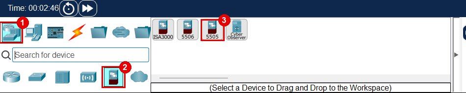

<div dir="rtl">

| ‎# | כבל | מכשיר ראשון | פורט | מכשיר שני | פורט |
|---|---|---|---|---|---|
| ‎1 | ‎Straight-Through | ‎ASA-HZ | ‎E0/0 | ‎SW-HZ-MGMT | ‎Fa0/1 |
| ‎2 | ‎Straight-Through | ‎ASA-HZ | ‎E0/1 | ‎PC-LAB-1 | ‎Fa0 |
| ‎3 | ‎Straight-Through | ‎ASA-HZ | ‎E0/2 | ‎PC-LAB-2 | ‎Fa0 |

</div>

רושמים במתג מה מחובר לפורט. **SW-HZ-MGMT**:

```
configure terminal
interface fa0/1
description to ASA-HZ
end
copy running-config startup-config
```

<details dir="rtl"><summary><b>📘 הסבר הפקודות של המשימה</b></summary>

<div dir="rtl">

| פקודה | מה היא עושה, ולמה היא כאן |
|---|---|
| ‎`interface fa0/1` | בוחרים פורט. כל מה שמתחת חל עליו, עד `exit`. |
| ‎`description to ASA-HZ` | הערה על הפורט. לא משנה כלום, אבל עוזרת לאנשים. |
| ‎`copy running-config startup-config` | שומר את מה שבזיכרון לקובץ ההפעלה. בלי זה הפסקת חשמל מוחקת את העבודה. |

</div>

</details>

**⏭ מה הלאה.** שיעור 5 צריך משתמשים בשרת של **כל** סניף. את הרצליה עושים בשיעור 5, את האחרים כאן.

## ‏D2 — AAA, ‏NTP ו-Syslog בשרתים של באר שבע וחיפה
**📖 איך הגענו לכאן.** בשיעור 5 כל סניף שואל את השרת שלו למי מותר להיכנס.

**🌐 הרשת עכשיו.** בשיעור 5, משימה 1, מגדירים את זה בשרת של הרצליה.

**❗ הבעיה.** הנתבים של באר שבע וחיפה ישאלו את השרתים **שלהם**, ואין מי שיענה.

**🎯 מה רוצים עכשיו.** משתמשים, מפתחות ושעה בשרתים של באר שבע (RADIUS) וחיפה (TACACS).

**💡 הפתרון.** אותם טפסים עם ערכים אחרים. באר שבע = **Radius**, חיפה = **Tacacs**.

**📋 מבצעים בפרויקט.** קוראים את שיעור 5, משימה 1 (שם הטפסים עם תמונות), וממלאים בשני השרתים.

### 🖱 הפתרון: על מה לוחצים ומה כותבים
‏**Services** ‏←‏ **AAA** ‏←‏ **On**. לכל שורה ממלאים ולוחצים **Add**:

<div dir="rtl">

| שרת | ‎Client Name | ‎Client IP | ‎Secret | ‎ServerType |
|---|---|---|---|---|
| ‎SRV-BEERSHEVA | ‎R-BS-MAIN | ‎192.168.67.2 | ‎Tesla#Aaa | ‎**Radius** |
| ‎SRV-BEERSHEVA | ‎R-BS-BKP | ‎192.168.67.3 | ‎Tesla#Aaa | ‎**Radius** |
| ‎SRV-HAIFA | ‎R-HF-MAIN | ‎192.168.99.2 | ‎Tesla#Aaa | ‎**Tacacs** |
| ‎SRV-HAIFA | ‎R-HF-BKP | ‎192.168.99.3 | ‎Tesla#Aaa | ‎**Tacacs** |

</div>

בשני השרתים, למטה: Username `teslauser`, Password `Tesla#User` ‏←‏ **Add**.

‏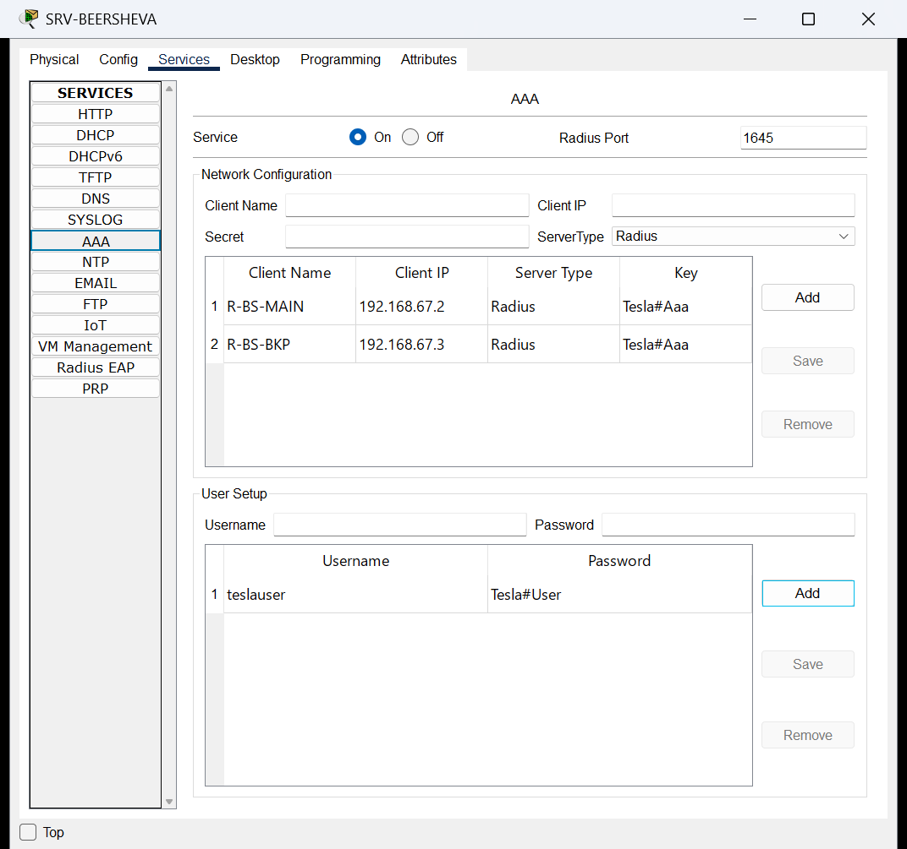

‏**NTP** ‏←‏ Authentication **Enable**, Password `Tesla#Ntp`, Key: ‏**2** בבאר שבע, **3** בחיפה.

‏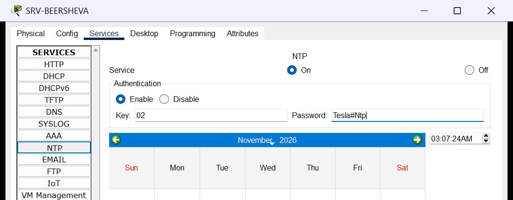

‏**SYSLOG** ‏←‏ בודקים שהוא On.

<details dir="rtl"><summary><b>📘 הטופס, שדה אחר שדה</b></summary>

<div dir="rtl">

| שדה או לחיצה | מה זה, ולמה |
|---|---|
| ‎Client Name, Client IP | הנתב שישאל, והכתובת שלו **לכיוון השרת**. |
| ‎Secret | המפתח בין הנתב לשרת. אותו טקסט נכתב בנתב. |
| ‎ServerType | השפה: Radius בבאר שבע, Tacacs בחיפה. חייב להתאים לנתב. |
| ‎Username, Password | האדם שנכנס. נכתב רק כאן, לא בנתבים. |
| ‎NTP Key | מספר המפתח. לכל סניף משלו: 1, 2, 3. |

</div>

</details>

**⏭ מה הלאה.** הכול מוכן לפרק האחרון: שיעור 5.

➡ עכשיו עושים את **[שיעור 5](../lesson-05/)**.

---

<a id="final"></a>

# בדיקה סופית

עושים את הבדיקות לפי הסדר. ה-ping הראשון למקום חדש יכול ללכת לאיבוד (`Request timed out`), וזה רגיל. אם אחת נכשלת, בעמודה האחרונה כתוב איפה לחפש.

<div dir="rtl">

| ‎# | מאיפה | מה כותבים | מה חייבים לראות | ואם לא |
|---|---|---|---|---|
| ‎1 | ‎PC-SALES-1 | ‎`ipconfig /renew` | 192.168.22.x, שער .1 | שיעור 3, משימות 1–4 |
| ‎2 | ‎PC-SALES-1 | `ping` לכתובת של PC-IT-1 | תשובות | שיעור 3, משימות 1–2 |
| ‎3 | ‎PC-SALES-1 | דפדפן: `http://www.tesla.lab` | ‎Welcome to Tesla - Herzliya branch | שיעור 3, משימה 3 |
| ‎4 | ‎PC-BS-MGMT-1 | ‎`ping 192.168.67.10` | תשובות | ‎C3–C5 |
| ‎5 | ‎PC-HF-MGMT-1 | ‎`ping 192.168.99.10` | תשובות | ‎C7–C9 |
| ‎6 | ‎PC-SALES-1 | ‎`ping 203.20.0.2` | תשובות | שיעור 4, משימות 1–5 |
| ‎7 | ‎PC-HF-CUST-1 | ‎`ping 203.20.0.10` | תשובות (NAT סטטי) | שיעור 4, הבלוק של R-BS-EXT |
| ‎8 | ‎PC-HF-CUST-1 | ‎`ping 192.168.52.10` | תשובות (VPN, הראשונה יכולה ללכת לאיבוד) | שיעור 5, משימה 3 |
| ‎9 | ‎PC-BS-LOG-1 | ‎`ping 192.168.67.10` | **נכשל** (ACL) | שיעור 5, משימה 2 |
| ‎10 | ‎PC-MGMT-1 | ‎`ssh -l teslauser 192.168.12.2` | סיסמה, ואז `R-HZ-MAIN` | שיעור 5, משימות 1 ו-4 |
| ‎11 | ‎PC-BS-MGMT-1 | ‎`ssh -l teslauser 192.168.64.2` | סיסמה, ואז `R-BS-MAIN` | ‏D2, ושיעור 5 סעיף 4.3 |
| ‎12 | ‎PC-HF-MGMT-1 | ‎`ssh -l teslauser 192.168.96.2` | סיסמה, ואז `R-HF-MAIN` | ‏D2, ושיעור 5 סעיף 4.3 |
| ‎13 | ‎PC-LAB-1 | ‎`ping 192.168.52.10` | תשובות, דרך ה-ASA | שיעור 5, משימה 5 |
| ‎14 | ‎PC-MGMT-1 | ‎`ping 192.168.1.10` | **נכשל** (אף אחד מבחוץ לא מגיע למעבדה) | שיעור 5, משימה 5 |

</div>

הסיסמה של `teslauser` היא `Tesla#User`. הסיסמאות של הקונסול נמצאות ב[דף הראשי](../README.md).
