# שיעור 04 — מחברים את הסניפים: WAN, ‏OSPF, ‏EIGRP, ‏BGP ו-NAT

<div dir="rtl">

> ⏱ 90 דקות · 🧰 Packet Tracer 9.x · 📂 קובץ התחלה: [`lesson04-start.pkt`](lesson04-start.pkt) או הקובץ שלכם אחרי [חלק C](../from-zero/README.md#part-c) · 💾 שומרים בשם `lesson04.pkt`

</div>

## מה יהיה לכם בסוף השיעור
שלושה סניפים שמחוברים לספק אינטרנט: OSPF בהרצליה, EIGRP בבאר שבע ובחיפה, BGP לספק, ושלושה סוגי NAT.

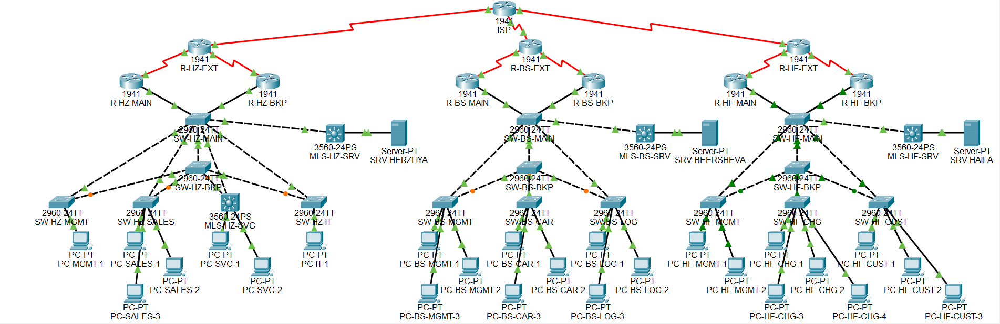

## 📖 הסיפור — פרק 4: גשרים בין האיים
**איך הגענו לכאן.** שיעור 1 חיבר מחלקה, שיעור 2 הפריד חמש, שיעור 3 הפך אותן לסניף אחד שעובד. בינתיים העמיתים שלנו בנו את **באר שבע** ואת **חיפה** בדיוק באותה דרך (קובץ ההתחלה, או [חלק C](../from-zero/) למי שבונה לבד: זה המבחן הכי טוב של שיעורים 2 ו-3).

**איפה אנחנו עכשיו.** שלושה סניפים שעובדים מצוין, כל אחד לבד. ביניהם עשרה נתבים וספק אינטרנט, עם תשעה קווים, **כולם אדומים**.

**מה רוצים היום.** כל סניף מגיע לאינטרנט, העולם מגיע לשרת של באר שבע, ואם הקו של הנתב הראשי נקרע אף אחד לא מרגיש.

**הדרך של היום:**

<div dir="rtl">

| משימה | על איזו שאלה היא עונה | למה דווקא עכשיו |
|---|---|---|
| ‎1 ‏WAN | הקווים חיים? | שום פרוטוקול לא עובד על קו מת |
| ‎2 ‏Track | ה-HSRP יודע שהקו נפל? | עכשיו נתב יכול להיות בריא וחסר תועלת |
| ‎3 ‏OSPF | מה הדרך בתוך החברה? | הקווים עובדים, אבל כל נתב מכיר רק שכנים |
| ‎4 ‏BGP | איך מדברים עם חברה אחרת? | הספק לא שלנו, ולכן הוא לא ב-OSPF |
| ‎5 ‏NAT | למה התשובה לא חוזרת? | החבילה יוצאת עם כתובת שהאינטרנט לא מכיר |
| 6 תקלה | הקו השני עובד? | כמו בשיעור 3: הוכחה, לא תקווה |

</div>

## תכנון הזמן (90 דקות, עם הפסקות)

<div dir="rtl">

| דקות | חלק |
|---|---|
| ‎0–20 | חלק 1 — קוראים את התיאוריה ועונים על כל ❓ לפני שפותחים את התשובה |
| ‎20–35 | משימה 1 — כתובות WAN (הרצליה ידנית, השאר בהדבקה) |
| ‎35–50 | משימות 2–3 — HSRP track, ‏OSPF, ‏EIGRP |
| ‎50–60 | משימה 4 — BGP |
| ‎60–75 | משימה 5 — NAT |
| ‎75–82 | משימה 6 — בדיקת נפילה |
| ‎82–90 | מצאו את הטעות, שאלות, ספר הפרויקט |

</div>

בקובץ ההתחלה הרצליה היא סוף שיעור 3, והרשתות הפנימיות של באר שבע וחיפה כבר מוכנות (באותה שיטה כמו הרצליה).
קווי ה-WAN מחוברים אבל בלי כתובות, ולכן הם **אדומים**.

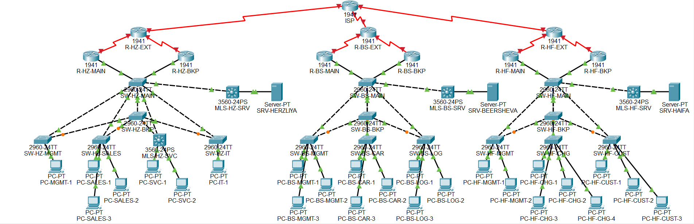

💡 **איך מדביקים בלוק:** נכנסים לנתב, כותבים `enable` ואת הסיסמה ‏←‏ מעתיקים את הבלוק ‏←‏ לוחצים **Paste** בפינה
הימנית התחתונה של ה-CLI. בסוף: `copy running-config startup-config`.

---

## חלק 1 — תיאוריה: קודם מבינים

### 1.1 קו Serial ו-clock rate
לקו טורי יש שני קצוות: ה-**DCE** קובע את קצב השעון, וה-**DTE** הולך אחריו. בפרויקט הזה ה-DCE הוא הנתב
שקרוב יותר לספק: EXT לכיוון הסניף, ISP לכיוון EXT.

💬 **במילים פשוטות:** שני אנשים סוחבים ספה, ואחד מהם סופר "אחת, שתיים". מי שקובע את הקצב הוא ה-DCE. הפקודה
`show controllers s0/0/0` אומרת באיזה צד אתם.

### 1.2 שלושה פרוטוקולי ניתוב

<div dir="rtl">

| | ‎OSPF | ‎EIGRP | ‎BGP |
|---|---|---|---|
| סוג | ‎link state | ‎advanced distance vector | ‎path vector |
| עובד | בתוך חברה (IGP) | בתוך חברה (IGP) | **בין** חברות (EGP) |
| מודד | ‏cost (לפי רוחב פס) | רוחב פס + השהיה | רשימת מספרי AS, מדיניות |
| ‎Admin distance | ‎110 | ‎90 | ‏20 (חיצוני) |
| סימון בטבלת הניתוב | ‎`O` | ‎`D` | ‎`B` |
| מספר | תהליך 10, אזור 0 | ‎‏AS 20, ‏AS 30 | ‎‏AS 65010, 65020, 65030, 65000 |

</div>

מספר התהליך של OSPF הוא **מקומי**. מספר ה-AS של EIGRP חייב להיות **זהה** בכל נתבי הסניף.

💬 **במילים פשוטות:** ‏OSPF הוא אפליקציית ניווט שמכירה את **כל המפה** ומחשבת את הדרך הטובה. ‏EIGRP מכיר את השכנים ואת מה שהם
סיפרו לו. ‏BGP הוא הסכם בין **מדינות**: דרך אילו מדינות עוברים.

**דוגמה — wildcard** (מה מותר שישתנה). מחסרים את המסכה מ-255.255.255.255:

<div dir="rtl">

| מסכה | ‎‏Wildcard | משמעות |
|---|---|---|
| ‎255.255.255.0 (/24) | ‎0.0.0.255 | רשת אחת |
| ‎255.255.252.0 (/22) | ‎0.0.3.255 | ‏4 רשתות: 192.168.96–99 |
| ‎255.255.192.0 (/18) | ‎0.0.63.255 | ‏64 רשתות: 192.168.0–63 |

</div>

**דוגמה — איך נתב בוחר** (R-HZ-EXT): קודם הנתיב ה**מדויק ביותר**, ורק בין נתיבים שווים ה-admin distance הנמוך.

<div dir="rtl">

| יעד | נתיבים מתאימים | נבחר |
|---|---|---|
| ‎192.168.22.20 | ‎`O 192.168.22.0/24`, `S* 0.0.0.0/0` | ‏O, כי ‎/24 מדויק יותר |
| ‎203.20.0.10 | ‎`B 203.20.0.0/24`, `S* 0.0.0.0/0` | ‏B, כי ‎/24 מדויק יותר |
| ‎8.8.8.8 | ‎`S* 0.0.0.0/0` | נתיב ברירת המחדל, לספק |

</div>

### ‏1.3 AS
**מערכת אוטונומית (AS)** היא רשת בניהול אחד. כל סניף הוא AS, והספק (65000) הוא AS נוסף. ‏**eBGP** = BGP בין
מספרי AS שונים. את השכנים מגדירים **ידנית**, בשני הצדדים.

### ‏1.4 NAT
כתובות פרטיות (192.168.x.x) לא עוברות באינטרנט. נתב הקצה **מתרגם** אותן:

<div dir="rtl">

| סוג | איפה | איך |
|---|---|---|
| ‎**PAT** (overload) | הרצליה | כולם יוצאים עם כתובת **אחת**, ומספרי הפורטים מפרידים |
| **סטטי** | באר שבע, השרת | פרטית אחת ↔ ציבורית אחת, כדי שאפשר יהיה **להיכנס** מבחוץ |
| **Pool דינמי** | חיפה | לוקחים כתובת פנויה מרשימה (‎.20–‎.30) |

</div>

<div dir="rtl">

| מונח | משמעות |
|---|---|
| ‎Inside local | הכתובת האמיתית של המחשב שלנו (192.168.22.20) |
| ‎Inside global | איך האינטרנט רואה אותו (203.10.0.1) |

</div>

💬 **במילים פשוטות:** משרד עם מספר טלפון חיצוני אחד (PAT). המזכירות זוכרת איזה עובד התקשר ומעבירה אליו את התשובה.
סטטי = עובד עם מספר ישיר. ‏Pool = מגירה עם 11 מספרים ישירים, כל הקודם זוכה.

**דוגמה — שני מחשבים יוצאים יחד ב-PAT:**

<div dir="rtl">

| מחשב (inside local) | פורט | יוצא בתור (inside global) | התשובה חוזרת אל |
|---|---|---|---|
| ‎192.168.22.20 | ‎1025 | ‎203.10.0.1 : 1025 | ‎192.168.22.20 |
| ‎192.168.42.21 | ‎1025 | ‎203.10.0.1 : **1024** | ‎192.168.42.21 |

</div>

שניהם בחרו באותו פורט, ולכן הנתב שינה לאחד מהם: בגלל זה קוראים לזה תרגום **פורטים**. (המספרים להמחשה.)

### 1.5 תוכנית ה-WAN

<div dir="rtl">

| קו | רשת | צד ראשון | צד שני |
|---|---|---|---|
| ‎R-HZ-MAIN ↔ R-HZ-EXT | ‎203.11.0.0/24 | ‎S0/0/0 .1 | ‎S0/0/0 .2 (DCE) |
| ‎R-HZ-BKP ↔ R-HZ-EXT | ‎203.12.0.0/24 | ‎S0/0/0 .1 | ‎S0/1/0 .2 (DCE) |
| ‎R-HZ-EXT ↔ ISP | ‎203.10.0.0/24 | ‎S0/0/1 .1 | ‎S0/0/0 .2 (DCE) |
| ‎R-BS-MAIN ↔ R-BS-EXT | ‎203.21.0.0/24 | ‎S0/0/0 .2 | ‎S0/0/1 .1 (DCE) |
| ‎R-BS-BKP ↔ R-BS-EXT | ‎203.22.0.0/24 | ‎S0/0/0 .1 | ‎S0/1/0 .2 (DCE) |
| ‎R-BS-EXT ↔ ISP | ‎203.20.0.0/24 | ‎S0/0/0 .1 | ‎S0/0/1 .2 (DCE) |
| ‎R-HF-MAIN ↔ R-HF-EXT | ‎203.31.0.0/24 | ‎S0/0/0 .2 | ‎S0/0/1 .1 (DCE) |
| ‎R-HF-BKP ↔ R-HF-EXT | ‎203.32.0.0/24 | ‎S0/0/0 .2 | ‎S0/1/0 .1 (DCE) |
| ‎R-HF-EXT ↔ ISP | ‎203.30.0.0/24 | ‎S0/0/0 .1 | ‎S0/1/0 .2 (DCE) |

</div>

---

## 🔑 פותחים מכשיר
לוחצים על המכשיר ‏←‏ **CLI** (1) ‏←‏ לוחצים בטקסט ואז Enter ‏←‏ `Tesla#Con` ‏←‏ `enable` ‏←‏ `Tesla#En1`. עם תמונות: [שיעור 2](../lesson-02/).

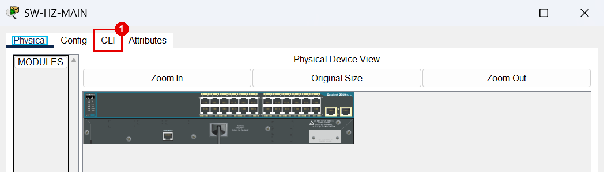

**איך בנויה כל משימה:** ‏🌐 הרשת עכשיו ‏←‏ ❗ הבעיה ‏←‏ 💡 הפתרון ‏←‏ 📋 מבצעים לבד ‏←‏ 🖱 הפתרון המלא: על מה לוחצים, מה כותבים ומה חייבים לראות.

## משימה 1 — כתובות WAN
**📖 איך הגענו לכאן.** שלושה סניפים מוכנים, ותשעה קווים אדומים ביניהם.

**🌐 הרשת עכשיו.** שלושה סניפים מוכנים, שלושה איים. עשרה נתבים מחכים:

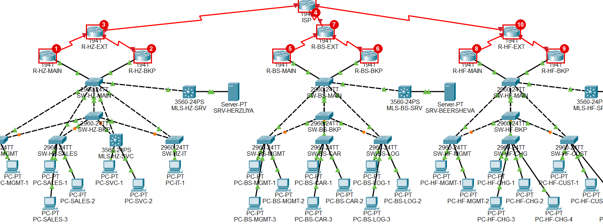

**❗ הבעיה.** כל הקווים הטוריים אדומים. ב-R-HZ-MAIN, ‏`show ip interface brief`:

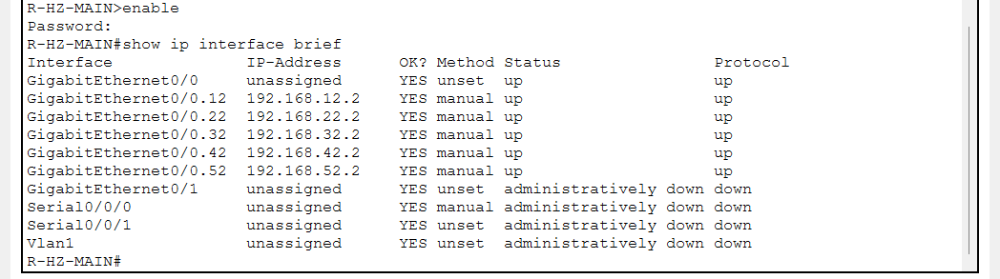

ל-`Serial0/0/0` אין כתובת והוא כבוי. פורט של נתב נולד כבוי.

**🎯 מה רוצים עכשיו.** כתובות ושעון בכל קו טורי, עד שהקווים ירוקים.

**💡 הפתרון.** לכל צד: כתובת מתוכנית ה-WAN ‏(1.5), ‏`no shutdown`, ובצד ה-**DCE** גם `clock rate` ‏(1.1).

**📋 מבצעים בפרויקט.** מוצאים את השורות של הנתב שלכם בטבלה 1.5, מסמנים אילו צדדים הם DCE, ומגדירים. מתי שני המשולשים נהיים ירוקים?

### 🖱 הפתרון: על מה לוחצים ומה כותבים
**R-HZ-MAIN:**
```
configure terminal
interface s0/0/0
ip address 203.11.0.1 255.255.255.0
no shutdown
end
```

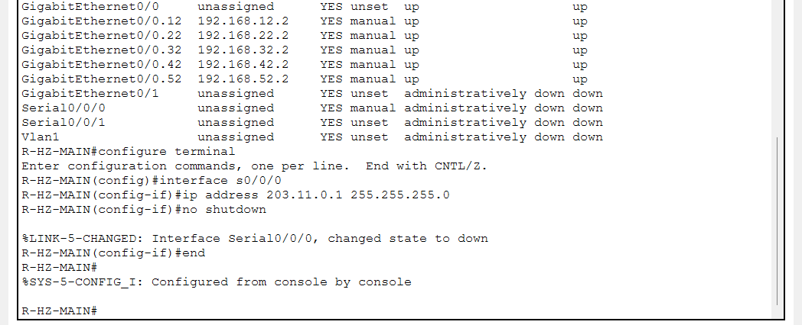

**R-HZ-BKP:**
```
configure terminal
interface s0/0/0
ip address 203.12.0.1 255.255.255.0
no shutdown
end
```

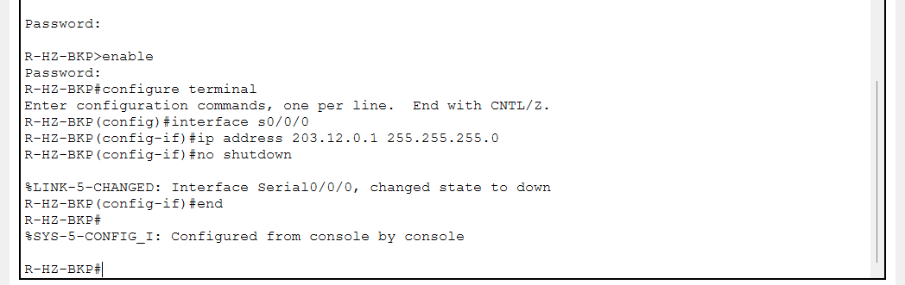

**R-HZ-EXT:**
```
configure terminal
interface s0/0/0
ip address 203.11.0.2 255.255.255.0
clock rate 2000000
no shutdown
exit
interface s0/1/0
ip address 203.12.0.2 255.255.255.0
clock rate 2000000
no shutdown
exit
interface s0/0/1
ip address 203.10.0.1 255.255.255.0
no shutdown
end
```

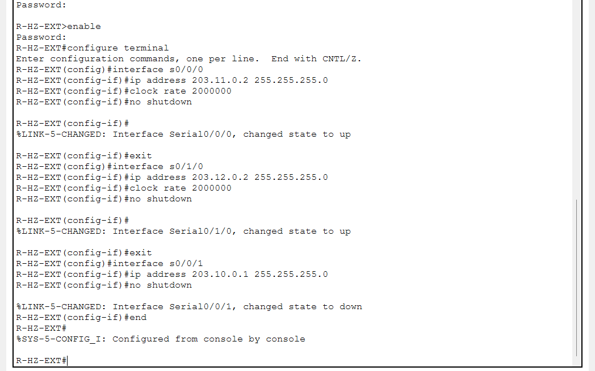

**ISP:**
```
configure terminal
interface s0/0/0
ip address 203.10.0.2 255.255.255.0
clock rate 2000000
no shutdown
exit
interface s0/0/1
ip address 203.20.0.2 255.255.255.0
clock rate 2000000
no shutdown
exit
interface s0/1/0
ip address 203.30.0.2 255.255.255.0
clock rate 2000000
no shutdown
end
```

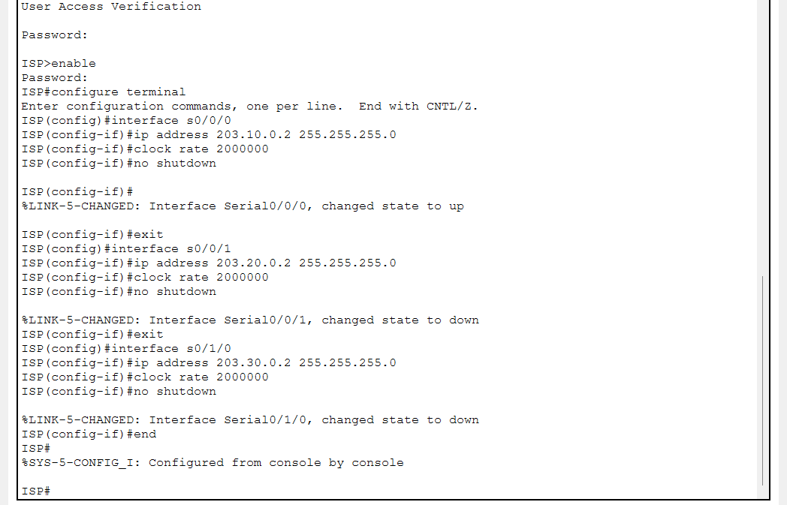

❓ איזה צד מקבל `clock rate`? רק ה-**DCE**. בצד DTE הפקודה לא נחוצה.

**באר שבע וחיפה:** כל קבוצה מדביקה נתב אחד. בבלוקים יש **הכול** לסניף: WAN, ‏HSRP track, ‏EIGRP, ‏BGP ו-NAT.
קוראים אותם תוך כדי משימות 2–5.

<details dir="rtl"><summary>R-BS-MAIN, R-BS-BKP, R-BS-EXT</summary>

**R-BS-MAIN**

<div dir="ltr">

```
configure terminal
interface s0/0/0
ip address 203.21.0.1 255.255.255.0
no shutdown
exit
interface g0/0.64
standby 64 track s0/0/0
exit
interface g0/0.65
standby 65 track s0/0/0
exit
interface g0/0.66
standby 66 track s0/0/0
exit
interface g0/0.67
standby 67 track s0/0/0
exit
router eigrp 20
network 192.168.64.0
network 192.168.65.0
network 192.168.66.0
network 192.168.67.0
network 203.21.0.0
no auto-summary
passive-interface g0/0.64
passive-interface g0/0.65
passive-interface g0/0.66
passive-interface g0/0.67
exit
ip route 0.0.0.0 0.0.0.0 203.21.0.2
end
```


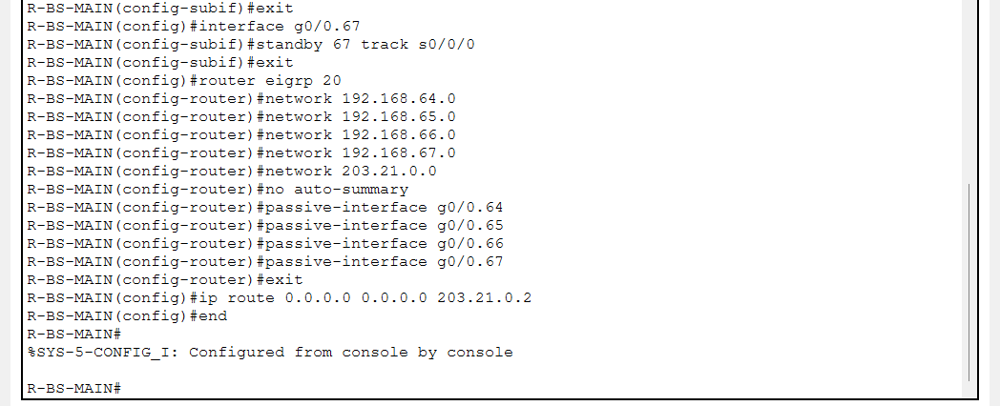

</div>

**R-BS-BKP**

<div dir="ltr">

```
configure terminal
interface s0/0/0
ip address 203.22.0.1 255.255.255.0
no shutdown
exit
router eigrp 20
network 192.168.64.0
network 192.168.65.0
network 192.168.66.0
network 192.168.67.0
network 203.22.0.0
no auto-summary
passive-interface g0/0.64
passive-interface g0/0.65
passive-interface g0/0.66
passive-interface g0/0.67
exit
ip route 0.0.0.0 0.0.0.0 203.22.0.2
end
```

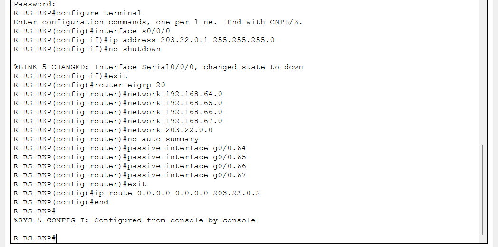

</div>

**R-BS-EXT**

<div dir="ltr">

```
configure terminal
interface s0/0/1
ip address 203.21.0.2 255.255.255.0
clock rate 2000000
no shutdown
exit
interface s0/1/0
ip address 203.22.0.2 255.255.255.0
clock rate 2000000
no shutdown
exit
interface s0/0/0
ip address 203.20.0.1 255.255.255.0
no shutdown
exit
router eigrp 20
network 203.21.0.0
network 203.22.0.0
no auto-summary
exit
ip route 0.0.0.0 0.0.0.0 203.20.0.2
router bgp 65020
neighbor 203.20.0.2 remote-as 65000
network 203.20.0.0 mask 255.255.255.0
exit
ip nat inside source static 192.168.67.10 203.20.0.10
access-list 1 permit 192.168.64.0 0.0.3.255
ip nat inside source list 1 interface s0/0/0 overload
interface s0/0/1
ip nat inside
interface s0/1/0
ip nat inside
interface s0/0/0
ip nat outside
exit
end
```

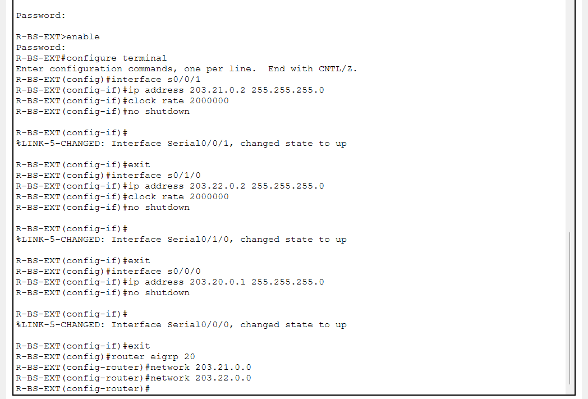

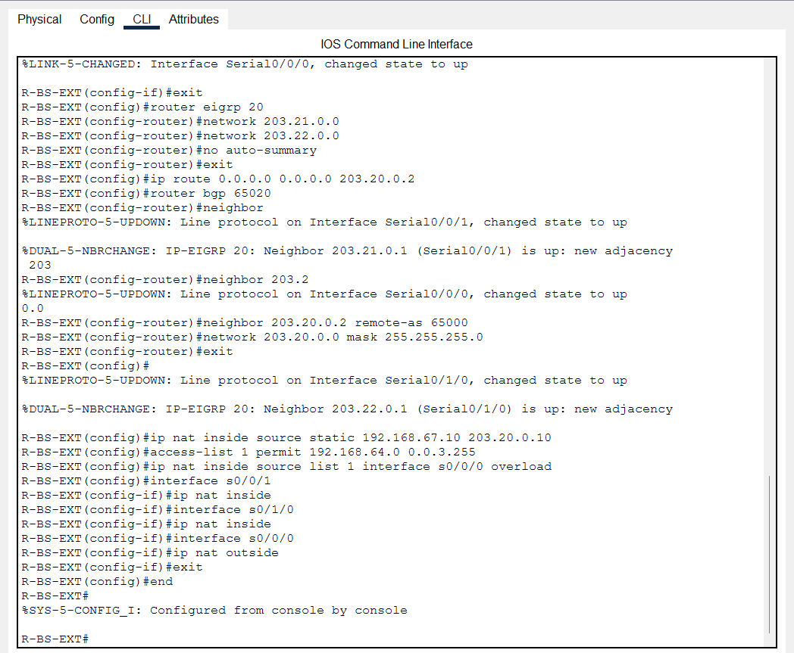

</div>

</details>

<details dir="rtl"><summary>R-HF-MAIN, R-HF-BKP, R-HF-EXT</summary>

**R-HF-MAIN**

<div dir="ltr">

```
configure terminal
interface s0/0/0
ip address 203.31.0.1 255.255.255.0
no shutdown
exit
interface g0/0.96
standby 96 track s0/0/0
exit
interface g0/0.97
standby 97 track s0/0/0
exit
interface g0/0.98
standby 98 track s0/0/0
exit
interface g0/0.99
standby 99 track s0/0/0
exit
router eigrp 30
network 192.168.96.0
network 192.168.97.0
network 192.168.98.0
network 192.168.99.0
network 203.31.0.0
no auto-summary
passive-interface g0/0.96
passive-interface g0/0.97
passive-interface g0/0.98
passive-interface g0/0.99
exit
ip route 0.0.0.0 0.0.0.0 203.31.0.2
end
```

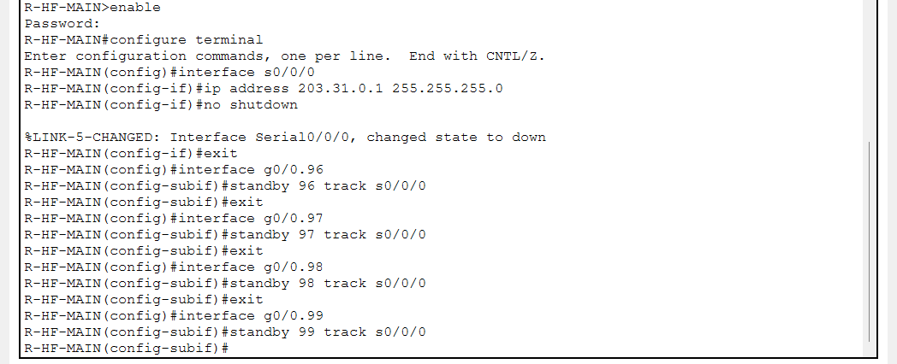


</div>

**R-HF-BKP**

<div dir="ltr">

```
configure terminal
interface s0/0/0
ip address 203.32.0.1 255.255.255.0
no shutdown
exit
router eigrp 30
network 192.168.96.0
network 192.168.97.0
network 192.168.98.0
network 192.168.99.0
network 203.32.0.0
no auto-summary
passive-interface g0/0.96
passive-interface g0/0.97
passive-interface g0/0.98
passive-interface g0/0.99
exit
ip route 0.0.0.0 0.0.0.0 203.32.0.2
end
```

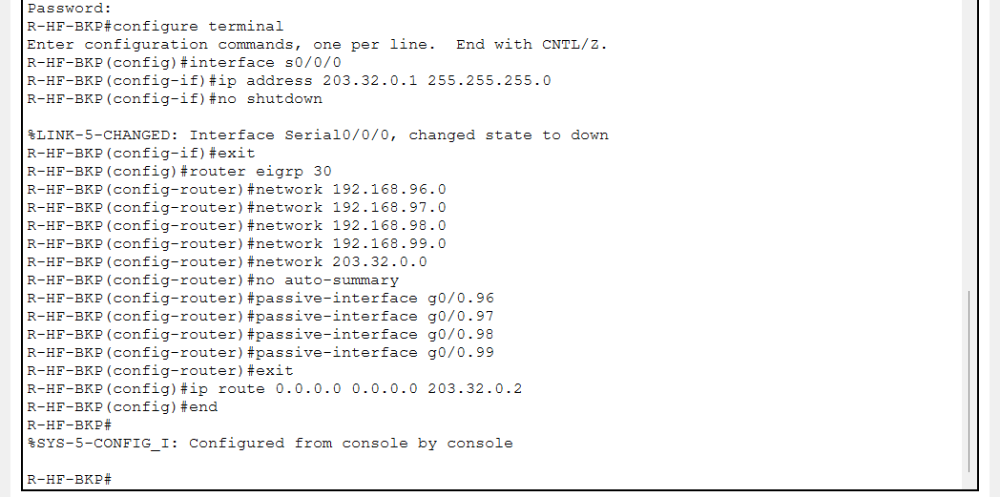

</div>

**R-HF-EXT**

<div dir="ltr">

```
configure terminal
interface s0/0/1
ip address 203.31.0.2 255.255.255.0
clock rate 2000000
no shutdown
exit
interface s0/1/0
ip address 203.32.0.2 255.255.255.0
clock rate 2000000
no shutdown
exit
interface s0/0/0
ip address 203.30.0.1 255.255.255.0
no shutdown
exit
router eigrp 30
network 203.31.0.0
network 203.32.0.0
no auto-summary
exit
ip route 0.0.0.0 0.0.0.0 203.30.0.2
router bgp 65030
neighbor 203.30.0.2 remote-as 65000
network 203.30.0.0 mask 255.255.255.0
exit
ip nat pool HAIFA-POOL 203.30.0.20 203.30.0.30 netmask 255.255.255.0
ip access-list extended NAT-HF
permit ip 192.168.96.0 0.0.3.255 any
exit
ip nat inside source list NAT-HF pool HAIFA-POOL
interface s0/0/1
ip nat inside
interface s0/1/0
ip nat inside
interface s0/0/0
ip nat outside
exit
end
```

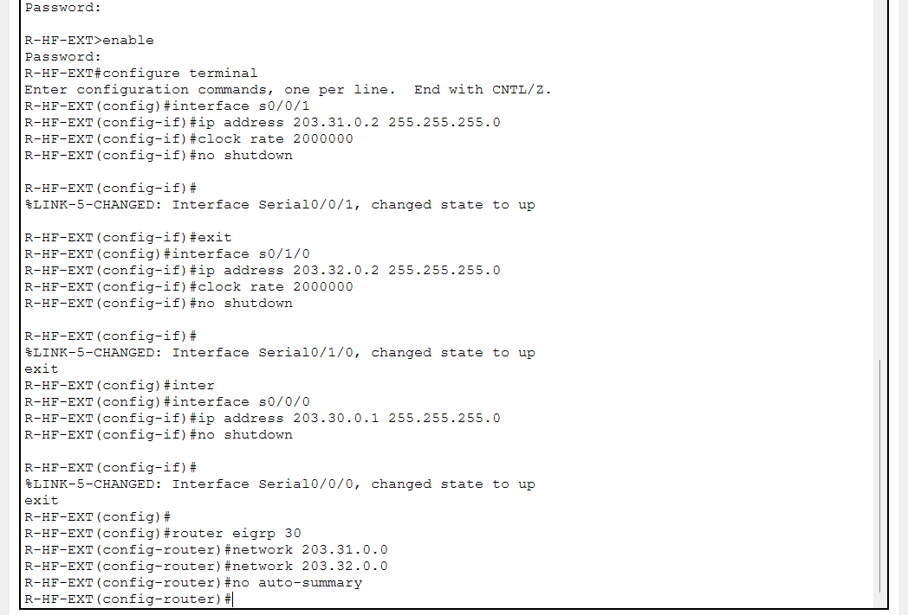

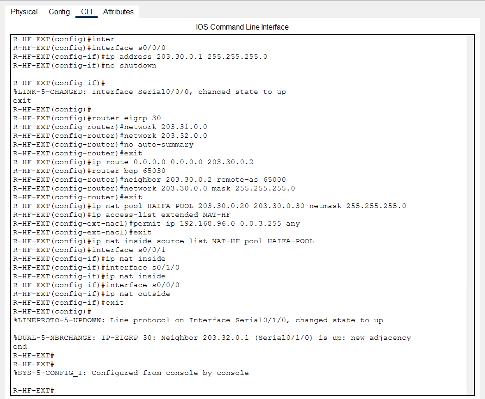

</div>

</details>

✅ כל הקווים הטוריים ירוקים.

<details dir="rtl" open><summary><b>📘 הסבר הפקודות של המשימה</b></summary>

<div dir="rtl">

| פקודה | מה היא עושה, ולמה היא כאן |
|---|---|
| ‎`show ip interface brief` | כל הפורטים, הכתובות, והאם הם up. |
| ‎`no shutdown` | מדליק את הפורט. פורטים של נתב כבויים כברירת מחדל. |
| ‎`interface s0/0/0` | בוחרים פורט. כל מה שמתחת חל עליו, עד `exit`. |
| ‎`ip address 203.11.0.1 255.255.255.0` | הכתובת והמסכה של הממשק. ברשת מקומית זו כתובת השער. |
| ‎`clock rate 2000000` | צד ה-DCE קובע את מהירות הקו הטורי (ביטים בשנייה), והצד השני עוקב. |
| ‎`interface g0/0.64` | **ממשק משנה**: דלת וירטואלית על אותו פורט פיזי, אחת לכל VLAN. |
| ‎`standby 64 track s0/0/0` | שומר על הקו הזה: אם הוא נופל, העדיפות יורדת ב-10 (‏110 הופך ל-100, פחות מ-105), והגיבוי מחליף. |
| ‎`router eigrp 20` | מפעיל EIGRP. המספר (AS) חייב להיות **זהה** בכל נתבי הסניף. |
| ‎`network 192.168.64.0` | ‏EIGRP עובד בממשק של הרשת הזו, ומפרסם אותה. |
| ‎`no auto-summary` | מפרסם את הרשתות המדויקות, ולא רשת אחת גדולה ומעוגלת. |
| ‎`passive-interface g0/0.64` | הרשת מתפרסמת, אבל הודעות ניתוב לא נשלחות למחשבים: אף אחד שם לא יכול להתחזות לנתב. |
| ‎`ip route 0.0.0.0 0.0.0.0 203.21.0.2` | מסלול ברירת מחדל: "כל מה שאני לא מכיר, שלח לשם". |
| ‎`router bgp 65020` | מפעיל BGP עם מספר ה-AS **שלנו**. |
| ‎`neighbor 203.20.0.2 remote-as 65000` | כתובת שכן ה-BGP ומספר ה-AS **שלו**. שני הצדדים חייבים לכתוב. |
| ‎`network 203.20.0.0 mask 255.255.255.0` | מפרסם לספק את הרשת הציבורית שלנו. המסכה חייבת להיות בדיוק כמו בטבלת הניתוב. |
| ‎`ip nat inside source static 192.168.67.10 203.20.0.10` | ‏NAT סטטי: כתובת פנימית אחת ↔ כתובת ציבורית אחת, תמיד. כך העולם מגיע לשרת. |
| ‎`access-list 1 permit 192.168.64.0 0.0.3.255` | רשימה סטנדרטית: הכתובות שיתורגמו (‎`0.0.3.255` = ארבע רשתות ביחד). |
| ‎`ip nat inside source list 1 interface s0/0/0 overload` | ‏PAT: כל מי שברשימה יוצא עם הכתובת ה**אחת** של הפורט הזה; `overload` מבדיל ביניהם לפי מספרי פורט. |
| ‎`ip nat inside` | הפורט הזה בצד של ה**בית**. |
| ‎`ip nat outside` | הפורט הזה בצד של ה**אינטרנט**. |
| ‎`ip nat pool HAIFA-POOL 203.30.0.20 203.30.0.30 netmask 255.255.255.0` | המאגר: מהכתובת הציבורית הראשונה עד האחרונה. |
| ‎`ip access-list extended NAT-HF` | פותח רשימה לפי שם או מספר, כדי להוסיף או להכניס שורות. |
| ‎`permit ip 192.168.96.0 0.0.3.255 any` | מי מתורגם: מהרשתות האלה לכל מקום. |
| ‎`ip nat inside source list NAT-HF pool HAIFA-POOL` | ‏NAT דינמי: כל מי שברשימה מקבל כתובת פנויה מהמאגר. |

</div>

</details>

**⏭ מה הלאה.** הקווים חיים. עכשיו יכול להישבר משהו חדש: קו, ולא רק נתב.

## משימה 2 — HSRP עוקב אחרי קו האינטרנט
**📖 איך הגענו לכאן.** לכל נתב ראשי קו משלו לנתב הקצה. ה-HSRP שומר רק על הצד הפנימי.

**🌐 הרשת עכשיו.** ל-R-HZ-MAIN (1) ול-R-HZ-BKP (2) יש קו משלהם אל R-HZ-EXT.

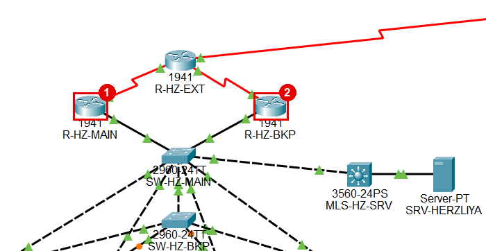

**❗ הבעיה.** מכבים את קו **האינטרנט** של הראשי (`interface s0/0/0`, ‏`shutdown`), מחכים 15 שניות וכותבים `show standby brief`:

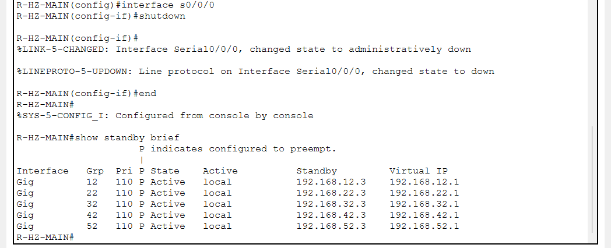

הוא **עדיין Active**! צד ה-LAN שלו תקין, ולכן HSRP לא רואה בעיה. כל המחשבים ממשיכים לשלוח לנתב שאין לו יציאה. (מחזירים: `no shutdown`.)

**🎯 מה רוצים עכשיו.** ה-HSRP שומר גם על הקו, כך שנתב בלי אינטרנט מוותר על התפקיד.

**💡 הפתרון.** `track`: ‏HSRP עוקב אחרי הקו הטורי. אם הוא נופל, העדיפות יורדת ב-10.

**📋 מבצעים בפרויקט.** מוסיפים track לחמש הקבוצות של R-HZ-MAIN. קודם מחשבים: מה תהיה העדיפות, ומי יהיה Active?

### 🖱 הפתרון: על מה לוחצים ומה כותבים
בשיעור 3 הגיבוי נכנס רק כשה-LAN נפל. עכשיו הנתב הראשי מאבד עדיפות גם כשה**קו הטורי** שלו נופל. ב-**R-HZ-MAIN**:
```
configure terminal
interface g0/0.12
standby 12 track s0/0/0
interface g0/0.22
standby 22 track s0/0/0
interface g0/0.32
standby 32 track s0/0/0
interface g0/0.42
standby 42 track s0/0/0
interface g0/0.52
standby 52 track s0/0/0
end
```

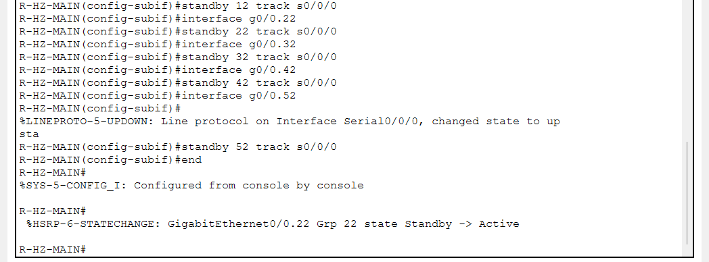

🧠 הקו נופל ‏←‏ 110 − 10 = **100**, פחות מ-105 ‏←‏ הגיבוי מחליף.

<div dir="rtl">

| הקו הטורי | ראשי | גיבוי | ‎‏Active |
|---|---|---|---|
| פעיל | ‎110 | ‎105 | ‎R-HZ-MAIN |
| נפל | ‎110 − 10 = **100** | ‎105 | ‎R-HZ-BKP |

</div>

❓ **שאלו את עצמכם:** מה היה קורה אם העדיפות של הגיבוי הייתה 99?

<details dir="rtl"><summary>תשובה</summary>

100 עדיין גבוה מ-99: הנתב הראשי היה נשאר Active בלי אינטרנט. ההפרש חייב להיות **קטן מ-10**.

</details>

<details dir="rtl" open><summary><b>📘 הסבר הפקודות של המשימה</b></summary>

<div dir="rtl">

| פקודה | מה היא עושה, ולמה היא כאן |
|---|---|
| ‎`interface s0/0/0` | בוחרים פורט. כל מה שמתחת חל עליו, עד `exit`. |
| ‎`shutdown` | מכבה את הפורט. |
| ‎`show standby brief` | מי Active ומי Standby בכל קבוצה, והעדיפות. |
| ‎`no shutdown` | מדליק את הפורט. פורטים של נתב כבויים כברירת מחדל. |
| ‎`interface g0/0.12` | **ממשק משנה**: דלת וירטואלית על אותו פורט פיזי, אחת לכל VLAN. |
| ‎`standby 12 track s0/0/0` | שומר על הקו הזה: אם הוא נופל, העדיפות יורדת ב-10 (‏110 הופך ל-100, פחות מ-105), והגיבוי מחליף. |

</div>

</details>

**⏭ מה הלאה.** הקווים עובדים ושמורים, ועדיין אף אחד לא יודע את הדרך לאף אחד.

## משימה 3 — OSPF בהרצליה
**📖 איך הגענו לכאן.** כל נתב מכיר רק את הרשתות שהוא נוגע בהן.

**🌐 הרשת עכשיו.** הקווים פועלים. כל נתב מכיר רק את השכנים שלו:

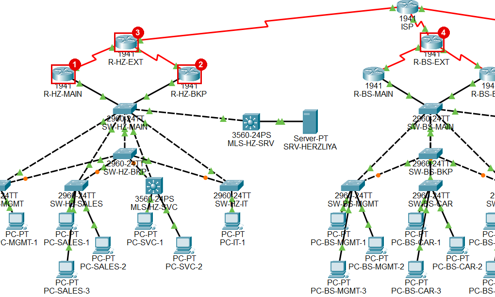

**❗ הבעיה.** ב-R-HZ-EXT, ‏`show ip route`:

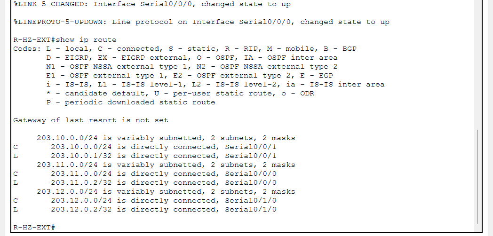

אין אף רשת 192.168. כשמגיעה מהאינטרנט תשובה למחשב, R-HZ-EXT לא יודע לאן לשלוח אותה וזורק אותה.

**🎯 מה רוצים עכשיו.** ‏OSPF: הנתבים של הרצליה מספרים זה לזה על כל הרשתות שלהם.

**💡 הפתרון.** פרוטוקול ניתוב: הנתבים **מספרים** אחד לשני מה הם מכירים. OSPF בהרצליה, EIGRP בבאר שבע ובחיפה (1.2). גם נתיבים סטטיים בשלושת הנתבים היו עובדים, עד שקו נופל: נתיב סטטי לא מגיב.

**📋 מבצעים בפרויקט.** OSPF 10, ‏area 0, ‏router-id ‏1.1.1.1 / 1.1.1.2 / 1.1.1.3, ‏passive בכל ממשק משנה של ה-LAN, ונתיב ברירת מחדל אל הנתב הבא בכיוון האינטרנט.

### 🖱 הפתרון: על מה לוחצים ומה כותבים
**R-HZ-MAIN:**
```
configure terminal
router ospf 10
router-id 1.1.1.1
network 192.168.12.0 0.0.0.255 area 0
network 192.168.22.0 0.0.0.255 area 0
network 192.168.32.0 0.0.0.255 area 0
network 192.168.42.0 0.0.0.255 area 0
network 192.168.52.0 0.0.0.255 area 0
network 203.11.0.0 0.0.0.255 area 0
passive-interface g0/0.12
passive-interface g0/0.22
passive-interface g0/0.32
passive-interface g0/0.42
passive-interface g0/0.52
exit
ip route 0.0.0.0 0.0.0.0 203.11.0.2
end
```

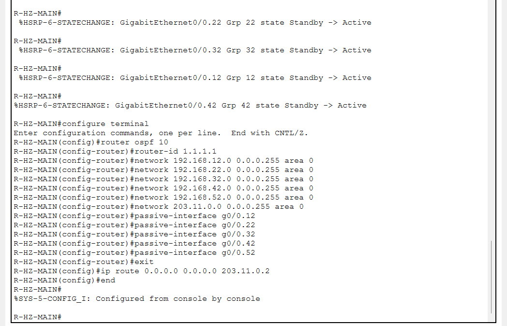

‏**R-HZ-BKP:** אותו דבר, עם `router-id 1.1.1.2`, עם `network 203.12.0.0 0.0.0.255 area 0` במקום 203.11, ועם
`ip route 0.0.0.0 0.0.0.0 203.12.0.2`.

הבלוק המלא של R-HZ-BKP:
```
configure terminal
router ospf 10
router-id 1.1.1.2
network 192.168.12.0 0.0.0.255 area 0
network 192.168.22.0 0.0.0.255 area 0
network 192.168.32.0 0.0.0.255 area 0
network 192.168.42.0 0.0.0.255 area 0
network 192.168.52.0 0.0.0.255 area 0
network 203.12.0.0 0.0.0.255 area 0
passive-interface g0/0.12
passive-interface g0/0.22
passive-interface g0/0.32
passive-interface g0/0.42
passive-interface g0/0.52
exit
ip route 0.0.0.0 0.0.0.0 203.12.0.2
end
```

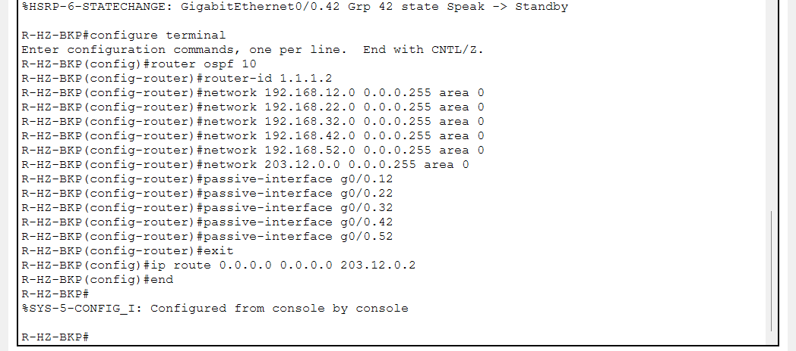

**R-HZ-EXT:**
```
configure terminal
router ospf 10
router-id 1.1.1.3
network 203.11.0.0 0.0.0.255 area 0
network 203.12.0.0 0.0.0.255 area 0
exit
ip route 0.0.0.0 0.0.0.0 203.10.0.2
end
```

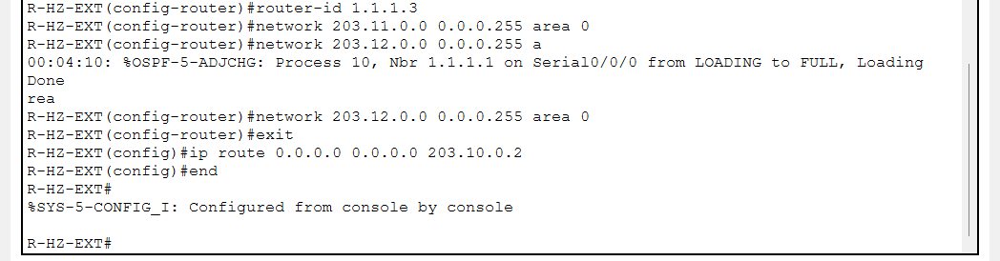

<div dir="rtl">

| פקודה | מה היא עושה | למה |
|---|---|---|
| ‎`router-id` | השם של הנתב ב-OSPF | קבוע, כדי שלא ישתנה עם הכתובות |
| ‎`network ... 0.0.0.255 area 0` | מפרסמת את הרשת | ‏wildcard: ההפך ממסכת רשת |
| ‎`passive-interface` | אין הודעות OSPF לכיוון המחשבים | אבטחה: אף אחד ב-LAN לא יכול להפוך ל"שכן" |
| ‎`ip route 0.0.0.0 0.0.0.0` | נתיב ברירת מחדל | "כל מה שאני לא מכיר ‏←‏ לאינטרנט" |

</div>

✅ ב-R-HZ-EXT: ‏`show ip ospf neighbor` ‏←‏ שני שכנים **FULL**. ב-`show ip route` ‏←‏ חמש הרשתות עם `O`, דרך **שני** הנתבים.

‏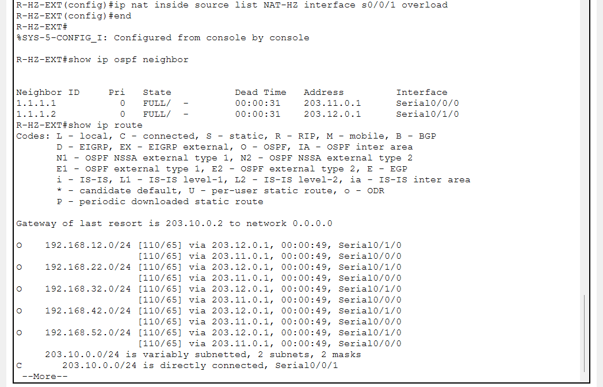

✅ ב-R-HZ-MAIN: ב-`show ip route` ה-gateway of last resort הוא 203.11.0.2.

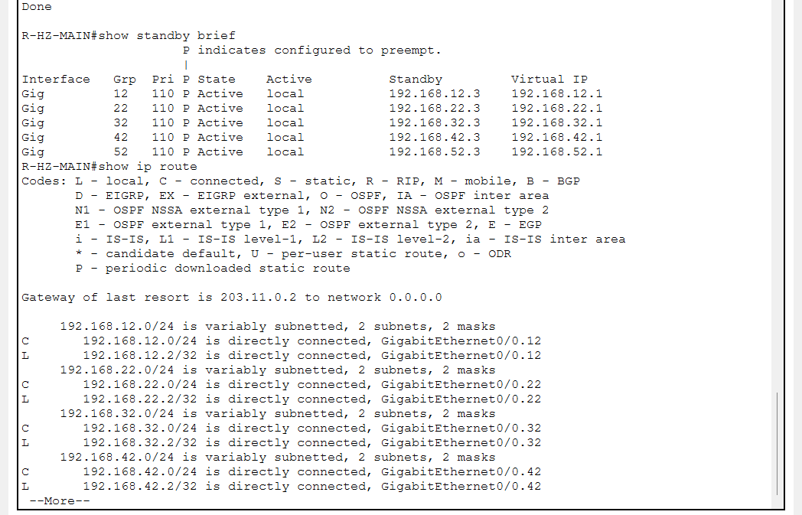

**באר שבע (EIGRP 20):** מסתכלים בבלוק של R-BS. ‏`show ip eigrp neighbors` ב-R-BS-EXT מראה שני שכנים:

‏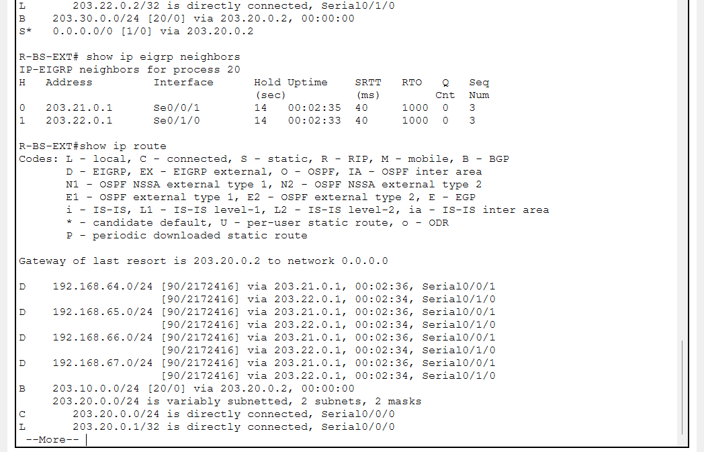

❓ למה יש `no auto-summary`? כדי ש-EIGRP יפרסם את הרשתות המדויקות ולא class שלם.

<details dir="rtl" open><summary><b>📘 הסבר שאר הפקודות של המשימה</b></summary>

<div dir="rtl">

| פקודה | מה היא עושה, ולמה היא כאן |
|---|---|
| ‎`show ip route` | טבלת הניתוב. האות מראה מי לימד: ‏`C` מחובר ישירות, ‏`O` מ-OSPF, ‏`D` מ-EIGRP, ‏`B` מ-BGP, ‏`S` סטטי. |
| ‎`router ospf 10` | מפעיל OSPF. המספר מקומי לנתב הזה. |
| ‎`show ip ospf neighbor` | שכני ה-OSPF. ‏FULL = החליפו ביניהם הכול. |
| ‎`show ip eigrp neighbors` | שכני ה-EIGRP. רשימה ריקה = מספר AS או רשת שגויים. |

</div>

</details>

**⏭ מה הלאה.** בתוך החברה כולם יודעים את הדרך. בחוץ יש חברה אחרת.

## משימה 4 — BGP לספק
**📖 איך הגענו לכאן.** כל סניף מכיר את עצמו. הספק לא מכיר אף אחד מאיתנו.

**🌐 הרשת עכשיו.** כל סניף מכיר את עצמו. בין הסניפים עומד הספק:

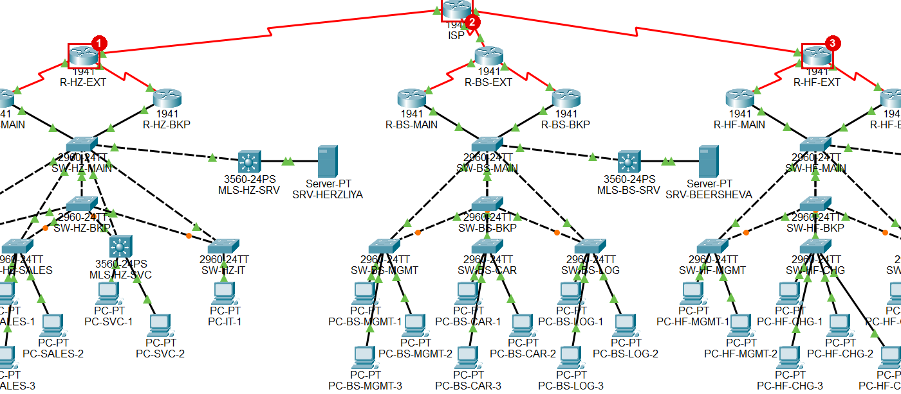

**❗ הבעיה.** הספק הוא **חברה אחרת**: אי אפשר להריץ איתו OSPF, כי אז הוא היה רואה את כל הרשת הפנימית והיה יכול לשנות לכם נתיבים. ב-ISP, ‏`show ip bgp summary` לא מחזיר כלום: אין לו אף שכן, ולכן הוא לא מעביר הלאה אף רשת.

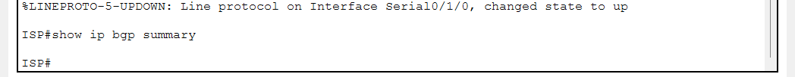

🧠 האמת: במודל הקטן שלנו שלושת הסניפים מחוברים **לאותו** נתב של הספק, ולכן גם נתיב ברירת המחדל לבדו היה מגיע אליהם. באינטרנט האמיתי יש אלפי ספקים, ורק BGP מספר להם מי נמצא איפה.

**🎯 מה רוצים עכשיו.** ‏BGP: מספרים לספק רק על הרשת הציבורית שלנו, ושומעים ממנו על האחרים.

**💡 הפתרון.** eBGP: כל סניף הוא AS, והוא מפרסם לספק **רק** את הרשת הציבורית שלו (1.3).

**📋 מבצעים בפרויקט.** הרצליה = AS 65010, הספק = AS 65000. מגדירים את שני הצדדים. איזה AS כותבים אחרי `remote-as`, שלכם או של השכן?

### 🖱 הפתרון: על מה לוחצים ומה כותבים
**R-HZ-EXT:**
```
configure terminal
router bgp 65010
neighbor 203.10.0.2 remote-as 65000
network 203.10.0.0 mask 255.255.255.0
end
```

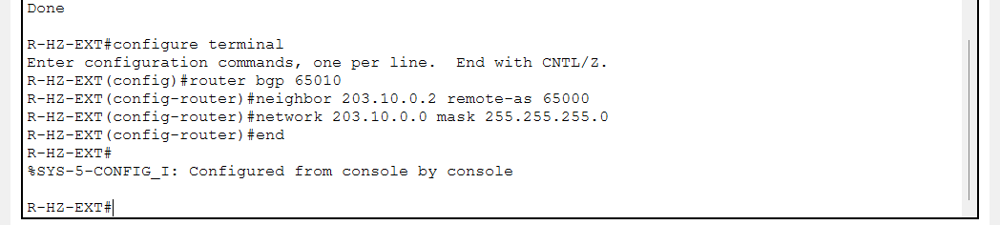

**ISP:**
```
configure terminal
router bgp 65000
neighbor 203.10.0.1 remote-as 65010
neighbor 203.20.0.1 remote-as 65020
neighbor 203.30.0.1 remote-as 65030
end
```

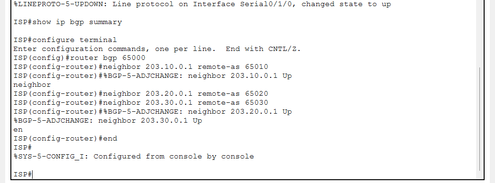

<div dir="rtl">

| פקודה | מה היא עושה |
|---|---|
| ‎`router bgp 65010` | מספר ה-AS שלנו |
| ‎`neighbor 203.10.0.2 remote-as 65000` | מי השכן ובאיזה AS הוא; שני הצדדים חייבים להסכים |
| ‎`network 203.10.0.0 mask 255.255.255.0` | מפרסמת את הרשת הציבורית שלנו; המסכה חייבת להיות בדיוק כמו בטבלת הניתוב |

</div>

✅ ב-ISP: ‏`show ip bgp summary`. שלושה שכנים, ו-**MsgRcvd** גדול מ-0.

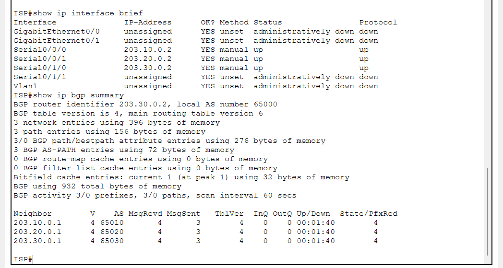

✅ ההוכחה האמיתית — ב-R-HF-EXT: ‏`show ip route bgp`. הרשתות הציבוריות של הסניפים האחרים הגיעו עם `B`:

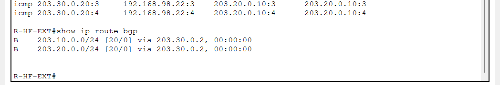

⚠️ בציוד אמיתי, מילה כמו `Idle` בעמודה האחרונה אומרת "לא מחובר". ב-Packet Tracer העמודה מראה מספר **גם כשה-AS שגוי** (בדקנו),
ולכן סומכים על `show ip route bgp`.

✅ ב-ISP: ‏`show ip route`. הוא **לא** מכיר אף רשת 192.168, וזה נכון: הספק לא צריך להכיר את הפנים שלנו.

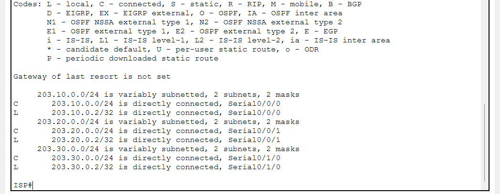

<details dir="rtl" open><summary><b>📘 הסבר שאר הפקודות של המשימה</b></summary>

<div dir="rtl">

| פקודה | מה היא עושה, ולמה היא כאן |
|---|---|
| ‎`show ip bgp summary` | רשימת שכני ה-BGP וההודעות שהתקבלו (MsgRcvd). ב-Packet Tracer שכן יכול להיראות תקין גם עם AS שגוי, ולכן בודקים גם את הנתיבים. |
| ‎`show ip route bgp` | טבלת הניתוב. האות מראה מי לימד: ‏`C` מחובר ישירות, ‏`O` מ-OSPF, ‏`D` מ-EIGRP, ‏`B` מ-BGP, ‏`S` סטטי. |

</div>

</details>

**⏭ מה הלאה.** הדרכים קיימות, וה-ping ממחשב עדיין נכשל. למה?

## משימה 5 — NAT
**📖 איך הגענו לכאן.** המסלולים מוכנים, אבל למחשבים כתובות פרטיות שהאינטרנט לא מכיר.

**🌐 הרשת עכשיו.** הנתיבים קיימים. מ-2 יוצאים לאינטרנט, ומ-5 נכנסים לשרת של באר שבע:

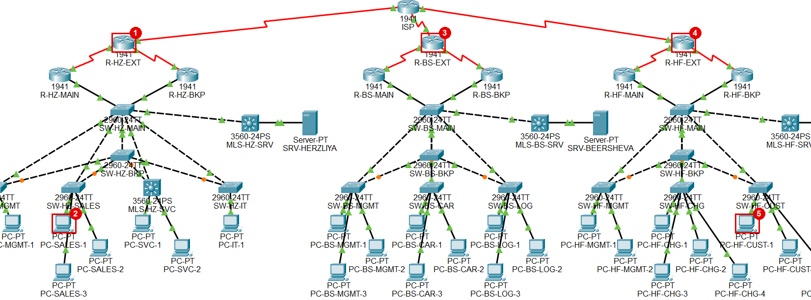

**❗ הבעיה.** ב-PC-SALES-1 ‏←‏ `ping 203.10.0.2`:

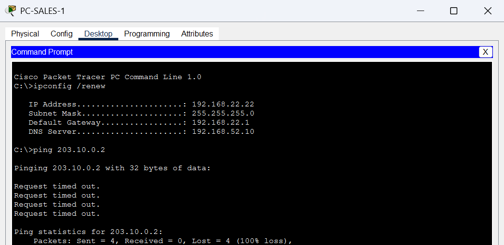

ה-ping **כן** מגיע לספק, אבל התשובה מיועדת ל-192.168.22.x, ולאף ספק אין נתיב לכתובת פרטית. התשובה מתה שם.

**🎯 מה רוצים עכשיו.** ‏NAT: מחליפים את הכתובת ביציאה, ומפרסמים את השרת של באר שבע בכתובת ציבורית.

**💡 הפתרון.** NAT בנתב הקצה: בדרך החוצה מחליפים את הכתובת הפרטית בציבורית, וזוכרים את זה בשביל התשובה (1.4).

**📋 מבצעים בפרויקט.** PAT ב-R-HZ-EXT: את מי מתרגמים, לאיזו כתובת, אילו פורטים הם inside ואיזה outside? אחר כך מוצאים את ה-NAT הסטטי ואת ה-pool בבלוקים של באר שבע וחיפה.

### 🖱 הפתרון: על מה לוחצים ומה כותבים
**R-HZ-EXT (PAT):**
```
configure terminal
ip access-list extended NAT-HZ
permit ip 192.168.0.0 0.0.63.255 any
exit
ip nat inside source list NAT-HZ interface s0/0/1 overload
interface s0/0/0
ip nat inside
interface s0/1/0
ip nat inside
interface s0/0/1
ip nat outside
end
```

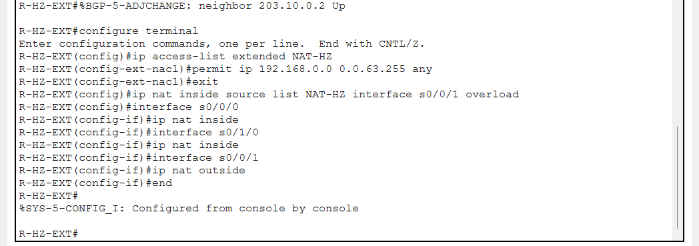

<div dir="rtl">

| פקודה | מה היא עושה |
|---|---|
| ‎`permit ip 192.168.0.0 0.0.63.255 any` | את מי מתרגמים: 192.168.0 עד 192.168.67 |
| ‎`overload` | ‏PAT: הרבה מחשבים, כתובת אחת |
| ‎`ip nat inside` / `outside` | איזה צד הוא הבית ואיזה האינטרנט |

</div>

‏✅ **PC-SALES-1**: קודם `ipconfig` (צריך כתובת), ואז `ping 203.10.0.2` ו-`ping 203.20.0.2` (הצד של הספק לכיוון באר שבע).

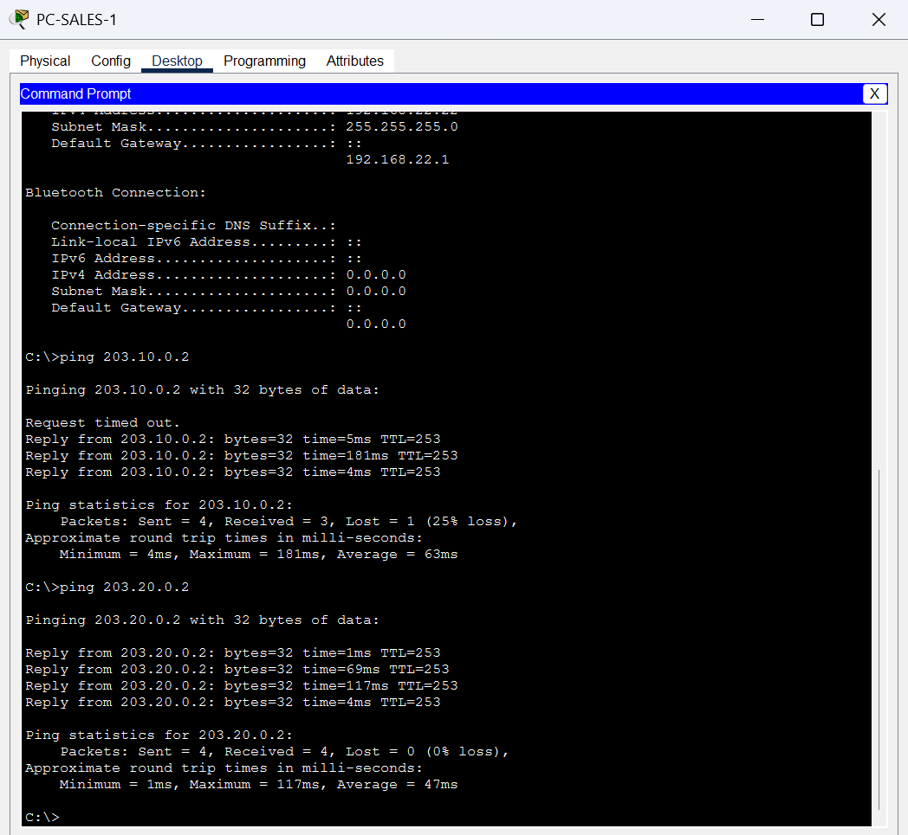

✅ מיד אחר כך ב-R-HZ-EXT: ‏`show ip nat translations`. הכתובת 192.168.22.20 יצאה בתור **203.10.0.1**.

‏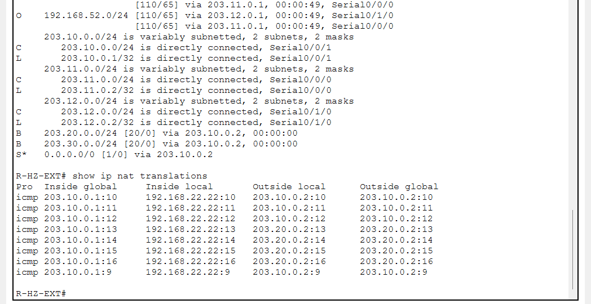

‏**NAT סטטי בבאר שבע** (בבלוק שהודבק): השרת 192.168.67.10 מפורסם בתור **203.20.0.10**.
מ-**PC-HF-CUST-1** בחיפה: `ping 203.20.0.10`, ובדפדפן `http://203.20.0.10`:

‏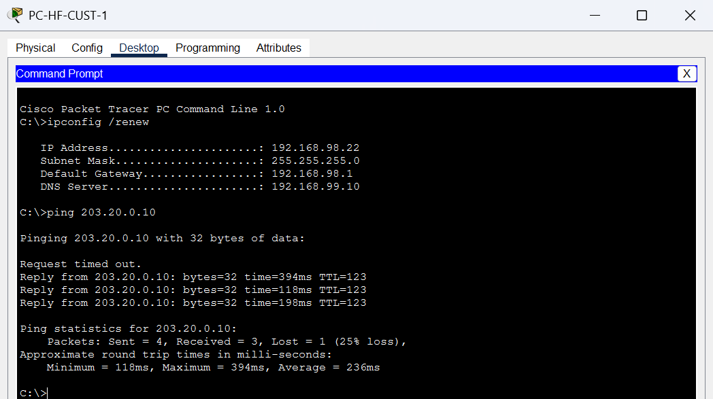

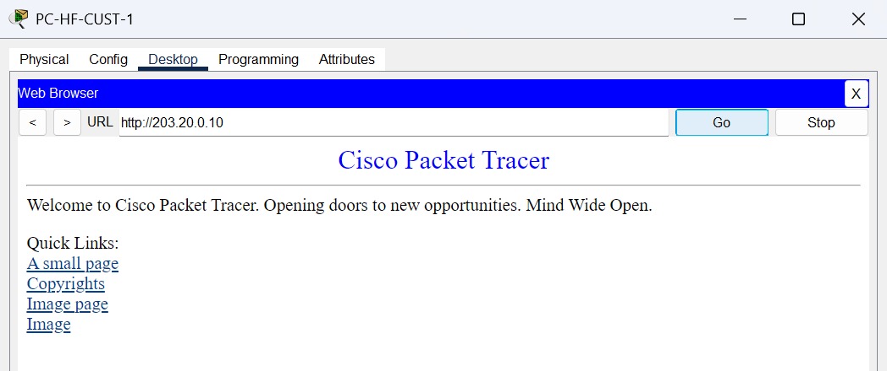

ב-R-BS-EXT השורה עם ‎`---`‎ קבועה: זה התרגום הסטטי.

‏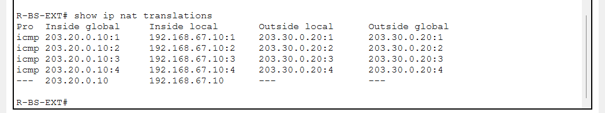

‏**Pool בחיפה:** אותו מחשב יצא בתור 203.30.0.20, הכתובת הראשונה ב-pool.

‏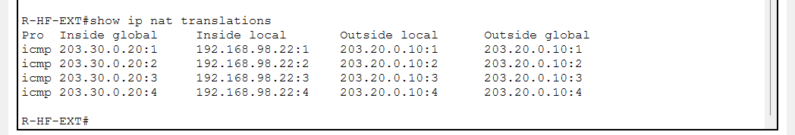

<details dir="rtl" open><summary><b>📘 הסבר שאר הפקודות של המשימה</b></summary>

<div dir="rtl">

| פקודה | מה היא עושה, ולמה היא כאן |
|---|---|
| ‎`ping 203.10.0.2` | שולח 4 הודעות בדיקה. תשובות = הדרך עובדת ב**שני** הכיוונים. |
| ‎`ip access-list extended NAT-HZ` | פותח רשימה לפי שם או מספר, כדי להוסיף או להכניס שורות. |
| ‎`ip nat inside source list NAT-HZ interface s0/0/1 overload` | ‏PAT: כל מי שברשימה יוצא עם הכתובת ה**אחת** של הפורט הזה; `overload` מבדיל ביניהם לפי מספרי פורט. |
| ‎`interface s0/0/0` | בוחרים פורט. כל מה שמתחת חל עליו, עד `exit`. |
| ‎`ip nat outside` | הפורט הזה בצד של ה**אינטרנט**. |
| ‎`ipconfig` | מראה את הכתובת, המסכה והשער של המחשב. |
| ‎`show ip nat translations` | מי תורגם לאיזו כתובת. |

</div>

</details>

**⏭ מה הלאה.** הכול עובד, עם שתי דרכים החוצה. נבדוק אם זה נכון.

## משימה 6 — חותכים את הקו
**📖 איך הגענו לכאן.** שני קווים, HSRP עם track, ‏OSPF ו-NAT עובדים ביחד.

**🌐 הרשת עכשיו.** הכול עובד, עם שתי יציאות:

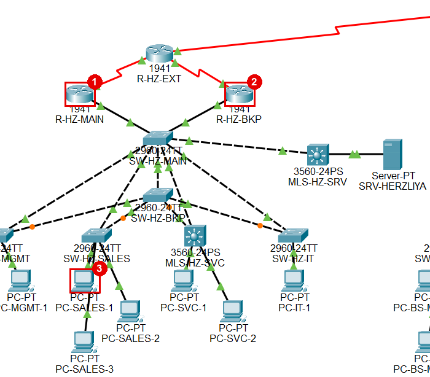

**❗ הבעיה.** במשימה 2 ראינו שהראשי נשאר Active בלי אינטרנט. האם `track` באמת פתר את זה? צריך להוכיח.

**🎯 מה רוצים עכשיו.** מנתקים את הקו הראשי באמצע ping, ועוקבים אחרי מה שעושה כל פרוטוקול.

**💡 הפתרון.** חותכים שוב את אותו קו ומשווים: הפעם העדיפות חייבת לרדת ל-100 והגיבוי חייב להיכנס.

**📋 מבצעים בפרויקט.** חותכים, בודקים `show standby brief`, בודקים `tracert` מ-PC-SALES-1, ומחזירים.

### 🖱 הפתרון: על מה לוחצים ומה כותבים
1. ‏**R-HZ-MAIN**: ‏`interface s0/0/0` ‏←‏ ‏`shutdown`. מחכים 15 שניות, `show standby brief`: העדיפות **100**, והוא כבר לא Active (עובר דרך *Speak* ל-*Standby*).

   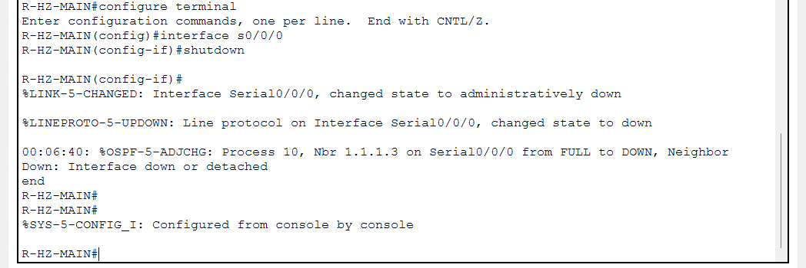

   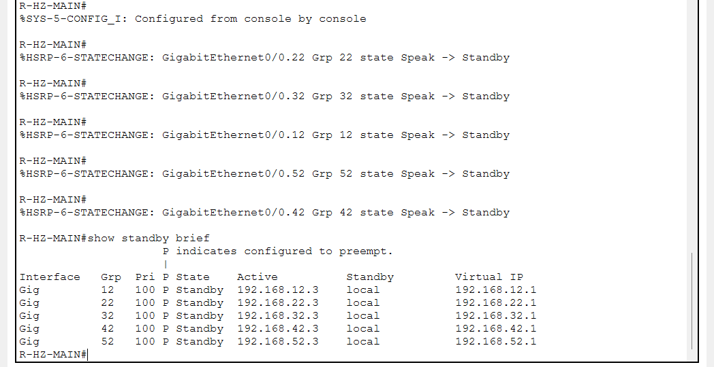
2. ‏**PC-SALES-1**: ‏`tracert 203.10.0.2` ‏←‏ ‏‎.3 ואז 203.12.0.2: דרך הגיבוי, והאינטרנט עדיין עובד.

   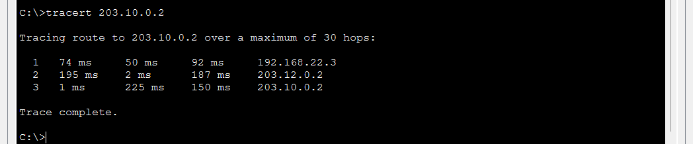
3. ‏`no shutdown`, ואחרי כ-30 שניות R-HZ-MAIN שוב Active.

   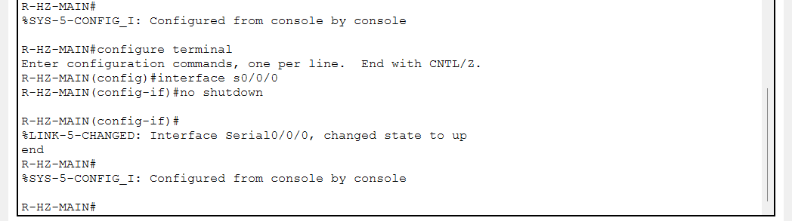

4. שומרים בכל **עשרת** הנתבים (גם ISP, באר שבע וחיפה): `copy running-config startup-config`. אחר כך File ‏←‏ Save.

<details dir="rtl" open><summary><b>📘 הסבר הפקודות של המשימה</b></summary>

<div dir="rtl">

| פקודה | מה היא עושה, ולמה היא כאן |
|---|---|
| ‎`show standby brief` | מי Active ומי Standby בכל קבוצה, והעדיפות. |
| ‎`tracert` | מראה כל נתב בדרך. |
| ‎`interface s0/0/0` | בוחרים פורט. כל מה שמתחת חל עליו, עד `exit`. |
| ‎`shutdown` | מכבה את הפורט. |
| ‎`no shutdown` | מדליק את הפורט. פורטים של נתב כבויים כברירת מחדל. |

</div>

</details>

**⏭ מה הלאה.** החברה מחוברת, ופתוחה. שיעור 5 מחליט מי עובר.

## 👀 רואים את זה קורה — NAT משנה את הכתובת
על מצב Simulation הסברנו ב[שיעור 1](../lesson-01/). קודם ב-Realtime: ‏`ping 203.10.0.2` מ-PC-SALES-1 עובד.
אחר כך **Simulation** ‏←‏ רק **ICMP** ‏←‏ שוב `ping 203.10.0.2`, ומתקדמים עד שהחבילה חוזרת.

**בדרך החוצה**, פותחים את החבילה ב-**R-HZ-EXT**:

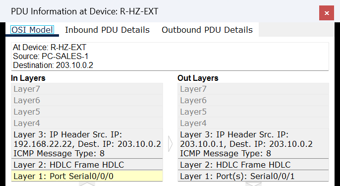

**בדרך חזרה**, באותו נתב:


<div dir="rtl">

| | נכנס | יוצא |
|---|---|---|
| בדרך החוצה: המקור | ‎192.168.22.22 | ‎**203.10.0.1** |
| בדרך חזרה: היעד | ‎203.10.0.1 | ‎**192.168.22.22** |

</div>


❓ הספק רואה רק את 203.10.0.1. איך R-HZ-EXT יודע למי להחזיר את התשובה?

<details dir="rtl"><summary>תשובה</summary>

הוא כתב שורה בטבלת התרגום (`show ip nat translations`) כשהחבילה יצאה, והוא קורא אותה בכיוון ההפוך.

</details>

💡 שכבה 2 היא עכשיו **HDLC** ולא Ethernet: בקו סריאלי יש רק שני צדדים, ולכן לא צריך MAC.

✏️ **נסו:** פתחו את החבילה ב-**ISP**, שכבה 3. יש שם כתובת 192.168?

<details dir="rtl"><summary>תשובה</summary>

לא. בגלל זה הספק גם לא צריך נתיב לרשתות הפרטיות שלכם.

</details>

## 🧯 לא עובד?

<div dir="rtl">

| מה רואים | כנראה | מה עושים |
|---|---|---|
| קו טורי אדום בצד אחד | חסר `no shutdown` באחד הקצוות | `show ip interface brief` בשני הקצוות |
| מצב `up/down` | חסר `clock rate` ב-DCE | `show controllers`, ואז `clock rate 2000000` |
| אין שכן OSPF | ‏network או wildcard שגוי, או אזור אחר | ‎`show ip protocols`, `show run` |
| אין שכן EIGRP | מספר AS שונה | ‏20 בבאר שבע, 30 בחיפה, בשלושת הנתבים |
| אין ping לאינטרנט, OSPF תקין | ‎‏NAT | `ip nat inside` ו-`outside` בפורטים הנכונים |
| `show ip nat translations` ריק | הרשומות פגו | עושים ping ומסתכלים מיד |
| ה-ping הראשון אבד | ‏ARP, או שהנתיבים עדיין נלמדים | ‏ping שוב |

</div>

---

## 🔎 מצאו את הטעות — מפרויקטים אמיתיים
1. באר שבע השתמשה ב-192.168.52.0, אותה רשת של השרתים בהרצליה.
2. ה-ISP הריץ OSPF + שני EIGRP + BGP עם **redistribution** בין כולם.
3. הוגדר רק שכן BGP **אחד** מתוך שלושה.
4. בשלושת הסניפים היה רק PAT, למרות שבספר הובטחו סטטי ודינמי.

<details dir="rtl"><summary>תשובה</summary>

1. שני סניפים עם אותה רשת אי אפשר לחבר: הנתב לא יודע לאן לשלוח. התיקון: באר שבע ב-64–67, ומתכננים מראש כתובות ל**כל** החברה.
2. הספק מכיר את כל הרשתות הפרטיות של הלקוחות: לא מציאותי ולא בטוח. התיקון: IGP רק בתוך הסניף, eBGP לספק, ונתיב ברירת מחדל החוצה.
3. ב-BGP אין שכנים אוטומטיים. צריך לכתוב כל צד ידנית.
4. סטטי לשרת שנכנסים אליו מבחוץ, pool לדינמי, PAT לשאר. הבוחן בודק שמה שכתוב בספר קיים בקובץ.

</details>

## 🏋 תרגילים
1. ב-R-HZ-EXT מוחקים `ip nat inside` מ-s0/0/0 ועושים ping מ-PC-SALES-1. מה קורה ולמה? החזירו.
2. משנים את ה-AS של השכן ב-R-HF-EXT ל-312. מה מראה `show ip bgp summary`? החזירו.
3. חשבו את ה-wildcard של 255.255.252.0. אילו רשתות מכסה ‎`192.168.96.0 0.0.3.255`?

<details dir="rtl"><summary>תשובות (את 1 ו-2 בדקנו)</summary>

1. ‏`Request timed out`, וטבלת התרגום ריקה. החבילה יוצאת בתור 192.168.22.x, הספק לא מכיר את הרשת הזו, ולכן התשובה לא יכולה לחזור. אחרי `ip nat inside` ה-ping עובד.
2. ‏‎`%BGP-3-NOTIFICATION ... (peer in wrong AS)`‎, ו-`show ip route bgp` **ריק**. כדי להחזיר: `no neighbor 203.30.0.2 remote-as 65001` ואז `neighbor 203.30.0.2 remote-as 65000`.

   
3. ‏0.0.3.255. הרשתות 192.168.96.0, ‏97.0, ‏98.0 ו-99.0.

</details>

## 🎓 להסביר לבוחן
- מה ההבדל בין IGP ל-EGP? למה לא OSPF לספק?
- מה זה DCE ו-DTE?
- למה ה-admin distance חשוב כשיש שני פרוטוקולים?
- מה ההבדל בין PAT, סטטי ודינמי? מה זה inside local ו-inside global?
- מה עושה `standby track`, ולמה על הקו הטורי ולא על ה-LAN?

<details dir="rtl"><summary>תשובות לדוגמה</summary>

1. ‏IGP = בתוך חברה אחת (OSPF, ‏EIGRP). ‏EGP = בין חברות (BGP). עם OSPF הספק היה לומד את כל הפנים שלנו, והתקלות שלנו היו מגיעות אליו.
2. שני הקצוות של קו טורי. ה-DCE נותן את השעון, ה-DTE מקבל אותו.
3. אם אותה רשת נלמדת משני פרוטוקולים, נכנס לטבלה זה עם המרחק הנמוך: EIGRP ‏(90) לפני OSPF ‏(110).
4. ‏PAT: רבים לאחד, לפי פורטים. סטטי: אחד לאחד, קבוע, מאפשר להיכנס. דינמי: אחד לאחד, זמני, מתוך pool. ‏Local = הכתובת האמיתית בפנים, global = איך העולם רואה אותה.
5. מוריד את העדיפות כשפורט נופל. נפילה של ה-LAN ‏HSRP מזהה לבד, אבל בלי track הוא לא יודע שקו האינטרנט נפל.

</details>

## ✏️ מבחן יציאה (3 דקות)
1. איזה פרוטוקול רץ בין R-HZ-EXT ל-ISP?
2. מה ה-wildcard של ‎/24?
3. איזה NAT תבחרו לשרת web?
4. מה אומר `S*`‎ בטבלת הניתוב?
5. ‏EIGRP 20 בנתב אחד ו-EIGRP 30 בשכן שלו. מה קורה?

<details dir="rtl"><summary>תשובות</summary>

1. ‏eBGP.
2. ‏0.0.0.255.
3. סטטי.
4. נתיב ברירת מחדל סטטי.
5. הם לא נהיים שכנים.

</details>

## ⏭ מה עשינו, ומה הלאה
**מה עשינו.** שלושה איים מחוברים לעולם. המסלולים נלמדים לבד, ולכל סניף שני קווים לנתב הקצה שלו.

**מה עדיין חסר.** פתחנו את הדלתות **לכולם**. הלוגיסטיקה מגיעה למחשב של המנהל, התעבורה בין הסניפים עוברת באינטרנט בלי הצפנה, המכשירים מנוהלים בסיסמה אחת משותפת, ואף אחד לא יודע מה קרה בלילה.

**מה הלאה.** ב[שיעור 5](../lesson-05/) לא מוסיפים דרכים. מחליטים **למי מותר להשתמש בהן**.

## 🛠 ספר הפרויקט
- [ ] תוכנית הכתובות של **כל** הסניפים. בודקים ששום דבר לא מופיע פעמיים.
- [ ] טבלת ה-WAN עם DCE/DTE.
- [ ] פסקה על כל אחד: OSPF, ‏EIGRP, ‏BGP, ושלושת סוגי ה-NAT. למה כל אחד נמצא דווקא שם?
- [ ] צילומי מסך: `show ip ospf neighbor`, ‏`show ip eigrp neighbors`, ‏`show ip bgp summary`, ‏`show ip nat translations`, ובדיקת הנפילה.
