# שיעור 05 — אבטחה וניהול: ACL, ‏VPN, ‏SSH, ‏AAA, ‏NTP, ‏Syslog ו-ASA

<div dir="rtl">

> ⏱ 90 דקות · 🧰 Packet Tracer 9.x · 📂 קובץ התחלה: [`lesson05-start.pkt`](lesson05-start.pkt) או הקובץ שלכם אחרי [חלק D](../from-zero/README.md#part-d) · 💾 שומרים בשם `lesson05.pkt`

</div>

## מה יהיה לכם בסוף השיעור
חברה מוגנת: מחלקות שלא מגיעות לאן שאסור, מנהרה מוצפנת הרצליה ↔ חיפה, ניהול מוצפן עם משתמשים מרכזיים, שעון נכון ויומנים, וחומת אש.

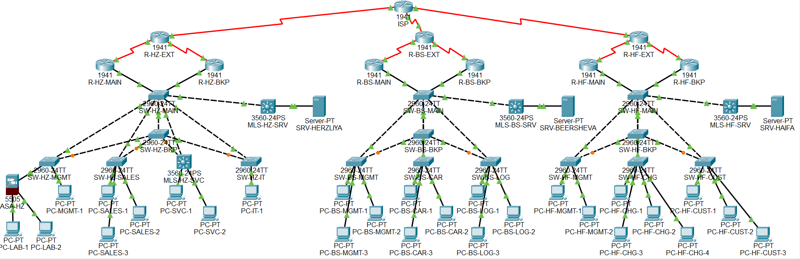

## 📖 הסיפור — פרק 5: סוגרים את הדלתות שצריך לסגור
**איך הגענו לכאן.** מחלקה אחת (1), חמש מחלקות (2), סניף שלם (3), שלושה סניפים באינטרנט (4). בארבעה שיעורים רק **פתחנו** דברים, כי המטרה הייתה שהכול יעבוד.

**איפה אנחנו עכשיו.** הכול עובד, **לכולם**: הלוגיסטיקה עושה ping למנהל, חיפה והרצליה מדברות בלי הצפנה, כמעט 30 מכשירים עם סיסמה אחת, כל אחד מראה שעה אחרת, ומעבדת בדיקות חדשה עומדת בלי הגנה (קובץ ההתחלה, או [חלק D](../from-zero/)).

**מה רוצים היום.** כל אחד מגיע רק למה שהוא צריך, אף אחד לא קורא את התעבורה שלנו, לכל כניסה יש שם ושעה, והמעבדה יוצאת החוצה בלי שאף אחד נכנס אליה.

**הדרך של היום:**

<div dir="rtl">

| משימה | על איזו שאלה היא עונה | למה דווקא עכשיו |
|---|---|---|
| 1 שרת | מי המשתמשים? | המכשירים ישאלו את השרת, ולכן הוא ראשון |
| ‎2 ‏ACL | מי מגיע למה? | קודם הכללים בתוך כל סניף |
| ‎3 ‏VPN | מי יכול לקרוא מה שעובר בחוץ? | בפנים יש סדר, עכשיו הדרך בין הסניפים |
| ‎4 ‏SSH, AAA, NTP, Syslog | מי נכנס, מאיפה, ומתי? | הדלת האחרונה היא המכשירים עצמם |
| ‎5 ‏ASA | איך מגינים על אזור שלם? | כל מה שלמעלה בודק חבילות; חומת אש זוכרת **שיחות** |

</div>

## תכנון הזמן (90 דקות, עם הפסקות)

<div dir="rtl">

| דקות | חלק |
|---|---|
| ‎0–15 | חלק 1 — קוראים את התיאוריה ועונים על כל ❓ לפני שפותחים את התשובה |
| ‎15–23 | משימה 1 — השרת (AAA, ‏NTP, ‏Syslog) |
| ‎23–35 | משימה 2 — ACL |
| ‎35–58 | משימה 3 — VPN, כולל הכישלון המתוכנן |
| ‎58–72 | משימה 4 — SSH, ‏AAA, ‏NTP, ‏Syslog (הרצליה ביד, השאר בהדבקה) |
| ‎72–83 | משימה 5 — ASA |
| ‎83–90 | טבלת הבדיקות הסופית, ספר הפרויקט |

</div>

זה השיעור הצפוף ביותר. אם אין מספיק זמן: SSH במתגים (4.4) וה-ASA יכולים לחכות ליום אחר.
שירותי AAA ו-NTP בשרתים של באר שבע וחיפה כבר מוגדרים בקובץ ההתחלה.

---

## חלק 1 — תיאוריה: קודם מבינים

### ‏1.1 ACL
רשימת כללים שנקראת מ**למעלה למטה**. ההתאמה הראשונה קובעת, ובסוף יש שורה בלתי נראית: **deny הכול**.

<div dir="rtl">

| | סטנדרטי | מורחב |
|---|---|---|
| בודק | מקור בלבד | מקור, יעד, פרוטוקול, פורט |
| מספרים | ‎1–99 | ‎100–199 |
| שמים אותו | קרוב ל**יעד** | קרוב ל**מקור** |

</div>

💬 **במילים פשוטות:** שומר בכניסה עם רשימה. הוא קורא מלמעלה, פועל לפי השורה **הראשונה** שמתאימה, ומי שלא ברשימה לא נכנס.

**דוגמה — קוראים את הרשימה שלנו (משימה 2) כמו הנתב:**

<div dir="rtl">

| חבילה | השורה הראשונה שמתאימה | תוצאה |
|---|---|---|
| מ-0.0.0.0 ל-255.255.255.255, ‏UDP 67 ‏(DHCP) | ‎`permit udp any any eq bootps` | ✅ עוברת |
| מ-192.168.66.22 ל-192.168.64.21, ‏ping | ‎`deny ip ...66.0 ...64.0` | ❌ חסומה |
| מ-192.168.66.22 ל-192.168.67.10, ‏TCP 80 | ‎`permit tcp ... eq www` | ✅ עוברת |
| מ-192.168.66.22 ל-192.168.67.10, ‏ping | ‎`deny ip ...66.0 ...67.0` | ❌ חסומה |
| מ-192.168.66.22 ל-203.20.0.2, ‏ping | ‎`permit ip ...66.0 any` | ✅ עוברת |

</div>

❓ **שאלו את עצמכם:** מה קורה אם כותבים את השורה האחרונה ראשונה?

<details dir="rtl"><summary>תשובה</summary>

היא מתאימה לכל מה ש-VLAN 66 שולח, ולכן לעולם לא מגיעים לשורות ה-deny ושום דבר לא נחסם.

</details>

### ‏1.2 VPN IPsec

<div dir="rtl">

| שלב | מה קורה | פקודה |
|---|---|---|
| ‎‏1 (ISAKMP) | הנתבים מזדהים (מפתח) ומסכימים על הצפנה | ‎`crypto isakmp policy` |
| ‎‏2 (IPsec) | הנתונים עצמם מוצפנים (ESP) | ‎`transform-set` |

</div>

- **הצפנה** (AES) — אף אחד לא קורא. **Hash** ‏(SHA) — אף אחד לא שינה. **מפתח משותף** — זה באמת אתם. **קבוצת DH** — יצירת סוד משותף דרך קו פתוח.
- ‏**Interesting traffic**: ‏ACL שאומר מה נכנס למנהרה.

💬 **במילים פשוטות:** שני סניפים שולחים מכתבים בדואר רגיל, בתוך כספת נעולה. הדואר רואה רק את הכתובות של הסניפים, לא מה
בפנים ולא מי כתב למי.

**דוגמה — ping מ-PC-HF-CUST-1 ‏(192.168.98.23) לשרת בהרצליה:**

<div dir="rtl">

| איפה | ממי למי | אפשר לקרוא? |
|---|---|---|
| ב-LAN של חיפה | מ-192.168.98.23 ל-192.168.52.10 | כן |
| באינטרנט | **מ-203.30.0.1 ל-203.10.0.1** ‏(ESP) | לא, מוצפן |
| ב-LAN של הרצליה | מ-192.168.98.23 ל-192.168.52.10 | כן |

</div>

### ‏1.3 AAA

<div dir="rtl">

| | השאלה |
|---|---|
| ‎Authentication | מי אתה? |
| ‎Authorization | מה מותר לך לעשות? |
| ‎Accounting | מה עשית? |

</div>

<div dir="rtl">

| | ‎TACACS+‎ | ‎RADIUS |
|---|---|---|
| פורט | ‎TCP 49 | ‎UDP 1645 / 1812 |
| מצפין | את כל ההודעה | רק את הסיסמה |
| טוב ל | ניהול ציוד רשת | משתמשי Wi-Fi ו-VPN |

</div>

💬 **במילים פשוטות:** נכנסים לבניין של חברה. השומר בודק מי אתם (authentication), הכרטיס פותח רק חלק מהדלתות (authorization),
והמצלמה רושמת איפה הייתם (accounting).

**דוגמה — `ssh -l teslauser 192.168.12.2`:** הנתב שואל את שרת ה-TACACS+‎ "הסיסמה נכונה?". כן — נכנסים. אם השרת **לא עונה**, הנתב בודק את
המשתמשים המקומיים (`local`). אם השרת ענה "לא", **אין** הזדמנות שנייה.

### 1.4 השאר
- ‏**SSH** — ניהול מוצפן. ‏Telnet שולח סיסמאות כטקסט גלוי.
- ‏**NTP** — אותה שעה בכל מקום, אחרת היומנים חסרי ערך. עם אימות, כדי שאף אחד לא יזייף.
- ‏**Syslog** — כל ההודעות לשרת אחד.
- ‏**ASA** — חומת אש: מרמה 100 (inside) לרמה 0 (outside) מותר, בכיוון ההפוך **חסום**. ‏`inspect` מאפשר ל**תשובות** לחזור.

**דוגמה — איך ה-ASA מחליט:**

<div dir="rtl">

| חבילה | רמות | תוצאה |
|---|---|---|
| מ-PC-LAB-1 לשרת, חיבור חדש | מ-100 ל-0 | ‎✅ |
| מהשרת ל-PC-LAB-1, ה**תשובה** | מ-0 ל-100 | ✅ בזכות `inspect` |
| מ-PC-MGMT-1 ל-PC-LAB-1, חיבור חדש | מ-0 ל-100 | ‎❌ |

</div>

---

## 🔑 פותחים מכשיר
לוחצים על המכשיר ‏←‏ **CLI** (1) ‏←‏ לוחצים בטקסט ואז Enter ‏←‏ `Tesla#Con` ‏←‏ `enable` ‏←‏ `Tesla#En1`. עם תמונות: [שיעור 2](../lesson-02/).

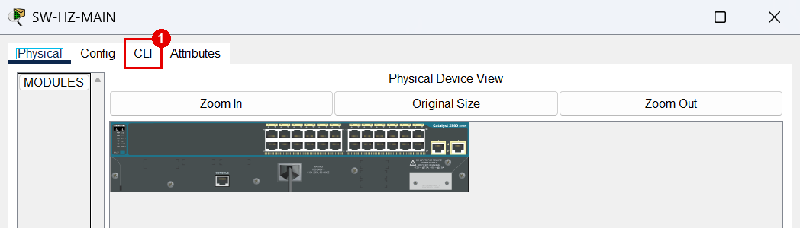

**איך בנויה כל משימה:** ‏🌐 הרשת עכשיו ‏←‏ ❗ הבעיה ‏←‏ 💡 הפתרון ‏←‏ 📋 מבצעים לבד ‏←‏ 🖱 הפתרון המלא: על מה לוחצים, מה כותבים ומה חייבים לראות.

## משימה 1 — השרת
**📖 איך הגענו לכאן.** שלושה סניפים באינטרנט, וכמעט 30 מכשירים עם סיסמה משותפת אחת.

**🌐 הרשת עכשיו.** שלושה סניפים באינטרנט. מתחילים מהשרת של הרצליה:

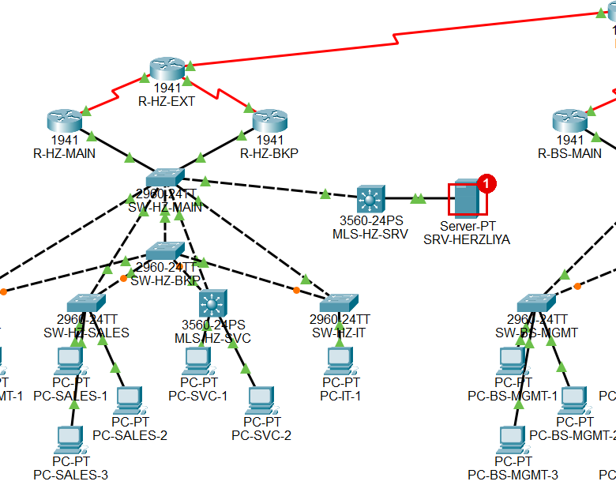

**❗ הבעיה.** כמעט 30 מכשירים עם אותה סיסמה, שכתובה על פתק. עובד עוזב: משנים בכולם. משהו קרה בלילה: כל מכשיר מראה שעה אחרת ושומר לעצמו את ההודעות. שירות ה-AAA ריק וכבוי:

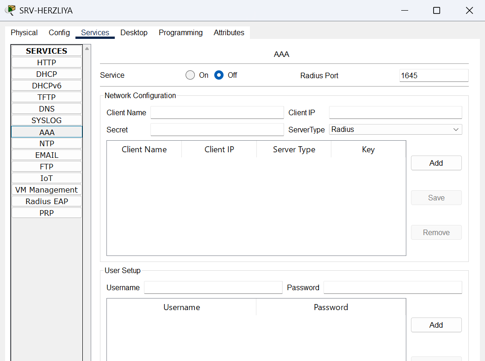

**🎯 מה רוצים עכשיו.** מקום אחד למשתמשים (AAA), שעון אחד נכון (NTP) ויומן אחד (Syslog). המכשירים ישתמשו בהם במשימה 4.

**💡 הפתרון.** שרת אחד שבודק משתמשים (**AAA**), נותן את השעה (**NTP**) ואוסף את ההודעות (**Syslog**). עכשיו מכינים את השרת, ובמשימה 4 מחברים אליו את הנתבים.

**📋 מבצעים בפרויקט.** שני לקוחות AAA (שני הנתבים), משתמש אחד, NTP עם מפתח 1, ו-Syslog דולק.

### 🖱 הפתרון: על מה לוחצים ומה כותבים
לוחצים על **SRV-HERZLIYA** ‏←‏ **Services** (1) ‏←‏ ‏AAA ‏(2), ‏NTP ‏(3), ‏SYSLOG ‏(4):

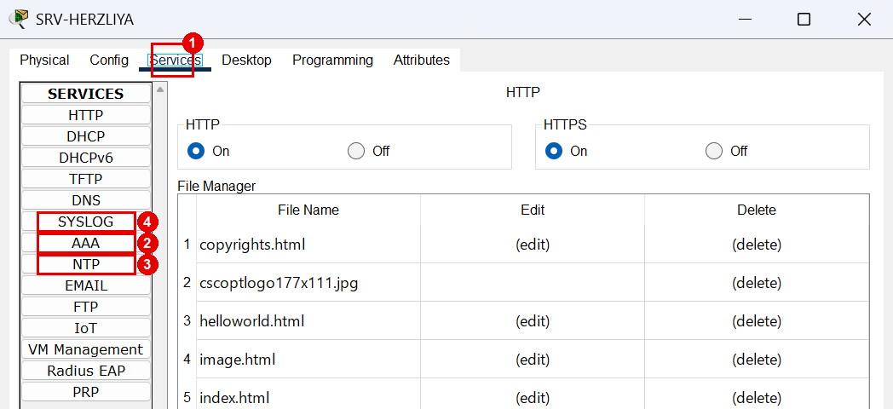

‏**SRV-HERZLIYA** ‏←‏ ‏Services ‏←‏ ‏**AAA** ‏←‏ ‏On (1). ‏Client Name (2), ‏Client IP (3), ‏Secret (4), ‏ServerType ‏←‏ ‏**Tacacs** ‏←‏ ‏**Add** (5):

<div dir="rtl">

| ‎Client Name | ‎Client IP | ‎Secret | ‎Type |
|---|---|---|---|
| ‎R-HZ-MAIN | ‎192.168.52.2 | ‎Tesla#Aaa | ‎Tacacs |
| ‎R-HZ-BKP | ‎192.168.52.3 | ‎Tesla#Aaa | ‎Tacacs |

</div>

למטה: Username (6) ‏`teslauser`, ‏Password ‏`Tesla#User` ‏←‏ ‏**Add** (7).

‏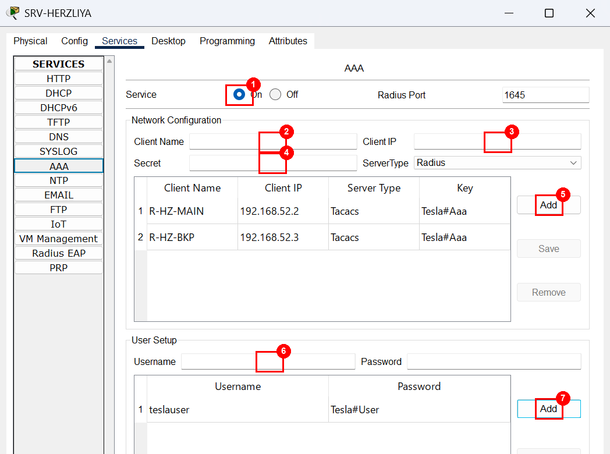

‏**NTP** ‏←‏ ‏Authentication ‏**Enable** (1), ‏Key (2) ‏‎`1`, ‏Password (3) ‏`Tesla#Ntp`. זה מוצג בתור ‎`01`, וזה עובד.

‏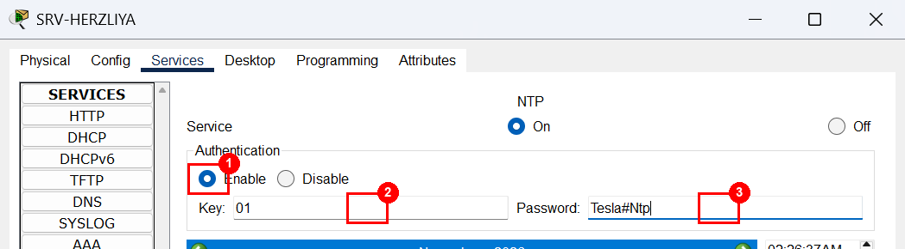

‏**SYSLOG** ‏←‏ בודקים שהוא On.

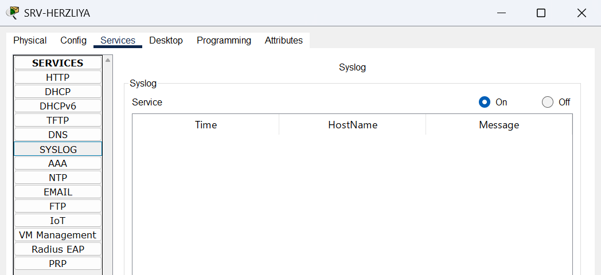

ההודעות של הנתבים מופיעות ברשימה הזו רק אחרי משימה 4.

<div dir="rtl">

| שדה | מה זה | חייב להתאים ל |
|---|---|---|
| ‎Client | הנתב שישאל את השרת | הכתובת שלו לכיוון השרת (VLAN 52) |
| ‎Secret | מפתח בין הנתב לשרת | ‎`tacacs-server host ... key` |
| ‎ServerType | השפה: Tacacs / Radius | `group tacacs+`‎ בנתב |
| ‎Username | מי שמתחבר | רק כאן, לא בנתב |

</div>

**⏭ מה הלאה.** לפני המכשירים, המחלקות: מי מגיע למי?

## משימה 2 — ACL בבאר שבע ובחיפה
**📖 איך הגענו לכאן.** בשיעור 3 פתחנו הכול לכולם, כי רצינו שיעבוד.

**🌐 הרשת עכשיו.** באר שבע: הלוגיסטיקה ב-VLAN 66, ההנהלה ב-VLAN 64, השרת ב-67. חיפה: עמדות הטעינה ב-97, ההנהלה ב-96.

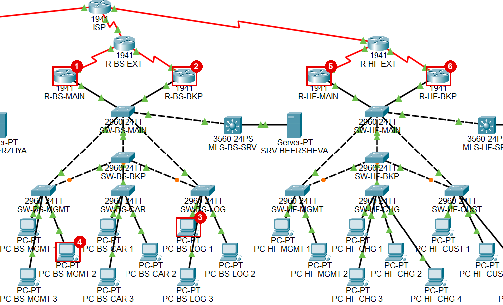

**❗ הבעיה.** בשיעור 3 פתחנו הכול לכולם. מחשב בהלוגיסטיקה יכול לעשות ping למחשב של המנהל ולנסות להיכנס לכל שירות בשרת. נראה את זה בצילום הראשון.

**🎯 מה רוצים עכשיו.** כללים: הלוגיסטיקה מגיעה רק לשירותים שהיא צריכה, ועמדות הטעינה בחיפה לא מגיעות להנהלה.

**💡 הפתרון.** **ACL מורחב**, קרוב למקור: בממשק המשנה של VLAN 66, ב**שני** הנתבים (1.1).

**📋 מבצעים בפרויקט.** לפני שמסתכלים: כותבים במילים, שורה אחר שורה, מה מותר ומה אסור, בסדר הנכון. לא לשכוח איך מחשב מקבל כתובת.

### 🖱 הפתרון: על מה לוחצים ומה כותבים
**המטרה:** הלוגיסטיקה (VLAN 66) לא מגיעה להנהלה (VLAN 64), ומהשרת מקבלת רק web, ‏DNS ו-FTP.

לפני: מ-**PC-BS-LOG-1** בודקים מה הכתובת של PC-BS-MGMT-2 ועושים לו ping. עובד.

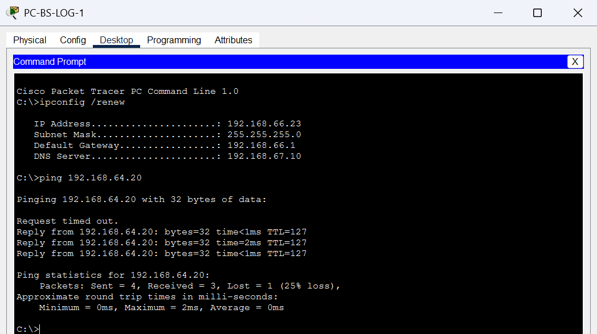

ב-**R-BS-MAIN וגם ב-R-BS-BKP**:
```
configure terminal
access-list 110 permit udp any any eq bootps
access-list 110 deny ip 192.168.66.0 0.0.0.255 192.168.64.0 0.0.0.255
access-list 110 permit tcp 192.168.66.0 0.0.0.255 host 192.168.67.10 eq www
access-list 110 permit udp 192.168.66.0 0.0.0.255 host 192.168.67.10 eq domain
access-list 110 permit tcp 192.168.66.0 0.0.0.255 host 192.168.67.10 eq ftp
access-list 110 deny ip 192.168.66.0 0.0.0.255 192.168.67.0 0.0.0.255
access-list 110 permit ip 192.168.66.0 0.0.0.255 any
interface g0/0.66
ip access-group 110 in
end
```

‏**R-BS-MAIN:**

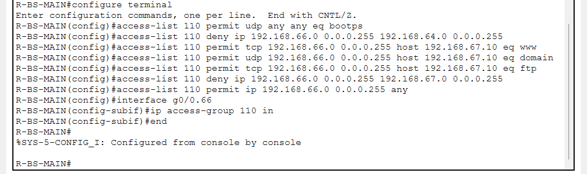

‏**R-BS-BKP, אותן פקודות:**

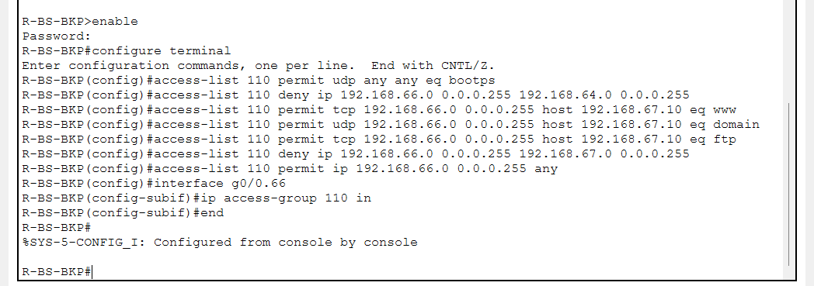

❓ **למה צריך את השורה הראשונה?** למחשב שמבקש DHCP עדיין אין כתובת: הוא שולח מ-0.0.0.0, ואף שורה אחרת לא
מרשה את זה. בדקנו בלעדיה, בשני הנתבים: `ipconfig /renew` נתקע.

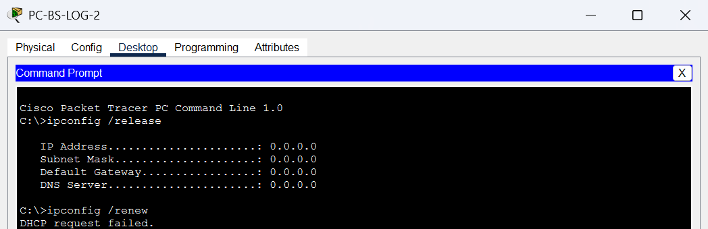

❓ **למה בשני הנתבים?** כל אחד מהם יכול להיות Active. בדקנו גם רק בראשי, בלי שורת bootps: ה-DHCP עדיין עבד, כי **הגיבוי** העביר
את הבקשה. ‏ACL בנתב אחד הוא מלא חורים.

✅ מ-PC-BS-LOG-2: הנהלה — חסום, ping לשרת — חסום, אינטרנט — עובד, web — עובד.


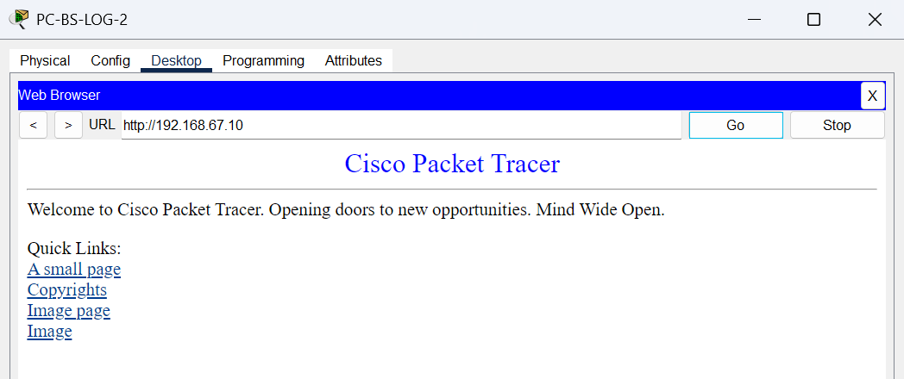

✅ ב-R-BS-MAIN: ‏`show access-lists` ‏←‏ המונים עולים.

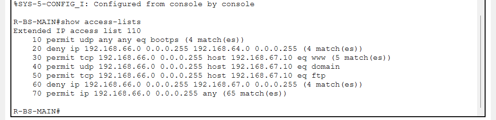

### 2.1 🔎 ה-FTP מתחבר, אבל `dir` נתקע. למה?
מ-**PC-BS-LOG-2**: ‏`ftp 192.168.67.10`, משתמש `beersheva`, סיסמה `Tesla#Ftp`. הכניסה מצליחה. עכשיו `dir`:

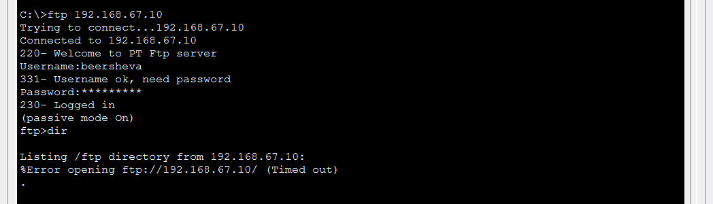

<details dir="rtl"><summary>תשובה</summary>

‏FTP משתמש ב**שני** חיבורים: פקודות בפורט 21, ונתונים בפורט אחר. ב-*passive mode* השרת בוחר פורט גבוה (מעל 1023) לנתונים. פתחנו
רק את 21, ולכן הנתונים נופלים על השורה `deny ip ... 192.168.67.0`.

</details>

התיקון, ב-**R-BS-MAIN וב-R-BS-BKP**. המספר 52 שם את השורה **לפני** ה-deny ‏(60):
```
configure terminal
ip access-list extended 110
52 permit tcp 192.168.66.0 0.0.0.255 host 192.168.67.10 gt 1023
end
copy running-config startup-config
```

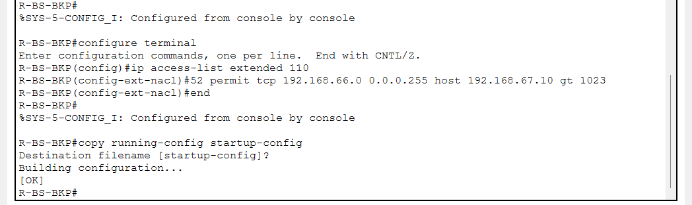

ב-R-BS-MAIN בודקים עם `show access-lists`:

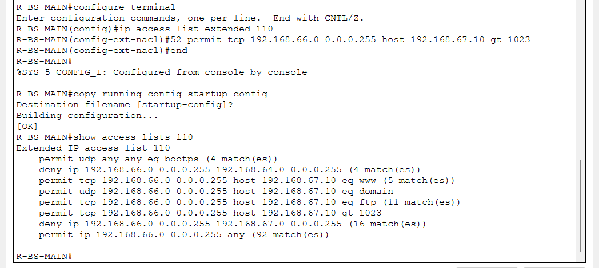

✅ מ-PC-BS-LOG-3 הרשימה מגיעה, ו-ping לשרת עדיין חסום. (יוצאים מ-FTP עם `quit`.)

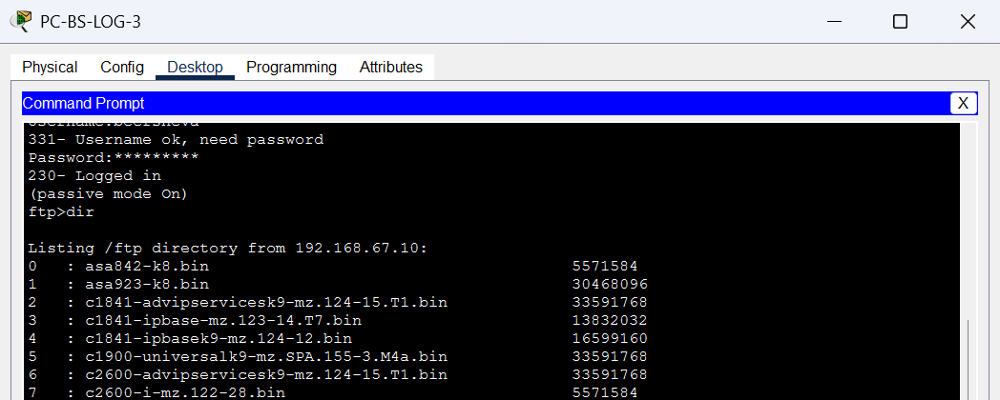

### 2.2 חיפה

❗ אותה בעיה בחיפה: עמדות הטעינה מגיעות להנהלה. 💡 אותו רעיון, שורת deny אחת.

**חיפה** (עמדות הטעינה 97 לא מגיעות להנהלה 96), ב-**R-HF-MAIN וב-R-HF-BKP**:
```
configure terminal
access-list 120 permit udp any any eq bootps
access-list 120 deny ip 192.168.97.0 0.0.0.255 192.168.96.0 0.0.0.255
access-list 120 permit ip 192.168.97.0 0.0.0.255 any
interface g0/0.97
ip access-group 120 in
end
copy running-config startup-config
```

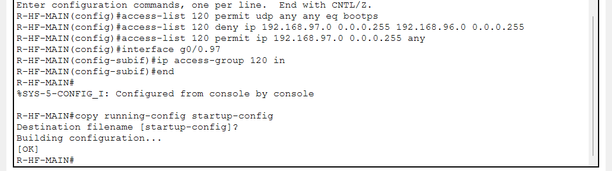


<details dir="rtl" open><summary><b>📘 הסבר הפקודות של המשימה</b></summary>

<div dir="rtl">

| פקודה | מה היא עושה, ולמה היא כאן |
|---|---|
| ‎`access-list 110 permit udp any any eq bootps` | קודם כול מתירים DHCP, אחרת המחשבים ב-VLAN הזה מאבדים את הכתובת. |
| ‎`access-list 110 deny ip 192.168.66.0 0.0.0.255 192.168.64.0 0.0.0.255` | חוסם הכול מהרשת הראשונה לשנייה. |
| ‎`access-list 110 permit tcp 192.168.66.0 0.0.0.255 host 192.168.67.10 eq www` | מתירים את האתר של השרת (TCP 80), ורק מהרשת הזו. |
| ‎`access-list 110 permit udp 192.168.66.0 0.0.0.255 host 192.168.67.10 eq domain` | מתירים שאלות DNS לשרת (UDP 53). |
| ‎`access-list 110 permit tcp 192.168.66.0 0.0.0.255 host 192.168.67.10 eq ftp` | מתירים את חיבור ה**שליטה** של FTP ‏(TCP 21). חיבור הנתונים צריך שורה נוספת. |
| ‎`access-list 110 permit ip 192.168.66.0 0.0.0.255 any` | מתיר את כל השאר. בלי זה ה-`deny` הבלתי נראה בסוף חוסם הכול. |
| ‎`interface g0/0.66` | **ממשק משנה**: דלת וירטואלית על אותו פורט פיזי, אחת לכל VLAN. |
| ‎`ip access-group 110 in` | שם את הרשימה על הפורט; `in` = מה שנכנס לנתב מהרשת הזו. רשימה שלא על פורט לא עושה כלום. |
| ‎`ipconfig /renew` | המחשב מבקש שוב כתובת מ-DHCP. |
| ‎`show access-lists` | שורות הרשימה, וכמה חבילות פגשו כל אחת. |
| ‎`ip access-list extended 110` | פותח רשימה לפי שם או מספר, כדי להוסיף או להכניס שורות. |
| ‎`52 permit tcp 192.168.66.0 0.0.0.255 host 192.168.67.10 gt 1023` | מכניס שורה **בין** שורות קיימות (52 אחרי 50): הפורטים של נתוני FTP, מעל 1023. |
| ‎`copy running-config startup-config` | שומר את מה שבזיכרון לקובץ ההפעלה. בלי זה הפסקת חשמל מוחקת את העבודה. |

</div>

</details>

**⏭ מה הלאה.** בתוך הסניף יש סדר. בין הסניפים המידע שלנו עובר באינטרנט, קריא.

## משימה 3 — VPN הרצליה ↔ חיפה
**📖 איך הגענו לכאן.** הרצליה וחיפה באינטרנט, מאחורי NAT, ולא מגיעות לרשתות הפרטיות זו של זו.

**🌐 הרשת עכשיו.** הרצליה וחיפה, כל אחד מאחורי NAT, והאינטרנט באמצע:

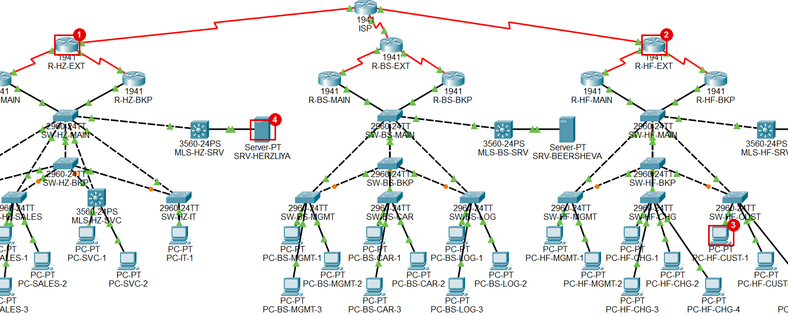

**❗ הבעיה.** עובד בחיפה צריך את השרת בהרצליה. ב-PC-HF-CUST-1 ‏←‏ `ping 192.168.52.10`:

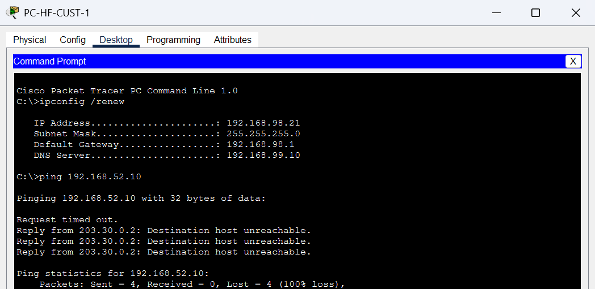

הספק לא מכיר כתובות פרטיות. וגם אם היינו מפרסמים את השרת עם NAT סטטי, הכול היה עובר **בלי הצפנה** וכל אחד היה יכול לנסות להיכנס.

**🎯 מה רוצים עכשיו.** מנהרה מוצפנת דרך האינטרנט, כאילו יש ביניהן כבל פרטי.

**💡 הפתרון.** **IPsec VPN** בין שני אתרים: החבילה הפרטית נוסעת, מוצפנת, בתוך חבילה ציבורית (1.2).

**📋 מבצעים בפרויקט.** רישיון ‏←‏ מנהרה בשני הצדדים ‏←‏ בדיקה ‏←‏ מגלים למה נכשל ‏←‏ מתקנים. שני הצדדים חייבים להיות תמונת מראה.

### 🖱 הפתרון: על מה לוחצים ומה כותבים
### 3.1 הרישיון

❗ הנתב לא מכיר את פקודות `crypto`. 💡 מפעילים את רישיון האבטחה, שומרים ומפעילים מחדש.

ב-R-HZ-EXT מנסים `crypto isakmp policy 10`. ה-1941 לא מכיר את הפקודה:

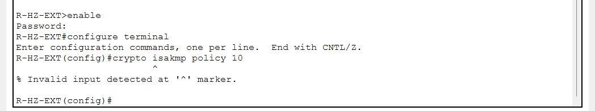

ב-**R-HZ-EXT וב-R-HF-EXT**:
```
configure terminal
license boot module c1900 technology-package securityk9
```
מופיע הסכם הרישיון. ⚠️ **לא הודפס כלום?** זה יכול לקרות ב-Packet Tracer כשהנתב כבר הופעל מחדש קודם. כותבים **שוב את אותה פקודה**, ואז הוא מופיע:

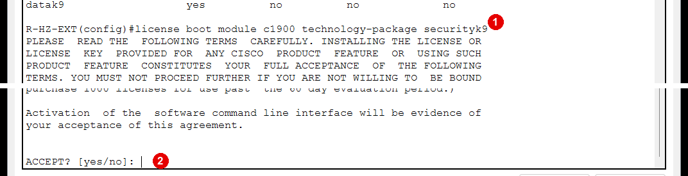

כשמופיע `ACCEPT? [yes/no]:`‎ עונים `yes`. חייבים לראות `Next reboot level = securityk9`. ואז:
```
end
copy running-config startup-config
reload
```

אחרי `yes`, ב-R-HF-EXT:

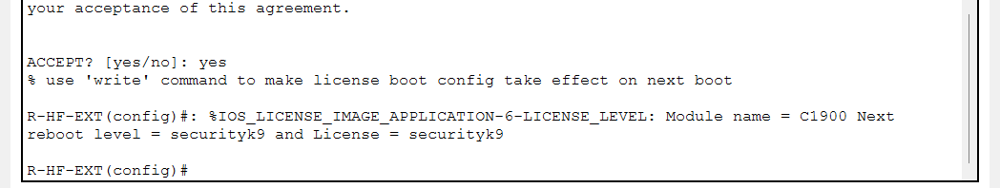

כשמופיע `Proceed with reload? [confirm]`‎ לוחצים **Enter**. הנתב עולה מחדש:

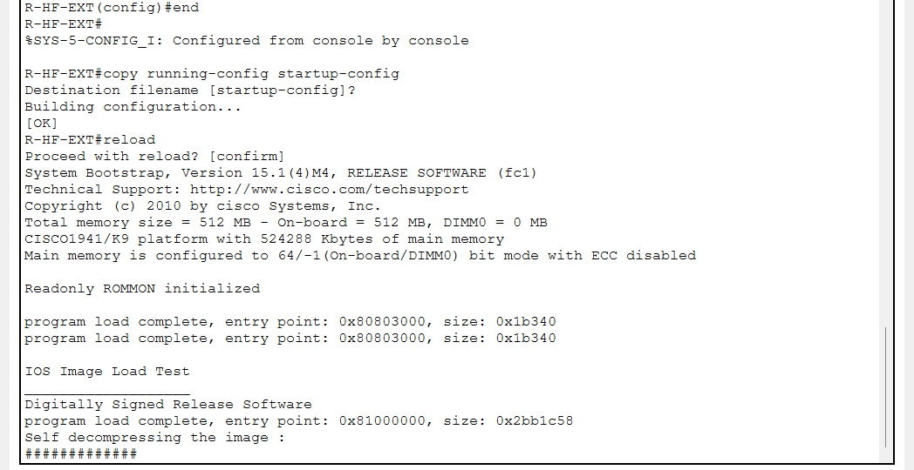

ב-R-HF-EXT אחרי ההפעלה מחדש:

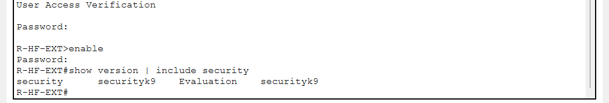

ב-R-HZ-EXT:


אחרי ההפעלה מחדש נכנסים שוב: `show version | include security` ‏←‏ ‏`securityk9`

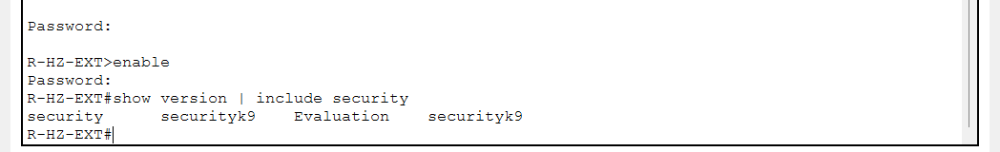

### 3.2 המנהרה

❗ לפני ההצפנה הנתבים חייבים להסכים על שפה ולזהות אחד את השני. 💡 שלב 1 (policy ומפתח), שלב 2 (transform-set), מה נכנס למנהרה (ACL), והכול נקשר ב-crypto map על הפורט היוצא.

**R-HZ-EXT:**
```
configure terminal
crypto isakmp policy 10
encryption aes 256
hash sha
authentication pre-share
group 5
lifetime 86400
exit
crypto isakmp key TeslaVpn2026 address 203.30.0.1
crypto ipsec transform-set VPN-SET esp-aes 256 esp-sha-hmac
ip access-list extended VPN-HZ-HF
permit ip 192.168.0.0 0.0.63.255 192.168.96.0 0.0.3.255
exit
crypto map VPN-MAP 10 ipsec-isakmp
set peer 203.30.0.1
set transform-set VPN-SET
match address VPN-HZ-HF
exit
interface s0/0/1
crypto map VPN-MAP
end
```
‏**R-HF-EXT** (תמונת מראה):
```
configure terminal
crypto isakmp policy 10
encryption aes 256
hash sha
authentication pre-share
group 5
lifetime 86400
exit
crypto isakmp key TeslaVpn2026 address 203.10.0.1
crypto ipsec transform-set VPN-SET esp-aes 256 esp-sha-hmac
ip access-list extended VPN-HF-HZ
permit ip 192.168.96.0 0.0.3.255 192.168.0.0 0.0.63.255
exit
crypto map VPN-MAP 10 ipsec-isakmp
set peer 203.10.0.1
set transform-set VPN-SET
match address VPN-HF-HZ
exit
interface s0/0/0
crypto map VPN-MAP
end
```

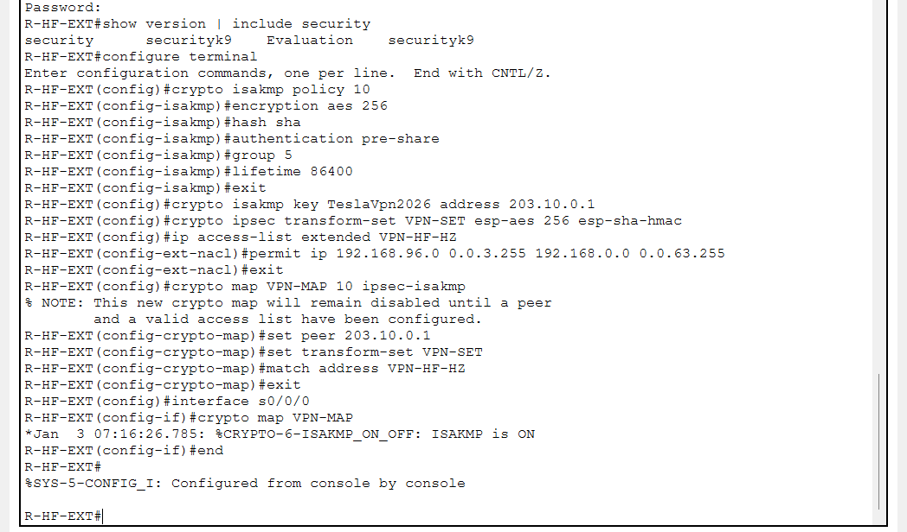

וב-R-HZ-EXT:

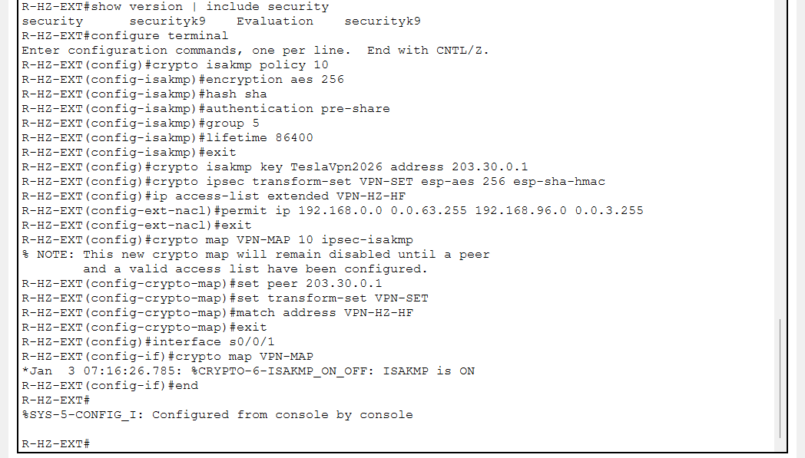

<div dir="rtl">

| פקודה | מה היא עושה |
|---|---|
| ‎`crypto isakmp policy 10` | שלב 1: חייב להיות זהה בשני הצדדים |
| ‎`crypto isakmp key` | אותו מפתח, עם הכתובת של **הצד השני** |
| ‎`transform-set` | איך מצפינים את הנתונים בשלב 2 |
| ‎`match address` | מה נכנס למנהרה; תמונת מראה בצד השני |
| `crypto map` על הממשק | מפעיל, על הפורט **היוצא** |

</div>

⚠️ משתמשים במפתח בלי ‎`#`‎. בבדיקות שלנו מפתח עם ‎`#`‎ לא העלה את המנהרה אף פעם.

### 3.3 🔎 זה לא עובד! למה?
‏**PC-HF-CUST-1** ‏←‏ ‏`ping 192.168.52.10`. התשובה "Destination host unreachable" מגיעה מ**הספק**:

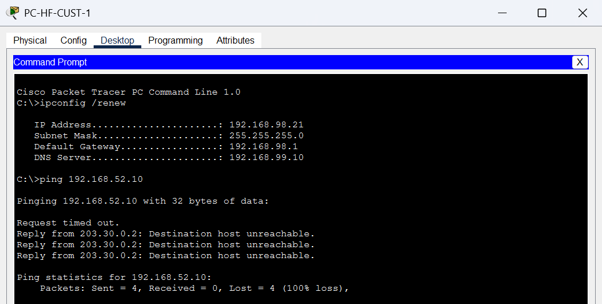

חוקרים ב-R-HF-EXT: ‏`show ip access-lists`, ‏`show crypto isakmp sa`, ‏`show ip nat translations`.

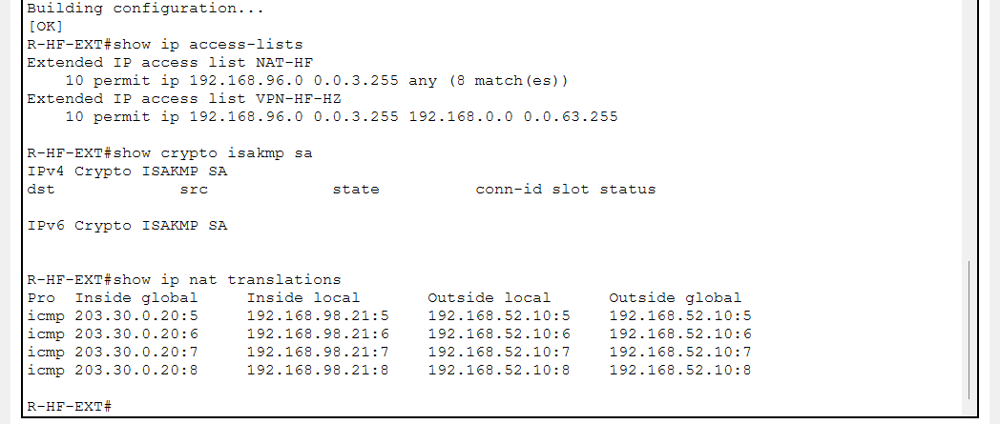

<details dir="rtl"><summary>תשובה</summary>

לרשימת ה-VPN אין התאמות, ולרשימת ה-NAT יש 8. הנתב עושה **NAT לפני ההצפנה**: המקור הפך ל-203.30.0.20, ולכן
החבילה כבר לא מתאימה לרשימת ה-VPN והיא יצאה לאינטרנט, ושם אף אחד לא מכיר את 192.168.52.10. התיקון: אומרים
ל-NAT **לא** לתרגם תנועה לסניף השני. השורה חייבת להיות **לפני** ה-permit, ולכן נותנים לה את המספר 5.

</details>

### 3.4 התיקון
**R-HZ-EXT:**
```
configure terminal
ip access-list extended NAT-HZ
5 deny ip 192.168.0.0 0.0.63.255 192.168.96.0 0.0.3.255
end
clear ip nat translation *
copy running-config startup-config
```
**R-HF-EXT:**
```
configure terminal
ip access-list extended NAT-HF
5 deny ip 192.168.96.0 0.0.3.255 192.168.0.0 0.0.63.255
end
clear ip nat translation *
copy running-config startup-config
```

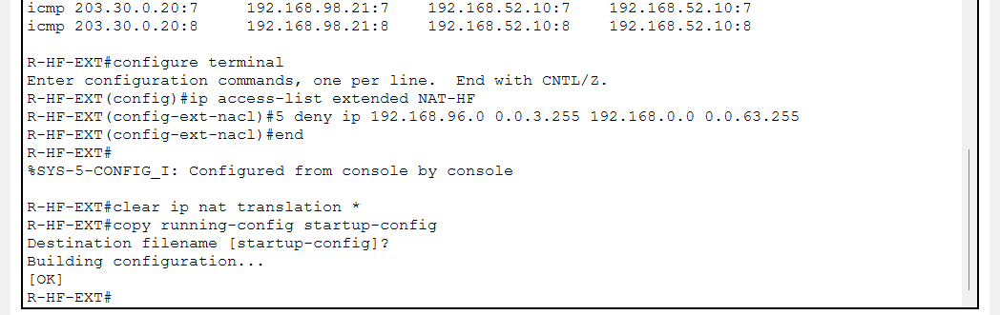

וב-R-HZ-EXT:

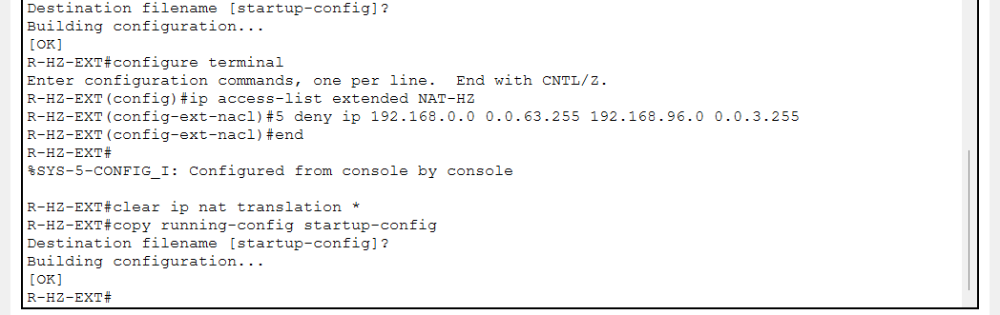

✅ שוב ping, **רק מחיפה**. התשובה הראשונה יכולה ללכת לאיבוד בזמן שהמנהרה עולה.

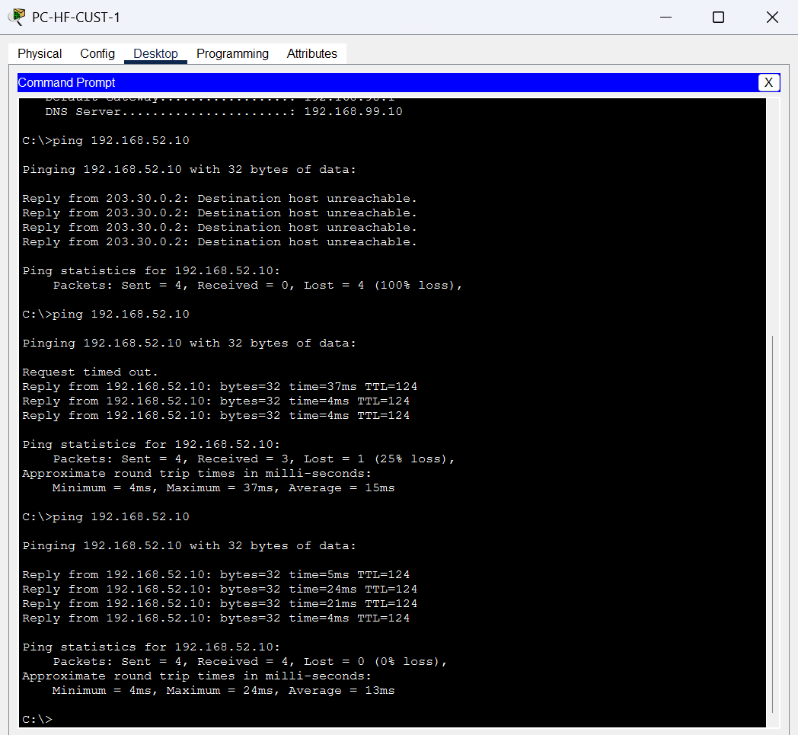

✅ ב-R-HF-EXT: ‏`show crypto isakmp sa` ‏←‏ ‏**QM_IDLE**, וב-`show crypto ipsec sa` ‏←‏ ‏encaps ו-decaps עולים.

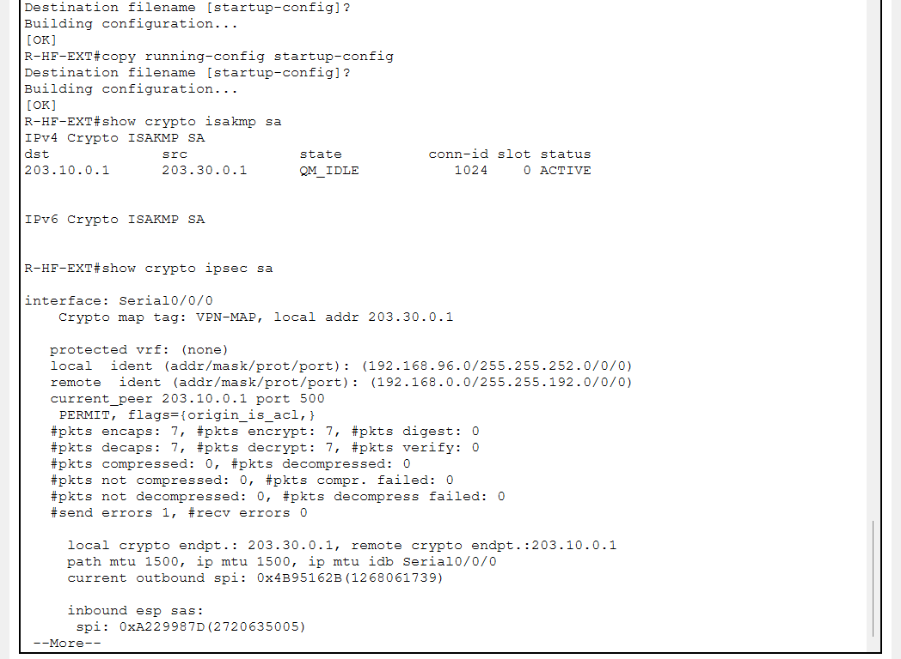

💡 נתקע? מפעילים את המנהרה מחדש: בפורט היוצא של **שני** נתבי הקצה `no crypto map VPN-MAP` ואז `crypto map VPN-MAP`, ו-ping
מצד אחד בלבד. (בנתבים אמיתיים יש גם `clear crypto isakmp`. ב-Packet Tracer אין.)

<details dir="rtl" open><summary><b>📘 הסבר שאר הפקודות של המשימה</b></summary>

<div dir="rtl">

| פקודה | מה היא עושה, ולמה היא כאן |
|---|---|
| ‎`ping 192.168.52.10` | שולח 4 הודעות בדיקה. תשובות = הדרך עובדת ב**שני** הכיוונים. |
| ‎`license boot module c1900 technology-package securityk9` | מפעיל את חבילת האבטחה של ה-1941. בלעדיה אין פקודות `crypto`. |
| ‎`copy running-config startup-config` | שומר את מה שבזיכרון לקובץ ההפעלה. בלי זה הפסקת חשמל מוחקת את העבודה. |
| ‎`reload` | מפעיל את הנתב מחדש. רק אז הרישיון נכנס לתוקף. |
| ‎`show version \| include security` | פרטי המכשיר. החלק שאחרי הקו מראה רק שורות עם "security". |
| ‎`encryption aes 256` | ההצפנה של שלב 1: AES עם מפתח של 256 ביט. |
| ‎`hash sha` | ‏SHA בודק שאף אחד לא שינה את ההודעה בדרך. |
| ‎`authentication pre-share` | הנתבים מזדהים עם מפתח משותף (כתוב למטה). |
| ‎`group 5` | קבוצת Diffie-Hellman: איך הנתבים מסכימים על סוד מעל קו פתוח. |
| ‎`lifetime 86400` | אחרי כמה שניות מחליפים מפתחות (86400 = יממה). |
| ‎`crypto ipsec transform-set VPN-SET esp-aes 256 esp-sha-hmac` | שלב 2: איך הנתונים עצמם מוצפנים (AES 256) ונבדקים (SHA). |
| ‎`ip access-list extended VPN-HZ-HF` | פותח רשימה לפי שם או מספר, כדי להוסיף או להכניס שורות. |
| ‎`permit ip 192.168.0.0 0.0.63.255 192.168.96.0 0.0.3.255` | התעבורה שנכנסת למנהרה: מהרשתות שלנו לשלהם. הצד השני כותב תמונת ראי. |
| ‎`crypto map VPN-MAP 10 ipsec-isakmp` | יוצר את המפה שמחברת הכול: מי, איך ומה. |
| ‎`set peer 203.30.0.1` | מי: הכתובת הציבורית של הצד השני. |
| ‎`set transform-set VPN-SET` | איך: באיזו הצפנה. |
| ‎`interface s0/0/1` | בוחרים פורט. כל מה שמתחת חל עליו, עד `exit`. |
| ‎`show ip access-lists` | שורות הרשימה, וכמה חבילות פגשו כל אחת. |
| ‎`show crypto isakmp sa` | שלב 1. `QM_IDLE` = תקין. |
| ‎`show ip nat translations` | מי תורגם לאיזו כתובת. |
| ‎`5 deny ip 192.168.0.0 0.0.63.255 192.168.96.0 0.0.3.255` | מכניס שורה **בהתחלה** (5 לפני 10): תעבורה למנהרה לא עוברת NAT. |
| ‎`clear ip nat translation *`‎ | מוחק תרגומים ישנים, כדי שהכלל החדש יעבוד מיד. |
| ‎`show crypto ipsec sa` | שלב 2. המונים `encaps` ו-`decaps` חייבים לגדול. |
| ‎`no crypto map VPN-MAP` | מוריד את המפה מהפורט: המנהרה נכבית. |
| ‎`clear crypto isakmp` | מוחק את המנהרה הישנה, כדי שתיבנה מחדש. |

</div>

</details>

**⏭ מה הלאה.** המידע בטוח. את הנתבים שמעבירים אותו עדיין אי אפשר לנהל בבטחה.

## משימה 4 — SSH, ‏AAA, ‏NTP ו-Syslog
**📖 איך הגענו לכאן.** השרת מכיר את המשתמשים ממשימה 1, והמכשירים עדיין לא שואלים אותו.

**🌐 הרשת עכשיו.** השרת מוכן ממשימה 1. עכשיו המכשירים לומדים להשתמש בו:

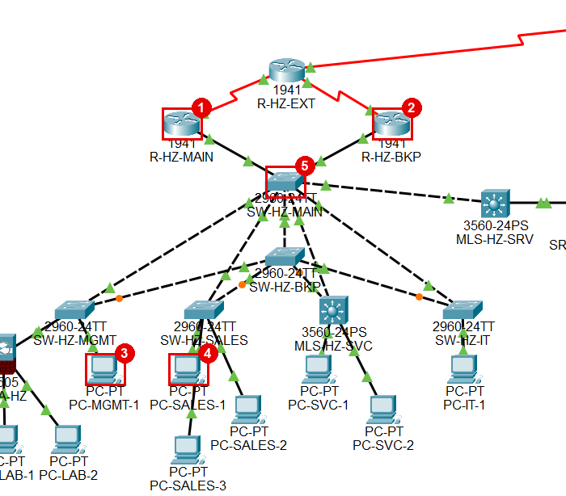

**❗ הבעיה.** ב-PC-MGMT-1 ‏←‏ `telnet 192.168.12.2`. הנתב פותח את הקו וסוגר אותו: אין בכלל ניהול מרחוק. ואם רק נוסיף סיסמה, Telnet ישלח אותה **בלי הצפנה**:

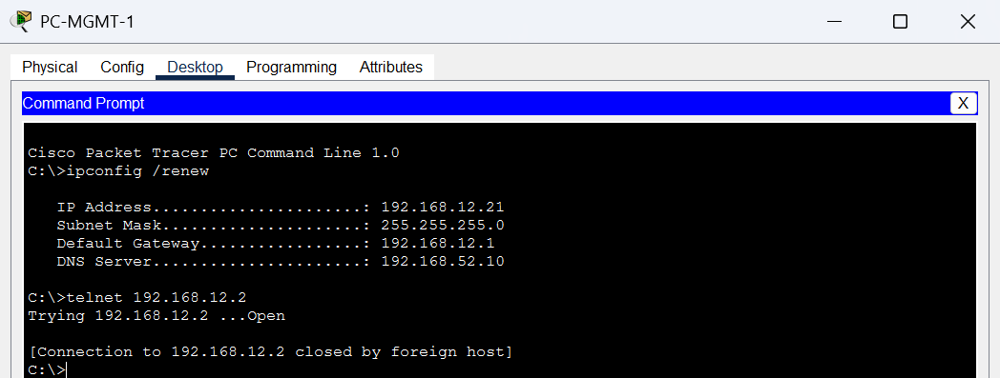

ב-R-HZ-MAIN, ‏`show clock`: השנה היא 1993, ו-NTP כבוי. יומן כזה לא מוכיח כלום:

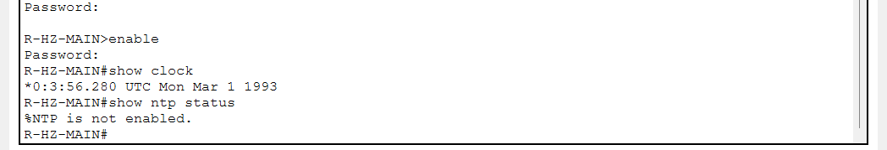

**🎯 מה רוצים עכשיו.** ניהול מוצפן (SSH), שם אישי לכל כניסה (AAA), שעה אחת (NTP), יומן אחד (Syslog).

**💡 הפתרון.** SSH (מוצפן), AAA (המשתמש נבדק בשרת, ויש משתמש מקומי לגיבוי), NTP עם מפתח, Syslog, ו-access-class כדי שרק ההנהלה תיכנס (1.3, 1.4).

**📋 מבצעים בפרויקט.** הסדר חשוב: קודם משתמש מקומי, ורק אחר כך `aaa new-model`. למה?

### 🖱 הפתרון: על מה לוחצים ומה כותבים
### 4.1 ב-R-HZ-MAIN, ואותו דבר ב-R-HZ-BKP
```
configure terminal
ip domain-name tesla.lab
username admin privilege 15 secret Tesla#Adm1
crypto key generate rsa general-keys modulus 1024
ip ssh version 2
aaa new-model
tacacs-server host 192.168.52.10 key Tesla#Aaa
aaa authentication login default group tacacs+ local
aaa authorization exec default group tacacs+ local
aaa authentication login CONSOLE local
line console 0
login authentication CONSOLE
exit
access-list 12 permit 192.168.12.0 0.0.0.255
line vty 0 4
transport input ssh
login authentication default
access-class 12 in
exit
ntp authentication-key 1 md5 Tesla#Ntp
ntp authenticate
ntp trusted-key 1
ntp server 192.168.52.10 key 1
ntp update-calendar
logging host 192.168.52.10
service timestamps log datetime msec
end
copy running-config startup-config
```

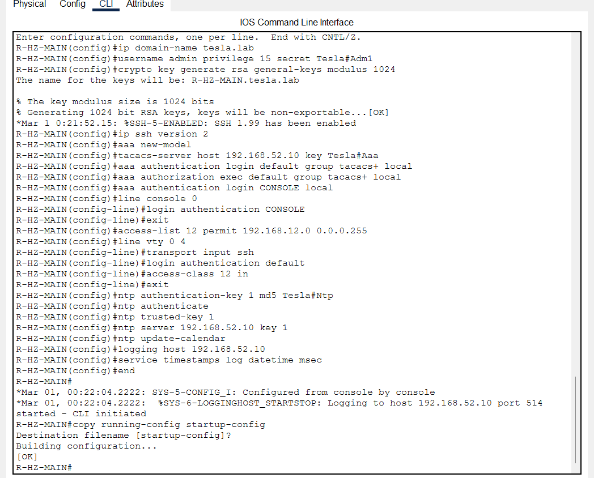

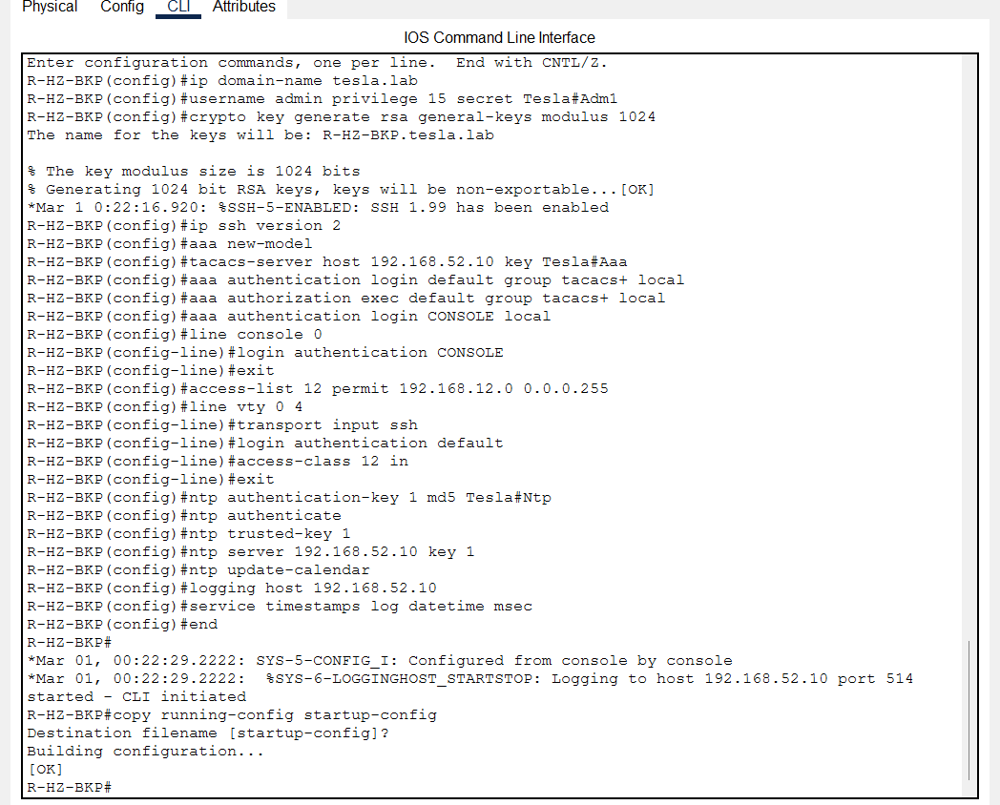

<div dir="rtl">

| פקודה | מה היא עושה | למה |
|---|---|---|
| `username admin` **לפני** `aaa new-model` | משתמש מקומי | אחרת נועלים את עצמכם בחוץ |
| ‎`crypto key generate rsa ... 1024` | מפתחות ל-SSH | בלעדיהם אין SSH 2 |
| ‎`group tacacs+ local` | קודם השרת, ואם הוא לא עונה — המשתמש המקומי | כדי לא להיתקע |
| ‎`CONSOLE local` | הקונסול עובד עם המשתמש המקומי | עם הכבל תמיד נכנסים |
| ‎`access-class 12 in` | רק VLAN 12 מנהל | ‏ACL סטנדרטי קרוב ליעד |
| `ntp trusted-key` ו-`key 1` | מקבל שעה רק משרת חתום | |

</div>

⚠️ מעכשיו **הקונסול מבקש שם משתמש**: ‏`admin` / ‏`Tesla#Adm1`.

### 4.2 בדיקה
1. ‏**PC-MGMT-1**: ‏`ssh -l teslauser 192.168.12.2`, סיסמה `Tesla#User`, ואז `show users`. המשתמש קיים **רק בשרת**, כלומר AAA עובד.

   ‏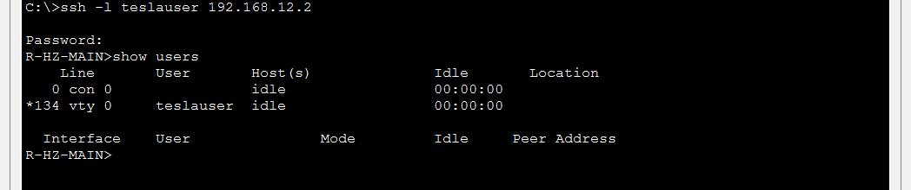
2. ‏`exit`, ואז `telnet 192.168.12.2` ‏←‏ נסגר.

   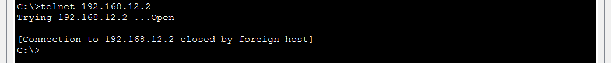
3. ‏**PC-SALES-1**: ‏`ssh -l teslauser 192.168.22.2` ‏←‏ ‏**refused** ‏(access-class).

   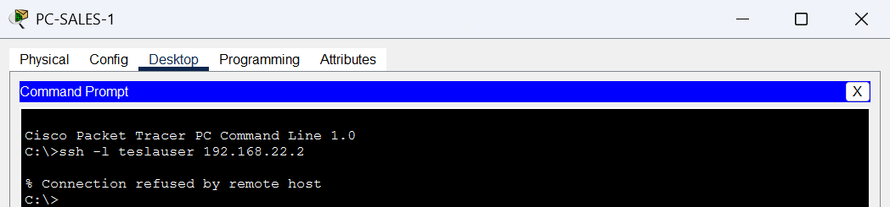
4. ב-R-HZ-MAIN: ‏`show ntp status` ‏←‏ ‏**synchronized** (יכול לקחת כמה דקות).

   ‏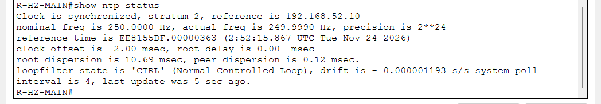
5. ב-R-HZ-MAIN: ‏`interface g0/1` ‏←‏ ‏`no shutdown` ‏←‏ ‏`shutdown`. בשרת ‏←‏ ‏SYSLOG: ההודעות הגיעו. שימו לב לקפיצה של התאריך מ-1993 להיום: NTP!

   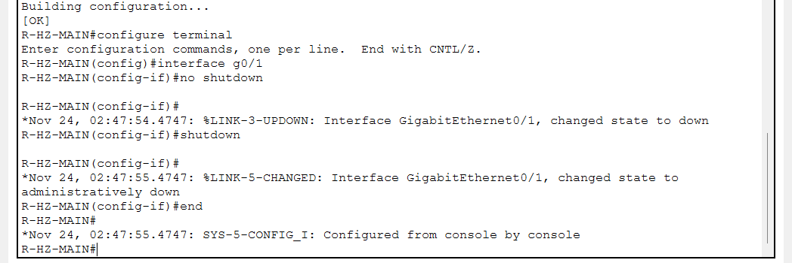

   ‏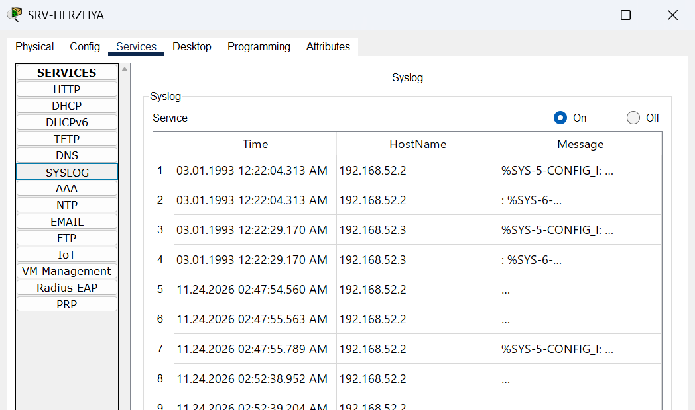

### 4.3 באר שבע וחיפה

❗ אותה בעיה בעוד שני סניפים. 💡 אותן פקודות, וכל סניף עם השרת **שלו**.

באר שבע משתמשת ב-**RADIUS**, חיפה ב-**TACACS+‎**. הסוג חייב להיות זהה בנתב ובשרת!

<details dir="rtl"><summary>R-BS-MAIN, R-BS-BKP (מדביקים אותו דבר בשניהם)</summary>

<div dir="ltr">

```
configure terminal
ip domain-name tesla.lab
username admin privilege 15 secret Tesla#Adm1
crypto key generate rsa general-keys modulus 1024
ip ssh version 2
aaa new-model
radius-server host 192.168.67.10 key Tesla#Aaa
aaa authentication login default group radius local
aaa authorization exec default group radius local
aaa authentication login CONSOLE local
line console 0
login authentication CONSOLE
exit
line vty 0 4
transport input ssh
login authentication default
exit
ntp authentication-key 2 md5 Tesla#Ntp
ntp authenticate
ntp trusted-key 2
ntp server 192.168.67.10 key 2
ntp update-calendar
logging host 192.168.67.10
service timestamps log datetime msec
end
copy running-config startup-config
```


</div>

</details>

<details dir="rtl"><summary>R-HF-MAIN, R-HF-BKP (מדביקים אותו דבר בשניהם)</summary>

<div dir="ltr">

```
configure terminal
ip domain-name tesla.lab
username admin privilege 15 secret Tesla#Adm1
crypto key generate rsa general-keys modulus 1024
ip ssh version 2
aaa new-model
tacacs-server host 192.168.99.10 key Tesla#Aaa
aaa authentication login default group tacacs+ local
aaa authorization exec default group tacacs+ local
aaa authentication login CONSOLE local
line console 0
login authentication CONSOLE
exit
line vty 0 4
transport input ssh
login authentication default
exit
ntp authentication-key 3 md5 Tesla#Ntp
ntp authenticate
ntp trusted-key 3
ntp server 192.168.99.10 key 3
ntp update-calendar
logging host 192.168.99.10
service timestamps log datetime msec
end
copy running-config startup-config
```

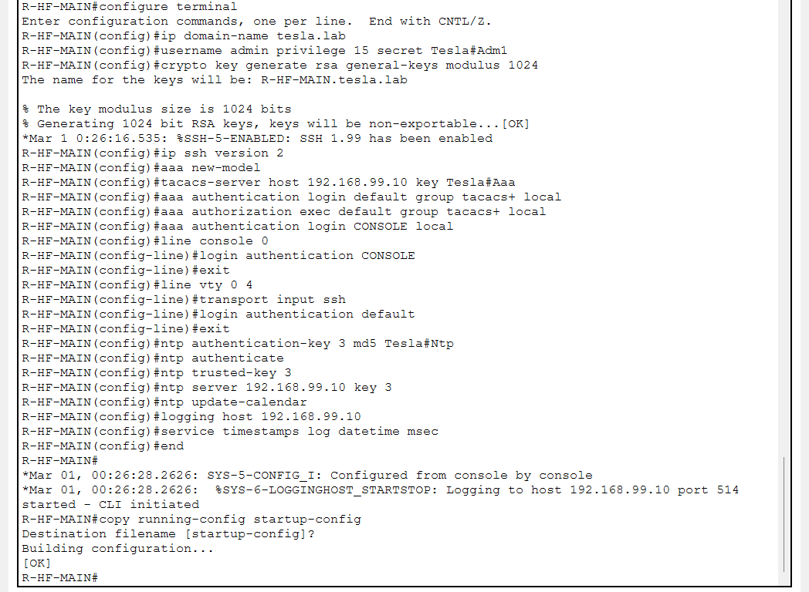


</div>

</details>

### 4.4 מתגים ונתבי קצה

❗ למתג שכבה 2 אין כתובת IP, ולכן אי אפשר לנהל אותו מרחוק. 💡 כתובת על ממשק VLAN, שער, ו-SSH עם המשתמש המקומי.

המכשירים:

<div dir="rtl">

| סוג | מכשירים | שורת ה-vty |
|---|---|---|
| נתבים | ‎ISP, R-HZ-EXT, R-BS-EXT, R-HF-EXT | ‎`line vty 0 4` |
| מתגים, הרצליה | ‎SW-HZ-MAIN, SW-HZ-BKP, SW-HZ-MGMT, SW-HZ-SALES, SW-HZ-IT, MLS-HZ-SVC, MLS-HZ-SRV | ‎`line vty 0 15` |
| מתגים, באר שבע | ‎SW-BS-MAIN, SW-BS-BKP, SW-BS-MGMT, SW-BS-CAR, SW-BS-LOG, MLS-BS-SRV | ‎`line vty 0 15` |
| מתגים, חיפה | ‎SW-HF-MAIN, SW-HF-BKP, SW-HF-MGMT, SW-HF-CHG, SW-HF-CUST, MLS-HF-SRV | ‎`line vty 0 15` |

</div>

**כל אחד מארבעת הנתבים:**
```
configure terminal
ip domain-name tesla.lab
username admin privilege 15 secret Tesla#Adm1
crypto key generate rsa general-keys modulus 1024
ip ssh version 2
line vty 0 4
transport input ssh
login local
end
copy running-config startup-config
```

**כל אחד מ-19 המתגים:**
```
configure terminal
ip domain-name tesla.lab
username admin privilege 15 secret Tesla#Adm1
crypto key generate rsa general-keys modulus 1024
ip ssh version 2
line vty 0 15
transport input ssh
login local
end
copy running-config startup-config
```

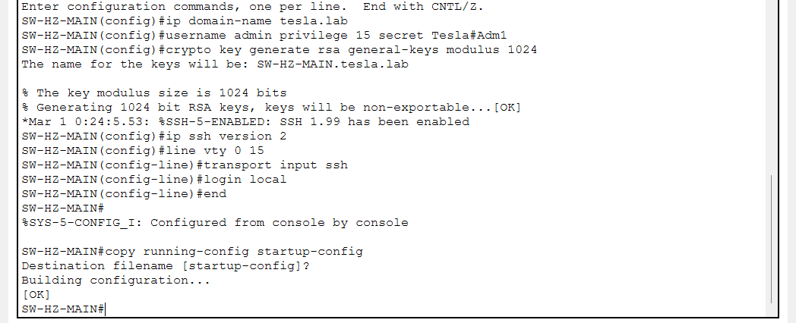

כתובת ניהול לשלושת המתגים הראשיים:

**SW-HZ-MAIN:**
```
configure terminal
interface vlan 12
ip address 192.168.12.240 255.255.255.0
no shutdown
exit
ip default-gateway 192.168.12.1
end
copy running-config startup-config
```

**SW-BS-MAIN:**
```
configure terminal
interface vlan 64
ip address 192.168.64.240 255.255.255.0
no shutdown
exit
ip default-gateway 192.168.64.1
end
copy running-config startup-config
```

**SW-HF-MAIN:**
```
configure terminal
interface vlan 96
ip address 192.168.96.240 255.255.255.0
no shutdown
exit
ip default-gateway 192.168.96.1
end
copy running-config startup-config
```
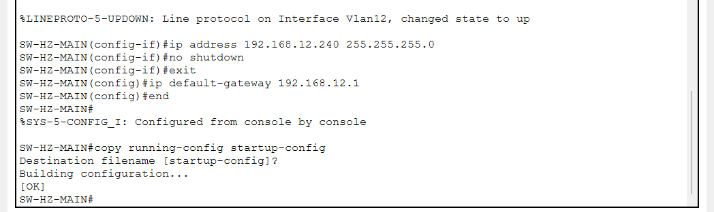

✅ ‏`ssh -l admin 192.168.12.240`

‏

<details dir="rtl" open><summary><b>📘 הסבר שאר הפקודות של המשימה</b></summary>

<div dir="rtl">

| פקודה | מה היא עושה, ולמה היא כאן |
|---|---|
| ‎`telnet 192.168.12.2` | ניהול מרחוק **בלי** הצפנה. כאן זה חייב להיכשל. |
| ‎`show clock` | השעה של המכשיר. ‎`*`‎ בהתחלה = לא מסונכרנת. |
| ‎`ip domain-name tesla.lab` | שם דומיין. SSH צריך אותו כדי לבנות את שם המפתח. |
| ‎`ip ssh version 2` | מתיר רק גרסה 2, המאובטחת. |
| ‎`tacacs-server host 192.168.52.10 key Tesla#Aaa` | כתובת שרת ה-TACACS+, והמפתח המשותף איתו. |
| ‎`aaa authentication login default group tacacs+ local` | **מי אתה?** קודם שואלים את השרת; אם הוא לא עונה, המשתמש המקומי. |
| ‎`aaa authorization exec default group tacacs+ local` | **מה מותר לך?** השרת מחליט על ההרשאות אחרי הכניסה. |
| ‎`aaa authentication login CONSOLE local` | רשימה נוספת, רק לקונסול: משתמש מקומי, כדי שלעולם לא תינעלו בחוץ. |
| ‎`line console 0` | נכנסים להגדרות של פורט הקונסול (הכבל הכחול / לשונית CLI). |
| ‎`login authentication CONSOLE` | הקו הזה משתמש ברשימה ששמה CONSOLE. |
| ‎`access-list 12 permit 192.168.12.0 0.0.0.255` | רשימה סטנדרטית (רק מקור): VLAN 12, ההנהלה. |
| ‎`line vty 0 4` | נכנסים להגדרות של הקווים **מרחוק**. ‎`0 4` = חמישה חיבורים ביחד, ‎`0 15` = שישה עשר. |
| ‎`transport input ssh` | מרחוק נכנסים רק ב-SSH. ‏Telnet (הקריא) סגור. |
| ‎`login authentication default` | הקו הזה משתמש ברשימת ברירת המחדל: קודם השרת, אחר כך המשתמש המקומי. |
| ‎`ntp authentication-key 1 md5 Tesla#Ntp` | המפתח שבו שרת הזמן חותם (מספר וטקסט). |
| ‎`ntp authenticate` | דורש חתימה: לא מאמינים לכל אחד לגבי השעה. |
| ‎`ntp server 192.168.52.10 key 1` | ממי לוקחים את השעה, ועם איזה מפתח. |
| ‎`ntp update-calendar` | מעדכן גם את שעון החומרה, כדי שהשעה תישמר אחרי אתחול. |
| ‎`logging host 192.168.52.10` | שולח את ההודעות של המכשיר לשרת ה-Syslog הזה. |
| ‎`service timestamps log datetime msec` | מוסיף תאריך, שעה ואלפיות שנייה לכל הודעה. |
| ‎`copy running-config startup-config` | שומר את מה שבזיכרון לקובץ ההפעלה. בלי זה הפסקת חשמל מוחקת את העבודה. |
| ‎`ssh -l teslauser 192.168.12.2` | ניהול מרחוק מוצפן: ‎`-l` ושם המשתמש, ואז כתובת המכשיר. |
| ‎`show users` | מי מחובר עכשיו, ומאיפה. |
| ‎`show ntp status` | האם השעון מסונכרן עם השרת. |
| ‎`interface g0/1` | בוחרים פורט. כל מה שמתחת חל עליו, עד `exit`. |
| ‎`no shutdown` | מדליק את הפורט. פורטים של נתב כבויים כברירת מחדל. |
| ‎`shutdown` | מכבה את הפורט. |
| ‎`radius-server host 192.168.67.10 key Tesla#Aaa` | כתובת שרת ה-RADIUS, והמפתח המשותף איתו. |
| ‎`login local` | הקו מבקש **משתמש וסיסמה** מהרשימה שבתוך המכשיר. |
| ‎`interface vlan 12` | ממשק וירטואלי של ה-VLAN: הכתובת **של המכשיר עצמו** ב-VLAN הזה (לניהול, או צד ב-ASA). |
| ‎`ip address 192.168.12.240 255.255.255.0` | הכתובת והמסכה של הממשק. ברשת מקומית זו כתובת השער. |
| ‎`ip default-gateway 192.168.12.1` | השער **של המתג עצמו**, כדי שהתשובות שלו יצאו מה-VLAN. |

</div>

</details>

**⏭ מה הלאה.** נשארה פינה אחת: מעבדת הבדיקות, בלי שום הגנה.

## משימה 5 — חומת האש ASA
**📖 איך הגענו לכאן.** ‏ACL בודק כל חבילה לבד. המעבדה צריכה משהו חכם יותר.

**🌐 הרשת עכשיו.** מעבדת בדיקות (PC-LAB-1, ‏PC-LAB-2) מאחורי חומת אש שעדיין לא הוגדרה:


**❗ הבעיה.** המעבדה צריכה להגיע לשרת, אבל אף אחד לא צריך להגיע **אל** המעבדה. ב-PC-LAB-1 ‏←‏ `ipconfig`, ‏`ping 192.168.52.10`: אין כתובת ואין רשת.


נתב מעביר כל מה שלא נאסר, ולכן ב-ACL לבד צריך לרשום כל סכנה.

**🎯 מה רוצים עכשיו.** חומת אש שזוכרת שיחות: המעבדה יוצאת ומקבלת תשובות, ואף אחד לא נכנס.

**💡 הפתרון.** חומת אש עובדת הפוך: מבחוץ **הכול** אסור, אלא אם זו תשובה למישהו מבפנים (רמות אבטחה ו-`inspect`, ‏1.4).

**📋 מבצעים בפרויקט.** inside = 100, outside = 0, נתיב ברירת מחדל ל-VIP, ‏NAT, ‏DHCP למעבדה, ו-inspect ל-icmp, http, dns. נחשו מי יכול לעשות ping למי.

### 🖱 הפתרון: על מה לוחצים ומה כותבים
לוחצים על **ASA-HZ** ‏←‏ **CLI** ‏←‏ `enable` ‏←‏ **Enter** (אין סיסמה):

⚠️ אם פתחתם את הלשונית **Config** של ה-ASA, אולי כבר רואים `ciscoasa#`‎ או `ciscoasa(config)#`‎. אז לא כותבים שוב `enable`. מתוך ‎`(config)#`‎ כותבים קודם `end`.


‏**ASA-HZ** ‏←‏ ‏CLI. כותבים `enable`, ובסיסמה לוחצים רק **Enter**:
```
configure terminal
hostname ASA-HZ
interface Ethernet0/0
switchport access vlan 2
interface Ethernet0/1
switchport access vlan 1
interface Ethernet0/2
switchport access vlan 1
interface Vlan1
nameif inside
security-level 100
ip address 192.168.1.1 255.255.255.0
interface Vlan2
nameif outside
security-level 0
no ip address
ip address 192.168.12.15 255.255.255.0
exit
route outside 0.0.0.0 0.0.0.0 192.168.12.1
object network INSIDE-NET
subnet 192.168.1.0 255.255.255.0
nat (inside,outside) dynamic interface
end
```


```
configure terminal
no dhcpd auto_config outside
dhcpd address 192.168.1.10-192.168.1.30 inside
dhcpd dns 192.168.52.10
dhcpd enable inside
class-map inspection_default
match default-inspection-traffic
exit
policy-map global_policy
class inspection_default
inspect icmp
inspect http
inspect dns
exit
service-policy global_policy global
end
write memory
```


⚠️ ב-Packet Tracer הפקודה `exit` מתוך `object network` קופצת ישר ל-‎`#`‎, לכן כאן כותבים `end` ופותחים שוב `configure terminal`.

✅ ‏`show switch vlan` ו-`show interface ip brief`

‏

‏✅ **PC-LAB-1** ‏←‏ ‏IP Configuration ‏←‏ ‏**DHCP** (1): ‏192.168.1.10 מה-ASA. (ב-Packet Tracer ה-DNS יכול להישאר 0.0.0.0, לכן בודקים עם כתובות.) אחר כך `ping 192.168.52.10` עובד:


✅ גולשים מ-PC-LAB-1 ל-`http://192.168.52.10`, ותוך 30 שניות ב-ASA: ‏`show xlate`


✅ **מבחוץ פנימה.** ‏PC-MGMT-1 ‏←‏ ‏`ping 192.168.1.10` נכשל. בהתחלה כי הנתב לא מכיר את הרשת ("unreachable" מהספק).
כדי שרק ה-ASA יחליט, מוסיפים **לצורך הבדיקה** ב-R-HZ-MAIN את `ip route 192.168.1.0 255.255.255.0 192.168.12.15` ועושים שוב ping:
‏**timed out**, ה-ASA חסם. אחר כך מוחקים עם `no ip route ...`‎.


<div dir="rtl">

| פקודה | מה היא עושה | למה |
|---|---|---|
| ‎`nameif inside` / `outside` | נותנת לפורט תפקיד | ה-ASA עובד עם שמות, לא עם מספרים |
| ‎`security-level 100` / ‎`0` | כמה אנחנו סומכים על הצד הזה | מגבוה לנמוך מותר |
| ‎`route outside 0.0.0.0 0.0.0.0 192.168.12.1` | נתיב ברירת מחדל | אחד בלבד, ל-VIP של HSRP |
| `object network` ו-`nat ... dynamic interface` | ‏PAT דרך הפורט החיצוני | הסניף לא מכיר את 192.168.1.0 |
| ‎`dhcpd address ... inside` | ה-ASA הוא שרת DHCP | למחשבי המעבדה |
| ‎`inspect icmp` | זוכר pings שיצאו | אחרת התשובות נחסמות |

</div>

<details dir="rtl" open><summary><b>📘 הסבר שאר הפקודות של המשימה</b></summary>

<div dir="rtl">

| פקודה | מה היא עושה, ולמה היא כאן |
|---|---|
| ‎`ipconfig` | מראה את הכתובת, המסכה והשער של המחשב. |
| ‎`ping 192.168.52.10` | שולח 4 הודעות בדיקה. תשובות = הדרך עובדת ב**שני** הכיוונים. |
| ‎`hostname ASA-HZ` | נותן למכשיר שם, זה שרואים בשורת הפקודה. כך לא כותבים במכשיר הלא נכון. |
| ‎`interface Ethernet0/0` | בוחרים פורט. כל מה שמתחת חל עליו, עד `exit`. |
| ‎`switchport access vlan 2` | לאיזה VLAN הפורט שייך. |
| ‎`interface Vlan1` | ממשק וירטואלי של ה-VLAN: הכתובת **של המכשיר עצמו** ב-VLAN הזה (לניהול, או צד ב-ASA). |
| ‎`ip address 192.168.1.1 255.255.255.0` | הכתובת והמסכה של הממשק. ברשת מקומית זו כתובת השער. |
| ‎`no ip address` | מוחק את הכתובת הישנה, כדי לתת חדשה. |
| ‎`subnet 192.168.1.0 255.255.255.0` | איזו רשת היא האובייקט. |
| ‎`nat (inside,outside) dynamic interface` | ‏PAT: המעבדה יוצאת עם הכתובת החיצונית של ה-ASA. |
| ‎`no dhcpd auto_config outside` | מבטל הגדרה אוטומטית מהמפעל שמפריעה לנו. |
| ‎`dhcpd dns 192.168.52.10` | ה-DNS שהמעבדה מקבלת. |
| ‎`dhcpd enable inside` | מפעיל את שרת ה-DHCP של ה-ASA, בצד הפנימי. |
| ‎`class-map inspection_default` | בוחר תעבורה: "על מה מסתכלים?" |
| ‎`match default-inspection-traffic` | הפרוטוקולים הנפוצים, לפי הפורטים הרגילים שלהם. |
| ‎`policy-map global_policy` | המדיניות: "מה עושים איתה?" |
| ‎`class inspection_default` | עבור התעבורה שנבחרה למעלה: |
| ‎`service-policy global_policy global` | מפעיל את המדיניות, בכל הפורטים. |
| ‎`write memory` | אותה שמירה, כמו שכותבים ב-ASA. |
| ‎`show switch vlan` | ב-ASA: אילו פורטים באיזה VLAN. |
| ‎`show interface ip brief` | ב-ASA: הפורטים, הכתובות והמצב. |
| ‎`show xlate` | ב-ASA: התרגומים הפעילים. |

</div>

</details>

**⏭ מה הלאה.** הפרויקט שלם. עושים את הבדיקות הסופיות, ואז מתחילים את שלכם.

## 👀 רואים את זה קורה — ה-ACL והמנהרה
על מצב Simulation הסברנו ב[שיעור 1](../lesson-01/).

### א. ה-ACL זורק חבילה
ב-Realtime בודקים את הכתובת של PC-BS-MGMT-2 (כאן 192.168.64.20). אחר כך **Simulation** ‏←‏ רק **ICMP** ‏←‏ עושים לה ping
מ-PC-BS-LOG-1, ומתקדמים עד שמופיעה חבילה אדומה:


החבילה האדומה היא התשובה של R-BS-MAIN. עכשיו פותחים את החבילה ש**נכנסה** ל-R-BS-MAIN ‏←‏ לוחצים **Next Layer** פעמיים, עד שכבה 3:


תוכנת Packet Tracer מראה **את השורה המדויקת** שחסמה. זו הדרך הטובה ביותר למצוא טעות ב-ACL.

❓ כל ה-Out Layers ריקות. מה זה אומר?

<details dir="rtl"><summary>תשובה</summary>

החבילה נעצרה כאן. אין לה יציאה.

</details>

### ב. ה-VPN מסתיר את הכתובות
ב-Realtime: ‏`ping 192.168.52.10` מ-PC-HF-CUST-1 עד שיש תשובה, כדי שהמנהרה תהיה למעלה. אחר כך **Simulation** ‏←‏ **ICMP** וגם
**IPSec** (לשונית Misc) ‏←‏ שוב ping, ופותחים את החבילה בשלושה מקומות:

**הנתב R-HF-EXT, הכניסה למנהרה:**


**הנתב ISP, באמצע האינטרנט:**


**הנתב R-HZ-EXT, היציאה מהמנהרה:**


<div dir="rtl">

| איפה | מקור | יעד | רואים שזה ICMP? |
|---|---|---|---|
| חיפה | ‎192.168.98.25 | ‎192.168.52.10 | כן |
| האינטרנט | ‎**203.30.0.1** | ‎**203.10.0.1** | **לא** |
| הרצליה | ‎192.168.98.25 | ‎192.168.52.10 | כן |

</div>


❓ השוו לשיעור 4. מה ההבדל בין זה לבין NAT?

<details dir="rtl"><summary>תשובה</summary>

‏NAT **מחליף** כתובת, ואת שאר החבילה אפשר לקרוא. ה-VPN שם את **כל** החבילה, מוצפנת, בתוך חבילה חדשה,
והצד השני מקבל אותה בדיוק כמו שהייתה.

</details>

✏️ **נסו:** ping ל-203.10.0.2 מ-PC-HF-CUST-1. זה עובר במנהרה?

<details dir="rtl"><summary>תשובה</summary>

לא. היעד לא ברשימה של המנהרה, ולכן הוא יוצא עם NAT כרגיל, וב-ISP רואים ICMP.

</details>

## 🧯 לא עובד?

<div dir="rtl">

| מה רואים | כנראה | מה עושים |
|---|---|---|
| ‏`renew` נכשל אחרי ACL | אין שורת bootps, או שהיא רק בנתב אחד | `show access-lists` בשניהם |
| הפקודה `crypto` נותנת `Invalid input` | אין רישיון, או שלא עשו `reload` | `show version` ומחפשים security |
| ה-VPN לא עולה | מפתח, peer או policy שונים | משווים את שתי ההגדרות שורה שורה |
| המנהרה עלתה, ping נכשל | ה-NAT לוקח את החבילה | השורה ‎`5 deny` בשני הצדדים |
| ‏SSH נותן `Connection refused` | אין מפתח RSA, או access-class | `show ip ssh`, מתחברים מ-VLAN 12 |
| ננעלתם בחוץ | ‏AAA בלי משתמש מקומי | בקונסול: `admin` / `Tesla#Adm1` |
| ‏NTP לא מסונכרן | המפתח, או מעט מדי זמן | אותו מספר מפתח בשרת, מחכים 5 דקות |

</div>

---

## בדיקות סופיות — כל הפרויקט

<div dir="rtl">

| נושא | בדיקה | התוצאה הנכונה |
|---|---|---|
| ‎VLAN / VTP | ‎`show vlan brief`, `show vtp status` | אותם VLAN-ים בסניף |
| ‎Trunk / STP | ‎`show interfaces trunk`, `show spanning-tree` | המתג הראשי הוא root |
| ‎HSRP | ‎`show standby brief` | ‏Active / Standby, והחלפה בנפילה |
| DHCP / DNS / web / FTP / דואר | מהמחשבים | הכול עובד |
| ‎DHCP Snooping | ‎`show ip dhcp snooping` | הפורטים המהימנים |
| ‎Port Security | ‏MAC זר | ‎‏err-disabled |
| ‎OSPF / EIGRP | ‎`show ip ospf neighbor`, `show ip eigrp neighbors` | ‏FULL / שני שכנים |
| ‎BGP | `show ip route bgp` בנתב EXT | נתיבי `B` לסניפים האחרים |
| ‎NAT | ‎`show ip nat translations` | סטטי, pool, ‏PAT |
| ‎VPN | ‎`show crypto isakmp sa` | ‎QM_IDLE |
| ‎ACL | ‎`show access-lists` | המונים עולים |
| ‎SSH / AAA | ‎`ssh -l teslauser` | נכנס. ‏Telnet נדחה |
| ‎NTP / Syslog | `show ntp status`, השרת | מסונכרן, יש הודעות |
| ‎ASA | ‎`show xlate` | מבפנים החוצה עובד, ההפך לא |

</div>

בסוף: שומרים בכל המכשירים, שומרים את הקובץ, **סוגרים את Packet Tracer, פותחים שוב** ובודקים שהכול נשמר.

## 🔎 מצאו את הטעות — מפרויקטים אמיתיים
1. ה-ACL היה רק בנתב הגיבוי.
2. הנתב בבאר שבע השתמש ב-RADIUS, והשרת הוגדר ל-TACACS.
3. ‏`ip ssh version 1` ומשתמשים עם `password 0`.
4. ה-VPN הצפין רק VLAN 12 ↔ VLAN 96, בלי החרגה מה-NAT.
5. ב-ASA היו שלושה נתיבי ברירת מחדל, אחד מהם לכיוון **inside**.

<details dir="rtl"><summary>תשובה</summary>

1. כל עוד הנתב הראשי הוא Active, ה-ACL לא עושה כלום.
2. הם לא מדברים באותה שפה, ולכן הכניסה תמיד נופלת למשתמש המקומי. אותו סוג ואותו מפתח בשני הצדדים.
3. ‏SSH 1 פרוץ, ו-password 0 קריא ב-`show run`. קודם יוצרים מפתחות RSA, אחר כך גרסה 2 ו-`secret`.
4. גם אם המנהרה עולה, ה-NAT לוקח את החבילות. כל הרשתות, ושורת `deny` ברשימת ה-NAT.
5. נתיב ברירת מחדל אחד בלבד, לכיוון outside, אל ה-**VIP** של HSRP.

</details>

## 🏋 תרגילים
1. ב-R-HF-EXT מחליפים את המפתח ל-`Tesla123` ומפעילים את המנהרה מחדש (`no crypto map VPN-MAP` ואז `crypto map VPN-MAP` ב-s0/0/0). ‏ping מחיפה. מה מראה עכשיו `show crypto isakmp sa`? החזירו.
2. אפשרו ללוגיסטיקה (66) גם `ping` לשרת בלבד. איפה ברשימה השורה חייבת להיות?
3. עצרו את שירות ה-AAA בשרת והתחברו ב-SSH עם `admin`. למה זה עובד?

<details dir="rtl"><summary>תשובות (בדקנו אותן)</summary>

1. ה-ping נכשל, ובמקום `QM_IDLE` רואים `MM_KEY_EXCH ... (deleted)`‎: שלב 1 נעצר במפתח. בלי להפעיל מחדש את המנהרה שום דבר לא משתנה, כי המנהרה הישנה ממשיכה לעבוד! כדי להחזיר: `no crypto isakmp key Tesla123 address 203.10.0.1`, המפתח המקורי, והפעלה מחדש.

   
2. לפני ה-deny של 67.0 (שורה 60): ‏`ip access-list extended 110` ואז ‎`55 permit icmp 192.168.66.0 0.0.0.255 host 192.168.67.10`. מוחקים עם `no 55`.
3. המשתמש `teslauser` מקבל `Login invalid`, ו-`admin` נכנס: השרת לא עונה, ולכן משתמשים ב-`local`. מחזירים את השירות ל-On.

</details>

## 🎓 להסביר לבוחן
- למה הסדר של השורות ב-ACL חשוב? מהי השורה הבלתי נראית?
- מה זה שלב 1 ושלב 2? מה זה interesting traffic?
- למה חייבים להחריג את תנועת ה-VPN מה-NAT?
- ‏TACACS+‎ מול RADIUS: שלושה הבדלים.
- מה ההבדל בין ASA לנתב עם ACL? מה עושה `inspect`?

<details dir="rtl"><summary>תשובות לדוגמה</summary>

1. ההתאמה הראשונה קובעת. בסוף יש שורה בלתי נראית `deny ip any any`.
2. שלב 1: הנתבים מזדהים (מפתח) ובונים ערוץ מוגן. שלב 2: מצפין את הנתונים עצמם. ‏Interesting traffic: מה שה-ACL ב-`match address` מרשה.
3. ה-NAT קורה לפני ההצפנה: המקור משתנה, החבילה כבר לא מתאימה לרשימת ה-VPN, והיא יוצאת לא מוצפנת.
4. ‏TCP 49 מול UDP; מצפין הכול מול רק את הסיסמה; מפריד בין authentication ל-authorization, ולכן מתאים לניהול ציוד.
5. חומת אש זוכרת חיבורים (stateful) ויש לה רמות אבטחה. ‏ACL רגיל בודק כל חבילה בנפרד. ‏`inspect` עוקב אחרי פרוטוקול כדי שהתשובות שלו יחזרו.

</details>

## ✏️ מבחן יציאה (3 דקות)
1. ב-ACL יש רק שורה אחת: `deny ip host 1.1.1.1 any`. מה עובר?
2. איזה מצב מראה ששלב 1 תקין?
3. למה המשתמש המקומי חייב להיות קיים לפני `aaa new-model`?
4. מ-inside ‏(100) ל-outside ‏(0): מותר או חסום?
5. למה ליומן צריך NTP?

<details dir="rtl"><summary>תשובות</summary>

1. כלום, בגלל ה-deny הבלתי נראה.
2. ‏QM_IDLE.
3. כדי לא להינעל בחוץ.
4. מותר.
5. כדי שאפשר יהיה להשוות את השעות של כל המכשירים.

</details>

## ⏭ מה עשינו, ומה הלאה
**מה עשינו.** ארבע הבקשות של המנהל התגשמו: מסודרת (1–3), שורדת תקלות (2–4), מחברת סניפים (4), לא נותנת לזרים להיכנס (2–5).

**מסתכלים אחורה.** כל צעד ענה על בעיה שהצעד הקודם יצר. כששואלים *"למה עשיתם את זה?"*, התשובה תמיד מתחילה ב*"כי לפני זה..."*. זה בדיוק מה שבוחן רוצה לשמוע.

**מה הלאה.** ספר הפרויקט, ואחריו [התרגול לבחינה](../exam/): שאלות, משימות ותקלות כמו שהבוחן נותן.

## 🛠 ספר הפרויקט
- [ ] כל ACL, שורה אחרי שורה: מי, לאן, ולמה.
- [ ] ה-VPN: שלב 1, שלב 2, התעבורה המעניינת, ולמה צריך החרגה מה-NAT.
- [ ] ‏SSH 2, ‏AAA, ‏NTP עם מפתח, Syslog, ‏ASA: פסקה על כל אחד.
- [ ] טבלת הבדיקות הסופית עם צילום מסך לכל שורה.
- [ ] לספר נכנס רק מה ש**באמת בניתם**.

➡ סיימתם? עושים את [הבדיקה הסופית](../from-zero/README.md#final): 14 בדיקות שמוכיחות שהפרויקט שלם.
